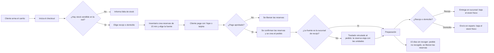
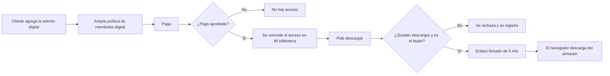
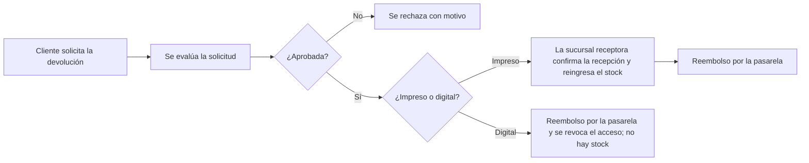

# Procesos de negocio

Resumen de los procesos principales de punta a punta, con los actores y las specs que los implementan. El detalle de comportamiento vive en cada spec; aquí se ve el recorrido completo.

## 1. Compra de libros impresos

**Actores:** cliente, Inventario, pasarela de pago, encargado de sucursal, logística. **Specs:** `ecommerce-carrito-checkout`, `inventario-seleccion-fuente`, `ecommerce-pagos`, `ecommerce-pedidos`, `inventario-traslados`, `ecommerce-envios`. **Puntos de control:** el correo de la cuenta debe estar verificado para iniciar el pago; límite de una reserva activa por cliente, 5 por hora y 10 por origen (RF28); si el pago queda pendiente la reserva se extiende hasta 30 minutos y se avisa al cliente por todos sus medios; el cliente puede cancelar mientras todas las líneas estén confirmadas (se anula, se libera y se reembolsa); el traslado de un pedido pagado no se rechaza y solo se cancela al anular el pedido; una falla del aviso por WhatsApp nunca interrumpe la compra.

## 2. Compra y descarga de un libro digital

**Actores:** cliente, pasarela de pago, almacén de archivos. **Specs:** `ecommerce-carrito-checkout`, `ecommerce-pagos`, `ecommerce-biblioteca-digital`. **Puntos de control:** nunca hay reserva ni consulta al Inventario; el archivo no pasa por la Web; máximo 5 descargas por acceso y 10 solicitudes de enlace por hora.

## 3. Reposición mediante traslado

| Paso | Quién | Resultado |
| :---: | :--- | :--- |
| 1 | Encargado o administración | Solicita el traslado (estado solicitado). |
| 2 | Origen o administración | Aprueba o rechaza. |
| 3 | Origen | Despacha: el stock físico del origen baja. |
| 4 | Destino | Recibe: el stock físico del destino sube. |
| 5 | Sistema | Notifica a origen y destino en cada cambio de estado y audita cada cambio. |

Si el traslado nace de un pedido pagado, el origen solo lo aprueba (no puede rechazarlo), el despacho consume la reserva del origen y la recepción la recrea en el destino; si el pedido se anula antes de despacharse, el traslado se cancela. El plazo estimado que ve el cliente sale de la ruta entre ambas sucursales. **Spec:** `inventario-traslados`.

## 4. Ajuste de inventario

El encargado registra una merma, un producto dañado o una corrección de conteo con motivo; la merma y el daño nunca descuentan más que el stock vendible, y la corrección se expresa como el conteo real, que no puede quedar por debajo de lo reservado. El ajuste y su auditoría ocurren en la misma transacción. **Spec:** `inventario-ajustes`.

## 5. Devolución y reembolso

**Spec:** `ecommerce-devoluciones` (quién aprueba un impreso está pendiente de decisión). El impreso se reembolsa solo después de confirmada su recepción. El libro digital ya descargado solo se reembolsa si el archivo es defectuoso.

## 6. Libro de Reclamaciones

Cualquier consumidor, con o sin sesión, registra una hoja (con nombre, documento, domicilio, correo, monto y detalle); recibe una constancia imprimible con un número único y el plazo de respuesta de 15 días; la administración la responde y la respuesta llega por correo; las hojas se conservan al menos dos años y las de spam se descartan sin borrarlas. Máximo 3 hojas por hora por origen. **Spec:** `ecommerce-libro-reclamaciones`.

## 7. Registro y recuperación de la cuenta

| Proceso | Pasos |
| :--- | :--- |
| **Registro** | La persona ingresa nombre, correo y contraseña (10 caracteres como mínimo), declara ser mayor de 18 años y acepta los términos y la privacidad (se guarda la versión y la fecha); recibe un código por correo y verifica el correo, necesario para pagar. Máximo 3 cuentas nuevas por hora por origen. El número de WhatsApp y el consentimiento para recibir avisos son opcionales y se registran aparte. |
| **Segundo factor** | El personal lo configura en su primer ingreso y recibe 8 códigos de respaldo; el cliente puede activarlo en su cuenta. Si se pierde el dispositivo y los códigos, la administración lo restablece. |
| **Recuperación** | La persona pide recuperar el acceso; recibe un código de un solo uso en su correo verificado; define una nueva contraseña y se revocan sus sesiones anteriores. El personal la recupera con el administrador central. La respuesta es la misma exista o no la cuenta. |
| **Cancelación** | El cliente cancela su cuenta; se desactiva y se suprimen o anonimizan sus datos personales, salvo lo que una obligación legal exija. |

**Spec:** `identidad-seguridad`.

## 8. Asistente de compra

El cliente consulta; el asistente obtiene datos de los servicios, redacta la respuesta como texto y enlaza a las pantallas. Nunca ejecuta acciones ni consulta las bases de datos. Si el proveedor del modelo no responde, la compra continúa sin él. **Spec:** `asistente-compra-ia`.
