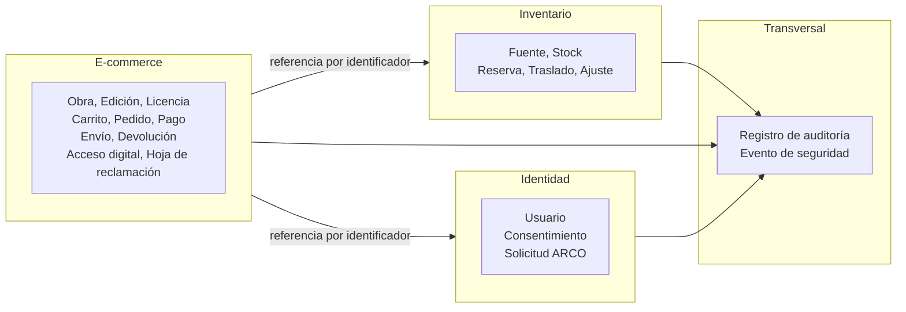
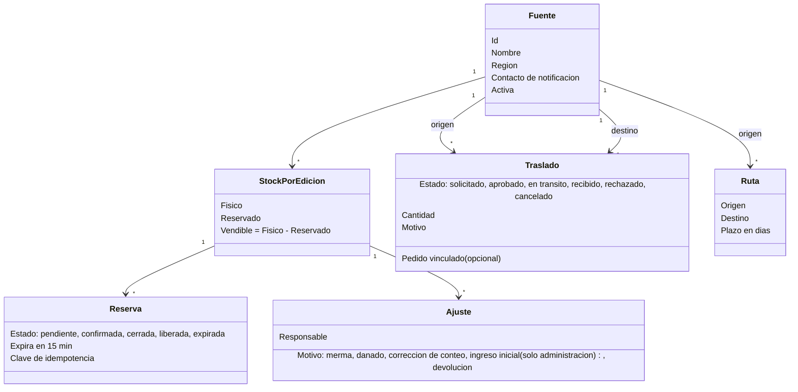
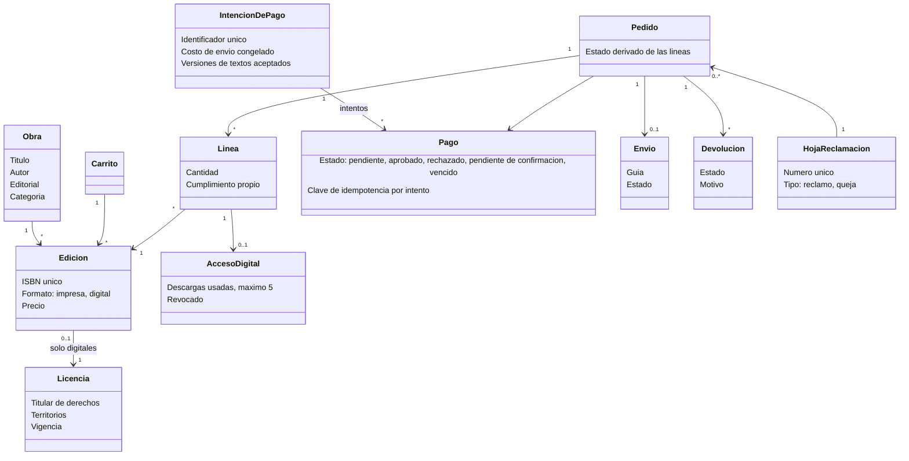
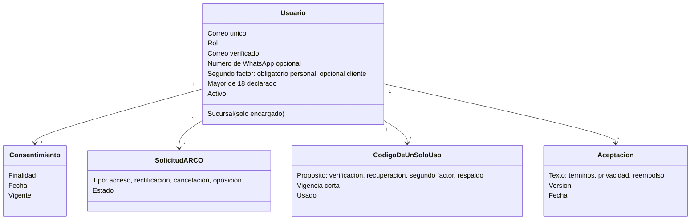

# Modelo de dominio

Describe las entidades del negocio, sus relaciones y sus invariantes, con el lenguaje del [glosario](../glossary.md). No es el modelo de datos: la estructura de tablas se define en el [diseño](../03-diseno-de-software/). Se agrupa por contexto, es decir, por el servicio que es dueño de cada concepto.

## 1. Contextos y fronteras

Los contextos se relacionan solo por identificadores y contratos REST; ninguno comparte tablas con otro (AD03, AD18). El Inventario conoce la **edición** solo por su identificador (ISBN o clave interna); el catálogo vive en el E-commerce.

## 2. Inventario

**Invariantes**

1. El stock vendible nunca es negativo, ni siquiera ante solicitudes simultáneas (AC01).
2. Una reserva no descuenta el stock físico; lo reduce el vendible. El físico baja al entregar un pedido de recojo, al pasar a en reparto un envío a domicilio y, en un traslado, al despacharse en el origen.
3. La reserva de un pedido es atómica: todas las líneas impresas o ninguna.
4. Un cliente tiene como máximo una reserva pendiente y hasta 5 reservas iniciadas por hora (RF28).
5. La merma y el daño solo descuentan y nunca más que el vendible; la corrección de conteo se expresa como el conteo real y no puede quedar por debajo de lo reservado.
6. Ciclo del traslado: solicitado → aprobado → en tránsito → recibido; solicitado → rechazado (no si está vinculado a un pedido); solicitado o aprobado → cancelado (al anularse el pedido vinculado, o por el origen o la administración si no está vinculado). El despacho descuenta del origen; la recepción suma al destino.
7. Un libro digital nunca tiene stock, reserva ni traslado.
8. Un traslado vinculado a un pedido mueve su reserva con las unidades: se consume en el origen al despachar y se recrea en el destino al recibir, en la misma transacción. Un pedido de recojo que supera 15 días en listo para recojo pasa a no recogido, libera sus reservas y ya no puede entregarse: solo se anula con reembolso.
9. Una reserva pendiente vencida no cuenta como activa aunque el trabajo de fondo no la haya procesado; si dos operaciones compiten por una misma reserva, gana la primera que confirma y la otra se rechaza por estado inválido.
10. El stock inicial entra con el motivo ingreso inicial, que solo registra la administración central.

## 3. E-commerce

**Invariantes**

1. Cada edición, impresa o digital, tiene su propio ISBN, único en todo el catálogo.
2. Un pedido se confirma solo con el pago aprobado y, para los impresos, con las reservas confirmadas; tiene como máximo un cobro aprobado.
3. El estado del pedido se deriva del estado de sus líneas; cada línea sigue su propio ciclo. Una línea de recojo puede pasar a *no recogido* a los 15 días calendario en listo para recojo; el cliente puede cancelar un pedido solo de impresos mientras todas sus líneas estén confirmadas.
8. Un pago *pendiente de confirmación* extiende la reserva una vez, hasta 30 minutos desde el inicio del pago; si se aprueba con la reserva vencida, se reembolsa. Un impreso devuelto se reembolsa después de confirmada su recepción.
4. Un libro digital solo se vende con licencia vigente y que incluya Perú (no se valida el territorio del comprador); los accesos ya concedidos se mantienen salvo reembolso, anulación u orden legal.
5. Un acceso digital es personal e intransferible, con máximo 5 descargas y enlaces de 5 minutos como máximo.
6. No se almacenan datos de tarjeta: solo los conoce la pasarela.
7. Las hojas de reclamaciones se conservan al menos dos años.

## 4. Identidad

**Invariantes**

1. Un encargado tiene exactamente una sucursal y cada sucursal tiene como máximo un encargado activo.
2. Las contraseñas se guardan con una función de resumen robusta y nunca en claro; los códigos de un solo uso caducan y se invalidan al usarse.
3. Un usuario desactivado conserva su historial, pero no puede ingresar ni renovar la sesión.
4. Las credenciales se firman con una clave que solo posee Identidad; los demás servicios solo verifican.
5. Solo se registran mayores de 18 años y la cuenta guarda la versión y fecha de los textos aceptados.

## 5. Transversal

| Entidad | Contenido | Reglas |
| :--- | :--- | :--- |
| **Registro de auditoría** | Usuario, rol, fecha UTC, acción, detalle y resultado. | Solo inserción; se escribe en la misma transacción que el cambio; sin datos sensibles; retención de dos años. |
| **Evento de seguridad** | Ingreso fallido, bloqueo, límite excedido, acceso denegado, recuperación de acceso, segundo factor fallido, cambio de rol. | Se registra siempre; si falla el registro, el rechazo se mantiene y se genera una alerta técnica. |

## 6. Relación con los requisitos

| Concepto | Requisitos |
| :--- | :--- |
| Fuente, stock, reserva | RF12, RF13, RF14, RF15, RF28, RNF01 |
| Traslado y ajuste | RF16, RF17 |
| Catálogo, edición y licencia | RF10, RF24 |
| Carrito, pedido y pago | RF03, RF04, RF05, RF06 |
| Acceso digital | RF22, RF23, RNF14 |
| Devolución | RF09 |
| Hoja de reclamación | RF25 |
| Usuario, consentimiento, ARCO | RF18, RF19, RF26, RF27, RNF07, RNF23 |
| Auditoría y eventos de seguridad | RF20, RNF08, RNF20 |
