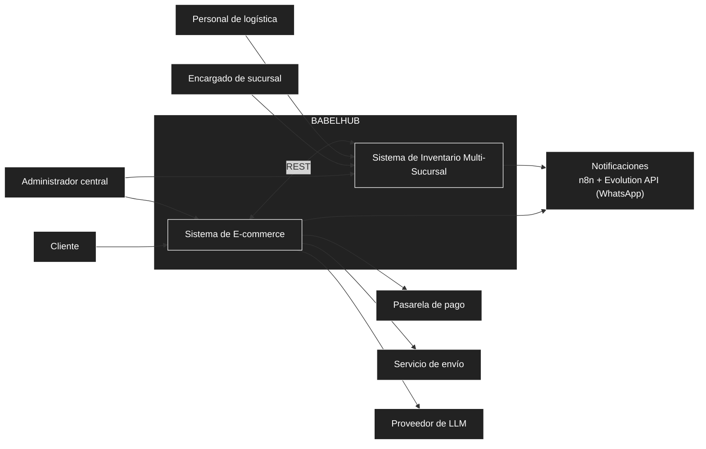

# 01 — Necesidad del negocio

## 1. Contexto y problema

El libro impreso sigue generando más del 91 % de los ingresos editoriales en el Perú, mientras la venta en línea crece (PwC). Cadenas como Librerías Crisol, con más de 35 tiendas, ya ofrecen "recojo en tienda", y Buscalibre reporta que sus ventas en provincias duplican el promedio nacional. Esto confirma que hay demanda fuera de Lima y que la ventaja competitiva depende de la logística.

**Problema central:** una librería con varias sucursales no sabe, en tiempo real, cuántos ejemplares de cada título tiene en cada tienda, ni desde cuál conviene atender o trasladar un pedido. El riesgo es vender en línea un libro que ya no existe (sobreventa) o perder ventas por no usar el stock de otra sucursal.

**Justificación del planteamiento:** BabelHub se define como **dos sistemas independientes pero interoperables** (E-commerce e Inventario Multi-Sucursal) y no como una tienda en línea con inventario embebido. El inventario tiene reglas propias (reservas, traslados, auditoría) y un patrón de uso distinto (personal interno, alta escritura), por lo que conviene diseñarlo, probarlo y escalarlo por separado. Para el inventario se adopta el patrón *Multi-Source Inventory* (MSI) de Adobe Commerce: cada sucursal es una **fuente** de stock y el **stock vendible = stock físico − reservas activas**.

## 2. Objetivos del negocio

| ID | Objetivo | Justificación |
| :--- | :--- | :--- |
| **OB01** | Mostrar al cliente únicamente stock realmente disponible. | Evita la sobreventa, que es el principal riesgo de vender con varias tiendas. |
| **OB02** | Atender pedidos desde la sucursal más conveniente y trasladar mercadería cuando sea necesario. | Aprovecha todo el stock de la red y mejora el servicio en provincias. |
| **OB03** | Dar a cada sucursal control sobre su propio inventario, y a la administración central visibilidad nacional. | Responsabilidad local con supervisión central. |
| **OB04** | Soportar una red inicial de 5 a 10 sucursales, con margen hasta unas 20, sin rediseñar. | MSI opera eficientemente de 1 a 20 fuentes (Adobe). |
| **OB05** | Operar con costo mínimo de infraestructura, sin servicios administrados de pago. | El proyecto debe ser viable con recursos gratuitos o propios. |

## 3. Alcance

| Dentro del alcance | Fuera del alcance |
| :--- | :--- |
| Catálogo, carrito, checkout, pagos, pedidos y asistente de compra (E-commerce). | Código a nivel de clases y contratos OpenAPI completos. |
| Fuentes por sucursal, stock vendible, reservas, selección de fuente, traslados y ajustes (Inventario). | Costeo y licenciamiento comercial detallado. |
| Identidad, roles y control de acceso por sucursal. | Aplicación móvil nativa (Android/iOS): extensión posterior; el alcance inicial es web responsiva. |
| Diseño de la arquitectura y del despliegue en Oracle Cloud. | Analítica avanzada y autoservicio de reportes: fase posterior. |

## 4. Actores

| Actor | Rol | Qué necesita realizar |
| :--- | :--- | :--- |
| **Cliente** | Persona que compra libros en línea. | Buscar libros, ver disponibilidad, armar el carrito, pagar, elegir despacho o recojo y seguir su pedido. |
| **Encargado de sucursal** | Personal de una tienda; solo accede a **su sucursal**. | Consultar y ajustar el stock local, preparar pedidos de recojo y gestionar traslados. |
| **Administrador central** | Personal de administración con visión nacional. | Gestionar el catálogo, usuarios, roles y sucursales; revisar auditoría e indicadores. |
| **Personal de logística** | Responsable de mover productos. | Dar seguimiento a traslados y generar guías de envío a domicilio. |
| **Pasarela de pago** *(externo)* | Culqi. | Procesar pagos con Yape y tarjetas. |
| **Servicio de envío** *(externo)* | Operador logístico (courier). | Gestionar la entrega y el seguimiento de los despachos a domicilio. |
| **Proveedor de LLM** *(externo)* | Modelo de lenguaje (por ejemplo, la API de Claude). | Generar las respuestas del asistente de compra. |
| **Servicio de notificaciones** *(propio, autoalojado)* | n8n y Evolution API, que envían los avisos por WhatsApp. | Avisar a clientes y sucursales de los cambios de estado. |

## 5. Necesidades del negocio

Prioridad: **Alta** (núcleo del problema), **Media**, **Baja** (puede diferirse).

| ID | Actor | Necesidad | Prioridad | Justificación |
| :--- | :--- | :--- | :---: | :--- |
| **NN01** | Cliente | Buscar libros y conocer su disponibilidad real, consolidada y por sucursal. | Alta | Una tienda en línea solo funciona si el stock mostrado es real (OB01). |
| **NN02** | Cliente | Comprar eligiendo despacho a domicilio o recojo en sucursal, y pagar de forma segura con Yape o tarjeta. | Alta | El recojo en tienda ya es un modelo validado por Crisol. |
| **NN03** | Cliente | Seguir el estado de su pedido y recibir avisos, incluso cuando está en tránsito entre sucursales. | Alta | Reduce consultas y da confianza durante el traslado. |
| **NN04** | Cliente | Recibir orientación de un asistente (recomendaciones y dudas frecuentes). | Media | Apoya la decisión de compra sin atención humana permanente. |
| **NN05** | Cliente | Solicitar la devolución de un pedido y su reembolso. | Baja | Necesario en una operación completa, pero no es el núcleo. |
| **NN06** | Encargado de sucursal | Conocer y mantener el stock exacto de su tienda (físico, reservado y vendible) con ajustes auditables. | Alta | El stock exacto es la base de todo el sistema (OB01, OB03). |
| **NN07** | Encargado de sucursal / Logística | Abastecer pedidos desde otra sucursal mediante traslados trazables. | Alta | Es la respuesta al problema central (OB02). |
| **NN08** | Administrador central | Mantener un catálogo único y consistente para toda la red. | Alta | Evita títulos duplicados o con datos distintos por tienda. |
| **NN09** | Administrador central | Controlar quién accede a qué (usuarios, roles y sucursales) y auditar las operaciones sensibles. | Alta | Cada encargado solo debe ver su sucursal; se manejan datos personales y pagos. |
| **NN10** | Administrador central | Consultar indicadores de venta, inventario y traslados por sucursal y región. | Baja | Aporta valor de gestión, pero puede venir en una fase posterior (OB03). |
| **NN11** | Personal de logística | Generar guías de envío y seguir los despachos a domicilio. | Media | Completa el ciclo de entrega fuera de la tienda. |
| **NN12** | Organización | Operar la plataforma con costo mínimo y sin depender de servicios administrados de pago. | Alta | Restricción económica del proyecto (OB05); condiciona el despliegue. |

## 6. Diagrama de contexto

## 7. Referencias

- Librerías Crisol: *Recojo en Tienda* y *Tiendas Crisol a nivel nacional* (crisol.com.pe).
- Adobe Developer: documentación del módulo *Multi-Source Inventory*.
- Gestión (2025): *Así crece Buscalibre Perú en provincias*.
- PwC (2025): *Global Entertainment & Media Outlook 2025-2029*, sección Libros, Perú.
