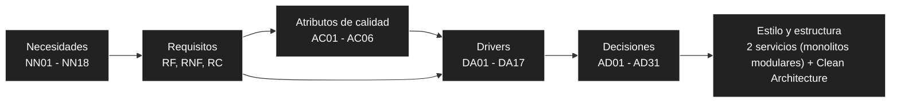

# Drivers arquitectónicos

Un **driver arquitectónico** es un requisito, atributo de calidad o restricción que condiciona de forma significativa la estructura del sistema. Se seleccionaron los que, si cambiaran, obligarían a cambiar la arquitectura.

## 1. Cadena de derivación

## 2. Drivers

| ID | Driver arquitectónico | Tipo | Origen | ¿Por qué influye en la arquitectura? | Decisiones |
| :--- | :--- | :--- | :--- | :--- | :--- |
| **DA01** | El sistema debe evitar la sobreventa cuando un título está en varias sucursales. | Calidad | AC01, RNF01, RF13, RF14 | Exige reservas transaccionales y control de concurrencia en la base. Un sistema de inventario aparte, con su propia base, lo aísla de la tienda pública y de su ciclo de despliegue y facilita su prueba, aunque el requisito en sí también se cumpliría con una base única. | AD01, AD03, AD08, AD23 |
| **DA02** | El sistema debe mantener tiempos de respuesta adecuados al consultar disponibilidad en picos de tráfico. | Calidad | AC02, RNF02 | Influye en el uso de caché, en la comunicación entre servicios y en el reparto de recursos de las VMs. | AD04, AD06 |
| **DA03** | El sistema debe seguir operando de forma aceptable sin SLA y con fallos parciales. | Calidad | AC03, RNF03 | Condiciona el reinicio automático, la degradación controlada ante la caída del inventario y los respaldos. | AD04, AD10, AD11, AD25 |
| **DA04** | El sistema debe permitir sumar sucursales sin rediseñar. | Calidad | AC05, RNF04 | Obliga a modelar cada sucursal como dato (fuente) y no como código o esquema. | AD01, AD03 |
| **DA05** | Cada encargado solo debe acceder a su sucursal, y los datos de usuarios y pagos deben protegerse. | Calidad | AC04, RNF05–RNF08, RF18 | Influye en la autenticación centralizada, el aislamiento de las bases de datos, la protección del borde de red y que el token no llegue al navegador. | AD05, AD12, AD13, AD15, AD18, AD22, AD26, AD30, AD31 |
| **DA06** | Debe integrarse con pasarela de pago, servicio de envío, LLM y WhatsApp. | Restricción | RC04, RC05, RC10, RC12 | Obliga a aislar los accesos externos para poder cambiar de proveedor sin tocar las reglas del negocio. | AD07, AD09, AD16, AD17 |
| **DA07** | La comunicación entre componentes debe ser mediante API REST, y el sistema debe tener una interfaz web responsiva para tres tipos de usuario. | Restricción | RC01, RC03, RC06, RNF13 | Limita las alternativas de comunicación, descarta un bus de eventos y exige un componente de interfaz que consuma las API sin romper la independencia de los servicios. | AD04, AD15, AD21 |
| **DA08** | Los cambios de reglas o proveedores deben quedar aislados y ser fáciles de probar. | Calidad | AC05, RNF09, RNF10 | Influye en la organización interna de cada servicio. | AD02, AD09 |
| **DA09** | El sistema debe ejecutarse en recursos gratuitos limitados y heterogéneos (ARM64 y x86_64): 2 VMs ARM de 1 OCPU y 6 GB y 2 VMs AMD micro. | Restricción | RC06–RC08, RNF11, RNF12, AC02 | Limita la cantidad de VMs, aplicaciones y contenedores (dos aplicaciones .NET, no cinco), obliga a que la base conviva con una aplicación y exige imágenes multi-arch. | AD02, AD10, AD11, AD15, AD16, AD18, AD19, AD21 |
| **DA10** | La operación debe tener costo mínimo y esfuerzo técnico manejable. | Negocio | NN12, RC09 | Favorece servicios gratuitos gestionados (Cloudflare) frente a componentes propios que haya que mantener. | AD13, AD14, AD21 |
| **DA11** | El cliente y la sucursal deben recibir avisos de estado por WhatsApp sin costo por mensaje y sin que el aviso bloquee la compra. | Negocio / Restricción | RF07, RC12, NN03, NN12 | Obliga a un puerto de notificación aislado, a un envío tolerante a fallos y a alojar n8n y Evolution API dentro del presupuesto de recursos. | AD16, AD30 |
| **DA12** | La librería vende libros digitales con licencia de terceros, y el archivo debe llegar solo a quien lo compró. | Calidad / Restricción legal | NN13, NN14, NN15, RF22–RF24, RNF14, RC13, AC04 | Exige un almacén de archivos fuera de las VMs, entrega por enlaces firmados, un modelo de licencia por título (titular, territorio, vigencia) y que la compra digital no dependa del Inventario. | AD19, AD20 |
| **DA13** | Superficie pública con flujos de negocio abusables (reservas, descargas, asistente). | Calidad | RF28, RNF17, AC04 | Límites de uso en el borde y en la Aplicación; registro y alertas. | AD13, AD22, AD24, AD25, AD30, AD31 |
| **DA14** | Experiencia móvil accesible con conexión variable. | Calidad | NN16, RNF25, RNF26, AC06 | Interfaz móvil primero, presupuesto de rendimiento y pruebas de accesibilidad. | AD26, AD29 |
| **DA15** | Privacidad y transferencias de datos fuera del país. | Restricción legal | RNF23, RC17, AC04 | Minimización, retención y qué datos reciben los proveedores. | AD27 |
| **DA16** | Recuperación con recursos mínimos. | Calidad | RNF24, AC03 | Respaldos fuera del dominio de falla y pruebas de restauración. | AD27, AD31 |
| **DA17** | Contenido generado por un LLM no es confiable. | Calidad | RNF22 | Aislamiento del asistente, solo lectura y salida como texto. | AD28 |

## 3. Riesgos y compromisos

| Riesgo o compromiso | Mitigación |
| :--- | :--- |
| La consulta síncrona al Inventario puede volverse cuello de botella o punto único de falla (DA02, DA03). | Caché Redis, reinicio automático, pruebas de carga con k6 y un mensaje claro cuando no se pueda validar el stock. |
| La disponibilidad en caché puede estar desactualizada (DA01, DA02). | Expiración corta y validación definitiva contra la base de datos al reservar. |
| La reducción del Free Tier de Oracle (ahora 2 OCPU y 12 GB en ARM y 2 VMs AMD micro) deja poca holgura de CPU (DA09). | Dos aplicaciones .NET en lugar de cinco, 1 OCPU por VM ARM, medición con k6 y componentes livianos. Sin segunda cuenta ni VMs de pago (decisión de 2026-11-06). |
| **La base de datos comparte VM con el Inventario** (DA05, DA16): si cae esa VM, cae todo el sistema, y si se compromete el servidor, la base también. | Defensa en profundidad (AD31): contenedores sin privilegios, red y roles separados, seguridad por filas, SSH solo por la VM-AUX, respaldo y WAL cifrados fuera de Oracle y restauración probada. Mejora opcional: réplica de PostgreSQL en caliente en VM-VENTAS, o una tercera VM ARM de pago. |
| Con cuatro VMs en serie y sin redundancia, cada VM es un punto de falla más y cada llamada entre servicios cruza la red (DA02, DA03). | Matriz de fallos por VM, reinicio automático, degradación controlada, malla privada cifrada, medición de la latencia entre VMs con k6 y, si hace falta, reagrupar Inventario y E-commerce (B11). |
| Oracle recupera instancias con uso muy bajo sostenido, y las VMs AMD micro tendrán poca carga (DA03, DA09). | Actualizar la cuenta a PAYG sin superar el cupo, con presupuesto y alerta de costo de 1 USD; revisar la política vigente. |
| Identidad y Asistente comparten proceso con la venta, y la interfaz de gestión depende del E-commerce (DA05, DA03). | Esquema y rol propios para Identidad, contextos de lectura de 5 minutos, límite de concurrencia y tiempos de espera en el asistente (AD07), pruebas de arquitectura entre módulos y réplica de gestión en la VM del Inventario (AD11). |
| La VM-BORDE (1/8 de OCPU) puede ser cuello de botella de toda la entrada (DA02, DA09). | Solo cloudflared y Nginx, medición con k6 y, si no rinde, mover ambos a VM-VENTAS; segundo conector de cloudflared en VM-VENTAS. |
| Un archivo digital se filtra o se redistribuye fuera de la tienda (DA12). | Enlaces firmados de 5 minutos, límite de descargas, registro de cada descarga y auditoría; la marca de agua personalizada queda como mejora posterior. No existe protección total sin DRM, y se acepta como riesgo mientras ningún titular lo exija. |
| La licencia de un título vence o cambia, o el titular exige DRM comercial (DA12). | El catálogo guarda vigencia y territorio por título (RF24); el puerto `AlmacenDeArchivos` y el caso de uso de descarga permiten incorporar un DRM sin tocar el dominio. |
| Cambian las cuotas gratuitas del almacén de archivos (DA10, DA12). | El almacén va detrás de un puerto; se verifican cuotas vigentes antes de contratar y se limita el tamaño de archivo y de catálogo digital. |
| Oracle puede no tener capacidad ARM al crear las VMs, o recuperar instancias inactivas (DA03, DA09). | Reintentar la creación, mantener el mismo Compose en local como respaldo, actualizar a PAYG y revisar la política de instancias inactivas. |
| El asistente depende de un LLM externo (latencia, costo, respuestas incorrectas) (DA06). | Responde solo con datos de las API, indica cuándo no sabe y su caída no bloquea la compra. |
| Cloudflare es una dependencia de terceros en el camino de todas las solicitudes (DA10). | Aceptable para este alcance; se documenta la alternativa de exponer Nginx directamente. |
| Evolution API no es un canal oficial de WhatsApp: el número puede ser bloqueado o el protocolo cambiar sin aviso (DA11). | Usar un número dedicado, volumen bajo y solo mensajes transaccionales con consentimiento; el puerto `Notificador` permite sustituirlo (WhatsApp Cloud API oficial o correo) sin tocar el negocio; el plan de salida está en [decisiones](02-decisiones-arquitectonicas.md) (AD16). Una falla de envío nunca bloquea la compra. |
| n8n y Evolution API consumen RAM y CPU en una VM con 1 OCPU (DA09, DA11). | Límites de memoria por contenedor, medición con k6 y reparto de carga: n8n y Evolution API van en VM-VENTAS, y Evolution API usa la Redis de esa VM y la base `evolution`. |
| Un programa acapara stock con reservas temporales o agota las consultas del asistente (DA13). | Límite de una reserva activa por cliente y 5 por hora (RF28), límites de uso en el borde y en la Aplicación (AD24), y expiración de reservas en 15 minutos. |
| Fuerza bruta de contraseñas o robo de credenciales (DA05, DA13). | Bloqueo temporal tras 5 fallos, credenciales de 15 minutos con renovación revocable, MFA obligatoria para el personal y opcional para el cliente (AD22) y alertas de seguridad (RNF20). |
| Inyección de instrucciones o contenido no confiable en el asistente (DA17). | Asistente de solo lectura, salida como texto, topes de consumo y sin acceso a bases de datos (AD28). |
| Fuga de datos personales hacia proveedores fuera del país (DA15). | Datos mínimos por proveedor, inventario de transferencias documentado (RC17) y retención definida (AD27). |
| Dependencias o imágenes con vulnerabilidades conocidas (DA05). | Versiones fijas, escaneo en CI, SBOM y contenedores sin privilegios (RNF19). |
| Pérdida de datos o de los respaldos por una falla de la VM del Inventario (DA16). | Respaldo diario cifrado y archivado de WAL fuera de Oracle, restauración probada y objetivos RPO ≤ 24 h (minutos con WAL) y RTO ≤ 4 h (AD27). |
| El proveedor gratuito de correo limita el volumen o marca los mensajes como no deseados, y se pierde la recuperación de cuentas (DA05, DA13). | Dominio propio con SPF, DKIM y DMARC, límite de solicitudes de código (SEG-19), restablecimiento asistido para el personal y alternativa de otro proveedor detrás del puerto `EnviadorDeCorreo` (AD30). |
