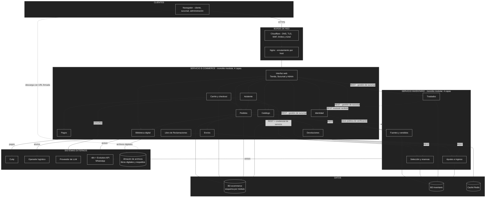

# Estilo arquitectónico

## 1. Estilo seleccionado

**Arquitectura basada en servicios (*Service-Based*) de granularidad gruesa, con dos servicios**: el sistema de **E-commerce** y el sistema de **Inventario Multi-Fuente**. Cada servicio es un **monolito modular** con **Clean Architecture** en cuatro capas.

- **Estructura global:** dos sistemas independientes e interoperables. Cada uno se construye, versiona y despliega por separado, tiene su propia base de datos y se integra con el otro por **REST síncrono** y un contrato estrecho (disponibilidad, reservar, confirmar, liberar y el aviso de traslado recibido).
- **Estructura de cada servicio:** un monolito modular. Los módulos corresponden a las specs, tienen un contrato público y un interior privado, y se hablan en el mismo proceso por esos contratos.
  - **E-commerce** (11 módulos): Catálogo, Carrito y checkout, Pagos, Pedidos, Envíos, Devoluciones, Biblioteca digital, Libro de Reclamaciones, Identidad, Asistente y la interfaz web (Tienda, Sucursal y Admin). La web es la capa de presentación del E-commerce, no un servicio aparte (AD15).
  - **Inventario** (4 módulos): Fuentes (incluye las unidades vendidas), Selección de fuente y reservas, Traslados y Ajustes (incluye el ingreso de mercadería).
- **Estructura interna:** cuatro capas (Presentación, Aplicación, Dominio, Infraestructura) cuyas dependencias apuntan siempre hacia el dominio. Los módulos son carpetas y espacios de nombres dentro de cada capa.
- **Unidad de despliegue:** cada servicio tiene su propia imagen, versión y configuración. En qué VM corre cada uno es una decisión de despliegue (AD11), no del estilo: ver [despliegue](05-despliegue.md).

**Justificación:** la red prevista es de 5 a 10 sucursales, hay un solo equipo y los recursos gratuitos son 2 OCPU y 12 GB de RAM ARM más dos VMs AMD micro (DA09). Con ese presupuesto, más servicios agregarían coordinación y consumo sin ventaja real de escalamiento, y un monolito único mezclaría el inventario con la venta. La separación que sí vale su costo es la que protege el problema central: el **Inventario** se aísla del resto porque (1) lo usa personal de sucursal y no el público, (2) debe poder operar aunque la tienda esté caída o en despliegue, y (3) su regla de oro, el stock nunca negativo, se prueba y asigna recursos por separado (DA01). Dentro de cada sistema, los módulos con límites verificados dan el orden de los servicios sin su costo de red (DA08).

## 2. Diagrama de arquitectura

La vista de despliegue sobre las VMs de Oracle está en [despliegue](05-despliegue.md). Las llamadas entre módulos del mismo servicio se dibujan solo donde importan; en el nivel 3 de C4 están completas.

## 3. Componentes y responsabilidades

| Componente | Responsabilidad | Decisión |
| :--- | :--- | :--- |
| **Servicio E-commerce** | Todo lo que ve el cliente y la administración de la venta: catálogo (impresos y digitales), carrito, checkout, pagos, pedidos, envíos, devoluciones, biblioteca digital, Libro de Reclamaciones, identidad y asistente, con la interfaz web de Tienda, Sucursal y Admin. Único sistema con el que interactúa el cliente final. | AD01, AD02, AD15 |
| **Interfaz web** | Capa de presentación del E-commerce (MVC con Razor y htmx): tres áreas por rol. No contiene reglas de negocio. Llama a los módulos en el mismo proceso y al Inventario por REST, solo desde el servidor. Se sirve en dos hosts: la tienda y la gestión del personal. | RC01, RC03, AD15 |
| **Módulo Identidad** | Autentica usuarios (con segundo factor para el personal), emite credenciales con rol y sucursal, firma con una clave propia que rota, y emite el contexto de lectura del asistente. Su esquema tiene un rol aparte. | AD05, AD18, AD22 |
| **Módulo Asistente** | Recomienda libros y responde dudas con datos de los otros módulos y del Inventario y un LLM externo. Solo lectura; su caída no afecta la compra. | AD07, AD28 |
| **Servicio Inventario** | Fuentes por sucursal, stock vendible (físico − reservas), reservas, selección de fuente, traslados, ajustes, ingreso de mercadería y unidades vendidas. Sin entrada pública. | AD01, AD08 |
| **Bases `ecommerce` e `inventario`** | Una base por servicio, con un esquema por módulo y un rol por esquema; Identidad queda aislada por rol. No hay llaves foráneas ni consultas entre bases. | AD03, AD12, AD18 |
| **Cloudflare y Nginx** | Cloudflare protege, cifra y limita el acceso; Nginx enruta por host (tienda y gestión). | AD13, AD14 |
| **Notificaciones (n8n + Evolution API)** | Reciben avisos por webhook de ambos servicios y los envían por WhatsApp; su falla no bloquea ninguna operación. | AD16 |
| **Almacén de archivos** | Guarda los EPUB y PDF en un bucket privado y los respaldos cifrados; el cliente descarga con URL firmada de corta duración. | AD19, AD20, AD27 |
| **Caché Redis** | Disponibilidad (corta duración), catálogo (mayor duración) y contadores de límites; vive en la VM del E-commerce. | AD06 |

## 4. Reglas de comunicación

| Origen | Destino | Tipo | Propósito |
| :--- | :--- | :--- | :--- |
| Navegador | Cloudflare → Nginx → interfaz web | HTTPS | Enviar todas las solicitudes de la interfaz. |
| Módulos del E-commerce | Otros módulos del E-commerce | Llamada en el mismo proceso, por el contrato público del módulo | Orquestar la compra y consultar datos; nunca el interior de otro módulo ni su esquema. |
| E-commerce | Inventario | REST síncrono (red privada), con credencial de servicio y la identidad del actor | Consultar disponibilidad real, reservar, confirmar y liberar; gestión de sucursal. |
| Inventario | E-commerce | REST (aviso) | Informar que un traslado vinculado a un pedido fue recibido. |
| Asistente | Catálogo, Pedidos e Inventario | Contrato público y REST de solo lectura | Obtener datos, sin acceder a las bases; los pedidos con el contexto de lectura del propio cliente. |
| Inventario | Módulo Identidad | Clave pública de verificación | Validar credenciales sin consultar en cada solicitud. |
| Servicios | Proveedor de correo | API externa | Códigos de seguridad, respuestas a reclamos, alertas y avisos de pago pendiente. |
| E-commerce e Inventario | Su base | SQL | Persistir; el E-commerce además usa Redis. |
| E-commerce | Culqi y operador logístico | API externa | Cobrar y gestionar entregas. |
| E-commerce e Inventario | n8n | Webhook (asíncrono, tolerante a fallos) | Pedir el envío de un aviso por WhatsApp. |
| n8n | Evolution API → WhatsApp | API interna y externa | Armar y enviar el mensaje. |
| E-commerce | Almacén de archivos | API S3 (HTTPS) | Subir archivos digitales, firmar URLs de descarga y subir respaldos. |
| Navegador | Almacén de archivos | HTTPS con URL firmada | Descargar el libro; el servicio no transporta el archivo. |
| Asistente | Proveedor de LLM | API externa | Generar respuestas. |

## 5. Alternativas descartadas

| Alternativa | Motivo del descarte |
| :--- | :--- |
| **Monolito único** (el inventario como un módulo más) | Es la opción técnicamente más simple, pero uniría la tienda pública con la gestión de stock en un solo proceso y una sola base: el personal no podría operar el inventario si la tienda cae o se despliega, y se reescribirían los requisitos de degradación (CAR-06, CAT-12, ENV-12). Se descarta de forma consciente; el límite entre módulos de cada servicio permite reunirlos si hiciera falta. |
| **Cuatro o más servicios** (identidad, asistente y web aparte) | Cinco aplicaciones .NET sobre 1 OCPU por VM no caben ni aportan aislamiento real: compartirían VM y base. Son módulos del E-commerce con límites verificados. |
| **Microservicios finos** | Añaden coordinación, comunicación y despliegue innecesarios para 5–10 sucursales y 12 GB de RAM. |
| **SOA clásica con ESB** | Un bus de integración con orquestación central es un componente pesado que contradice AD04; la integración es REST directo con un contrato estrecho. |
| **Arquitectura orientada a eventos** | Su complejidad operativa no se justifica con el volumen previsto; REST síncrono basta. |
| **SPA que llama a las API desde el navegador** | Expone el JWT al navegador, exige CORS y añade otro stack al proyecto. |
| **Guardar los archivos digitales en la VM o en PostgreSQL** | El disco es escaso, los archivos pasarían por una VM de 1 OCPU y inflarían los respaldos. Ver AD19. |
| **Capas tradicionales** | El dominio quedaría atado a la base de datos y a los proveedores externos, y sería más difícil de probar. |

## 6. Ventajas y limitaciones

| Ventajas | Limitaciones |
| :--- | :--- |
| Aísla el inventario, la parte más crítica, de la tienda pública y de su ciclo de despliegue. | La comunicación síncrona hace que el E-commerce dependa de la disponibilidad del Inventario para vender impresos. |
| Dos aplicaciones .NET en lugar de cinco: menos memoria, menos latencia y menos piezas que operar. | La interfaz de gestión vive en el E-commerce: si cae su VM, el personal pierde la pantalla (se mitiga con la réplica de gestión). |
| Transacciones ACID dentro de cada servicio: pedido, pago y auditoría en una sola transacción. | Los límites entre módulos solo se sostienen con pruebas de arquitectura; sin ellas el monolito se degrada. |
| Reglas de negocio aisladas por módulo y fáciles de probar. | Identidad y Asistente comparten proceso con la venta: se compensa con base y rol aparte, límites de concurrencia y tiempos de espera. |
| Se adapta a recursos gratuitos limitados. | Clean Architecture agrega interfaces y proyectos, lo que implica más código base para un sistema pequeño. |
| Cada sucursal nueva es una fuente, no un cambio de código. | Si la red superara ampliamente las 20 sucursales, habría que revisar el estilo. |
| La caída de un servicio no arrastra al otro: la matriz de fallos está en [despliegue](05-despliegue.md) §6. | Las bases separadas exigen mantener la coherencia entre ventas e inventario mediante llamadas REST y reservas, no con transacciones entre servicios. |

## 7. Alineación con el estilo basado en servicios

En su formulación habitual (M. Richards y N. Ford, *Fundamentals of Software Architecture*), el estilo se reconoce por las características de la tabla. Esta tabla muestra cómo las cumple BabelHub y dónde se aparta, para que el estilo declarado coincida con lo que se construye.

| Característica del estilo | Cómo se cumple en BabelHub | Evidencia |
| :--- | :--- | :--- |
| Pocos servicios de dominio y de grano grueso (habitualmente entre 4 y 12) | **Dos** servicios muy gruesos: E-commerce e Inventario. Está por debajo del rango habitual; se declara y se justifica en §1. Cada servicio agrupa muchas capacidades. | AD01, AD02 |
| Cada servicio es una unidad de despliegue independiente | Imagen, versión y configuración propias. El E-commerce y el Inventario no referencian el Dominio, la Aplicación ni la Infraestructura del otro; solo se hablan por REST. `BabelHub.Shared` contiene únicamente contratos. | AGENTS.md §3; `tests/architecture` |
| La interfaz se separa de los servicios o va en uno de ellos | La interfaz es la capa de presentación del E-commerce y llama al Inventario solo desde el servidor. | AD15 |
| Cada servicio tiene estructura interna propia | Monolito modular con Clean Architecture en cuatro capas; los módulos tienen contrato público e interior privado. | AD09, AD02 |
| La base de datos suele ser **compartida**; dividirla por dominio es una variante válida | Una base por servicio, con esquema por módulo y rol por esquema. No hay tablas ni consultas entre bases. | AD03, AD18; [despliegue](05-despliegue.md) §5 |
| Comunicación remota síncrona, sin mensajería obligatoria | REST síncrono; sin bus de eventos. | AD04 |
| Transacciones ACID dentro de cada servicio; entre servicios, coordinación | La reserva con expiración, las claves de idempotencia y la validación definitiva contra la base sustituyen las transacciones distribuidas. | AD08, AD23 |
| Los fallos y el escalamiento se acotan por servicio | Cada servicio puede reiniciarse, actualizarse o moverse de VM por separado; la matriz de fallos define el efecto de cada caída. | [despliegue](05-despliegue.md) §3 y §6 |
| *Una VM por servicio no es un requisito del estilo* | El reparto en VMs responde a capacidad y riesgo, no al estilo. | AD11; [despliegue](05-despliegue.md) §2 |

**Dónde se aproxima o se aparta (a conciencia):**
- **Dos servicios**, en el extremo bajo del rango habitual: la escala y el presupuesto no justifican más; Richards describe los servicios de este estilo como grandes y parecidos a un monolito. Una descripción igual de exacta es «dos monolitos modulares integrados por API».
- **Base por servicio** en lugar de una compartida: más aislamiento a cambio de no poder cruzar datos con una consulta; por eso las reservas y los pedidos se coordinan por REST.
- **Dependencia síncrona E-commerce → Inventario**: es el costo de REST sin eventos; se acota con caché, tiempos de espera y el mensaje de «no se puede validar el stock».
- **Identidad y Asistente dentro del E-commerce**: menos aislamiento que como servicios; se mitiga con rol y esquema propios, contextos de lectura de 5 minutos y bulkheads.

**Cuándo revisar el estilo:** más de unas 20 sucursales; un módulo que necesite escalar de forma muy distinta al resto (por ejemplo, el catálogo, que podría separarse del E-commerce); o un requisito de procesamiento asíncrono masivo que justifique mensajería.

## 8. Relación con SOA y con el ESB

El estilo basado en servicios y la SOA clásica son estilos distintos (en *Fundamentals of Software Architecture* se tratan en capítulos separados). En sentido amplio ambos son «orientados a servicios»; la diferencia está en la topología.

| Elemento de la SOA clásica | BabelHub |
| :--- | :--- |
| Servicios con contrato explícito | Sí: REST con contratos versionados en `BabelHub.Shared`. |
| Bajo acoplamiento y autonomía | Sí, con una dependencia síncrona E-commerce → Inventario. |
| Servicios compartidos y reutilizables | Parcial: Identidad, auditoría y notificaciones dentro de cada servicio. |
| **ESB** (mediación, transformación, enrutamiento por contenido) | **No**, a propósito (AD04). |
| Orquestación centralizada | No: el checkout orquesta dentro del E-commerce. |
| Modelo canónico, registro de servicios, taxonomía | No: DTOs en `Shared` y direcciones por configuración. |
| SOAP y WS-* | No: REST con JSON. |

**Cloudflare y Nginx no son un ESB.** Cloudflare es el borde (DNS, TLS, WAF, límites de uso y túnel) y Nginx solo reparte rutas por host. Ambos tocan únicamente el tráfico de entrada; las llamadas entre servicios van directas. Lo más parecido es un API Gateway básico.

## 9. Dominio, subdominio y actores

La interfaz es una sola aplicación con tres áreas, servida en **dos hosts**:
- **Tienda** (dominio principal): visitantes y clientes.
- **Gestión** (subdominio, por ejemplo `gestion.`): el personal que no es visitante ni cliente (encargados de sucursal, logística y administración central). Tiene cookies propias, reglas más estrictas en Cloudflare y acceso protegido con Cloudflare Access y MFA.

El corte entre público y personal **no coincide con el corte entre servicios**: el personal también opera funciones del E-commerce (catálogo, envíos, devoluciones, reclamos), por eso la gestión es una sola interfaz que usa los dos servicios.
