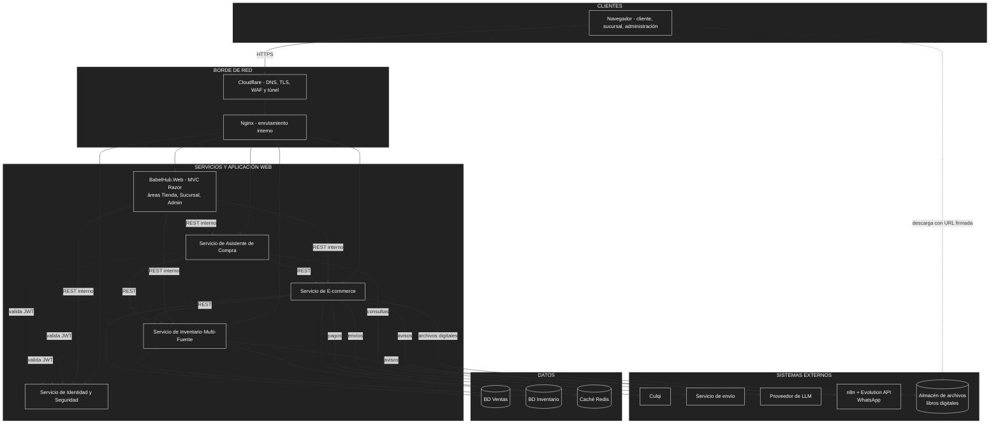

# Estilo arquitectónico

## 1. Estilo seleccionado

**Arquitectura basada en servicios (*Service-Based*) de granularidad gruesa**, con **Clean Architecture** como organización interna de cada servicio.

- **Estructura global:** pocos servicios independientes, cada uno con una responsabilidad clara y, cuando la necesita, con su propia base de datos. Se comunican por **REST síncrono**. La interfaz es una aplicación web (`BabelHub.Web`, MVC con Razor) que actúa como cliente de los servicios (AD15).
- **Estructura interna:** cada servicio se divide en cuatro capas cuyas dependencias apuntan siempre hacia el dominio.

**Justificación:** la red prevista es de 5 a 10 sucursales y los recursos son 2 OCPU y 12 GB en total, por lo que dividir el sistema en más servicios agregaría coordinación y consumo sin ventaja real de escalamiento (DA09). Un monolito, en cambio, mezclaría el inventario con la venta y dificultaría aislar y probar la parte más crítica (DA01). Clean Architecture compensa el tamaño reducido del sistema con límites claros dentro de cada servicio (DA08).

## 2. Diagrama de arquitectura

La vista de despliegue sobre las VMs de Oracle está en [decisiones arquitectónicas](02-decisiones-arquitectonicas.md).

## 3. Componentes y responsabilidades

| Componente | Responsabilidad | Decisión |
| :--- | :--- | :--- |
| **Aplicación Web (`BabelHub.Web`)** | Interfaz de clientes, encargados de sucursal y administración central en tres áreas; consume los servicios por REST desde el servidor y guarda el JWT en el servidor. No contiene reglas de negocio. | RC01, RC03, AD15 |
| **Cloudflare y Nginx** | Cloudflare protege y cifra el acceso; Nginx enruta cada solicitud al servicio correspondiente. | AD13, AD14 |
| **Servicio de E-commerce** | Catálogo (impresos y digitales), carrito, checkout, pagos, pedidos y biblioteca digital (acceso y descarga). Único servicio con el que interactúa el cliente final. | AD01, AD02, AD19, AD20 |
| **Servicio de Inventario Multi-Fuente** | Fuentes por sucursal, stock vendible (físico − reservas), reservas, selección de fuente, traslados y ajustes. | AD01, AD08 |
| **Servicio de Identidad y Seguridad** | Autentica usuarios (con segundo factor para el personal), emite JWT con rol y sucursal, firma con una clave propia que rota, y emite la credencial de lectura del asistente. | AD05, AD22 |
| **Servicio de Asistente de Compra** | Recomienda libros y responde dudas con datos de las API y un LLM externo. | AD07 |
| **BD Ventas y BD Inventario** | PostgreSQL separadas; la de Inventario se aísla por su volumen de escritura. Identidad usa el esquema propio `identidad` en la instancia de Ventas. | AD03, AD12, AD18 |
| **Notificaciones (n8n + Evolution API)** | Reciben avisos de E-commerce e Inventario por webhook y los envían por WhatsApp; su falla no bloquea ninguna operación. | AD16 |
| **Almacén de archivos digitales** | Guarda los EPUB y PDF en un bucket privado; el cliente los descarga con URL firmada de corta duración. | AD19, AD20 |
| **Caché Redis** | Disponibilidad (corta duración) y catálogo (mayor duración). | AD06 |

## 4. Reglas de comunicación

| Origen | Destino | Tipo | Propósito |
| :--- | :--- | :--- | :--- |
| Navegador | Cloudflare → Nginx → Web | HTTPS | Enviar todas las solicitudes de la interfaz. |
| Aplicación Web | E-commerce, Inventario, Identidad y Asistente | REST síncrono (red interna) | Obtener y modificar datos con el JWT del usuario. |
| E-commerce | Inventario | REST síncrono | Consultar disponibilidad real y solicitar reservas. |
| Asistente | E-commerce e Inventario | REST síncrono | Obtener datos, sin acceder a las bases; los pedidos con la credencial de lectura del propio cliente. |
| Servicios | Proveedor de correo | API externa | Códigos de seguridad, respuestas a reclamos, alertas y avisos de pago pendiente. |
| Todos los servicios | Identidad | Validación de JWT | Verificar rol y sucursal permitidos. |
| E-commerce e Inventario | Su base y Redis | SQL y caché | Persistir y acelerar sus datos. |
| E-commerce | Culqi y servicio de envío | API externa | Cobrar y gestionar entregas. |
| E-commerce e Inventario | n8n | Webhook (asíncrono, tolerante a fallos) | Pedir el envío de un aviso por WhatsApp. |
| n8n | Evolution API → WhatsApp | API interna y externa | Armar y enviar el mensaje. |
| E-commerce | Almacén de archivos | API S3 (HTTPS) | Subir archivos digitales y firmar URLs de descarga. |
| Navegador | Almacén de archivos | HTTPS con URL firmada | Descargar el libro; la Web y el E-commerce no transportan el archivo. |
| Asistente | Proveedor de LLM | API externa | Generar respuestas. |

## 5. Alternativas descartadas

| Alternativa | Motivo del descarte |
| :--- | :--- |
| **Monolito único** | Mezcla el inventario con la venta y dificulta aislarlo, probarlo y asignarle recursos. |
| **Microservicios finos** | Añaden coordinación, comunicación y despliegue innecesarios para 5–10 sucursales, con 12 GB de RAM en total. |
| **Arquitectura orientada a eventos** | Su complejidad operativa no se justifica con el volumen previsto; REST síncrono basta. |
| **Interfaz dentro del servicio E-commerce** | Mezclaría la UI del personal de sucursal con la venta y rompería la independencia de los servicios. |
| **SPA que llama a las API desde el navegador** | Expone el JWT al navegador, exige CORS y añade otro stack al proyecto. |
| **Guardar los archivos digitales en la VM o en PostgreSQL** | El disco es escaso, los archivos pasarían por una VM de 1 OCPU y inflarían los respaldos. Ver AD19. |
| **Capas tradicionales** | El dominio quedaría atado a la base de datos y a los proveedores externos, y sería más difícil de probar. |

## 6. Ventajas y limitaciones

| Ventajas | Limitaciones |
| :--- | :--- |
| Aísla el inventario, la parte más crítica, del resto del sistema. | La comunicación síncrona hace que el E-commerce dependa de la disponibilidad del Inventario. |
| Pocos servicios: despliegue y mantenimiento sencillos con Docker Compose. | Identidad y Redis son puntos compartidos que requieren cuidado. |
| Reglas de negocio aisladas y fáciles de probar. | Clean Architecture agrega interfaces y proyectos, lo que implica más código base para un sistema pequeño. |
| Se adapta a recursos gratuitos limitados. | Dos bases separadas exigen mantener la coherencia entre ventas e inventario mediante llamadas REST. |
| Cada sucursal nueva es una fuente, no un cambio de código. | Si la red superara ampliamente las 20 sucursales, habría que revisar el estilo. |
