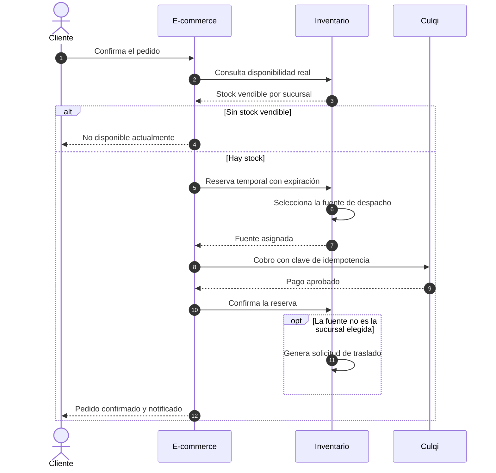
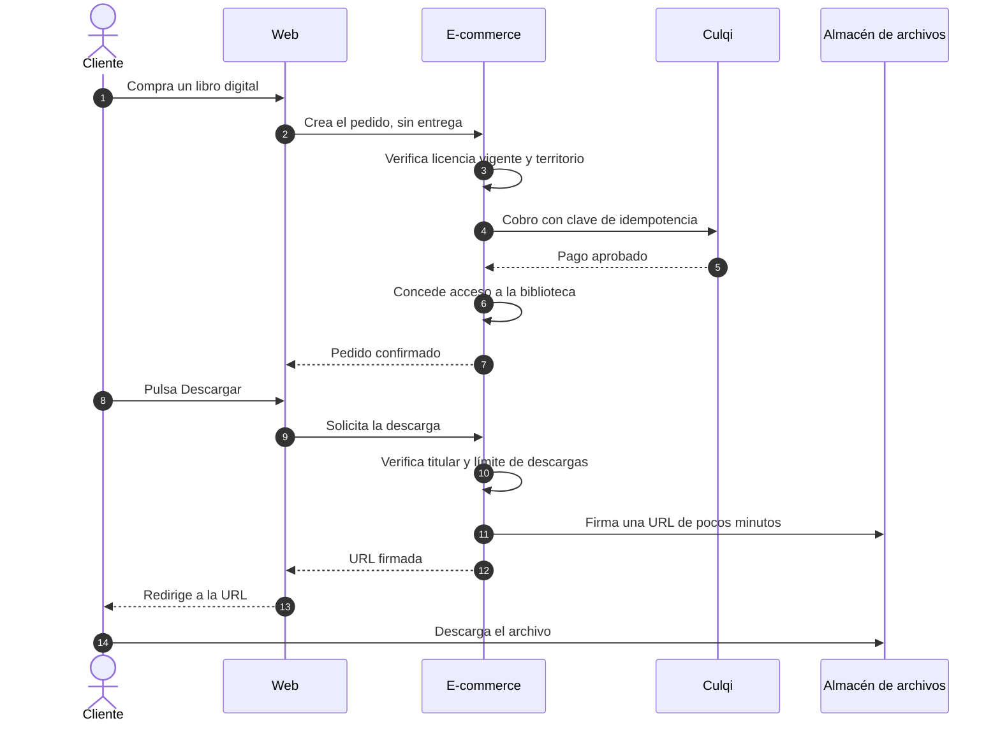

# Escenarios y flujos

## 2. Flujo secundario: compra y descarga de un libro digital

El libro digital no pasa por el Inventario: no hay stock ni fuente que seleccionar.

En un pedido mixto, el cobro es único: las líneas impresas siguen el flujo principal y las digitales conceden acceso al aprobarse el pago.
