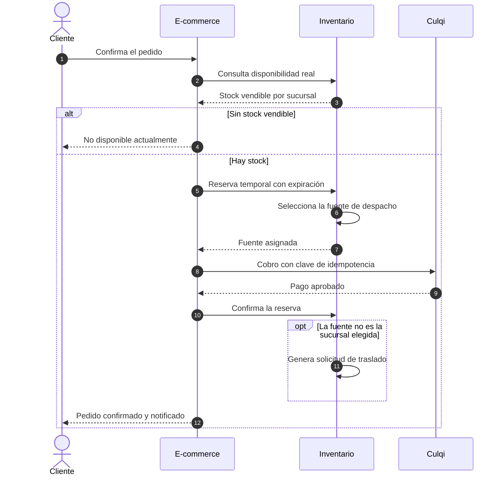
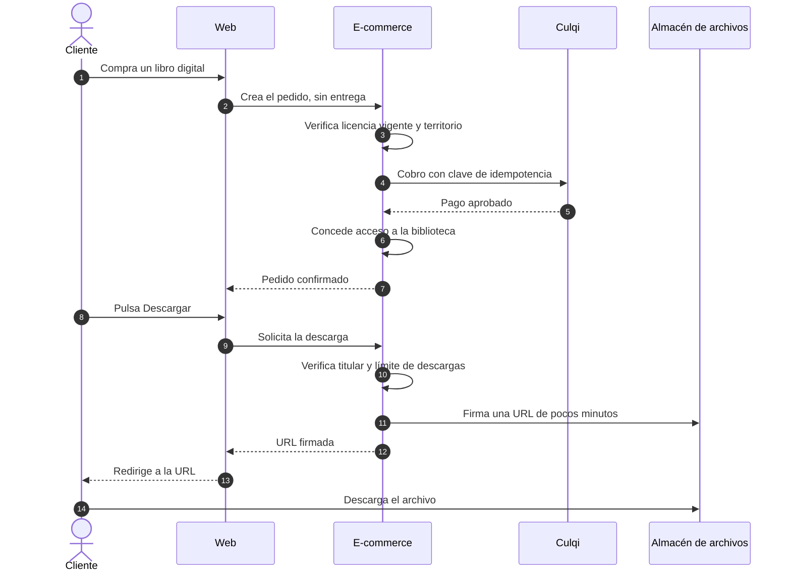
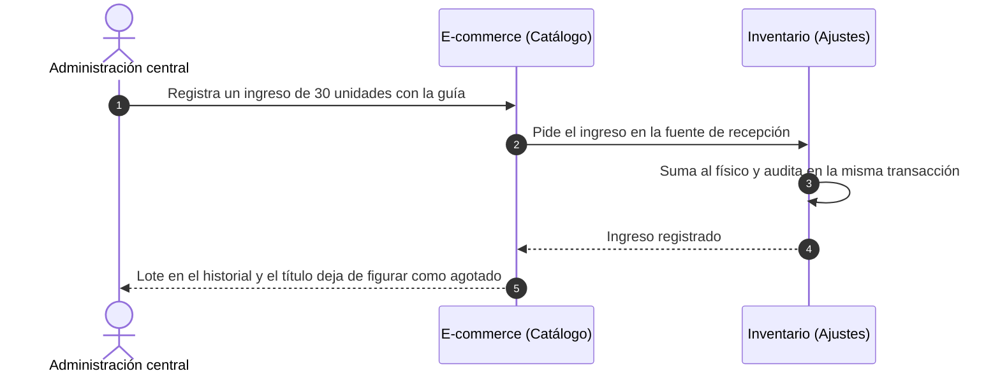

# Escenarios y flujos

## 2. Flujo secundario: compra y descarga de un libro digital

El libro digital no pasa por el Inventario: no hay stock ni fuente que seleccionar.

En un pedido mixto, el cobro es único: las líneas impresas siguen el flujo principal y las digitales conceden acceso al aprobarse el pago.

## 3. Variantes del flujo principal

| Situación | Qué ocurre |
| :--- | :--- |
| Correo sin verificar | No se inicia el pago ni se reserva; se invita a verificar el correo y el carrito se conserva (CAR-21). |
| La fuente no es la sucursal de recojo | La consulta previa de selección informa el traslado y su plazo antes de pagar (CAR-09, SEL-20); el traslado se crea al confirmarse el pago (SEL-03) y la reserva viaja con las unidades. |
| Pago pendiente de confirmación | La reserva se extiende hasta 30 minutos y se avisa por pantalla, correo y WhatsApp con consentimiento; si el pago llega con la reserva vencida, se reembolsa (PAG-13 a PAG-15). |
| Entrega | En recojo, el físico baja al entregar (SEL-11); a domicilio, al pasar el envío a en reparto (SEL-21). |
| Pedido no recogido | A los 15 días en listo para recojo se liberan las reservas y la administración decide el reembolso (PED-15, PED-16). |
| Cancelación del cliente | Con todas las líneas impresas aún confirmadas, se anula, se libera, se cancela el traslado y se reembolsa (PED-17). |

## 4. Flujo de apoyo: ingreso de mercadería

La administración central recibe la importación en Lima y registra cada lote desde el Catálogo. Solo entra a la fuente de recepción; las demás sucursales reciben stock por traslado o devolución.

Si el Inventario no responde al dar de alta una edición con stock inicial, la edición queda creada con stock 0 y se indica que el ingreso debe registrarse después (CAT-20). Un título agotado no se da de baja (CAT-21).

## 5. Escenarios de degradación

| Situación | Qué ocurre |
| :--- | :--- |
| Cae el contenedor de Inventario | El catálogo sigue mostrando la última disponibilidad y el checkout informa que no puede validar el stock, sin cobrar (CAR-06, CAT-12). |
| Cae la VM de ventas | El personal sigue operando el inventario por la réplica de gestión; no hay tienda ni avisos. |
| Cae la VM del Inventario | Cae todo el sistema (la base está ahí); se restaura desde el respaldo y el archivado de WAL. |

El detalle y las mitigaciones están en [despliegue](05-despliegue.md) §6.
