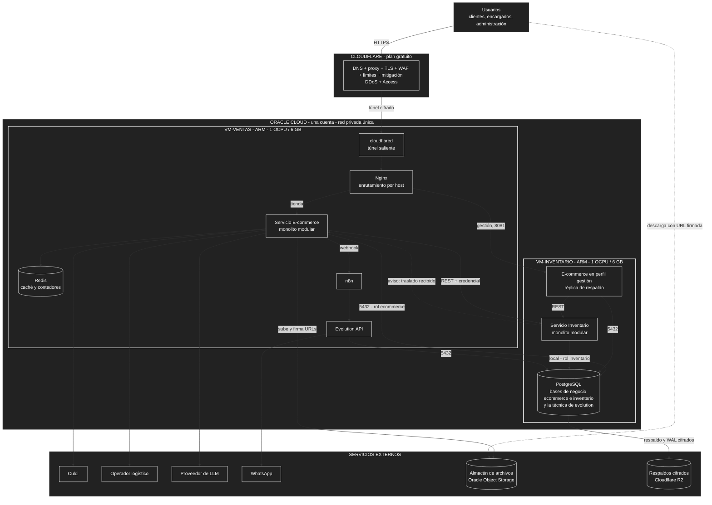

# Despliegue en Oracle Cloud Free Tier

Este documento reparte los servicios en máquinas virtuales (VMs) **usando solo recursos gratuitos de una sola cuenta de Oracle** (desde el 2026-11-25, los respaldos usan además el cupo gratuito de Cloudflare R2). La **estructura** del sistema (dos servicios, módulos, bases) está en el [estilo arquitectónico](03-estilo-arquitectonico.md) y no cambia con el reparto: lo que se decide aquí es **en qué host corre cada unidad de despliegue**.

> **Topología vigente desde el 2026-11-25: DOS VMs** (decisión de la persona responsable; DD-100). No hubo capacidad para las AMD micro en `sa-santiago-1`: `cloudflared` y Nginx corren **dentro de VM-VENTAS** (el respaldo previsto en B11), **VM-BORDE no existe** y **VM-AUX queda aplazada**. Lo que se pierde mientras tanto está en §6.2. La topología de cuatro VMs sigue siendo el objetivo si aparece capacidad: volver a ella exige recuperar el Compose del borde del historial y no cambia el código de los servicios.

## 1. Recursos disponibles

Las condiciones del Free Tier cambiaron en 2026. Las cifras se contrastaron con fuentes públicas secundarias (no con la documentación oficial de Oracle) y deben **verificarse en la consola al crear la cuenta**.

| Recurso | Disponible gratis | Uso en BabelHub |
| :--- | :--- | :--- |
| VMs ARM (Ampere A1) | **2 OCPU y 12 GB de RAM en total**, repartibles en 1 a 4 instancias (antes 4 OCPU y 24 GB). | **2 VMs de 1 OCPU y 6 GB**: la venta con la entrada pública, y el inventario con su base. |
| VMs x86 (AMD micro) | **2 instancias** de 1/8 OCPU y 1 GB de RAM. | **Sin usar** (2026-11-25: sin capacidad en la región). Previstas para la entrada y para el salto SSH con monitoreo (VM-AUX, aplazada). |
| Almacenamiento en bloque | 200 GB en total; el volumen de arranque mínimo es de 47 GB. | 2 × 47 GB = 94 GB; sin volúmenes extra. Los respaldos van al almacén de objetos. |
| Total de VMs | **4** posibles: 2 ARM y 2 AMD micro. | Hoy **2** (las ARM), en **una sola cuenta**. |

**Cuenta de pago por uso (PAYG).** Actualizarla **no amplía el cupo gratuito**: los recursos Always Free siguen siendo gratis y todo lo que supere el cupo se cobra. Se recomienda actualizar para evitar que Oracle recupere instancias con uso muy bajo (fuentes secundarias; a verificar) y reducir los fallos de capacidad al crear VMs ARM. Se activa con un **presupuesto y una alerta de costo de 1 USD** para detectar a tiempo cualquier recurso fuera del cupo. **Decisión (2026-11-06):** se usa una sola cuenta de Oracle, sin segunda cuenta de Oracle ni VMs de pago. **2026-11-25:** los respaldos van a Cloudflare R2 (cupo gratuito de 10 GB-mes, cifra a verificar; cobra el excedente), con aviso de facturación en esa cuenta y revisión diaria del uso (PLA-06).

Condiciones a tener en cuenta:
- Superar el cupo ARM inhabilita las instancias o genera cargos, según el tipo de cuenta.
- Crear instancias ARM suele fallar por falta de capacidad en regiones populares; hay que reintentar o elegir bien la región al registrarse, porque no se cambia después.
- La CPU de una AMD micro es 1/8 de OCPU: solo corre componentes livianos.

## 2. Unidad de despliegue y host

Un **servicio** es una unidad de despliegue independiente: tiene su propio código, imagen, versión, configuración y base de datos. Una **VM** es el host donde se ejecutan esas unidades. El estilo basado en servicios exige lo primero; no exige una VM por servicio. Lo segundo es una decisión de capacidad y de riesgo, con estos criterios:

| Criterio | Regla |
| :--- | :--- |
| Lo expuesto es liviano | cloudflared y Nginx solo reenvían tráfico. Lo ideal es que vayan en una VM aparte; sin capacidad para ella comparten VM-VENTAS, en redes de Docker propias y sin publicar puertos (§4). |
| La venta y el inventario no comparten CPU | Cada servicio corre en su propia VM ARM de 1 OCPU. |
| El estado va junto al sistema más crítico | La base de datos vive en la VM del Inventario y no tiene acceso desde Internet. |
| Lo periférico tolera fallos | Las notificaciones (n8n y Evolution API) van con la venta: su caída no bloquea la compra (AD16). |
| Mínimo privilegio por VM | Cada VM recibe solo los secretos de sus contenedores. |
| Mover un servicio es configuración | Cambiar un servicio de VM solo cambia su Compose y las direcciones, no el código. |

## 3. Despliegue

| VM | Tipo | Contenedores | Justificación |
| :--- | :--- | :--- | :--- |
| **VM-VENTAS** | ARM, 1 OCPU y 6 GB | cloudflared y Nginx (la entrada pública), servicio E-commerce (con todos sus módulos y la interfaz web, rol `tienda`), Redis, n8n y Evolution API. | La entrada, la venta y lo periférico. Las notificaciones no bloquean la compra aunque se degraden. Redis vive aquí para que la caché de disponibilidad sobreviva a una caída del Inventario. |
| **VM-INVENTARIO** | ARM, 1 OCPU y 6 GB | Servicio Inventario, **réplica de gestión** del E-commerce (rol `gestion`: la única que sirve la gestión), PostgreSQL (dos bases de negocio, `ecommerce` e `inventario`, y la base técnica `evolution`). | El sistema más crítico con su base. La base **no tiene acceso desde Internet**. La réplica de gestión es la misma imagen del E-commerce con el perfil «solo gestión» (Sucursal y Admin). |
| VM-AUX (**aplazada**) | AMD micro | Salto SSH y monitoreo ligero. | No se creó por falta de capacidad; ver §6.2. |

**Compromiso aceptado:** la base de datos comparte VM con el Inventario, por lo que deja de ser una VM «solo de datos». Es el precio de usar solo recursos gratuitos. Se compensa con red privada, un rol por esquema, seguridad por filas, contenedores sin privilegios y respaldo en el almacén de objetos (§4 y §5). Si hubiera presupuesto, mover PostgreSQL a una tercera VM ARM (≈ 7 USD al mes, a verificar) es un cambio de Compose, no de código.

### Estimación de memoria (a validar con mediciones reales)

El detalle por contenedor está en el [presupuesto de recursos](07-presupuesto-de-recursos.md). Objetivo de RNF12: menos del 70 % por VM (unos 4,2 GB en las ARM).

| VM | Consumo estimado | Holgura |
| :--- | :--- | :--- |
| VM-VENTAS | Sistema ~0,5 GB; E-commerce ~0,25–0,45 GB; n8n ~0,3–0,5 GB; Evolution API ~0,3–0,5 GB; Redis ~0,1–0,25 GB; Nginx y cloudflared < 0,15 GB. Total ~1,5–2,4 GB. | Buena. La CPU (un .NET, dos de Node y la entrada sobre 1 OCPU) es el límite real. |
| VM-INVENTARIO | Sistema ~0,5 GB; Inventario ~0,15–0,25 GB; réplica de gestión ~0,2–0,35 GB; PostgreSQL ~1,2–1,8 GB. Total ~2,1–2,9 GB. | Buena; la memoria sobrante la usa el sistema como caché de disco. |

## 4. Red y seguridad de las VMs

Todas las VMs comparten la **red privada de la misma cuenta**; no hay tráfico entre servicios por Internet ni hace falta una malla adicional.

| Tema | Regla |
| :--- | :--- |
| Entrada | Solo Cloudflare Tunnel llega a la aplicación; los puertos 80 y 443 de Oracle están **cerrados**. El Inventario no tiene entrada pública: solo acepta llamadas de la VM-VENTAS y de la réplica de gestión. |
| Entrada dentro de VM-VENTAS (DD-101) | Un solo conector: `cloudflared` → Nginx (red de Docker `tunel`, solo ellos dos) → E-commerce (red `entrada`, interna, solo Nginx y el E-commerce). Nginx y `cloudflared` **no publican ningún puerto** y no están en la red donde viven Redis, n8n y Evolution API. Nginx cree `CF-Connecting-IP` solo de la dirección fija de `cloudflared`; el E-commerce cree `X-Origen-Cliente` solo de la dirección fija de Nginx (`BABELHUB__Ecommerce__ProxiesConocidos`, fijada en el Compose). Ningún contenedor necesita llegar a un puerto publicado en la dirección privada de su propia VM. |
| Gestión (DD-102) | `gestion.<dominio>` va de Nginx a la réplica de gestión (`http://<VM-INVENTARIO>:8081`, el único proceso con el rol `gestion`; el de la tienda rechaza ese host). La réplica cree `X-Origen-Cliente` solo de la dirección privada de VM-VENTAS (`IP_VENTAS`, que fija su Compose). Como cualquier contenedor de esa VM saldría con la misma dirección, en VM-VENTAS una regla `DOCKER-USER` (`scripts/proteger-gestion.sh`, que `desplegar.sh` pone y cron repone cada minuto) deja llegar a ese puerto **solo a Nginx** (DD-104). **Residual:** hasta un minuto tras reiniciar la VM y quien ya sea administrador de ella; la regla se verifica en la VM (guía 08 §13.2), no se probó en local. |
| Escucha | Cada servicio publica su puerto **solo en la dirección privada de su VM**, nunca en `0.0.0.0`. |
| Direcciones | Las direcciones de los servicios y de la base son variables de entorno por VM (por ejemplo `BABELHUB__INVENTARIO__URL`); no hay nombres de Docker entre VMs. |
| Autenticación | Las llamadas entre el E-commerce y el Inventario llevan **credencial de servicio** (SEG-15): estar en la red no basta para ser atendido (AM24). |
| Base de datos | `pg_hba` solo con `hostssl` (TLS 1.3 con certificado de la CA privada de la cuenta) por base: toda conexión de red sin TLS se rechaza y la última regla rechaza lo demás; los clientes verifican al servidor (`SSL Mode=VerifyFull`; Evolution API, con `sslmode=require` + `sslaccept=strict` + `sslcert=`, porque Prisma ignora `verify-full`); un rol por esquema sin permiso sobre los demás; PostgreSQL en su propia red de Docker. Ver §5.3. |
| Redis | Contraseña y usuarios con ACL; prefijos por tipo de clave; solo la VM-VENTAS. El **Redis de contadores** es una instancia aparte de la de caché (`infra/redis-contadores/`): `noeviction`, 100 MB, AOF cada segundo, sin instantáneas, el usuario por defecto desactivado y un único usuario `limites` con la contraseña de `BABELHUB__Seguridad__ClaveDeRedisDeLimites`, limitado a las claves `lim:*`, `blq:*`, `idem:*`, `rech:*` y `rsv:*` y a estos comandos: `EVAL`, `EVALSHA`, `SCRIPT LOAD`, `TIME`, `DBSIZE`, `PTTL`, `EXISTS`, `ZADD`, `ZREMRANGEBYSCORE`, `ZCARD`, `ZCOUNT`, `ZRANGE`, `ZREM`, `SET`, `GET`, `PEXPIRE`, `DEL`, `PING`, `HELLO`, `CLIENT SETINFO`, `CLIENT SETNAME`, `ECHO` e `INFO` (este último para el vigilante de memoria, alerta al 70 %). Solo TLS en el puerto 6380 con certificados montados como secretos; esa configuración está escrita y aún no se probó contra un Redis real con TLS. |
| Reloj | Sincronización de hora (`chrony`) en todas las VMs: las credenciales duran 15 minutos y la validación debe tolerar una desviación pequeña (propuesta: ±60 s). |
| Arranque | No hay orden de arranque entre VMs: cada servicio reintenta la conexión a su base y a sus dependencias con esperas crecientes y expone un `healthcheck` que Docker y el monitoreo consultan. |
| Acceso administrativo | SSH solo con llave pública y **solo desde la IP del administrador** (lista de seguridad), directo a cada VM mientras VM-AUX esté aplazada (sería el único punto de salto). Ninguna VM acepta SSH desde cualquier origen de Internet. |
| Contenedores | Sin privilegios, con sistema de archivos de solo lectura cuando se pueda, sin el socket de Docker y con límites de memoria y CPU. |
| Host | Actualizaciones automáticas de seguridad, paquetes mínimos, discos y respaldos cifrados, y alertas de ingreso por SSH, procesos o puertos nuevos (aplazadas con VM-AUX: §6.2). |
| Monitoreo | **Aplazado con VM-AUX** (§6.2): era la comprobación, desde fuera de las VMs de aplicaciones, de la puerta pública, la salud y los respaldos. Las alertas de seguridad (RNF20) siguen saliendo de los registros de cada servicio. |

**Límites y protección de entrada (AD24).** Cuatro niveles: Cloudflare (protección DDoS, reglas WAF, *Bot Fight Mode*, Turnstile en inicio de sesión, registro, reclamos, reservas y asistente, y Cloudflare Access con MFA en el host de gestión), Nginx (`limit_req` y `limit_conn` por la IP real del cliente), la Aplicación (presupuestos por actor y por rol, también para el personal) y la base (`CONNECTION LIMIT` por rol y `statement_timeout`). Ver [operación segura](../05-seguridad/07-operacion-segura.md).

## 5. Base de datos

### 5.1 Una instancia con una base por servicio

PostgreSQL corre en VM-INVENTARIO como **una sola instancia** con dos bases de negocio, una por servicio, más la base técnica de Evolution API:

| Base | Dueño | Contenido |
| :--- | :--- | :--- |
| `ecommerce` | Servicio E-commerce | Un **esquema por módulo**: `catalogo`, `carrito`, `pagos`, `pedidos`, `envios`, `devoluciones`, `biblioteca`, `reclamaciones`, `web` (sesiones) y **`identidad`** (aislado por rol). Una tabla de auditoría compartida por los módulos y otra en el esquema aislado `identidad`. |
| `inventario` | Servicio Inventario | Fuentes, stock, reservas, traslados, ajustes, ingresos de mercadería y su auditoría. |
| `evolution` | Evolution API | Datos propios de la herramienta de WhatsApp (n8n guarda los suyos en un volumen). No es de nuestros sistemas. |

**Por qué Identidad es un esquema y no una tercera base.** Con Identidad como módulo del E-commerce, un rol propio por esquema da el mismo aislamiento práctico (el rol de los demás módulos no tiene permiso sobre `identidad`) y permite que cancelar una cuenta y anonimizar sus pedidos ocurran en una sola transacción. Los demás módulos obtienen los datos de una persona por el contrato público del módulo Identidad, nunca por sus tablas.

### 5.2 Comparación de opciones

| Opción | Aislamiento de datos | Memoria | Operación | Veredicto |
| :--- | :--- | :--- | :--- | :--- |
| A. Una base compartida por ambos sistemas | Débil: cualquiera cruza tablas del otro y se salta el contrato REST. | Mínima | Mínima | Descartada. |
| **B. Una instancia, una base por servicio, esquema por módulo y rol por esquema** | **Fuerte entre servicios** (PostgreSQL no permite consultas entre bases) y suficiente entre módulos. | Una sola memoria compartida (~0,75 GB de buffers) | Un servidor, un respaldo por base | **Elegida** (AD03, AD18). |
| C. Una instancia por servicio | Fuerte | Un juego de buffers por instancia | Más servidores que actualizar | Descartada: con 1 OCPU no da aislamiento de CPU y consume más RAM. |

### 5.3 Reglas que sostienen el aislamiento

- Un rol por esquema y por servicio, sin ser superusuario ni dueño de las tablas; `REVOKE CONNECT ... FROM PUBLIC` y sin permiso sobre otras bases. Las aplicaciones usan un rol de lectura y escritura sin permiso de `UPDATE` ni `DELETE` sobre la auditoría; la anonimización de AUD-19 la hace un rol de depuración aparte, solo sobre las columnas de datos personales.
- **Seguridad por filas (RLS)** en el Inventario: el alcance por sucursal se repite en la base (política por sucursal con `FORCE ROW LEVEL SECURITY`; la aplicación fija la sucursal con `SET LOCAL` en cada transacción). Es una **segunda capa** frente a un error de alcance en la Aplicación; no protege contra el control total del servidor.
- **TLS hacia PostgreSQL, de extremo a extremo (AM24, DD-90 a DD-94).** El servidor arranca con `ssl=on`, TLS 1.3 como mínimo y un certificado propio (`tls-postgres-cert.pem`, emitido por la CA privada de la cuenta con la IP privada de VM-INVENTARIO y el nombre `postgres`); `infra/postgres/servidor/iniciar.sh` copia el certificado y la clave a la memoria del contenedor con los permisos 0600 que exige PostgreSQL (el sistema de archivos sigue de solo lectura y sin capacidades) y `infra/postgres/servidor/pg_hba.conf`, dentro de la imagen, solo admite `hostssl` con `scram-sha-256` hacia `ecommerce`, `inventario` y (solo la cuenta `evolution`) `evolution`; el socket local del contenedor (salud, creación de bases, respaldo y archivado) sigue sin red y toda otra conexión se rechaza. Los clientes **verifican** al servidor: las cadenas de Npgsql llevan `SSL Mode=VerifyFull` (la raíz de confianza es `ca-bundle.pem`, de `desplegar.sh`) y la URI de Evolution API, `sslmode=require&sslaccept=strict&sslcert=` con la CA, porque Prisma ignora `verify-full` y cae en «prefer» sin verificar. `scripts/desplegar.sh` se niega a desplegar una VM cuyas cadenas no lo pidan, y `scripts/ensayo-local.sh` comprueba que una conexión sin TLS, con otra CA o con otro nombre se rechaza.
- Límite de conexiones por rol y `statement_timeout`, para que un sistema no agote al otro.
- El respaldo es una copia consistente del clúster con archivado de WAL (PLA-09), que permite restaurar las dos bases al mismo instante; en producción solo se restaura el clúster completo; extraer una sola base en una instancia aparte queda para ensayo o consulta.
- Entre `ecommerce` e `inventario` no hay llaves foráneas: solo identificadores (por ejemplo, `edicion_id`) y contratos REST.

**Costo aceptado:** ambas bases comparten CPU, disco y memoria con la aplicación de Inventario. Una consulta pesada de un servicio puede afectar al otro. Se mitiga con los límites anteriores y con la medición de carga (k6).

## 6. Fallos y mitigaciones

Sin redundancia, **cada VM es un punto de falla**. La arquitectura aísla el efecto de cada caída; no evita que ocurra.

| Cae | Efecto | Mitigación y recuperación |
| :--- | :--- | :--- |
| **El contenedor de Inventario** | **No cae todo.** El catálogo se sigue mostrando con la última disponibilidad conocida y el checkout informa que no puede validar el stock, sin cobrar a ciegas (CAT-12, CAR-06). | Reinicio automático y `healthcheck`. La caché de disponibilidad vive en Redis de la VM-VENTAS, no en la que cae. |
| **VM-VENTAS** | Sin tienda, catálogo ni compras, y **sin entrada pública de ningún tipo, tampoco la gestión** (Nginx y `cloudflared` viven aquí). El Inventario y su base siguen vivos y la réplica de gestión sigue sirviendo al Inventario la clave de verificación y las revocaciones (IDE-85), pero el personal no puede llegar a ella desde Internet. Sin avisos de WhatsApp. | Recrear la VM-VENTAS desde las imágenes (RTO ≤ 4 h); los avisos pendientes se reintentan (NOT-04). Las sesiones están en la base, así que al volver la entrada siguen abiertas. El escenario ESC-AC03-03 (operar la gestión con VM-VENTAS caída) **no se cumple** con esta topología. |
| **VM-INVENTARIO** | **Cae todo**: ahí están también las bases `ecommerce` e `inventario`, así que no hay inicio de sesión, ni catálogo, ni inventario. Es el costo del compromiso. | Respaldo diario cifrado y archivado continuo de WAL **en Cloudflare R2** (comprimidos y cifrados; archivo de cambios de 7 días); restaurar en la misma VM o en otra (RPO de minutos con WAL y ≤ 24 h solo si el archivo de cambios está roto; RTO ≤ 4 h). Mejora opcional y gratuita: una **réplica de PostgreSQL en caliente en VM-VENTAS** (~1 GB) con promoción manual, que baja el RTO a minutos. |
| **El contenedor de Nginx o el de cloudflared** | Sin entrada pública (tienda y gestión). | Reinicio automático y `healthcheck`. No hay segundo conector: uno que saltara Nginx permitiría falsificar la IP del cliente (DD-101). |
| **VM-AUX** (aplazada) | No existe todavía: ver §6.2. | Acceso desde la IP del administrador. |
| **La cuenta de Oracle** | Se pierden las VMs, los libros digitales, las portadas y el registro de supresiones. Los respaldos de las bases, en Cloudflare R2, sobreviven. | Sin segunda copia de libros ni registro (riesgo aceptado, B13). Los respaldos de R2 permiten recuperar las bases en otra máquina con el mismo Compose (ver [operación segura](../05-seguridad/07-operacion-segura.md) §5), pero sin el registro de supresiones el sistema **no se abre al público** (PLA-19). |
| **La cuenta de Cloudflare** | Se pierden los respaldos (y, con ella, la entrada pública, el DNS y el túnel). El sistema en marcha conserva sus datos. | Segundo factor en la cuenta; sin segunda copia (B13). |

**Compromiso de la VM-INVENTARIO.** Concentra la base, el Inventario y la réplica de gestión. Si alguien toma el control de ese servidor, la base queda comprometida y la seguridad por filas no ayuda. Por eso la defensa es en profundidad (AD31): contenedores sin privilegios y en redes separadas, `pg_hba` por base y origen, SSH solo desde la IP del administrador (por la VM-AUX cuando exista), discos y respaldos cifrados, detección de cambios y, sobre todo, **recuperación**: respaldo y WAL cifrados en el almacén de objetos.

### 6.1 Limitaciones declaradas

Lo siguiente se acepta de forma consciente y debe figurar en el informe y en la exposición como limitación, no como omisión:

- **Punto único de falla de datos:** si cae VM-INVENTARIO caen las dos bases y, con ellas, el inicio de sesión, el catálogo y el inventario (AD31); la réplica de gestión solo mantiene al personal si la base sigue viva. No hay redundancia ni SLA (DA03).
- **Sin segunda copia (B13):** los respaldos y el archivo de cambios están en Cloudflare R2 y los libros, las portadas y el registro de supresiones en Oracle; cada cosa tiene una sola copia en su proveedor. Se acepta por falta de recursos.
- **Archivo de cambios de 7 días (aceptado, 2026-11-25):** si el respaldo diario falla más de 7 días seguidos se pierde la recuperación reciente y nadie avisa desde fuera: la persona responsable comprueba cada día que el respaldo se hizo (guía 08).
- **Registro de supresiones solo en Oracle (aceptado, 2026-11-25):** sin él el sistema no se reabre al público (PLA-19).
- **Respaldos en un tercero, provisional (2026-11-25):** la credencial de la VM puede leer, listar y borrar lo vencido; el bloqueo de retención de R2 lo puede quitar el administrador de la cuenta; sin recuperación a un instante intermedio anterior a 7 días (spec `transversal-plataforma` §5; AM47).
- **La entrada comparte VM y CPU con la venta** (DD-100): `cloudflared` y Nginx compiten con el E-commerce, n8n y Evolution API por 1 OCPU; no está medido en la VM real (T39). Además, si cae VM-VENTAS se pierde también el acceso del personal.
- **Sin VM-AUX** (aplazada): ver §6.2.
- **Memoria casi al límite en VM-INVENTARIO** (ver el [presupuesto de recursos](07-presupuesto-de-recursos.md)).
- **Aspectos legales sin consulta experta** (B09): el marco legal usa valores propuestos; imprescindible revisarlo antes de operar con clientes reales.
- **Cifras del Free Tier de fuentes secundarias:** se confirman en la consola al crear la cuenta (sección 9) y se anota la fecha de verificación.

### 6.2 Lo que se pierde mientras VM-AUX esté aplazada (2026-11-25)

Decisión de la persona responsable: no juntar VM-AUX con VM-VENTAS (sus credenciales de sello y de avisos quedarían junto al servicio que vigilan, PLA-38) y aplazarla. Mientras tanto **no se cumplen** estas partes de `transversal-plataforma`; los scripts de `scripts/vm-aux/` se conservan y se instalan cuando exista la VM (registro en `progress/hallazgos.md`).

| Falta | Consecuencia | Paliativo manual (no cumple el requisito) |
| :--- | :--- | :--- |
| Salto SSH único | SSH directo a cada VM desde la IP del administrador; no hay un único punto que endurecer y vigilar. | Regla TCP 22 solo con la IP actual; llave con frase de paso. |
| Aviso, originado **fuera** de la VM de datos, de respaldo diario ausente o de archivado con más de 15 minutos de atraso (PLA-20) | Si VM-INVENTARIO cae o el respaldo falla, **nadie avisa**. Solo queda el aviso del espacio local reservado, que sale de la propia VM de datos (PLA-21). | Revisar a diario el contenedor de respaldos y `/var/log/babelhub-respaldo.log`. |
| Vigilancia de la retención (PLA-18) | Nadie avisa si el almacén retiene más de lo esperado. | Revisión manual del almacén. |
| Sellos horarios del registro de supresiones y su ancla semanal (PLA-38) | Al restaurar, el registro no se puede contrastar con un sello: la verificación del sello que fija el plan de plataforma (§3) exige entonces su vía de excepción, con la decisión explícita de la persona responsable, y una entrada falsificada podría pasar sin detectarse. | Ninguno automático. La credencial del servicio no puede sobrescribir ni borrar entradas, pero **hasta que se aplique la retención con bloqueo** (guía 08 §9, aplazada) una credencial de administración sí podría. |
| Copia diaria del registro a `supresiones-copia` (PLA-38) | El registro queda con **una sola copia**. | Ninguno. |
| Latido externo y comprobación de la puerta pública | Una caída solo se nota si alguien la mira. | Un monitor HTTP externo gratuito sobre `https://<dominio>/health/live` (llega al E-commerce; `/health` lo responde Nginx). |
| Alerta de ingreso SSH y de procesos nuevos (AM29, AD31) | Sin aviso de un acceso indebido. | Revisar `last` y `journalctl -u ssh`. |
| Alerta de cuota del almacén (PLA-29, PLA-30) | Ya estaba pendiente (T40). | Presupuesto de 1 USD (Oracle), aviso de facturación de Cloudflare y revisión diaria del uso. |

**Antes de operar con clientes o datos reales** (junto con B09) hace falta VM-AUX o un vigilante equivalente fuera de las VMs de aplicaciones.

### 6.3 Sin respaldos hasta el cambio a Cloudflare R2 (2026-11-25)

Mientras el código de compresión y R2 no esté en `main`, la guía no lo describa y los contenedores de R2 no estén creados con sus reglas y comprobados, **no hay ningún respaldo**: el archivado y el respaldo diario no deben activarse (guía 08 §9 y §10.2). Lo que este documento y la operación segura describen de R2 y la compresión es el objetivo. Perder VM-INVENTARIO o su disco **pierde las dos bases**: RNF24, PLA-09, PLA-15 y PLA-18 no se cumplen y las filas de recuperación de §6 describen el objetivo, no el estado. **Condición para salir:** respaldos activos y una restauración probada, antes de cualquier dato o cobro real.

## 7. Reglas de red

| Origen | Destino | Puerto | Estado |
| :--- | :--- | :--- | :--- |
| Internet | Cualquier VM | 80 y 443 | **Cerrados** (el tráfico entra por el túnel saliente) |
| IP del administrador | VM-VENTAS y VM-INVENTARIO | 22 (SSH, solo con llave pública) | Permitido (directo mientras VM-AUX esté aplazada) |
| Contenedor de Nginx | Contenedor del E-commerce | 8080, por la red de Docker `entrada` de VM-VENTAS | Interno de la VM: no pasa por la dirección privada ni por la lista de seguridad |
| VM-VENTAS (Nginx) | VM-INVENTARIO | 8081 (réplica de gestión) | Permitido |
| VM-VENTAS, VM-INVENTARIO (réplica) | VM-INVENTARIO | 8082 (API del Inventario, por HTTPS: el contenedor escucha en 8443 y se publica como 8082; DD-55) | Permitido |
| VM-INVENTARIO (Inventario) | VM-VENTAS | 8443, por HTTPS con el certificado de la CA privada de la cuenta (aviso de traslado recibido y solicitud de avisos de traslado, alcance `solicitar-aviso`; antes 8080, DD-55) | Permitido |
| VM-INVENTARIO | VM-VENTAS | 5678 (webhook de n8n) | Cerrado: el Inventario ya no llama a n8n (pide los avisos al E-commerce, `transversal-notificaciones` D10) |
| VM-VENTAS | VM-INVENTARIO | 5432 (PostgreSQL, rol ecommerce) | Permitido |
| Cualquier otro origen | VM-INVENTARIO | todos | **Denegado** |
| VM-INVENTARIO (réplica de gestión) | VM-VENTAS | 6380 (Redis de contadores, dedicado, con TLS y contraseña; si no responde, SEG-26 rechaza las acciones que dependen de un límite) | Permitido |
| Internet | n8n y Evolution API | todos | **Sin publicar** (paneles por túnel SSH) |
| Evolution API | WhatsApp | HTTPS saliente | Permitido |
| VM-VENTAS | Almacén de archivos | HTTPS saliente | Permitido (subir archivos y firmar URLs) |
| VM-INVENTARIO | Cloudflare R2 | HTTPS saliente | Permitido (respaldos y WAL cifrados) |
| VM-AUX (aplazada) | Almacén de archivos y servidor de correo | HTTPS y TLS salientes | Sin uso hasta que exista (§6.2) |
| Internet | Almacén de archivos | HTTPS | Solo con URL firmada vigente; bucket privado |

Complementos: en las VMs se conserva el cortafuegos de la imagen de Oracle, pero **los puertos que publica Docker no pasan por él**: la barrera de entrada es la lista de seguridad de la subred (y en VM-VENTAS, además, una regla `DOCKER-USER` limita quién llega a la réplica de gestión, DD-104); secretos como variables de entorno fuera del repositorio y SSH sin contraseña.

### 7.1 Entornos del E-commerce y transporte seguro (2026-11-23)

Las VMs corren el E-commerce en uno de dos entornos **de tipo producción**, que se endurecen igual (HTTPS entre servicios, Redis con TLS, correo y almacén reales, hosts permitidos, proxies conocidos): **`Staging`**, para que la pasarela de pago revise la tienda con la pasarela **simulada** (no se cobra y la pantalla lo dice), y **`Production`**, con la pasarela real y su llave de producción (`ecommerce-pagos` PAG-34, D25). Se elige en el archivo de secretos de cada servicio y `scripts/desplegar.sh` comprueba que el entorno y la pasarela sean coherentes; ver `docs/07-proceso-de-desarrollo/08-guia-primer-despliegue.md` §15.1.

Entre el público y la aplicación, **Cloudflare termina TLS** (Universal SSL, Always Use HTTPS, Full strict) y el túnel y Nginx entregan HTTP **dentro** de VM-VENTAS (y, para la gestión, hacia VM-INVENTARIO por la red privada): la aplicación toma solo `X-Forwarded-Proto` para ver el esquema real, redirige con `308` lo que el borde declare HTTP (menos la salud), envía HSTS y cookies `Secure` y no pide nada por HTTP (PAG-36). El tráfico **entre servicios** va por HTTPS con la CA privada (DD-55).

## 8. Sistema operativo

**Decisión (2026-10-16):** **Ubuntu Server LTS mínimo sin entorno gráfico** en las VMs ARM y AMD de Oracle, por ser la imagen oficial para Ampere A1 (misma familia, mismo `apt` y mismo Docker que Debian); en local se puede usar Debian. El criterio se mantiene: instalación mínima y sin interfaz gráfica para ahorrar memoria.

## 9. Pendientes de verificar

- Cupo ARM, número de instancias y condiciones del Free Tier en la cuenta, y si la actualización a PAYG evita la recuperación por inactividad.
- Capacidad ARM en la región elegida; las más cercanas a Perú son las de Sudamérica, pero la disponibilidad varía.
- **Rendimiento de la entrada en VM-VENTAS** (`cloudflared` y Nginx junto al resto, 1 OCPU) con k6; volver a una VM aparte si aparece capacidad (DD-100).
- **Comprobación en la VM del camino de la entrada con el cortafuegos de Oracle** (guía 08 §13.2): en local no se reprodujeron las reglas `iptables` de la imagen de Oracle.
- **Latencia entre VMs** y CPU de cada VM de 1 OCPU con k6, incluida la réplica de gestión y PostgreSQL en la VM-INVENTARIO.
- Disponibilidad de subred privada sin costo.
- Registro de imágenes para recrear VMs sin depender de una cuenta de Oracle (por ejemplo, el registro de contenedores del repositorio).
- Costo y registro del dominio para Cloudflare, con el subdominio de gestión y sus reglas de Access (B04). Mientras no haya dominio se usan nombres de trabajo: la tienda en `<dominio>` y el personal en `gestion.<dominio>`; el Nginx ya enruta por ese prefijo (`gestion.*`).
- **Verificación de cifras (fecha 2026-11-06, solo fuentes secundarias):** cupo de VMs y disco del Free Tier, condiciones de PAYG y de la recuperación por inactividad; cuota de Oracle Object Storage (unos 20 GB; cifras antiguas de 10 GB). Confirmar todas en la consola y en las páginas oficiales al crear las cuentas y anotar la fecha.
- Imágenes multi-arch de todos los contenedores (PostgreSQL, Redis, Nginx, cloudflared y .NET ofrecen ARM64 y x86_64).
- Imágenes ARM64 de n8n y de Evolution API, y consumo real de memoria de ambos.
- Términos de uso de WhatsApp frente a Evolution API; usar un número dedicado.
- Culqi: idempotencia, soporte de Yape, reembolsos y llaves de pruebas (sandbox). **La pasarela de pago queda definida: Culqi (AD17).**
- Almacén de archivos (Oracle Object Storage, B02 cerrado el 2026-11-12): cuota gratuita vigente, costo de operaciones y límite de tamaño por archivo; confirmarlos antes de implementar `ecommerce-biblioteca-digital`.
- Archivado de WAL y réplica opcional de PostgreSQL: herramienta (por ejemplo, pgBackRest o WAL-G) y costo de operación.
- Contratos con los titulares de derechos: se simulan con datos de ejemplo y los libros se suben directamente (alcance académico; ver [marco legal](../01-analisis-de-sistema/03-marco-legal.md)).

## 10. Fuentes del despliegue

- Oracle Cloud Free Tier: reducción del cupo ARM a 2 OCPU y 12 GB, 2 VMs x86 micro, 200 GB de bloque (InfoQ, 2026; análisis técnicos de la comunidad).
- Cloudflare: plan gratuito, Cloudflare Tunnel, Access y Turnstile (documentación de Cloudflare).
- Canonical y Oracle: imagen de Ubuntu para Ampere A1.
- M. Richards y N. Ford, *Fundamentals of Software Architecture*: estilo basado en servicios (despliegue y datos).
