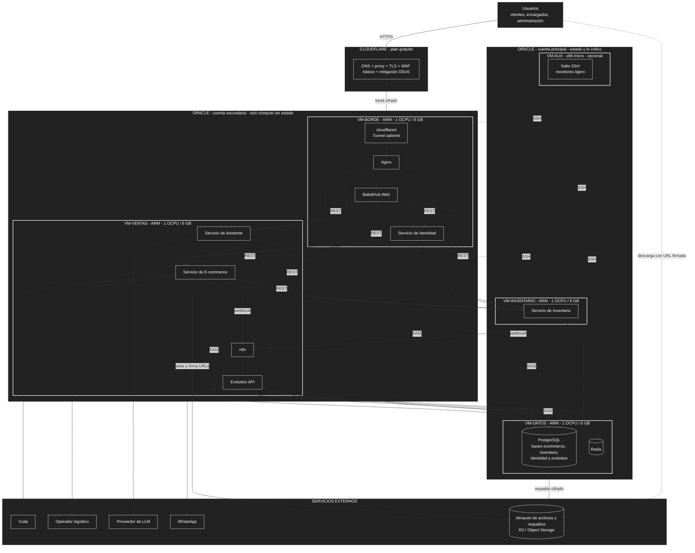

# Despliegue en Oracle Cloud Free Tier

Este documento reparte los servicios en máquinas virtuales (VMs). La **estructura** del sistema (servicios, imágenes, bases) está en el [estilo arquitectónico](03-estilo-arquitectonico.md) y no cambia con el reparto: lo que se decide aquí es **en qué host corre cada unidad de despliegue**.

## 1. Recursos disponibles

Las condiciones del Free Tier cambiaron en 2026. Las cifras se contrastaron con fuentes públicas secundarias (no con la documentación oficial de Oracle) y deben **verificarse en la consola al crear la cuenta**.

| Recurso (por cuenta) | Disponible gratis | Implicancia para BabelHub |
| :--- | :--- | :--- |
| VMs ARM (Ampere A1) | **2 OCPU y 12 GB de RAM en total**, repartibles en **1 o 2 instancias** (antes 4 OCPU y 24 GB). | Es el único cupo con recursos útiles: como máximo **2 VMs ARM de 1 OCPU y 6 GB** por cuenta. |
| VMs x86 (AMD micro) | **2 instancias** de 1/8 OCPU y 1 GB de RAM. | No sirven para .NET ni PostgreSQL; sí para tareas livianas (salto SSH, monitoreo). |
| Almacenamiento en bloque | 200 GB en total; el volumen de arranque mínimo es de 47 GB. | Cuatro VMs usan unos 188 GB solo en arranque; queda poca holgura. |
| Total de VMs | **Máximo 4 por cuenta**: 2 ARM y 2 x86 micro. | La propuesta original decía «hasta 4 VMs ARM»: no es correcto. |

**Cuenta de pago por uso (PAYG).** Actualizar la cuenta a PAYG **no amplía el cupo gratuito**: los recursos Always Free siguen siendo gratis y todo lo que supere el cupo se cobra. Sirve para evitar que Oracle recupere instancias con uso muy bajo (fuentes secundarias; a verificar) y reduce los fallos de capacidad al crear VMs ARM. Se activa con un **presupuesto y una alerta de costo de 1 USD** para detectar a tiempo cualquier recurso fuera del cupo.

Condiciones a tener en cuenta:
- Superar el cupo ARM inhabilita las instancias o genera cargos, según el tipo de cuenta.
- Crear instancias ARM suele fallar por falta de capacidad en regiones populares; hay que reintentar o elegir bien la región de origen al registrarse, porque no se cambia después.
- **Segunda cuenta (decisión del responsable, 2026-11-06):** se usará una segunda cuenta, también PAYG y con otra tarjeta. El FAQ de Oracle Cloud Free Tier permite **una cuenta gratuita por persona** y prohíbe crear varias; incumplirlo puede llevar a la suspensión o cancelación de la cuenta. No se asume que PAYG elimine ese riesgo (a verificar). Queda aceptado y mitigado: ver §3 y el riesgo en [drivers](01-drivers-arquitectonicos.md).

## 2. Unidad de despliegue y host

Un **servicio** es una unidad de despliegue independiente: tiene su propio código, imagen, versión, configuración y base de datos. Una **VM** es el host donde se ejecutan esas unidades. El estilo basado en servicios exige lo primero; no exige una VM por servicio. Lo segundo es una decisión de capacidad y de riesgo, que se toma con estos criterios:

| Criterio | Regla |
| :--- | :--- |
| Lo crítico se aísla | El Inventario (AC01, escritura intensiva) no comparte host con nada más. |
| El estado va aparte | Las bases de datos y Redis viven en una VM sin aplicaciones y sin acceso desde Internet (AD12). |
| Lo expuesto va junto | El borde de red, la Web y la identidad son sin estado de negocio y se reconstruyen desde las imágenes. |
| Lo periférico tolera fallos | El Asistente y las notificaciones pueden compartir host: su caída no bloquea la compra (AD07, AD16). |
| Mínimo privilegio por VM | Cada VM recibe solo los secretos de los servicios que aloja (la clave de Culqi solo en VM-VENTAS; la clave de firma solo en VM-BORDE). |
| Mover un servicio es configuración | Cambiar de VM un servicio solo cambia el Compose de esa VM y las direcciones (variables de entorno), no el código. |

## 3. Perfiles de despliegue

Se mantienen **dos perfiles con las mismas imágenes y el mismo código**; cambia solo el reparto y la red. **Decisión (2026-11-06):** se adopta el perfil objetivo, con dos cuentas de Oracle, ambas en PAYG sin superar su cupo; el perfil mínimo queda como contingencia.

| | **Perfil objetivo** | **Perfil mínimo (contingencia)** |
| :--- | :--- | :--- |
| Cuentas de Oracle | Dos (principal y secundaria) | Una |
| VMs ARM (1 OCPU y 6 GB cada una) | **4**: VM-BORDE, VM-VENTAS, VM-INVENTARIO y VM-DATOS | **2**: VM-APP y VM-DATOS |
| Red entre VMs | Malla WireGuard entre cuentas (§4) | Subred privada de la misma red virtual |
| Cuándo se usa | Entrega y operación normal | Si no se obtiene la segunda cuenta o se pierde (§7) |

Dónde corre cada cosa, con la cuenta de cada VM:

| VM | Cuenta | Contenedores | Justificación |
| :--- | :--- | :--- | :--- |
| **VM-BORDE** | Secundaria | cloudflared, Nginx, Web, Identidad. | Entrada pública, interfaz y emisión de credenciales: sin estado de negocio, se reconstruye desde las imágenes. La verificación de la firma es local en cada servicio; Identidad solo atiende inicios de sesión, renovaciones y la publicación de su clave pública. |
| **VM-VENTAS** | Secundaria | E-commerce, Asistente, n8n y Evolution API. | La venta y lo periférico. El Asistente y los avisos no bloquean la compra aunque se degraden. n8n conserva sus flujos y la sesión de WhatsApp de Evolution API (se respaldan). |
| **VM-INVENTARIO** | Principal | Inventario. | Aísla lo más crítico (AC01): su CPU no compite con la venta, el asistente ni Node. |
| **VM-DATOS** | Principal | PostgreSQL (una instancia con las bases `ecommerce`, `inventario`, `identidad` y `evolution`), Redis y las tareas de respaldo. | Todo el estado persistente. Sin aplicaciones y sin acceso desde Internet. |
| **VM-AUX** *(opcional)* | Principal | Salto SSH y monitoreo ligero. | Aprovecha una VM gratuita sin gastar cupo ARM. Ver §4. |

**Por qué el estado y lo crítico van en la cuenta principal.** La segunda cuenta es la que Oracle podría suspender (§1). Si se pierde, se pierden VM-BORDE y VM-VENTAS, que no guardan estado de negocio y se recrean desde las imágenes: los datos, el Inventario y los respaldos siguen en la cuenta principal (§7).

**Perfil mínimo.** VM-APP aloja cloudflared, Nginx, Web y los cuatro servicios más n8n y Evolution API; VM-DATOS es la misma. Es el despliegue de la versión anterior de este documento: el límite real es la CPU (5 aplicaciones .NET y 2 de Node sobre 1 OCPU) y todos los servicios comparten host y dominio de falla.

### Estimación de memoria (a validar con mediciones reales)

El detalle por contenedor está en el [presupuesto de recursos](07-presupuesto-de-recursos.md). Objetivo de RNF12: menos del 70 % por VM (unos 4,2 GB).

| VM | Consumo estimado | Holgura |
| :--- | :--- | :--- |
| VM-BORDE | Sistema y Docker ~0,5 GB; Web y Identidad ~0,25–0,4 GB; Nginx y cloudflared < 0,1 GB. Total ~0,8–1,0 GB. | Amplia; la CPU la comparten dos aplicaciones .NET. |
| VM-VENTAS | Sistema ~0,5 GB; E-commerce y Asistente ~0,25–0,4 GB; n8n ~0,3–0,5 GB; Evolution API ~0,3–0,5 GB. Total ~1,4–1,9 GB. | Buena; n8n y Evolution API son los mayores consumos y tienen límite. |
| VM-INVENTARIO | Sistema ~0,5 GB; Inventario ~0,12–0,2 GB. Total ~0,6–0,7 GB. | Muy amplia; la reserva de CPU es la razón de la VM. |
| VM-DATOS | Sistema ~0,4 GB; PostgreSQL con ~0,75 GB de buffers y conexiones, Redis ~0,25 GB y respaldos. Total ~2,0–2,8 GB. | Buena; la memoria sobrante la usa el sistema como caché de disco. |

## 4. Red entre VMs

Con todos los contenedores en una VM bastaba la red interna de Docker. Con varias VMs, **la red entre ellas pasa a ser una frontera de confianza** y se trata como tal.

| Tema | Regla |
| :--- | :--- |
| Red privada | Ningún tráfico entre servicios, hacia la base ni hacia Redis viaja por Internet sin cifrar. En el perfil objetivo, una **malla WireGuard** (`wg0`) une las cuatro VMs entre las dos cuentas; las reglas de firewall se escriben sobre esa interfaz. Alternativa a validar: peering de redes virtuales entre cuentas, si Oracle lo permite sin costo. En el perfil mínimo basta la subred privada de la cuenta. |
| Escucha | Cada servicio publica su puerto **solo en la dirección privada de su VM**, nunca en `0.0.0.0`; Cloudflare Tunnel sigue siendo la única entrada pública. |
| Direcciones | Las direcciones de los servicios y de la base son variables de entorno por VM (por ejemplo `BABELHUB__SERVICIOS__INVENTARIO_URL`); no hay nombres de Docker entre VMs. |
| Autenticación | Las llamadas entre servicios llevan **credencial de servicio** (SEG-15): con varias VMs, estar en la red ya no basta para ser atendido (AM24). |
| Base de datos | `pg_hba` por base y por dirección de origen, con `hostssl` (TLS); un rol por servicio sin permiso sobre otras bases (§5). |
| Redis | Contraseña y usuarios con ACL por servicio, y prefijos de claves por servicio (`eco:`, `inv:`, `evo:`). |
| Arranque | No hay orden de arranque entre VMs: cada servicio reintenta la conexión a su base y a sus dependencias con esperas crecientes y expone un `healthcheck` (vida y disponibilidad) que Docker y el monitoreo consultan. |
| Reloj | Sincronización de hora (`chrony`) en todas las VMs: las credenciales duran 15 minutos y la validación debe tolerar una desviación pequeña (propuesta: ±60 s). |
| Acceso administrativo | SSH solo con llave pública, desde la IP del administrador o desde **VM-AUX**, que funciona como **salto**: es el único punto de entrada administrativo a las demás VMs. VM-DATOS y VM-INVENTARIO no aceptan SSH desde Internet. |
| Monitoreo | VM-AUX comprueba cada pocos minutos, **desde fuera de las VMs de aplicaciones**, que la puerta pública y la salud de cada servicio respondan, y avisa por correo. No reemplaza las alertas de seguridad (RNF20), que salen de los registros de cada servicio. |

## 5. Base de datos

### 5.1 ¿Conviene separar la VM de datos?

**Veredicto: sí, con las condiciones indicadas.**

| A favor | En contra |
| :--- | :--- |
| **Seguridad:** la VM de datos no tiene puerto abierto a Internet y, si se vulnera una aplicación, el atacante no obtiene directamente los archivos de la base. | **Latencia de red:** cada consulta cruza la red privada; Inventario hace muchas consultas cortas y la caché Redis lo compensa. |
| **Aislamiento de recursos:** el recolector de basura de .NET y PostgreSQL no compiten por memoria. | **Más piezas que operar:** reglas de red y claves propias por VM. |
| **Mantenimiento independiente:** se reinician o actualizan las aplicaciones sin tocar la base. | **Nuevo punto de falla:** si la VM de datos cae, todo el sistema deja de funcionar. |
| **Respaldos más limpios:** el volumen de datos se respalda o se restaura sin tocar las aplicaciones. | **Reparto fijo:** con 6 GB cada una, la memoria libre de una VM no se presta a otra. |

**Condiciones para que la separación aporte seguridad real:**
- El puerto 5432 solo acepta conexiones de las VMs de los servicios que usan cada base (regla de red de Oracle, firewall del sistema y `pg_hba`).
- VM-DATOS no es accesible por SSH desde Internet, solo desde VM-AUX o desde la IP del administrador.
- Si la red lo permite sin costo, se la ubica en una subred privada; si no, se deja en la pública con las reglas anteriores. **A verificar** en la cuenta.
- La conexión usa TLS.
- Se respaldan las bases (como mínimo con un volcado diario fuera de la VM) y se prueba la restauración.

### 5.2 Una instancia, una base lógica por servicio

El estilo basado en servicios, en su formulación habitual, comparte una sola base de datos entre servicios; la base por servicio es la regla de los microservicios. Este proyecto toma un punto intermedio: **cada servicio con estado tiene su propia base lógica y su propio rol, y todas comparten una instancia de PostgreSQL** en VM-DATOS.

| Opción | Aislamiento de datos | Memoria | Operación | Veredicto |
| :--- | :--- | :--- | :--- | :--- |
| A. Una base compartida con esquemas por servicio | Débil: un rol con permisos de más cruza esquemas. | Mínima | Mínima | Descartada: la separación depende de los permisos de cada esquema. |
| **B. Una instancia con una base por servicio y un rol por base** | **Fuerte:** PostgreSQL no permite consultas entre bases; un rol sin `CONNECT` no entra. | Una sola memoria compartida (~0,75 GB de buffers) | Un servidor, un respaldo por base | **Elegida** (AD03, AD18). |
| C. Una instancia por servicio | Fuerte, con configuración propia | Un juego de buffers por instancia (~0,5 GB cada una) | Cuatro servidores que actualizar | Descartada: con 1 OCPU en VM-DATOS no ofrece aislamiento de CPU y consume más RAM. |

| Base | Servicio dueño | Contenido |
| :--- | :--- | :--- |
| `ecommerce` | E-commerce | Catálogo, carritos, pedidos, pagos, envíos, devoluciones, biblioteca digital, reclamaciones, avisos y su auditoría. |
| `inventario` | Inventario | Fuentes, stock, reservas, traslados, ajustes y su auditoría. |
| `identidad` | Identidad | Usuarios, renovaciones, códigos, consentimientos y su auditoría. |
| `evolution` | Evolution API | Datos propios de Evolution API (n8n guarda los suyos en un volumen). |

El Asistente no tiene base: es de solo lectura y consume las API (AD07, AD28).

**Reglas que sostienen el aislamiento:**
- Un rol por base, sin ser superusuario, con `REVOKE CONNECT ... FROM PUBLIC` y sin permiso sobre otras bases; el rol de la aplicación no puede modificar la auditoría.
- Límite de conexiones por rol (`CONNECTION LIMIT`) y `statement_timeout`, para que un servicio no agote a los demás.
- El volcado y la restauración se hacen **por base**; la restauración de `inventario` no toca `ecommerce`.

**Costo aceptado:** las bases comparten CPU, disco y memoria compartida. Una consulta pesada de un servicio puede afectar a otro. Se mitiga con los límites anteriores, con la separación de VM entre aplicaciones y datos y con la medición de carga (k6). Si Inventario necesitara su propia instancia, mover `inventario` a otra VM solo cambia su cadena de conexión.

## 6. Reglas de red (perfil objetivo)

| Origen | Destino | Puerto | Estado |
| :--- | :--- | :--- | :--- |
| Internet | Cualquier VM | 80 y 443 | **Cerrados** (el tráfico entra por el túnel saliente) |
| IP del administrador | VM-AUX | 22 (SSH, solo con llave pública) | Permitido |
| VM-AUX | Las demás VMs | 22 | Permitido |
| Cualquier VM | Otra VM | 51820/UDP (WireGuard) | Solo entre las cuatro VMs |
| VM-BORDE | VM-VENTAS | 8080 (E-commerce, Asistente) | Permitido |
| VM-BORDE, VM-VENTAS | VM-INVENTARIO | 8080 (Inventario) | Permitido |
| VM-VENTAS, VM-INVENTARIO | VM-BORDE | 8080 (solo Identidad: clave pública y credencial de lectura) | Permitido |
| VM-INVENTARIO | VM-VENTAS | 5678 (webhook de n8n) | Permitido |
| VM-BORDE, VM-VENTAS, VM-INVENTARIO | VM-DATOS | 5432 (cada una solo a su base) y 6379 (Redis) | Permitido |
| Cualquier otro origen | VM-DATOS | todos | **Denegado** |
| Internet | n8n y Evolution API | todos | **Sin publicar** (paneles por túnel SSH) |
| Evolution API | WhatsApp | HTTPS saliente | Permitido |
| VM-VENTAS | Almacén de archivos | HTTPS saliente | Permitido (subir archivos y firmar URLs) |
| VM-DATOS | Almacén de archivos | HTTPS saliente | Permitido (respaldos cifrados) |
| Internet | Almacén de archivos | HTTPS | Solo con URL firmada vigente; bucket privado |

En el perfil mínimo valen las mismas reglas con VM-APP en lugar de VM-BORDE, VM-VENTAS y VM-INVENTARIO. Complementos: firewall del sistema operativo con las mismas reglas, secretos como variables de entorno fuera del repositorio y SSH sin contraseña.

## 7. Fallos y contingencia

Con más VMs en serie, **cada VM es un punto de falla más y no hay redundancia**. La arquitectura de servicios aísla el efecto de cada caída; no evita que ocurra. Esto es lo que se espera (AC03, RNF03):

| Cae | Efecto | Degradación y recuperación |
| :--- | :--- | :--- |
| **VM-BORDE** | Sin acceso público y sin inicio de sesión. Los datos siguen intactos. | Recrear la VM con su Compose desde las imágenes (RTO ≤ 4 h). |
| **VM-VENTAS** | Sin catálogo ni compras; la Web muestra servicio no disponible. **El personal de sucursal sigue operando el inventario.** Sin avisos ni asistente. | Recrear la VM; los avisos pendientes se reintentan al volver (NOT-04). |
| **VM-INVENTARIO** | El catálogo se sigue consultando y el checkout informa que no puede validar el stock, sin cobrar a ciegas. | Reinicio automático; si persiste, recrear la VM. |
| **VM-DATOS** | **Caída total** de todo lo que tiene estado. Es el mayor riesgo. | Restaurar desde el último respaldo (RPO ≤ 24 h, RTO ≤ 4 h). |
| **VM-AUX** | Sin salto SSH ni monitoreo; el sistema sigue funcionando. | Acceder desde la IP del administrador. |
| **La cuenta secundaria** | Se pierden VM-BORDE y VM-VENTAS. | Pasar al **perfil mínimo** en la cuenta principal: reutilizar VM-INVENTARIO como VM-APP con los contenedores de las dos VMs perdidas, desde las imágenes, los secretos custodiados y el respaldo de n8n y Evolution API. RTO ≤ 4 h. |
| **La cuenta principal** | Se pierden el Inventario, los datos y VM-AUX. | Restaurar los respaldos cifrados del almacén de objetos en otra máquina con el mismo Compose (ver [operación segura](../05-seguridad/07-operacion-segura.md) §5). |

## 8. Sistema operativo

**Decisión (2026-10-16):** **Ubuntu Server LTS mínimo sin entorno gráfico** en las VMs de Oracle, por ser la imagen oficial para Ampere A1 (misma familia, mismo `apt` y mismo Docker que Debian); en local se puede usar Debian. La propuesta original indicaba Debian: el cambio se justifica por la imagen oficial y se menciona en la entrega. El criterio se mantiene: instalación mínima y sin interfaz gráfica para ahorrar memoria.

## 9. Pendientes de verificar

- Cupo ARM, número de instancias y condiciones del Free Tier en cada cuenta, y si la actualización a PAYG evita la recuperación por inactividad.
- **Segunda cuenta de Oracle (adoptada; riesgo aceptado en B10):** posible suspensión por la regla de una cuenta gratuita por persona; comprobar si ser PAYG cambia la situación. Alternativa sin segunda cuenta: pagar en la misma cuenta las dos VMs ARM adicionales (del orden de 14 USD al mes cada una, a verificar en la calculadora de costos de Oracle), con una sola red y sin riesgo de términos.
- **Prueba de concepto de red entre cuentas:** WireGuard frente a peering de redes virtuales, latencia entre las VMs de la misma región y consumo de CPU (B11).
- Capacidad ARM en la región elegida (la misma para ambas cuentas); las más cercanas a Perú son las de Sudamérica, pero la disponibilidad varía.
- Disponibilidad de subred privada sin costo.
- Registro de imágenes para recrear VMs sin depender de una cuenta de Oracle (por ejemplo, el registro de contenedores del repositorio).
- Costo y registro del dominio para Cloudflare.
- Imágenes multi-arch de todos los contenedores (PostgreSQL, Redis, Nginx, cloudflared y .NET ofrecen ARM64).
- Comportamiento del sistema bajo carga con k6 sobre cada VM de 1 OCPU, incluida la latencia añadida por las llamadas entre VMs.
- Imágenes ARM64 de n8n y de Evolution API, y consumo real de memoria de ambos.
- Términos de uso de WhatsApp frente a Evolution API; usar un número dedicado.
- Culqi: idempotencia, soporte de Yape, reembolsos y llaves de pruebas (sandbox). **La pasarela de pago queda definida: Culqi (AD17).**
- Almacén de archivos: cuotas gratuitas vigentes de Cloudflare R2 y de Oracle Object Storage, costo de operaciones y límite de tamaño por archivo; elegir uno antes de implementar `ecommerce-biblioteca-digital`.
- Contratos con los titulares de derechos: se simulan con datos de ejemplo, al ser un proyecto académico (ver [marco legal](../01-analisis-de-sistema/03-marco-legal.md)).

## 10. Fuentes del despliegue

- Oracle Cloud Free Tier: reducción del cupo ARM a 2 OCPU y 12 GB, 2 VMs x86 micro, 200 GB de bloque (InfoQ, 2026; análisis técnicos de la comunidad).
- Oracle Cloud Free Tier FAQ: una cuenta gratuita por persona y suspensión por incumplimiento.
- Cloudflare: plan gratuito y Cloudflare Tunnel (documentación de Cloudflare).
- Canonical y Oracle: imagen de Ubuntu para Ampere A1.
- M. Richards y N. Ford, *Fundamentals of Software Architecture*: estilo basado en servicios (despliegue y datos).
