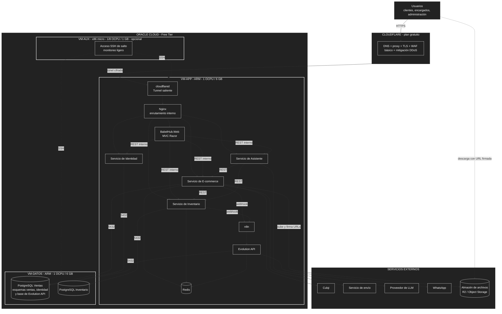

# Despliegue en Oracle Cloud Free Tier

## 1. Recursos disponibles

Las condiciones del Free Tier cambiaron en 2026. Los datos siguientes se contrastaron con fuentes públicas y deben **verificarse en la consola de Oracle al crear la cuenta**.

| Recurso | Disponible gratis | Implicancia para BabelHub |
| :--- | :--- | :--- |
| VMs ARM (Ampere A1) | **2 OCPU y 12 GB de RAM en total**, repartibles en **1 o 2 instancias** (antes 4 OCPU y 24 GB). | Es el único cupo con recursos útiles. La propuesta original decía "hasta 4 VMs ARM"; con el límite actual caben como máximo **2**. |
| VMs x86 (AMD micro) | **2 instancias** de 1/8 OCPU y 1 GB de RAM. | Son muy limitadas: no sirven para .NET ni PostgreSQL, pero sí para tareas livianas. |
| Almacenamiento en bloque | 200 GB en total; el volumen de arranque mínimo es de 47 GB. | Cuatro VMs usarían unos 188 GB solo en arranque; queda poca holgura. |
| Total de VMs | **Máximo 4**: 2 ARM y 2 x86 micro. | Responde a la duda sobre el límite de 4: son 4 en total, de dos tipos distintos. |

Condiciones a tener en cuenta:
- Superar el cupo ARM puede inhabilitar las instancias o generar cargos, según el tipo de cuenta.
- Crear instancias ARM suele fallar por falta de capacidad en regiones populares; hay que reintentar o elegir bien la región de origen al registrarse, porque no se cambia después.
- Conviene revisar la política de Oracle sobre instancias con uso muy bajo sostenido.

## 2. Distribución propuesta de VMs

| VM | Tipo | Contenedores | Justificación |
| :--- | :--- | :--- | :--- |
| **VM-APP** | ARM, 1 OCPU y 6 GB | cloudflared, Nginx, Web, E-commerce, Inventario, Identidad, Asistente, n8n, Evolution API y Redis. | Concentra los componentes sin estado de negocio; puede reconstruirse desde las imágenes. n8n conserva solo su volumen de flujos y la sesión de WhatsApp de Evolution API (se respalda). |
| **VM-DATOS** | ARM, 1 OCPU y 6 GB | PostgreSQL Ventas (esquemas `ventas` e `identidad`, más la base de Evolution API) y PostgreSQL Inventario, más tareas de respaldo. | Es la VM con el estado persistente; se protege y se respalda aparte. |
| **VM-AUX** *(opcional)* | x86 micro, 1/8 OCPU y 1 GB | Acceso SSH de salto y monitoreo ligero de disponibilidad. | Aprovecha una VM gratuita sin consumir cupo ARM. No debe alojar nada crítico: es muy pequeña y puede ser recuperada si está inactiva. |

**Estimación de memoria (a validar con mediciones reales):**

| VM | Consumo estimado | Holgura |
| :--- | :--- | :--- |
| VM-APP (6 GB) | Sistema y Docker ~0,5 GB; cuatro servicios .NET y la web ~1,0–2,0 GB; n8n ~0,3–0,6 GB; Evolution API ~0,3–0,5 GB; Redis limitado a ~0,25 GB; Nginx y cloudflared < 0,2 GB. Total ~2,4–4,0 GB. | Suficiente en RAM, pero ya cerca del 70 % del objetivo de RNF12 en el peor caso; el límite real es la **CPU** (5 aplicaciones .NET y 2 de Node sobre 1 OCPU). Se fijan límites de memoria por contenedor y se mide con k6. |
| VM-DATOS (6 GB) | Sistema ~0,4 GB; dos PostgreSQL con ~1 GB de buffers cada uno y conexiones, ~2,5–3,5 GB. | Buena; la memoria sobrante la usa el sistema como caché de disco. |

**Por qué 1 OCPU y 6 GB en cada una:** el cupo es de 2 OCPU y 12 GB, y la relación de 6 GB por OCPU lo reparte por igual. La alternativa de dar más a la VM-DATOS no ayuda, porque el cuello de botella previsto es la CPU de las aplicaciones.

## 3. ¿Conviene separar la base de datos?

**Veredicto: sí, con las condiciones indicadas.**

| A favor | En contra |
| :--- | :--- |
| **Seguridad:** la VM de datos no tiene puerto abierto a Internet, y si se vulnera una aplicación el atacante no obtiene directamente los archivos de la base. | **Latencia de red:** cada consulta cruza la red interna. Es pequeña dentro de la misma red de Oracle, pero Inventario hace muchas consultas cortas; la caché Redis lo compensa. |
| **Aislamiento de recursos:** el recolector de basura de .NET y PostgreSQL no compiten por memoria, y un fallo por falta de memoria en las aplicaciones no mata la base. | **Más piezas que operar:** dos VMs que actualizar, con reglas de red y claves SSH propias. |
| **Mantenimiento independiente:** se puede reiniciar o actualizar las aplicaciones sin tocar la base. | **Reparto fijo:** con 6 GB cada una, la memoria libre de una VM no se puede prestar a la otra. |
| **Respaldos más limpios:** el volumen de datos se respalda o se restaura sin tocar las aplicaciones. | **Nuevo punto de falla:** si la VM de datos cae, todo el sistema deja de funcionar. |
| **Reglas de firewall distintas** para cada VM. | **Riesgo de capacidad:** pedir dos instancias ARM aumenta la probabilidad de recibir un error de falta de capacidad. |

**Condiciones para que la separación aporte seguridad real:**
- El puerto 5432 solo acepta conexiones desde la VM-APP (regla de red de Oracle y firewall del sistema).
- La VM-DATOS no es accesible por SSH desde Internet, solo desde la VM-AUX o desde la IP del administrador.
- Si la red lo permite sin costo, se la ubica en una subred privada; si no, se deja en la pública pero con las reglas anteriores. **A verificar** en tu cuenta.
- Se cifra la conexión a PostgreSQL con TLS, o se confía en la red privada de Oracle y se documenta.
- Se respaldan las bases (como mínimo con un volcado diario fuera de la VM) y se prueba la restauración.

**Contingencia:** si Oracle solo concede una instancia, se usa **una VM ARM de 2 OCPU y 12 GB** con las bases en contenedores sin puertos publicados, en una red interna de Docker y con volúmenes separados. Se pierde el aislamiento por VM, pero se conserva el aislamiento por red.

## 7. Reglas de red

| Origen | Destino | Puerto | Estado |
| :--- | :--- | :--- | :--- |
| Internet | VM-APP | 80 y 443 | **Cerrados** (el tráfico entra por el túnel saliente) |
| IP del administrador | VM-APP y VM-AUX | 22 (SSH, solo con llave pública) | Permitido |
| VM-APP | VM-DATOS | 5432 (PostgreSQL) | Permitido |
| VM-AUX | VM-APP y VM-DATOS | 22 | Permitido |
| Cualquier otro origen | VM-DATOS | todos | **Denegado** |
| Internet | n8n y Evolution API | todos | **Sin publicar** (solo red interna de Docker; paneles por túnel SSH) |
| Evolution API | WhatsApp | HTTPS saliente | Permitido |
| VM-APP (E-commerce) | Almacén de archivos | HTTPS saliente | Permitido (subir archivos y firmar URLs) |
| Internet | Almacén de archivos | HTTPS | Solo con URL firmada vigente; bucket privado |

Complementos: firewall del sistema operativo con las mismas reglas, secretos como variables de entorno fuera del repositorio y SSH sin contraseña.

## 5. Sistema operativo

Se propone **Ubuntu Server LTS mínimo sin entorno gráfico** en las VMs de Oracle (misma familia, mismo `apt` y mismo Docker) y Debian en local si se desea. El criterio se mantiene: instalación mínima y sin interfaz gráfica para ahorrar memoria.

## 6. Pendientes de verificar

- Cupo ARM, número de instancias y condiciones del Free Tier en tu cuenta.
- Capacidad ARM en la región elegida; las más cercanas a Perú son las de Sudamérica, pero la disponibilidad varía.
- Disponibilidad de subred privada sin costo.
- Costo y registro del dominio para Cloudflare.
- Imágenes multi-arch de todos los contenedores (PostgreSQL, Redis, Nginx, cloudflared y .NET ofrecen ARM64).
- Comportamiento del sistema bajo carga con k6 sobre 1 OCPU por VM, con n8n y Evolution API en marcha.
- Imágenes ARM64 de n8n y de Evolution API, y consumo real de memoria de ambos.
- Términos de uso de WhatsApp frente a Evolution API; usar un número dedicado.
- Culqi: idempotencia, soporte de Yape, reembolsos y llaves de pruebas (sandbox).
- Almacén de archivos: cuotas gratuitas vigentes de Cloudflare R2 y de Oracle Object Storage, costo de operaciones y límite de tamaño por archivo; elegir uno antes de implementar `ecommerce-biblioteca-digital`.
- Contratos con los titulares de derechos: se simulan con datos de ejemplo, al ser un proyecto académico (ver [marco legal](../01-analisis-de-sistema/03-marco-legal.md).

## 7. Fuentes del despliegue

- Oracle Cloud Free Tier: reducción del cupo ARM a 2 OCPU y 12 GB, 2 VMs x86 micro, 200 GB de bloque (InfoQ, 2026; análisis técnicos de la comunidad).
- Cloudflare: plan gratuito y Cloudflare Tunnel (documentación de Cloudflare).
- Canonical y Oracle: imagen de Ubuntu para Ampere A1.
