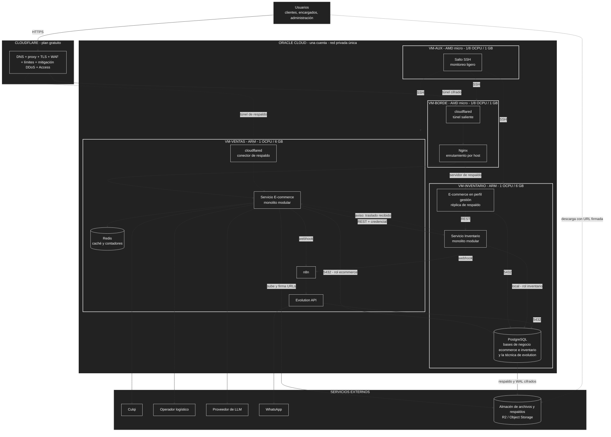

# Despliegue en Oracle Cloud Free Tier

Este documento reparte los servicios en máquinas virtuales (VMs) **usando solo recursos gratuitos de una sola cuenta de Oracle**. La **estructura** del sistema (dos servicios, módulos, bases) está en el [estilo arquitectónico](03-estilo-arquitectonico.md) y no cambia con el reparto: lo que se decide aquí es **en qué host corre cada unidad de despliegue**.

## 1. Recursos disponibles

Las condiciones del Free Tier cambiaron en 2026. Las cifras se contrastaron con fuentes públicas secundarias (no con la documentación oficial de Oracle) y deben **verificarse en la consola al crear la cuenta**.

| Recurso | Disponible gratis | Uso en BabelHub |
| :--- | :--- | :--- |
| VMs ARM (Ampere A1) | **2 OCPU y 12 GB de RAM en total**, repartibles en 1 a 4 instancias (antes 4 OCPU y 24 GB). | **2 VMs de 1 OCPU y 6 GB**: la venta y el inventario con su base. |
| VMs x86 (AMD micro) | **2 instancias** de 1/8 OCPU y 1 GB de RAM. | Borde de red y salto SSH con monitoreo. No sirven para .NET ni PostgreSQL. |
| Almacenamiento en bloque | 200 GB en total; el volumen de arranque mínimo es de 47 GB. | 4 × 47 GB = 188 GB; sin volúmenes extra. Los respaldos van al almacén de objetos. |
| Total de VMs | **4**: 2 ARM y 2 AMD micro. | Las cuatro, en **una sola cuenta**. |

**Cuenta de pago por uso (PAYG).** Actualizarla **no amplía el cupo gratuito**: los recursos Always Free siguen siendo gratis y todo lo que supere el cupo se cobra. Se recomienda actualizar para evitar que Oracle recupere instancias con uso muy bajo (fuentes secundarias; a verificar) y reducir los fallos de capacidad al crear VMs ARM. Se activa con un **presupuesto y una alerta de costo de 1 USD** para detectar a tiempo cualquier recurso fuera del cupo. **Decisión (2026-11-06):** se usa una sola cuenta, sin segunda cuenta ni VMs de pago.

Condiciones a tener en cuenta:
- Superar el cupo ARM inhabilita las instancias o genera cargos, según el tipo de cuenta.
- Crear instancias ARM suele fallar por falta de capacidad en regiones populares; hay que reintentar o elegir bien la región al registrarse, porque no se cambia después.
- La CPU de una AMD micro es 1/8 de OCPU: solo corre componentes livianos.

## 2. Unidad de despliegue y host

Un **servicio** es una unidad de despliegue independiente: tiene su propio código, imagen, versión, configuración y base de datos. Una **VM** es el host donde se ejecutan esas unidades. El estilo basado en servicios exige lo primero; no exige una VM por servicio. Lo segundo es una decisión de capacidad y de riesgo, con estos criterios:

| Criterio | Regla |
| :--- | :--- |
| Lo expuesto es liviano y va aparte | cloudflared y Nginx solo reenvían tráfico y caben en una AMD micro. |
| La venta y el inventario no comparten CPU | Cada servicio corre en su propia VM ARM de 1 OCPU. |
| El estado va junto al sistema más crítico | La base de datos vive en la VM del Inventario y no tiene acceso desde Internet. |
| Lo periférico tolera fallos | Las notificaciones (n8n y Evolution API) van con la venta: su caída no bloquea la compra (AD16). |
| Mínimo privilegio por VM | Cada VM recibe solo los secretos de sus contenedores. |
| Mover un servicio es configuración | Cambiar un servicio de VM solo cambia su Compose y las direcciones, no el código. |

## 3. Despliegue

| VM | Tipo | Contenedores | Justificación |
| :--- | :--- | :--- | :--- |
| **VM-BORDE** | AMD micro (1/8 OCPU, 1 GB) | cloudflared y Nginx. | Entrada pública. Solo reenvían tráfico (menos de 150 MB). Si no rinde en k6, pasan a VM-VENTAS sin tocar nada más. |
| **VM-VENTAS** | ARM, 1 OCPU y 6 GB | Servicio E-commerce (con todos sus módulos y la interfaz web), Redis, n8n, Evolution API y un segundo conector de cloudflared. | La venta y lo periférico. Las notificaciones no bloquean la compra aunque se degraden. Redis vive aquí para que la caché de disponibilidad sobreviva a una caída del Inventario. |
| **VM-INVENTARIO** | ARM, 1 OCPU y 6 GB | Servicio Inventario, **réplica de gestión** del E-commerce, PostgreSQL (dos bases de negocio, `ecommerce` e `inventario`, y la base técnica `evolution`). | El sistema más crítico con su base. La base **no tiene acceso desde Internet**. La réplica de gestión es la misma imagen del E-commerce con el perfil «solo gestión» (Sucursal y Admin). |
| **VM-AUX** | AMD micro | Salto SSH y monitoreo ligero. | Aprovecha una VM gratuita sin consumir cupo ARM. Ver §4. |

**Compromiso aceptado:** la base de datos comparte VM con el Inventario, por lo que deja de ser una VM «solo de datos». Es el precio de usar solo recursos gratuitos. Se compensa con red privada, un rol por esquema, seguridad por filas, contenedores sin privilegios y respaldo fuera de Oracle (§4 y §5). Si hubiera presupuesto, mover PostgreSQL a una tercera VM ARM (≈ 7 USD al mes, a verificar) es un cambio de Compose, no de código.

### Estimación de memoria (a validar con mediciones reales)

El detalle por contenedor está en el [presupuesto de recursos](07-presupuesto-de-recursos.md). Objetivo de RNF12: menos del 70 % por VM (unos 4,2 GB en las ARM y 0,7 GB en las micro).

| VM | Consumo estimado | Holgura |
| :--- | :--- | :--- |
| VM-BORDE | Sistema y Docker ~0,4 GB; Nginx y cloudflared < 0,1 GB. Total ~0,5 GB. | Justa pero suficiente; solo hay un proceso de enrutamiento. |
| VM-VENTAS | Sistema ~0,5 GB; E-commerce ~0,25–0,45 GB; n8n ~0,3–0,5 GB; Evolution API ~0,3–0,5 GB; Redis ~0,1–0,25 GB; cloudflared < 0,05 GB. Total ~1,5–2,3 GB. | Buena. La CPU (un .NET y dos de Node sobre 1 OCPU) es el límite real. |
| VM-INVENTARIO | Sistema ~0,5 GB; Inventario ~0,15–0,25 GB; réplica de gestión ~0,2–0,35 GB; PostgreSQL ~1,2–1,8 GB. Total ~2,1–2,9 GB. | Buena; la memoria sobrante la usa el sistema como caché de disco. |
| VM-AUX | Sistema ~0,3 GB y monitoreo. | Amplia. |

## 4. Red y seguridad de las VMs

Todas las VMs comparten la **red privada de la misma cuenta**; no hay tráfico entre servicios por Internet ni hace falta una malla adicional.

| Tema | Regla |
| :--- | :--- |
| Entrada | Solo Cloudflare Tunnel llega a la aplicación; los puertos 80 y 443 de Oracle están **cerrados**. El Inventario no tiene entrada pública: solo acepta llamadas de la VM-VENTAS y de la réplica de gestión. |
| Escucha | Cada servicio publica su puerto **solo en la dirección privada de su VM**, nunca en `0.0.0.0`. |
| Direcciones | Las direcciones de los servicios y de la base son variables de entorno por VM (por ejemplo `BABELHUB__INVENTARIO__URL`); no hay nombres de Docker entre VMs. |
| Autenticación | Las llamadas entre el E-commerce y el Inventario llevan **credencial de servicio** (SEG-15): estar en la red no basta para ser atendido (AM24). |
| Base de datos | `pg_hba` por base y por dirección de origen, con `hostssl` (TLS); un rol por esquema sin permiso sobre los demás; PostgreSQL en su propia red de Docker. Ver §5. |
| Redis | Contraseña y usuarios con ACL; prefijos por tipo de clave; solo la VM-VENTAS. |
| Reloj | Sincronización de hora (`chrony`) en todas las VMs: las credenciales duran 15 minutos y la validación debe tolerar una desviación pequeña (propuesta: ±60 s). |
| Arranque | No hay orden de arranque entre VMs: cada servicio reintenta la conexión a su base y a sus dependencias con esperas crecientes y expone un `healthcheck` que Docker y el monitoreo consultan. |
| Acceso administrativo | SSH solo con llave pública, desde la IP del administrador o desde **VM-AUX**, el único punto de salto. Ninguna VM acepta SSH desde Internet. |
| Contenedores | Sin privilegios, con sistema de archivos de solo lectura cuando se pueda, sin el socket de Docker y con límites de memoria y CPU. |
| Host | Actualizaciones automáticas de seguridad, paquetes mínimos, discos y respaldos cifrados, y alertas de ingreso por SSH, procesos o puertos nuevos. |
| Monitoreo | VM-AUX comprueba cada pocos minutos, **desde fuera de las VMs de aplicaciones**, que la puerta pública y la salud de cada servicio respondan, y avisa por correo. No reemplaza las alertas de seguridad (RNF20), que salen de los registros de cada servicio. |

**Límites y protección de entrada (AD24).** Cuatro niveles: Cloudflare (protección DDoS, reglas WAF, *Bot Fight Mode*, Turnstile en inicio de sesión, registro, reclamos, reservas y asistente, y Cloudflare Access con MFA en el host de gestión), Nginx (`limit_req` y `limit_conn` por la IP real del cliente), la Aplicación (presupuestos por actor y por rol, también para el personal) y la base (`CONNECTION LIMIT` por rol y `statement_timeout`). Ver [operación segura](../05-seguridad/07-operacion-segura.md).

## 5. Base de datos

### 5.1 Una instancia con una base por servicio

PostgreSQL corre en VM-INVENTARIO como **una sola instancia** con dos bases de negocio, una por servicio, más la base técnica de Evolution API:

| Base | Dueño | Contenido |
| :--- | :--- | :--- |
| `ecommerce` | Servicio E-commerce | Un **esquema por módulo**: `catalogo`, `carrito`, `pagos`, `pedidos`, `envios`, `devoluciones`, `biblioteca`, `reclamaciones`, `web` (sesiones) y **`identidad`** (aislado por rol). Una sola tabla de auditoría del sistema. |
| `inventario` | Servicio Inventario | Fuentes, stock, reservas, traslados, ajustes, ingresos de mercadería y su auditoría. |
| `evolution` | Evolution API | Datos propios de la herramienta de WhatsApp (n8n guarda los suyos en un volumen). No es de nuestros sistemas. |

**Por qué Identidad es un esquema y no una tercera base.** Con Identidad como módulo del E-commerce, un rol propio por esquema da el mismo aislamiento práctico (el rol de los demás módulos no tiene permiso sobre `identidad`) y permite que cancelar una cuenta y anonimizar sus pedidos ocurran en una sola transacción. Los demás módulos obtienen los datos de una persona por el contrato público del módulo Identidad, nunca por sus tablas.

### 5.2 Comparación de opciones

| Opción | Aislamiento de datos | Memoria | Operación | Veredicto |
| :--- | :--- | :--- | :--- | :--- |
| A. Una base compartida por ambos sistemas | Débil: cualquiera cruza tablas del otro y se salta el contrato REST. | Mínima | Mínima | Descartada. |
| **B. Una instancia, una base por servicio, esquema por módulo y rol por esquema** | **Fuerte entre servicios** (PostgreSQL no permite consultas entre bases) y suficiente entre módulos. | Una sola memoria compartida (~0,75 GB de buffers) | Un servidor, un respaldo por base | **Elegida** (AD03, AD18). |
| C. Una instancia por servicio | Fuerte | Un juego de buffers por instancia | Más servidores que actualizar | Descartada: con 1 OCPU no da aislamiento de CPU y consume más RAM. |

### 5.3 Reglas que sostienen el aislamiento

- Un rol por esquema y por servicio, sin ser superusuario ni dueño de las tablas; `REVOKE CONNECT ... FROM PUBLIC` y sin permiso sobre otras bases. Las aplicaciones usan un rol de lectura y escritura sin permiso de `UPDATE` ni `DELETE` sobre la auditoría.
- **Seguridad por filas (RLS)** en el Inventario: el alcance por sucursal se repite en la base (política por sucursal con `FORCE ROW LEVEL SECURITY`; la aplicación fija la sucursal con `SET LOCAL` en cada transacción). Es una **segunda capa** frente a un error de alcance en la Aplicación; no protege contra el control total del servidor.
- Límite de conexiones por rol y `statement_timeout`, para que un sistema no agote al otro.
- El volcado y la restauración se hacen **por base**; la restauración de `inventario` no toca `ecommerce`.
- Entre `ecommerce` e `inventario` no hay llaves foráneas: solo identificadores (por ejemplo, `edicion_id`) y contratos REST.

**Costo aceptado:** ambas bases comparten CPU, disco y memoria con la aplicación de Inventario. Una consulta pesada de un servicio puede afectar al otro. Se mitiga con los límites anteriores y con la medición de carga (k6).

## 6. Fallos y mitigaciones

Sin redundancia, **cada VM es un punto de falla**. La arquitectura aísla el efecto de cada caída; no evita que ocurra.

| Cae | Efecto | Mitigación y recuperación |
| :--- | :--- | :--- |
| **El contenedor de Inventario** | **No cae todo.** El catálogo se sigue mostrando con la última disponibilidad conocida y el checkout informa que no puede validar el stock, sin cobrar a ciegas (CAT-12, CAR-06). | Reinicio automático y `healthcheck`. La caché de disponibilidad vive en Redis de la VM-VENTAS, no en la que cae. |
| **VM-VENTAS** | Sin tienda, catálogo ni compras. El Inventario y su base siguen vivos, y el personal sigue operando gracias a la **réplica de gestión**. Sin avisos de WhatsApp. | Nginx pasa el host de gestión al servidor de respaldo (la réplica en VM-INVENTARIO, misma imagen del E-commerce en perfil «solo gestión»). Las sesiones están en la base, así que el cambio no cierra sesiones. Recrear la VM-VENTAS desde las imágenes (RTO ≤ 4 h); los avisos pendientes se reintentan (NOT-04). |
| **VM-INVENTARIO** | **Cae todo**: ahí están también las bases `ecommerce` e `inventario`, así que no hay inicio de sesión, ni catálogo, ni inventario. Es el costo del compromiso. | Respaldo diario cifrado y archivado continuo de WAL **fuera de Oracle**; restaurar en la misma VM o en otra (RPO de minutos con WAL y ≤ 24 h solo con el volcado; RTO ≤ 4 h). Mejora opcional y gratuita: una **réplica de PostgreSQL en caliente en VM-VENTAS** (~1 GB) con promoción manual, que baja el RTO a minutos. |
| **VM-BORDE** | Sin entrada por Nginx. | El **segundo conector de cloudflared** en VM-VENTAS apunta directo a la aplicación; Cloudflare reparte entre ambos. Recrear la VM. |
| **VM-AUX** | Sin salto SSH ni monitoreo; el sistema sigue funcionando. | Acceder desde la IP del administrador. |
| **La cuenta de Oracle** | Se pierde todo. | Restaurar los respaldos cifrados del almacén de objetos en otra máquina con el mismo Compose (ver [operación segura](../05-seguridad/07-operacion-segura.md) §5). |

**Compromiso de la VM-INVENTARIO.** Concentra la base, el Inventario y la réplica de gestión. Si alguien toma el control de ese servidor, la base queda comprometida y la seguridad por filas no ayuda. Por eso la defensa es en profundidad (AD31): contenedores sin privilegios y en redes separadas, `pg_hba` por base y origen, SSH solo por la VM-AUX, discos y respaldos cifrados, detección de cambios y, sobre todo, **recuperación**: respaldo y WAL fuera de Oracle.

### 6.1 Limitaciones declaradas

Lo siguiente se acepta de forma consciente y debe figurar en el informe y en la exposición como limitación, no como omisión:

- **Punto único de falla de datos:** si cae VM-INVENTARIO caen las dos bases y, con ellas, el inicio de sesión, el catálogo y el inventario (AD31); la réplica de gestión solo mantiene al personal si la base sigue viva. No hay redundancia ni SLA (DA03).
- **Entrada con poca CPU:** VM-BORDE tiene 1/8 de OCPU; si no rinde, cloudflared y Nginx pasan a VM-VENTAS (B11).
- **Memoria casi al límite en VM-INVENTARIO** (ver el [presupuesto de recursos](07-presupuesto-de-recursos.md)).
- **Aspectos legales sin consulta experta** (B09): el marco legal usa valores propuestos; imprescindible revisarlo antes de operar con clientes reales.
- **Cifras del Free Tier de fuentes secundarias:** se confirman en la consola al crear la cuenta (sección 9) y se anota la fecha de verificación.

## 7. Reglas de red

| Origen | Destino | Puerto | Estado |
| :--- | :--- | :--- | :--- |
| Internet | Cualquier VM | 80 y 443 | **Cerrados** (el tráfico entra por el túnel saliente) |
| IP del administrador | VM-AUX | 22 (SSH, solo con llave pública) | Permitido |
| VM-AUX | Las demás VMs | 22 | Permitido |
| VM-BORDE | VM-VENTAS | 8080 (E-commerce) | Permitido |
| VM-BORDE | VM-INVENTARIO | 8081 (réplica de gestión, solo como respaldo) | Permitido |
| VM-VENTAS, VM-INVENTARIO (réplica) | VM-INVENTARIO | 8082 (API del Inventario) | Permitido |
| VM-INVENTARIO (Inventario) | VM-VENTAS | 8080 (aviso de traslado recibido) | Permitido |
| VM-INVENTARIO | VM-VENTAS | 5678 (webhook de n8n) | Permitido |
| VM-VENTAS | VM-INVENTARIO | 5432 (PostgreSQL, rol ecommerce) | Permitido |
| Cualquier otro origen | VM-INVENTARIO | todos | **Denegado** |
| VM-INVENTARIO (réplica de gestión) | VM-VENTAS | 6379 (Redis, con contraseña; si no responde, límite local) | Permitido |
| Internet | n8n y Evolution API | todos | **Sin publicar** (paneles por túnel SSH) |
| Evolution API | WhatsApp | HTTPS saliente | Permitido |
| VM-VENTAS | Almacén de archivos | HTTPS saliente | Permitido (subir archivos y firmar URLs) |
| VM-INVENTARIO | Almacén de archivos | HTTPS saliente | Permitido (respaldos y WAL cifrados) |
| Internet | Almacén de archivos | HTTPS | Solo con URL firmada vigente; bucket privado |

Complementos: firewall del sistema operativo con las mismas reglas, secretos como variables de entorno fuera del repositorio y SSH sin contraseña.

## 8. Sistema operativo

**Decisión (2026-10-16):** **Ubuntu Server LTS mínimo sin entorno gráfico** en las VMs ARM y AMD de Oracle, por ser la imagen oficial para Ampere A1 (misma familia, mismo `apt` y mismo Docker que Debian); en local se puede usar Debian. El criterio se mantiene: instalación mínima y sin interfaz gráfica para ahorrar memoria.

## 9. Pendientes de verificar

- Cupo ARM, número de instancias y condiciones del Free Tier en la cuenta, y si la actualización a PAYG evita la recuperación por inactividad.
- Capacidad ARM en la región elegida; las más cercanas a Perú son las de Sudamérica, pero la disponibilidad varía.
- **Rendimiento de la VM-BORDE (1/8 de OCPU)** con k6; si no rinde, cloudflared y Nginx pasan a VM-VENTAS.
- **Latencia entre VMs** y CPU de cada VM de 1 OCPU con k6, incluida la réplica de gestión y PostgreSQL en la VM-INVENTARIO.
- Disponibilidad de subred privada sin costo.
- Registro de imágenes para recrear VMs sin depender de una cuenta de Oracle (por ejemplo, el registro de contenedores del repositorio).
- Costo y registro del dominio para Cloudflare, con el subdominio de gestión y sus reglas de Access (B04). Mientras no haya dominio se usan nombres de trabajo: la tienda en `<dominio>` y el personal en `gestion.<dominio>`; el Nginx ya enruta por ese prefijo (`gestion.*`).
- **Verificación de cifras (fecha 2026-11-06, solo fuentes secundarias):** cupo de VMs y disco del Free Tier, condiciones de PAYG y de la recuperación por inactividad; cuotas de Cloudflare R2 (10 GB-mes, 1 millón de operaciones de escritura y 10 millones de lectura al mes) y de Oracle Object Storage (unos 20 GB; cifras antiguas de 10 GB). Confirmar todas en la consola y en las páginas oficiales al crear las cuentas y anotar la fecha.
- Imágenes multi-arch de todos los contenedores (PostgreSQL, Redis, Nginx, cloudflared y .NET ofrecen ARM64 y x86_64).
- Imágenes ARM64 de n8n y de Evolution API, y consumo real de memoria de ambos.
- Términos de uso de WhatsApp frente a Evolution API; usar un número dedicado.
- Culqi: idempotencia, soporte de Yape, reembolsos y llaves de pruebas (sandbox). **La pasarela de pago queda definida: Culqi (AD17).**
- Almacén de archivos: cuotas gratuitas vigentes de Cloudflare R2 y de Oracle Object Storage, costo de operaciones y límite de tamaño por archivo; elegir uno antes de implementar `ecommerce-biblioteca-digital`.
- Archivado de WAL y réplica opcional de PostgreSQL: herramienta (por ejemplo, pgBackRest o WAL-G) y costo de operación.
- Contratos con los titulares de derechos: se simulan con datos de ejemplo y los libros se suben directamente (alcance académico; ver [marco legal](../01-analisis-de-sistema/03-marco-legal.md)).

## 10. Fuentes del despliegue

- Oracle Cloud Free Tier: reducción del cupo ARM a 2 OCPU y 12 GB, 2 VMs x86 micro, 200 GB de bloque (InfoQ, 2026; análisis técnicos de la comunidad).
- Cloudflare: plan gratuito, Cloudflare Tunnel, Access y Turnstile (documentación de Cloudflare).
- Canonical y Oracle: imagen de Ubuntu para Ampere A1.
- M. Richards y N. Ford, *Fundamentals of Software Architecture*: estilo basado en servicios (despliegue y datos).
