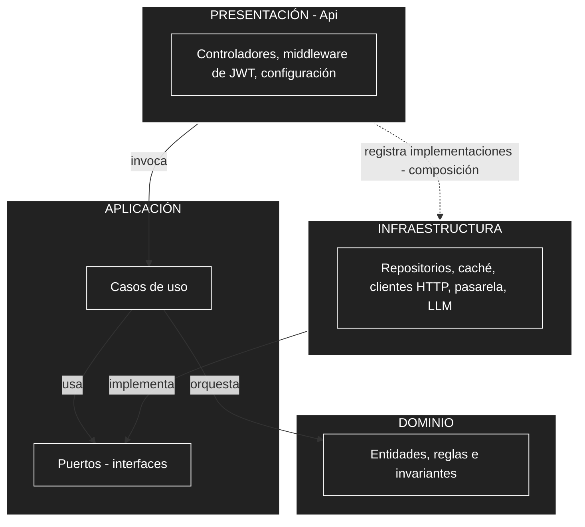
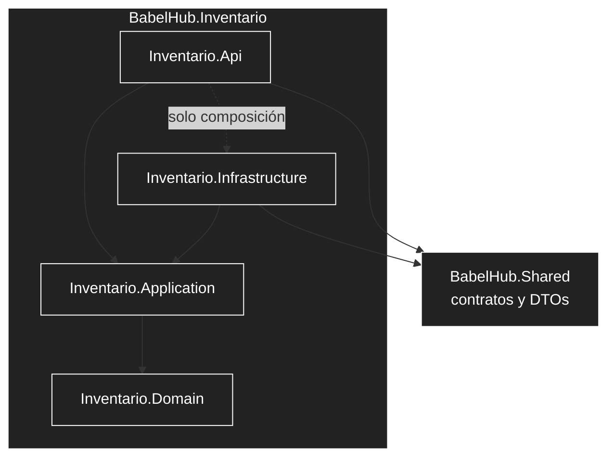
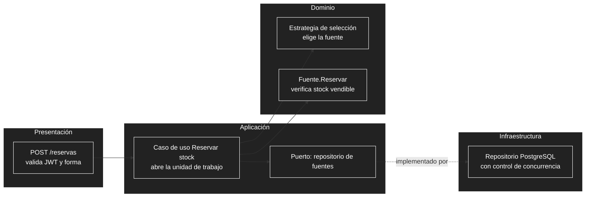

# Enfoque arquitectónico: Clean Architecture

Este documento desarrolla el enfoque que resume la [organización interna](02-organizacion-interna.md) (y, a nivel de estilo, el [estilo arquitectónico](../02-arquitectura-de-software/03-estilo-arquitectonico.md)): cómo se organizan las responsabilidades y las dependencias **dentro de cada servicio**. El estilo global (servicios de granularidad gruesa) decide *qué piezas hay*; Clean Architecture decide *cómo se ordena el código de cada pieza*. Se baja hasta la estructura de carpetas del repositorio y el flujo de trabajo con especificaciones (*Spec-Driven Development*).

## 1. Resumen del enfoque

| Elemento | Descripción aplicada a BabelHub |
| :--- | :--- |
| **Enfoque** | Clean Architecture (Arquitectura Limpia). |
| **Objetivo** | Separar responsabilidades y controlar las dependencias hacia el dominio. |
| **Problema que resuelve** | Evita acoplar las reglas del negocio (stock vendible, reservas, traslados) a la API web, a PostgreSQL, a Redis, a la pasarela de pago, al servicio de envío o al LLM. |
| **Capas** | Dominio, Aplicación, Infraestructura y Presentación (API). |
| **Beneficios** | Pruebas unitarias sin base de datos; cambio de proveedores sin tocar las reglas; código ordenado y fácil de delegar a un agente de desarrollo. |
| **Drivers** | DA01 (sobreventa), DA05 (acceso por sucursal), DA06 (integraciones externas), DA08 (cambios aislados). Decisión AD09. |

**Por qué este enfoque y no otro.** El valor del sistema está en pocas reglas críticas (el stock vendible nunca es negativo, la selección de la fuente, el ciclo de vida del traslado). Si esas reglas dependieran de la base de datos o de la API, serían difíciles de probar y de cambiar. Con la regla de dependencia, el dominio queda aislado, y los cambios más probables (otra pasarela, otra estrategia de selección, otro proveedor de LLM) se resuelven en una sola capa. El costo es más proyectos e interfaces; se compensa aplicando la versión completa solo donde hay lógica de negocio real (sección 6).

## 2. Regla de dependencia



**Regla:** el código solo puede depender de capas más internas. El Dominio no depende de nadie; la Aplicación solo del Dominio; Infraestructura y Presentación dependen de la Aplicación. Cuando un caso de uso necesita algo del exterior, define una interfaz (puerto) y la Infraestructura la implementa. La Presentación es además la **raíz de composición**: es el único lugar que conoce las implementaciones concretas y las conecta (inyección de dependencias).

### Matriz de dependencias permitidas

| Capa ↓ puede usar → | Dominio | Aplicación | Infraestructura | Presentación | Shared (contratos) |
| :--- | :---: | :---: | :---: | :---: | :---: |
| **Dominio** | — | No | No | No | **No** |
| **Aplicación** | Sí | — | No | No | **No** |
| **Infraestructura** | Sí | Sí | — | No | Sí |
| **Presentación (Api)** | Sí | Sí | Solo para registrar (composición) | — | Sí |

## 3. Las cuatro capas

### 3.1 Dominio

**Qué es:** el modelo del negocio expresado en código, sin ninguna dependencia técnica (ni EF, ni HTTP, ni JSON, ni Redis).

| Contiene | No contiene |
| :--- | :--- |
| Entidades y objetos de valor (por ejemplo, ISBN, Cantidad). | Acceso a datos, consultas SQL, caché. |
| Reglas e invariantes que siempre deben cumplirse. | Llamadas HTTP o a servicios externos. |
| Servicios de dominio y estrategias (por ejemplo, la selección de fuente). | Atributos de serialización o de controladores. |
| Estados y transiciones válidas (pedido, traslado, reserva). | Conocimiento del usuario autenticado. |

**Reglas clave por servicio** (cada una será una especificación EARS en `specs/`):

| Servicio | Reglas del dominio |
| :--- | :--- |
| **Inventario** | *Stock vendible = stock físico − reservas activas*, y nunca negativo (RF13, RNF01). Una reserva pasa por *pendiente → confirmada* o *pendiente → liberada/expirada*. Un traslado pasa por *solicitado → aprobado → en tránsito → recibido* (o *rechazado*), y solo puede despacharse si el origen tiene stock vendible. Todo ajuste exige motivo y usuario. La merma y el daño solo descuentan, nunca más que el stock vendible; la corrección de conteo se expresa como conteo físico real y no puede quedar por debajo de las unidades reservadas. Ningún ajuste suma por merma o daño: el ingreso de mercadería llega por traslado o devolución. |
| **E-commerce** | Un pedido agrupa líneas. Se confirma con pago aprobado y, para las líneas impresas, reserva confirmada; las líneas digitales pasan a *acceso concedido* al aprobarse el pago. El ISBN es único **por edición** (impresa o digital). Estados válidos del pedido y sus transiciones (RF06). Un pago se asocia a una clave de idempotencia (RF05). Un libro digital nunca genera reserva, selección de fuente ni traslado. Un libro digital no se vende con licencia vencida ni fuera de los territorios autorizados (RF24). El acceso digital es personal, intransferible y tiene un tope de descargas (RF23). |
| **Identidad** | Un encargado de sucursal siempre tiene exactamente una sucursal asignada; el administrador central, ninguna restricción. Un cliente solo recibe avisos por WhatsApp si registró su número y dio su consentimiento. |
| **Asistente** | La respuesta debe basarse en datos recibidos de las API; si no hay datos, el resultado debe indicar que no puede responder (RF08). |

**Selección de fuente como estrategia.** El criterio (cercanía y disponibilidad) se modela como una interfaz del dominio con una implementación por defecto; cambiarlo a, por ejemplo, "menor costo de traslado" implica agregar una implementación, sin tocar controladores, base de datos ni el E-commerce (AC06, RNF09).

### 3.2 Aplicación

**Qué es:** los casos de uso del sistema; coordina el dominio y los puertos, sin saber cómo se guardan los datos ni cómo llegan las solicitudes.

| Contiene | No contiene |
| :--- | :--- |
| Un caso de uso por acción del usuario (por ejemplo, *Reservar stock*, *Aprobar traslado*, *Confirmar pago*). | Reglas del negocio que pertenezcan al dominio. |
| Puertos (interfaces) hacia el exterior: repositorios, notificador, pasarela, LLM, caché, reloj. | Código de EF Core, HttpClient, Redis o SDKs de terceros. |
| Transacciones y orden de los pasos (qué se hace primero y qué si falla). | Tipos de ASP.NET (controladores, `HttpContext`). |
| Políticas de autorización por alcance de sucursal (ver sección 8). | DTOs compartidos entre servicios. |

**Puertos previstos:**

| Puerto | Servicio | Implementación (Infraestructura) |
| :--- | :--- | :--- |
| Repositorio de fuentes, reservas, traslados y ajustes | Inventario | PostgreSQL (BD Inventario) |
| Repositorio de libros, carritos, pedidos y pagos | E-commerce | PostgreSQL (BD Ventas) |
| Cliente de inventario | E-commerce y Asistente | Llamadas REST al servicio de Inventario |
| Cliente de catálogo y pedidos | Asistente | Llamadas REST al servicio de E-commerce |
| Pasarela de pago | E-commerce | Culqi (Yape y tarjetas) |
| Servicio de envío | E-commerce | Operador logístico |
| Notificador | E-commerce e Inventario | Webhook de n8n, que envía por Evolution API (WhatsApp); si falla, deja el aviso pendiente y no interrumpe el caso de uso |
| Registro de auditoría | E-commerce e Inventario | Tabla de auditoría de solo inserción en la base de cada servicio |
| Proveedor de LLM | Asistente | API del modelo de lenguaje |
| Caché | E-commerce e Inventario | Redis |
| Almacén de archivos (subir y firmar URLs de descarga) | E-commerce | Almacén S3-compatible (Cloudflare R2 u Oracle Object Storage); en desarrollo, un emulador compatible con S3 o una carpeta local |
| Usuario actual | Todos | Lectura de los claims del JWT |
| Unidad de trabajo | E-commerce e Inventario | Transacción de PostgreSQL |

### 3.3 Infraestructura

**Qué es:** el código que habla con el mundo exterior; implementa los puertos de la Aplicación.

| Contiene | Ejemplos |
| :--- | :--- |
| Persistencia | Contexto de EF Core, repositorios, migraciones, control de concurrencia. |
| Caché | Implementación sobre Redis, con expiración corta (disponibilidad) y mayor (catálogo). |
| Clientes externos | Cliente HTTP hacia Inventario o E-commerce, pasarela de pago, servicio de envío, proveedor de LLM. |
| Mapeos | Traducción entre contratos externos (`BabelHub.Shared`, respuestas de terceros) y los modelos internos. |

Esta capa es la **frontera anticorrupción**: si la pasarela cambia su formato, solo cambia aquí.

### 3.4 Presentación (Api)

**Qué es:** la entrada HTTP del servicio y su composición.

| Responsabilidad | Detalle |
| :--- | :--- |
| Exponer la API REST | Controladores finos: reciben la solicitud, la validan en forma y llaman a un caso de uso. |
| Autenticación | Valida el JWT emitido por el servicio de Identidad y comprueba el rol (RNF05). |
| Traducir errores | Convierte excepciones o resultados de la Aplicación en códigos HTTP (400, 403, 404, 409). |
| Composición | Registra las implementaciones de Infraestructura (inyección de dependencias), configura la caché y lee los secretos de las variables de entorno. |
| Empaquetado | Contiene el `Dockerfile` del servicio, con imagen multi-arch. |

Los controladores **no contienen reglas de negocio**. Si un `if` decide algo del negocio, pertenece al Dominio o a un caso de uso.

## 4. Mapa a la estructura del repositorio

La estructura propuesta tiene un proyecto por servicio en `src/`. Se recomienda que cada servicio con lógica de negocio se subdivida así:

```
src/
├── BabelHub.Inventario/                        servicio completo
│   ├── BabelHub.Inventario.Domain/
│   │   ├── Fuentes/                            Fuente, ItemDeFuente
│   │   ├── Reservas/                           Reserva, estados
│   │   ├── Traslados/                          Traslado, ciclo de vida
│   │   ├── Ajustes/                            Ajuste de inventario
│   │   └── Seleccion/                          estrategia de selección de fuente
│   ├── BabelHub.Inventario.Application/
│   │   ├── Fuentes/                            casos de uso de fuentes y disponibilidad
│   │   ├── SeleccionFuente/                    casos de uso de reserva y selección
│   │   ├── Traslados/                          casos de uso de traslados
│   │   └── Abstracciones/                      puertos
│   ├── BabelHub.Inventario.Infrastructure/
│   │   ├── Persistencia/                       DbContext, repositorios, migraciones
│   │   ├── Cache/                              Redis
│   │   └── Notificaciones/
│   └── BabelHub.Inventario.Api/
│       ├── Controllers/
│       ├── Program.cs
│       └── Dockerfile
│
├── BabelHub.Ecommerce/                         servicio completo (misma forma)
│   ├── BabelHub.Ecommerce.Domain/              Catalogo, Carrito, Pedidos, Pagos,
│   │                                           Envios, Devoluciones, Biblioteca
│   │                                           (accesos digitales), Reclamaciones
│   ├── BabelHub.Ecommerce.Application/         casos de uso y puertos
│   ├── BabelHub.Ecommerce.Infrastructure/      PostgreSQL, cliente de Inventario,
│   │                                           Culqi, envío, notificaciones, Redis,
│   │                                           almacén de archivos
│   └── BabelHub.Ecommerce.Api/
│
├── BabelHub.Identidad/                         versión reducida (ver sección 6); esquema propio `identidad`
├── BabelHub.AsistenteCompra/                   versión reducida (ver sección 6)
├── BabelHub.Web/                               interfaz MVC Razor (ver sección 4.3)
│   ├── Areas/{Tienda, Sucursal, Admin}/        Controllers, Views y ViewModels por rol
│   ├── Clients/                                HttpClient tipados hacia cada servicio
│   ├── Infrastructure/                         sesión por cookie, manejo del JWT, errores
│   ├── wwwroot/
│   └── Dockerfile
└── BabelHub.Shared/                            solo contratos entre servicios
```

Las subcarpetas de `Application` coinciden con las carpetas de `specs/` (`inventario-fuentes`, `inventario-seleccion-fuente`, `inventario-traslados`, `ecommerce-carrito-checkout`, etc.), de modo que **cada especificación se implementa en un lugar predecible**.

La solución es un único `BabelHub.sln` en la raíz del repositorio, con una carpeta de solución por servicio y una para `tests`. No se usa el formato `.slnx`, para que Visual Studio, Rider y la CLI en Linux lo abran sin diferencias.

### 4.1 Referencias entre proyectos



Cada flecha es una referencia de proyecto. Al separar las capas en proyectos distintos, **el compilador impide** que, por ejemplo, el Dominio use Entity Framework.

### 4.2 Reglas para `BabelHub.Shared`

| Regla | Justificación |
| :--- | :--- |
| Contiene **solo contratos**: DTOs de las API entre servicios, constantes de roles y claims. | Es el acuerdo REST entre servicios (RC03). |
| **No** contiene entidades, reglas ni lógica. | Si el dominio se comparte, los servicios dejan de ser independientes (AD01). |
| **No** la referencian el Dominio ni la Aplicación. | Un cambio en un contrato HTTP no debe llegar al núcleo del negocio. |
| Los adaptadores de Infraestructura traducen entre el contrato y el modelo interno. | Duplica algún tipo pequeño, pero a cambio protege el núcleo (anticorrupción). |
| Ningún servicio referencia el Dominio, la Aplicación ni la Infraestructura de otro. | Los servicios se comunican solo por REST. |

### 4.3 `BabelHub.Web`: la interfaz

`BabelHub.Web` es una aplicación ASP.NET Core MVC con Razor. Lo que en un proyecto de cuatro capas tradicional sería la capa "Web" se reparte aquí en dos piezas: la **Api** de cada servicio (entrada HTTP/JSON del servicio) y **`BabelHub.Web`** (interfaz de usuario). No es una capa de Clean Architecture: es un cliente de los servicios, como lo sería una app móvil.

| Aspecto | Regla |
| :--- | :--- |
| Organización | Un solo proyecto con áreas por rol: `Tienda` (cliente), `Sucursal` (encargado y logística) y `Admin` (administración central). `Tienda` incluye catálogo, carrito, checkout, biblioteca digital y Libro de Reclamaciones. Sin Dominio ni Aplicación propios. |
| Referencias | Solo a `BabelHub.Shared`. Nunca al Dominio, Aplicación o Infraestructura de un servicio. |
| Comunicación | `HttpClient` tipados en `Clients/`, llamados **desde el servidor** por la red interna; el navegador nunca llama a los servicios. |
| Autenticación | Inicia sesión contra Identidad, guarda el JWT en el servidor y entrega una cookie de sesión (`HttpOnly`, `Secure`, `SameSite`) más protección anti-falsificación en los formularios. Las llaves de protección de datos van en un volumen. |
| Reglas de negocio | Ninguna. Valida la forma de la entrada para mejorar la experiencia, pero la autoridad es siempre el servicio. |
| Pagos | El script de Culqi tokeniza la tarjeta o Yape en el navegador; la Web envía solo el token al servicio E-commerce, que realiza el cobro. |
| Descargas digitales | La Web nunca recibe ni reenvía el archivo: pide una URL firmada al E-commerce y redirige al navegador al almacén. Las descargas fallidas se muestran con un mensaje claro (límite alcanzado, enlace vencido, licencia retirada). |
| Errores | Traduce los códigos de los servicios (400, 403, 404, 409, 503) a pantallas con estados claros: vacío, cargando, error y con datos (RNF13). |
| Pruebas | Pruebas E2E con Playwright y pruebas de los clientes HTTP; no se prueban las vistas de forma unitaria. |

### 4.4 Resto de carpetas

| Carpeta | Rol respecto a Clean Architecture |
| :--- | :--- |
| `specs/` | Cada `spec.md` describe comportamiento (EARS) sin tecnología; `plan.md` asigna cada pieza a una capa; `tasks.md` ordena el trabajo por capa. |
| `tests/unit` | Pruebas de Dominio y Aplicación, sin base de datos ni red. |
| `tests/integration` | Pruebas de Infraestructura (PostgreSQL con Testcontainers) y del contrato REST E-commerce ↔ Inventario. |
| `tests/e2e` | Playwright sobre la Presentación y el flujo completo. |
| `tests/load` | k6 sobre la disponibilidad y el checkout (RNF02). |
| `infra/` | Composición del despliegue: `docker-compose.local.yml`, `docker-compose.oracle.yml`, `nginx/` y `n8n/` (flujos exportados). Incluye n8n y Evolution API. Es la raíz de composición a nivel de sistema. |
| `docs/` | Carpetas `01-analisis-de-sistema` a `07-proceso-de-desarrollo` como documentación del sistema, y `glossary.md` (términos: fuente, stock vendible, reserva, traslado). El glosario fija el lenguaje que usa el Dominio. No se crea `architecture.md`: el `README.md` y el [estilo arquitectónico](../02-arquitectura-de-software/03-estilo-arquitectonico.md) ya cumplen esa función. |
| `AGENTS.md` | Contiene la regla de dependencia como norma no negociable (sección 9). |

## 5. Ejemplo recorrido: reservar stock

Caso de uso del servicio de Inventario invocado por el E-commerce antes del cobro (RF14, AD08). Los nombres son ilustrativos.



| Paso | Capa | Qué ocurre |
| :--- | :--- | :--- |
| 1 | Presentación | Recibe la solicitud, valida el token y la forma del cuerpo y llama al caso de uso. |
| 2 | Aplicación | Obtiene el usuario actual, carga las fuentes candidatas mediante el puerto y abre una transacción. |
| 3 | Dominio | La estrategia elige la fuente; la entidad aplica la regla "no reservar más que el stock vendible". Si no alcanza, rechaza. |
| 4 | Infraestructura | Guarda la reserva de forma atómica. Si dos solicitudes compiten por la última unidad, el control de concurrencia hace fallar a una. |
| 5 | Aplicación | Si falló por concurrencia, reintenta con otra fuente o devuelve "sin stock"; si tuvo éxito, confirma la transacción. |
| 6 | Presentación | Traduce el resultado a 201, 409 (sin stock) o 403 (fuera de alcance). |

**La regla del dominio no basta ante la concurrencia.** La entidad garantiza el invariante dentro de una operación, pero dos solicitudes simultáneas pueden leer el mismo stock. Por eso la Infraestructura debe garantizar la atomicidad (bloqueo de la fila o control de concurrencia optimista) y la Aplicación decide qué hacer cuando falla. Esta separación es la respuesta técnica a AC01 y debe probarse en `tests/integration` con solicitudes simultáneas.

## 6. Alcance por servicio

| Servicio | Versión | Organización | Justificación |
| :--- | :--- | :--- | :--- |
| **Inventario** | Completa | 4 proyectos (Domain, Application, Infrastructure, Api). | Concentra las reglas críticas y la concurrencia. |
| **E-commerce** | Completa | 4 proyectos. | Concentra varias integraciones externas (pasarela, envío, Inventario) que conviene aislar. |
| **Identidad** | Reducida | 1 proyecto con carpetas `Domain`, `Application`, `Infrastructure` y `Api`; puertos solo donde haya algo que sustituir. | Poca lógica de negocio; la regla de dependencia se mantiene por convención y revisión. |
| **Asistente de Compra** | Reducida | 1 proyecto con las mismas carpetas; puertos para el LLM y los clientes de catálogo e inventario. | Su valor está en las integraciones; el dominio es mínimo (política de fundamentación). |
| **Web** | Sin capas | 1 proyecto MVC con áreas por rol (sección 4.3). | Es un cliente de presentación; no tiene reglas de negocio que aislar. |

Si un servicio reducido crece en lógica, se promueve a la versión completa sin cambiar su contrato REST.

## 7. Pruebas por capa

| Capa | Qué se prueba | Dónde | Herramienta | Criterio |
| :--- | :--- | :--- | :--- | :--- |
| Dominio | Invariantes y transiciones (stock vendible, estados de traslado, selección de fuente). | `tests/unit` | xUnit | Sin base de datos ni red. |
| Aplicación | Casos de uso con puertos simulados (qué pasa si no hay stock, si el pago falla). | `tests/unit` | xUnit | Sin infraestructura real. |
| Infraestructura | Repositorios, migraciones, concurrencia, clientes HTTP. | `tests/integration` | xUnit + Testcontainers | Con PostgreSQL real. |
| Contrato E-commerce ↔ Inventario | Que ambas partes respetan los DTOs de `Shared`. | `tests/integration` | xUnit | Detecta cambios que rompen la comunicación. |
| Web | Clientes HTTP hacia los servicios y recorridos de usuario por área. | `tests/integration` y `tests/e2e` | xUnit; Playwright | Los recorridos de cada área cumplen los criterios de las specs. |
| Biblioteca digital | Que solo el titular descargue, que un enlace vencido o ajeno se rechace y que el tope de descargas se respete. | `tests/integration` | xUnit + Testcontainers (emulador de almacén S3) | AC09: 0 descargas no autorizadas. |
| Presentación y flujo | Búsqueda → compra con recojo → cambio de estado. | `tests/e2e` | Playwright | Criterios de aceptación de las specs. |
| Rendimiento | Disponibilidad y checkout bajo carga. | `tests/load` | k6 | p95 de RNF02. |

**Verificación automática de la regla de dependencia.** Además de las referencias entre proyectos, se puede agregar una prueba de arquitectura (por ejemplo, con una biblioteca como NetArchTest) que falle si el Dominio referencia a Infraestructura o si un servicio referencia a otro. Es opcional, pero convierte la regla en algo verificable en cada ejecución.

## 8. Seguridad por capas

Este apartado **precisa** lo indicado en [organización interna, sección 3 (responsabilidades por capa)](02-organizacion-interna.md): la Presentación valida el token y el rol; el alcance por sucursal se aplica también en la Aplicación.

| Aspecto | Capa | Cómo |
| :--- | :--- | :--- |
| Validar la firma y vigencia del JWT; exigir autenticación. | Presentación | Middleware de autenticación. |
| Comprobar el rol (por ejemplo, solo logística ve ciertos traslados). | Presentación | Políticas de autorización por rol. |
| Obtener rol y sucursal del usuario. | Aplicación (puerto) / Presentación (implementación) | El puerto *usuario actual* se implementa leyendo los claims del token. |
| **Impedir que un encargado opere otra sucursal.** | **Aplicación** | Cada caso de uso compara la sucursal del usuario con la del recurso. |
| Registrar auditoría de operaciones sensibles. | Aplicación | El caso de uso solicita el registro; la Infraestructura lo guarda sin posibilidad de modificarlo. |
| Secretos (claves de Culqi, LLM, webhook de n8n). | Presentación | Variables de entorno; nunca en el repositorio. |
| Sesión del usuario en la interfaz y token fuera del navegador. | `BabelHub.Web` | Cookie de sesión del servidor; el JWT nunca llega al navegador. |
| Descarga de libros digitales solo para quien los compró. | Aplicación e Infraestructura | El caso de uso compara al usuario con el titular del acceso y revisa el tope de descargas; la Infraestructura firma una URL de 5 minutos como máximo y registra la descarga. |

**Justificación:** si el alcance por sucursal se comprobara solo en los controladores, bastaría con que un controlador nuevo lo olvidara para abrir un acceso indebido (RNF05). Hacerlo en la Aplicación lo vuelve inherente a cada caso de uso y probable con pruebas unitarias.

## 9. Reglas para `AGENTS.md` y el flujo de especificaciones

### 9.1 Reglas no negociables sugeridas

```
## Arquitectura (Clean Architecture)
1. El Dominio no referencia ningún otro proyecto ni paquete de infraestructura.
2. La Aplicación solo referencia al Dominio y define los puertos que necesita.
3. La Infraestructura implementa los puertos; es el único lugar con EF Core, Redis, HttpClient y SDKs de terceros.
4. La Api no contiene reglas de negocio; solo traduce HTTP, autentica y compone dependencias.
5. Un servicio nunca referencia el Dominio, la Aplicación ni la Infraestructura de otro; se comunican por REST.
6. BabelHub.Shared contiene solo contratos (DTOs y constantes); no lo referencian Dominio ni Aplicación.
7. Toda regla de negocio nueva se escribe primero como prueba unitaria en tests/unit.
8. Los secretos se leen de variables de entorno; nunca se escriben en el repositorio.
9. BabelHub.Web solo referencia a BabelHub.Shared; no contiene reglas de negocio y llama a los servicios solo desde el servidor.
10. Una falla del Notificador nunca interrumpe un caso de uso.
11. Los archivos digitales nunca se guardan en el repositorio, en la base de datos ni en las VMs; viven en el almacén de objetos y se entregan solo con URL firmada de corta duración.
12. Un libro digital no consulta al Inventario ni genera reservas.
```

### 9.2 Cómo se refleja en cada feature

| Archivo de la feature | Qué debe indicar respecto a las capas |
| :--- | :--- |
| `spec.md` | El comportamiento en EARS, **sin** nombrar tecnologías. Es la fuente de las reglas del Dominio. |
| `plan.md` | Una sección "Capas afectadas": qué entidades o reglas nuevas (Dominio), casos de uso y puertos (Aplicación), adaptadores (Infraestructura) y endpoints (Api). |
| `tasks.md` | Tareas atómicas ordenadas **de adentro hacia afuera**: Dominio → Aplicación → Infraestructura → Presentación → pruebas de integración y E2E. |
| `decisions.md` | Decisiones locales (por ejemplo, la estrategia de concurrencia elegida), con enlace a AD09. |

### 9.3 Correspondencia entre specs y servicios

| Especificación | Servicio | Capas principales |
| :--- | :--- | :--- |
| `inventario-fuentes` | Inventario | Dominio (fuente, stock vendible), Aplicación (disponibilidad), Infraestructura (BD, caché). |
| `inventario-seleccion-fuente` | Inventario | Dominio (estrategia de selección y reservas), Aplicación (reservar y confirmar). |
| `inventario-ajustes` | Inventario | Dominio (ajuste con motivo y usuario; entrada por devolución), Aplicación (registrar ajuste), Infraestructura (auditoría). |
| `inventario-traslados` | Inventario | Dominio (ciclo de vida del traslado), Aplicación (aprobar, despachar, recibir), Infraestructura (notificaciones). |
| `ecommerce-catalogo` | E-commerce | Dominio (libro, edición impresa o digital, ISBN único por edición, licencia del titular), Aplicación (buscar, publicar, dar de baja, retirar al vencer la licencia), Infraestructura (búsqueda, caché de catálogo y almacén de archivos). |
| `ecommerce-carrito-checkout` | E-commerce | Dominio (carrito, pedido con líneas), Aplicación (checkout; la entrega solo se pide si hay impresos), Infraestructura (cliente de Inventario, solo para impresos). |
| `ecommerce-biblioteca-digital` | E-commerce | Dominio (acceso digital, tope de descargas), Aplicación (conceder acceso, solicitar descarga), Infraestructura (almacén de archivos y URLs firmadas). |
| `ecommerce-pagos` | E-commerce | Aplicación (puerto de pasarela, idempotencia, Yape y tarjetas), Infraestructura (Culqi). |
| `ecommerce-pedidos` | E-commerce | Dominio (estados y transiciones del pedido), Aplicación (consultar y avanzar estados), Infraestructura (notificaciones). |
| `ecommerce-envios` | E-commerce | Aplicación (puerto de envío, guías y seguimiento), Infraestructura (operador logístico). |
| `ecommerce-devoluciones` | E-commerce | Dominio (devolución y su ciclo; política distinta para libros digitales), Aplicación (solicitar, reembolsar, reingresar stock de impresos, revocar acceso digital), Infraestructura (reembolso en Culqi, cliente de Inventario). |
| `ecommerce-libro-reclamaciones` | E-commerce | Dominio (reclamo y su plazo de conservación), Aplicación (registrar, consultar e imprimir copia), Infraestructura (persistencia). El enlace permanente vive en `web-base`. |
| `asistente-compra-ia` | Asistente | Aplicación (consulta fundamentada), Infraestructura (LLM y clientes REST). |
| `identidad-seguridad` | Identidad | Dominio (usuario, rol, sucursal, consentimiento), Infraestructura (emisión de JWT, esquema `identidad`), Api. |
| `transversal-auditoria` | E-commerce e Inventario (Identidad según se requiera) | Contrato único de registro inmutable (quién, qué, cuándo, detalle); lo implementa cada servicio en su propia base. |
| `transversal-notificaciones` | E-commerce e Inventario | Puerto `Notificador`, plantillas de avisos, reintentos y contrato del webhook de n8n; no bloquea la operación. |
| `web-base` | Web | Estructura de áreas, sesión por cookie, manejo de errores, estados de pantalla y enlace permanente al Libro de Reclamaciones. Las pantallas de cada función se describen en el `plan.md` de su feature. |

| `web-indice-infinito` *(opcional)* | Web | Experimento aislado «El índice infinito»: generador determinista propio, sin base de datos y fuera del flujo de compra (ver [El índice infinito](../06-experiencia-de-usuario/03-estados-accesibilidad-y-criterios.md)). Se escribe al final. |

**Total: 18 especificaciones**, una de ellas opcional. Los indicadores y reportes (RF21) quedan diferidos y no tienen carpeta. Las specs transversales no tienen servicio propio porque la arquitectura se limita a cuatro servicios (AD02): definen un contrato que cada servicio implementa.

## 10. Convenciones sugeridas

| Elemento | Convención | Ejemplo |
| :--- | :--- | :--- |
| Proyecto | `BabelHub.<Servicio>.<Capa>` | `BabelHub.Inventario.Domain` |
| Caso de uso | Verbo + sustantivo | `ReservarStock`, `AprobarTraslado` |
| Puerto | Prefijo `I` y nombre del rol | `IRepositorioDeFuentes`, `IPasarelaDePago` |
| Adaptador | Tecnología + puerto | `RepositorioDeFuentesPostgres`, `PasarelaCulqi`, `NotificadorN8n` |
| Lenguaje del dominio | Términos de `docs/glossary.md` | fuente, stock vendible, reserva, traslado |

Son sugerencias propias, no vienen de la propuesta original.

## 11. Ventajas, costos y riesgos

| Ventajas | Costos y riesgos | Mitigación |
| :--- | :--- | :--- |
| Reglas críticas aisladas y fáciles de probar. | Más proyectos, interfaces y código de mapeo para un sistema pequeño. | Versión reducida en Identidad y Asistente; sin patrones adicionales que no se necesiten. |
| Cambio de pasarela, LLM o estrategia sin tocar el núcleo. | Riesgo de interfaces "por costumbre" que solo tienen una implementación. | Crear un puerto solo cuando haya algo externo o una variación real. |
| El compilador hace cumplir la regla de dependencia. | Curva de aprendizaje y disciplina para el equipo. | `AGENTS.md`, prueba de arquitectura opcional y revisión en cada tarea. |
| Encaja con el flujo de especificaciones por capa. | `Shared` puede degradarse en un "cajón de sastre". | Reglas de la sección 4.2 y revisión de lo que entra. |
| Facilita delegar tareas atómicas a un agente. | El Dominio puede quedar anémico si la lógica se filtra a la Aplicación. | Reglas en entidades y servicios de dominio; los casos de uso solo orquestan. |
