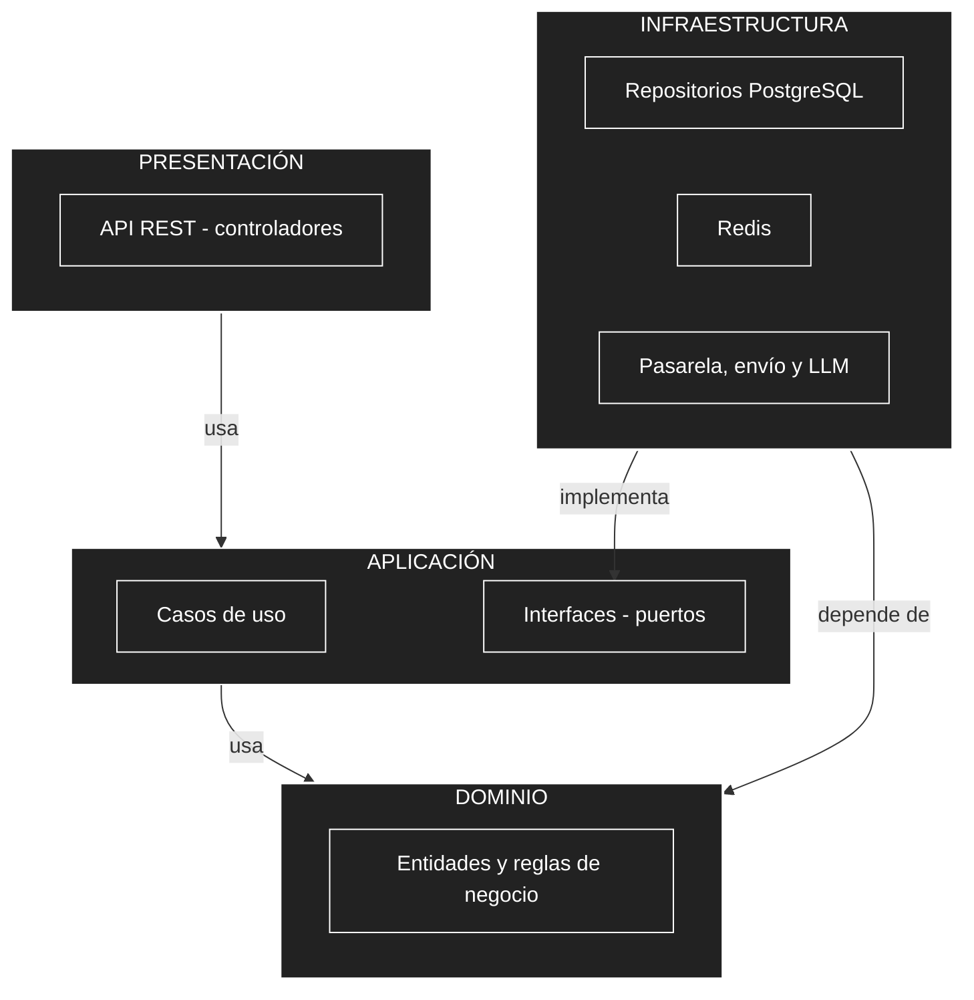

# Organización interna: Clean Architecture por servicio

## 1. Elementos

| Elemento | Descripción aplicada a BabelHub |
| :--- | :--- |
| **Enfoque** | Clean Architecture (Arquitectura Limpia) en cada servicio .NET. |
| **Objetivo** | Separar responsabilidades y controlar las dependencias hacia el dominio. |
| **Problema que resuelve** | Evita que las reglas del negocio queden acopladas a la interfaz web, la base de datos, la pasarela de pago, el servicio de envío o el LLM. |
| **Capas** | Presentación, Aplicación, Dominio e Infraestructura. |
| **Beneficios** | Facilita el mantenimiento y las pruebas unitarias; permite cambiar una tecnología (por ejemplo, de Culqi a otra pasarela) sin modificar las reglas del negocio; ordena el código. |
| **Alcance** | Completo en E-commerce e Inventario, que concentran la lógica. Versión reducida (Presentación y Aplicación con acceso a datos simple) en Identidad y Asistente. `BabelHub.Web` queda fuera de este esquema: es un cliente de presentación sin dominio propio. |

## 2. Dependencias



**Regla de dependencia:** las dependencias apuntan hacia el dominio. El Dominio no conoce a ninguna otra capa; la Aplicación solo conoce el Dominio; la Presentación y la Infraestructura dependen de la Aplicación, nunca al revés. Cuando un caso de uso necesita algo externo (guardar, cobrar, notificar), lo pide mediante una interfaz definida en la Aplicación y la Infraestructura la implementa.

## 3. Responsabilidades por capa

| Capa | Responsabilidad | En Inventario | En E-commerce |
| :--- | :--- | :--- | :--- |
| **Presentación** | Recibir solicitudes REST, validar la entrada, verificar token y rol, y el alcance por sucursal se comprueba también. | Controladores de disponibilidad, reservas, traslados y ajustes. | Controladores de catálogo, carrito, pedidos y pagos. |
| **Aplicación** | Coordinar los casos de uso sin conocer detalles técnicos. | Consultar disponibilidad, reservar, seleccionar fuente, gestionar traslados y ajustes. | Buscar libros, gestionar carrito, realizar pedido, confirmar pago, consultar pedidos. |
| **Dominio** | Entidades y reglas del negocio, sin dependencias técnicas. | Fuente, ítem de fuente, reserva, traslado y ajuste. Regla: *stock vendible = físico − reservas activas*, nunca negativo. | Libro (edición impresa o digital), carrito, pedido con líneas, pago y acceso digital; estados del pedido. |
| **Infraestructura** | Implementar el acceso a tecnologías externas. | Repositorios PostgreSQL, Redis y notificaciones. | Repositorios PostgreSQL, cliente REST de Inventario, pasarela de pago, servicio de envío y almacén de archivos. |

## 4. Interfaces (puertos) previstas

| Interfaz (en Aplicación) | Implementación (en Infraestructura) |
| :--- | :--- |
| Repositorio de inventario / de ventas | Acceso a PostgreSQL |
| Cliente de inventario | Llamadas REST del E-commerce al Inventario |
| Pasarela de pago | Integración con Culqi |
| Servicio de envío | Integración con el operador logístico |
| Notificador | Webhook de n8n, que envía por Evolution API (WhatsApp) |
| Enviador de correo | Proveedor gratuito de correo para los códigos de seguridad (AD30) |
| Proveedor de LLM | API del modelo de lenguaje |
| Caché | Redis |
| Almacén de archivos | Almacén S3-compatible (Cloudflare R2 u Oracle Object Storage) |

Gracias a ellas, cambiar de pasarela o de proveedor de LLM requiere solo una nueva implementación en Infraestructura.

## 5. Organización del código y pruebas

```
Inventario/
├── Inventario.Domain/          entidades y reglas de negocio
├── Inventario.Application/     casos de uso e interfaces
├── Inventario.Infrastructure/  PostgreSQL, Redis e integraciones
└── Inventario.Api/             controladores REST y configuración
```

Los nombres de proyectos son una convención sugerida, no parte de la propuesta original.

| Capa | Tipo de prueba | Herramienta |
| :--- | :--- | :--- |
| Dominio | Unitarias (por ejemplo, el cálculo de stock vendible) | xUnit |
| Aplicación | Unitarias de casos de uso con interfaces simuladas | xUnit |
| Infraestructura | Integración con la base real | xUnit + Testcontainers |
| Presentación | Flujos completos de extremo a extremo; carga | Playwright; k6 |
