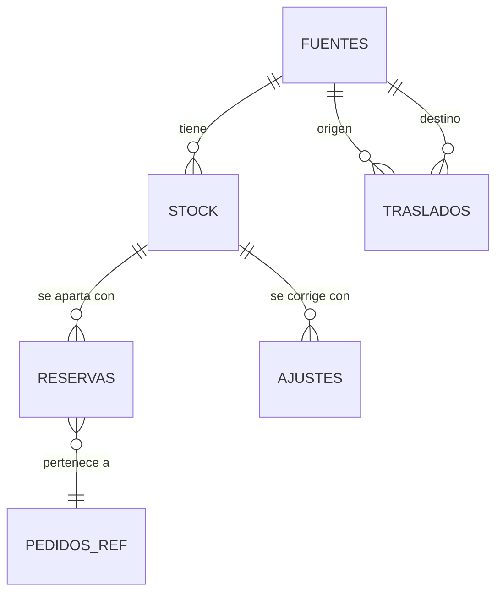

# Modelo de datos lógico

Traduce el [modelo de dominio](../01-analisis-de-sistema/07-modelo-de-dominio.md) a tablas, restricciones e índices. Es un **diseño lógico de referencia**: el plan de cada spec fija los nombres definitivos y las migraciones. Las bases siguen AD03 y AD18: una instancia PostgreSQL con **una base por servicio** (`ecommerce` e `inventario`), un **esquema por módulo** dentro de cada base y un **rol por esquema**. No hay llaves foráneas ni consultas entre las dos bases: solo identificadores y contratos REST.

## 1. Convenciones

| Tema | Regla |
| :--- | :--- |
| Identificadores | Clave sustituta (GUID o secuencia) y, cuando existe, clave natural única (ISBN, número de hoja). |
| Fechas | `timestamptz` en UTC; la interfaz muestra la hora de Lima. |
| Dinero | `numeric(12,2)` en soles; nunca `float`. |
| Nombres | Tablas y columnas en español, minúsculas con guion bajo (`reservas`, `fecha_expiracion`). |
| Borrado | Baja lógica para catálogo y usuarios; auditoría y hojas de reclamación nunca se borran (solo se anonimiza lo que corresponda). |
| Concurrencia | Columna de versión por fila (`version`) en agregados con escritura concurrente (stock). |
| Permisos | Un rol por esquema que solo puede usar su propio esquema (`REVOKE` a los demás); la aplicación se conecta con un rol de acceso que es miembro de los roles de esquema y, dentro de cada transacción, usa `SET LOCAL ROLE` del módulo que escribe, de modo que una operación entre módulos (cancelar una cuenta y anonimizar sus pedidos) es una sola transacción sin ampliar el permiso de ningún módulo (**confirmado al implementar `identidad-seguridad` T30 y T50**: el rol de cada esquema se llama `rol_<esquema>`, sin login y sin ser dueño de las tablas; el rol de acceso de la aplicación es `NOINHERIT` y no hereda nada, de modo que sin `SET LOCAL ROLE` no puede leer ni escribir; cada rol recibe solo los `GRANT` mínimos por tabla y columna tras un `REVOKE ALL`, y la auditoría y los registros de Identidad solo admiten `INSERT` y `SELECT`); el rol de la aplicación no es dueño de las tablas y no puede modificar ni borrar la auditoría; solo un rol de depuración, distinto, con permiso limitado a las columnas de datos personales, anonimiza (AUD-19). En el Inventario, además, seguridad por filas por sucursal (RLS). |
| Datos personales | Marcados en el diccionario; el borrado o la anonimización se prueba (RNF23). |

## 2. Inventario (base `inventario`, un esquema por módulo)

| Tabla | Columnas principales | Restricciones |
| :--- | :--- | :--- |
| `fuentes` | id, nombre, region, direccion, contacto_aviso, activa, es_recepcion | Nombre único; `activa` por defecto verdadero; **una sola fuente con `es_recepcion`** (índice único parcial), por defecto Lima (FUE-19). |
| `stock` | fuente_id, edicion_id, fisico, reservado, version | PK (fuente_id, edicion_id); **CHECK (fisico >= 0 AND reservado >= 0 AND reservado <= fisico)**, que impide el vendible negativo incluso ante concurrencia. |
| `reservas` | id, pedido_id, cliente_id, huella_origen, fuente_id, edicion_id, cantidad, estado, fecha_expiracion, fecha_confirmacion, clave_idempotencia, fecha_creacion | Estado en (pendiente, confirmada, cerrada, liberada, expirada); `cerrada` se usa al entregar, pasar a en reparto o consumirse en el despacho de un traslado (el destino recibe una reserva nueva); `clave_idempotencia` única por cliente; índice parcial sobre estado pendiente por cliente (límite de una pendiente). |
| `traslados` | id, numero (identidad generada, el «TR-0042» de las pantallas), edicion_id, origen_id, destino_id, cantidad, estado, motivo, motivo_de_cierre, pedido_id (anulable), pedido_anulado, fecha_estimada, estimada_por_confirmar, guia, solicitado_por (anulable), fechas por estado (solicitado_en, aprobado_en, despachado_en, recibido_en, cerrado_en), alerta_de_demora_en, version | Origen distinto de destino; cantidad positiva; estado en (solicitado, aprobado, en-transito, recibido, rechazado, cancelado); **un traslado con `pedido_id` nunca está `rechazado`**; la marca `pedido_anulado` y la estimación de llegada solo en un vinculado; textos de hasta 200 caracteres y guía de hasta 40; fechas coherentes con el estado; **único parcial `(pedido_id, edicion_id, origen_id)` entre los no cancelados** (la generación desde un pedido es idempotente); seguridad por filas (el alcance de datos es `red` o la sucursal de origen o de destino); la cuenta de aplicación (`rol_traslados`) no puede borrar un traslado ni cambiar su origen, destino, cantidad, pedido ni estimación (UPDATE por columnas). Esquema `traslados`. |
| `mensajes_salientes` (esquema `traslados`) | id, secuencia (identidad, orden de entrega), tipo (`aviso` o `estado-de-pedido`), clave_de_evento (`traslado:<id>:<estado>`), sucursal_codigo, carga (JSON con solo códigos, identificadores y campos tipados), estado (pendiente, enviado, fallido), intentos, proxima_fecha, arrendado_hasta, motivo_de_fallo (permanente, credencial o vencido), alertado_en, creado_en, enviado_en | Buzón de salida hacia el E-commerce (TRA-10, TRA-11): se inserta en la transacción del cambio de estado con `ON CONFLICT DO NOTHING`; **único `(clave_de_evento, sucursal_codigo, tipo)`**; el estado de un pedido se entrega en orden por traslado; la cuenta de aplicación actualiza solo las columnas de entrega y puede borrar (purga a los 30 días). |
| `rutas` | origen_id, destino_id, plazo_dias, actualizada_en | PK (origen_id, destino_id); origen distinto de destino; **CHECK (plazo_dias > 0)**; direccional. |
| `ajustes` | id, fuente_id, edicion_id, motivo, cantidad_anterior, cantidad_posterior, conteo_real (solo la corrección de conteo), nota, usuario_id (anulable tras la depuración), fecha, devolucion_id y pedido_id (ambos obligatorios con el motivo devolución y solo con él) | Motivo en (`merma`, `danio`, `correccion-de-conteo`, `ingreso-de-mercaderia`, `devolucion`); la diferencia es posterior − anterior (la merma y el daño bajan el físico, el ingreso y la devolución lo suben, la corrección deja el físico en el conteo real, distinto del anterior); cantidades de 0 a 1 000 000; nota de hasta 200 caracteres; **único `(devolucion_id, edicion_id)`** para no reingresar dos veces (AJU-16); seguridad por filas sobre `fuente_id`; solo inserción para la cuenta de aplicación; **única excepción** (AJU-21): a los 2 años, solo el rol de depuración, distinto de la aplicación (función `ajustes.anonimizar_registros()`), pone `usuario_id` a nulo y vacía `nota`, sin tocar movimiento ni cantidades. |
| `ingresos` | id, fuente_id, edicion_id, cantidad, referencia, nota, usuario_id (anulable tras la depuración), fecha, ajuste_id | Solo en la fuente de recepción; **CHECK (cantidad entre 1 y 5000)**; referencia de hasta 60 caracteres (letras, dígitos, espacio, `-`, `/` y `.`); seguridad por filas sobre `fuente_id`; solo inserción para la cuenta de aplicación, con la misma excepción de depuración a los 2 años sobre `usuario_id` y `nota` (AJU-21; la referencia es un código de documento y se conserva); el ajuste con motivo `ingreso-de-mercaderia` se crea en la misma transacción y se enlaza por `ajuste_id` (AJU-13, AJU-19). |
| `operaciones_idempotentes` (esquema `ajustes`) | usuario_id, operacion (`ajuste` o `ingreso`), clave, huella_de_carga, resultado, creada_en | PK (usuario_id, operacion, clave); guarda solo los identificadores del resultado, sin notas ni datos personales; se inserta primero, en la misma transacción del efecto; se purga a los 30 días con una función propia (`ajustes.purgar_operaciones()`), porque la cuenta de aplicación no tiene `DELETE` (AJU-22). |
| `eventos_limite` | id, clave («política\|contador»), instante | Esquema `plataforma`. Un registro por reserva iniciada, por cliente y por origen (SEL-14, SEL-19) y, en transacción independiente, el presupuesto del personal (SEG-30); el conteo usa una ventana deslizante (SEG-21) con un bloqueo asesor por clave (con 12 cuentas de un origen reservando a la vez se aceptan exactamente 10), la hora de la base como único reloj y el evento se inserta en la misma transacción de la reserva (si esta se revierte, el evento desaparece); los registros de más de 24 horas se purgan. Índice por (clave, instante). El rol del esquema solo tiene `SELECT`, `INSERT` y `DELETE`; el rol de acceso no la lee. La clave del origen es una huella no reversible, no la IP (SEG-25). |
| `entradas_procesadas` | clave («proveedor\|identificador»), estado (en_curso, completada), desenlace, id_del_recurso, fecha | Esquema `plataforma`. Entradas de integración ya vistas (SEG-12): la clave es única y la reclamación va en la misma transacción que el efecto, de modo que si este falla la reclamación se revierte; un duplicado concurrente recibe «en curso» y uno posterior, el resultado guardado. No guarda el cuerpo ni datos personales. Se purgan a los 30 días. Índice por fecha. |
| `latido` | id (siempre 1), instante, numero | Esquema `plataforma`, en los dos servicios. Una sola fila (`CHECK (id = 1)`) que el rol de base de datos `plataforma_latido` actualiza cada minuto para que el archivado continuo de cambios tenga siempre WAL nuevo que archivar aunque no haya actividad (PLA-15). Ese rol solo puede actualizar `instante` y `numero`: no inserta, no borra, no vacía, no lee otras tablas ni crea objetos, con 2 conexiones y plazos de 5 s por sentencia y 2 s de bloqueo. El WAL es del clúster: el latido se ejecuta contra una sola base (por defecto `inventario`, en la VM de datos). |
| `auditoria` | id (uuid), secuencia (identidad generada: orden estable de la lista y del cursor de instantánea), servicio, tipo (auditoria, seguridad o ambos), actor_tipo (usuario, sistema, integracion, anonimo), actor_id, rol, instante_utc, accion, objeto_tipo, objeto_id, sucursal_origen, sucursal_destino, motivo (código de catálogo), origen, ruta (plantilla sin parámetros ni consulta, o «sin-coincidencia»), detalle (jsonb, máx. 1000 caracteres), claves_personales, resultado, truncado, correlacion (la genera el servidor), anonimizado_en | Esquema `auditoria`, tablas de un propietario (`auditoria_migraciones`) del que la aplicación no es miembro: la aplicación solo inserta y lee; disparadores por fila y por sentencia (`ENABLE ALWAYS`) rechazan `UPDATE`, `DELETE` y `TRUNCATE`. Índice único parcial `(servicio, correlacion, motivo)` para `AccesoDenegado` (un evento por solicitud), índices por instante, acción, actor, objeto, sucursal y búsqueda de texto (`pg_trgm`). Solo la función de depuración `SECURITY DEFINER` (sin parámetros, propietario `auditoria_depuracion_dueno`, ejecutable solo por `auditoria_depuracion`) anonimiza (AUD-19). |
| `alertas` | id (`eco:`/`inv:` + GUID), servicio, motivo (catálogo cerrado), clase (seguridad o tecnica), primera_ocurrencia, ultima_ocurrencia, ocurrencias, revisadas_hasta, revisada_por, revisada_en, enviada_por_correo, intentos_de_correo, proximo_intento_de_correo | Esquema `auditoria`. **No es auditoría**: se actualiza al agrupar (ventana fija de 15 minutos) y al revisar hasta el contador visto, que nunca retrocede (AUD-13, AUD-34). El correo (con espera creciente) es solo del E-commerce. |
| `acumulado_de_limites` | huella, limite, ventana_inicio (ventana fija de 5 minutos), rechazos, direccion_completa, cerrada_en, intentos_de_cierre | Esquema `auditoria`. Cada rechazo de un límite se suma sin diferirlo; **tope de 1000 filas por ventana** (lo que no cabe se agrupa en la fila `otros`). Al cerrar la ventana (10 segundos después de su fin) se escribe un solo evento y **se borra la dirección completa**; la fila se purga a las 24 horas (AUD-04, AUD-41). |
| `por_anonimizar` | identificador_opaco (uuid), tipo (cuenta_cancelada o baja_de_titular), registrado_en, procesado_en | Esquema `auditoria`. Los identificadores cuyos registros debe anonimizar la depuración; se retiene 30 días después de procesada. Cada inserción se audita en el registro de la ejecución (AUD-36, AM34). |
| `estado_de_depuracion`, `politica_de_anonimizacion` | estado (id = 1: última exitosa, primer fallo, intentos, próximo intento, anonimizados sin registrar); política (acción, objeto_personal, rol_personal) | Esquema `auditoria`. El estado persiste la espera creciente y la alerta de las 24 horas (AUD-31); la política es de solo lectura y se genera desde el catálogo de acciones (una prueba de deriva la compara). |

**Regla de oro:** `reservado` se actualiza en la misma transacción que la fila de `reservas`, y el `CHECK` es la última defensa contra la sobreventa (AD23). El vendible se calcula como `fisico - reservado`; no se almacena.

**Unidades vendidas** (FUE-21): no se guardan; se calculan por fuente y periodo a partir de las reservas confirmadas y cerradas, sin contar las liberadas, las anuladas ni el consumo por traslado, para que cada unidad cuente una sola vez para la fuente que despacha (domicilio) o entrega (recojo).

## 3. E-commerce (base `ecommerce`, un esquema por módulo)

Esquemas: `catalogo`, `carrito`, `pagos`, `pedidos`, `envios`, `devoluciones`, `biblioteca`, `reclamaciones`, `web` (sesiones) e `identidad` (sección 4). Cada tabla vive en el esquema de su módulo; una transacción puede abarcar varios esquemas del mismo servicio (por ejemplo, pedido, pago y auditoría).

| Tabla | Columnas principales | Restricciones |
| :--- | :--- | :--- |
| `obras` (esquema `catalogo`) | id, titulo, autor, editorial, categoria, descripcion (texto opcional de 1 a 600 caracteres, nulo si falta; CAT-01, D18), portada_clave, portada_huella, portada_tipo, estado (`activa` o `baja`), dada_de_baja_en, version, creada_en | Baja lógica; `version` es la concurrencia optimista de todo el agregado (obra, ediciones, licencias y archivos). Índices trigrama sobre el título, el autor y la editorial (con `catalogo.normalizar`: minúsculas y sin tildes) y por categoría y por huella de portada. La clave de la portada es aleatoria y el archivo vive en el almacén de objetos. |
| `ediciones` | id, obra_id, tipo (`impresa` o `digital`), isbn13, isbn_ingresado, precio, estado (`activa`, `retirada_de_venta` o `baja`), motivo_de_retiro, retirada_en, dada_de_baja_en | `isbn13` **único**, canonicalizado (un ISBN-10 se convierte) y **sigue reservado** tras la baja; una edición por obra y tipo entre las no dadas de baja (índice parcial); `precio` ≥ 0 en `numeric(12,2)`; el tipo no cambia. Un disparador de restricción **diferido** exige al confirmar que una digital tenga licencia y archivo y que una impresa no. |
| `licencias` | edicion_id, tipo (`comercial` o `dominio_publico`), titular, territorios, vigente_hasta, formato (`epub` o `pdf`) | Solo para ediciones digitales; `vigente_hasta` obligatoria en la comercial y nula en la de dominio público; la regla «vigencia posterior a hoy» (día de Lima) se aplica al registrar o cambiar la licencia, no al leerla. |
| `archivos_digitales` | edicion_id, clave_en_almacen, tipo_detectado, tamano, huella_sha256, subido_en, subido_por | Solo la **referencia** del libro: el archivo nunca está en la base. `tamano` ≤ 50 MiB; `subido_por` es un identificador de personal (retención de 2 años, §6). |
| `archivos_pendientes` | id, usuario_id, finalidad (`portada` o `libro`), clave_en_almacen, estado (`subiendo`, `lista`, `consumida`, `descarte`), tipo_detectado, tamano, huella_sha256, creado_en, vence_en, consumido_en | Un archivo subido que aún no pertenece a ninguna obra: ligado a quien lo subió, a su finalidad y vence a las 24 horas; se consume una sola vez. La fila nace `subiendo` **antes** de escribir el objeto; el trabajo de fondo parte de estas filas (borra el objeto y luego la fila; las `consumida` se purgan a los 7 días sin tocar el objeto, que ya vive en la obra). `usuario_id` es un identificador de personal (§6). |
| `ingresos_solicitados` | id, edicion_id, clave_de_idempotencia, usuario_id, estado (`pendiente`, `registrado`, `fallido`), ingreso_id, cantidad, referencia, nota, solicitado_en, intentos, ultimo_intento_en, resultado_en | Constancia local de cada ingreso de mercadería pedido al Inventario: la clave de idempotencia es **única** (el nonce de un token firmado de 30 minutos) y un solo `pendiente` por edición (índice único parcial). `usuario_id`, `referencia` y `nota` son datos de personal (§6). La fuente de verdad del stock es el Inventario. |
| `carritos` | id, cuenta_id (nulo en el de visitante; único), visitante_hash (SHA-256 de la cookie, 32 bytes; único), estado (`abierto`, `fusionado`), version, creado_en, modificado_en, vence_en | Exactamente uno de `cuenta_id` y `visitante_hash` (`CHECK`); solo el de visitante vence (la última acción de la persona más 30 días; un `GET` no lo mueve). Un carrito `fusionado` no admite líneas (disparador). Sin datos personales. |
| `lineas_de_carrito` | carrito_id, edicion_id, posicion, cantidad, es_digital, agregada_en, retiro_pendiente | Clave compuesta `(carrito_id, edicion_id)`; cantidad de 1 a 20 (decisión de la persona del 2026-11-19; antes 99) y 1 para digitales (`CHECK`); `retiro_pendiente` anota la baja de una edición mientras el checkout está `reservando`, `en_pago` o `pago_pendiente`. |
| `avisos_de_carrito` | id, cuenta_id, tipo (`edicion_retirada`, `fusion_ajustada`), edicion_id, titulo, detalle, cantidad_final, creado_en, visto_en | Sin datos personales; se purgan 30 días después de vistos o a los 90 días. |
| `checkouts` | id, cuenta_id, carrito_id, estado (`en_edicion`, `reservando`, `en_pago`, `pago_pendiente`, `pagado`, `cancelado`, `reiniciado`), paso, version, tipo_de_entrega, codigo_de_sucursal_de_recojo, region_de_entrega, direccion, contacto_nombre, contacto_telefono, envio_congelado, total_congelado, pedido_id, reservando_desde, huella_de_reserva, generacion_de_reserva, huella_de_instantanea, reserva_expira_en, pedido_descartado, reserva_a_liberar_desde, pedido_a_liberar, limite_pendiente_en, pago_pendiente_desde, versión y fecha de cada texto aceptado, creado_en, modificado_en | A lo más uno vivo por cuenta (índice único parcial); `pedido_id` único. **`CHECK`: el contacto solo existe completo, con el checkout vivo y a domicilio.** `pedido_a_liberar` (con `reserva_a_liberar_desde`) es el pedido cuya reserva falta liberar: nunca se deduce del pedido vivo. Los terminados se eliminan a los 30 días salvo los que aún tienen una reserva por liberar. |
| `lineas_del_checkout` | checkout_id, edicion_id, posicion, linea_id (único), es_digital, titulo, isbn, cantidad, precio_unitario, codigo_de_fuente_informado, requiere_traslado_informado, plazo_informado_dias, consultado_en | Se reconstruye al volver a `en_edicion` conservando el `linea_id` de las ediciones que siguen. Sin datos personales. |
| `fusiones_aplicadas` | visitante_hash (único), carrito_de_cuenta_id, aplicada_en | Hace idempotente la fusión desde un segundo dispositivo; cae en cascada con el carrito de la cuenta y se purga a los 30 días. |
| `pedidos` (esquema `pedidos`) | id, numero (10 caracteres, único, generado con un generador criptográfico), cuenta_id (opaco), tipo_de_entrega (`recojo`, `domicilio` o `digital`), codigo_de_sucursal_de_recojo, region_de_entrega, costo_de_envio, total, estado (derivado de las líneas), creado_en, fecha_estado_final, contacto_nombre, contacto_telefono, contacto_direccion, contacto_anonimizado_en, versión y fecha aceptada de los términos, la privacidad y (si hay digitales) el reembolso digital, version | `CHECK`: contacto completo o ausente, solo a domicilio, nulo si está anonimizado y obligatorio a domicilio mientras no se anonimice; recojo con sucursal y domicilio con región; `fecha_estado_final` si y solo si el estado es `entregado` o `anulado`. **Un disparador solo deja que el contacto pase a nulo**, nunca cambiar de valor. Estado derivado de las líneas (`confirmado`, `en_transito`, `recibido`, `en_preparacion`, `listo_para_recojo`, `despachado`, `entregado`, `no_recogido`, `anulado`); total en soles. |
| `lineas_de_pedido` | id, pedido_id, edicion_id, posicion, es_digital, titulo, isbn, cantidad, precio_unitario, importe, estado (`disponible` solo en digitales), codigo_de_fuente, requiere_traslado, traslado_id, fecha_estimada_de_llegada, listo_en, entregada_en, no_recogida_en, anulada_en, envio_id, version | Una línea por edición y pedido; una digital no tiene fuente ni traslado y una impresa siempre tiene fuente; el estado de la línea depende de su tipo y su fecha de entrega o anulación va con el estado (`CHECK`). |
| `anulaciones` y `anulacion_lineas` | id, pedido_id, origen (`administracion` o `cliente`), motivo (lista cerrada), incluye_envio, hay_digitales, monto, estado (`en_curso`, `completada`, `fallida`, `descartada`), reembolso_id y la marca de cada paso (envíos cancelados, reservas liberadas, reembolso registrado, accesos revocados), iniciada_por, rol_del_iniciador, sucursal_del_iniciador, proximo_intento_en, intentos, creada_en, completada_en; y por línea: anulacion_id, linea_id, posicion, en_curso | **Índices únicos parciales** garantizan una sola anulación `en_curso` por pedido y por línea; el reembolso solo se registra una vez. Los pasos se marcan al hacerlos para reanudar sin repetirlos. |
| `entregas` y `entrega_lineas` | id, pedido_id, estado, iniciada_por, rol_del_iniciador, sucursal_del_iniciador, proximo_intento_en, intentos, creada_en; y por línea: clave_de_cierre (una por línea), cierre_confirmado_en, resultado_del_cierre (`cerrada`, `ya_cerrada`, `ya_salio`), en_curso | Una entrega `en_curso` por línea (índice único parcial); una línea pasa a entregada solo si el Inventario confirmó su cierre. |
| `liberaciones_de_reserva` | linea_id, pedido_id, motivo (`no-recogido`), pendiente_desde, intentos | La reserva de una línea no recogida cuya liberación en el Inventario aún no se confirmó; se borra al lograrla. |
| `estados_de_traslado_recibidos` | evento_id (`traslado:<id>:<estado>`), traslado_id, pedido_id, estado, cuerpo_huella, recibido_en | Solo sirve para la idempotencia de la entrada del Inventario (PED-19); se purga a los 90 días. |
| `liberaciones_de_contacto` y `depuraciones_de_pedidos` | pedido_id, desde, intentos, ultimo_intento_en; y una sola fila con la última depuración exitosa | La primera lleva la cola de liberar el contacto que Pagos guardó; la segunda alimenta la alerta de «sin corrida en 24 horas» (PED-39). |
| `intenciones` (esquema `pagos`) | id (= `pedido_id`), cuenta_id, estado (`abierta`, `con_cobro`, `aprobada`, `completada`, `compensada`, `cerrada_sin_cobro`), motivo_de_cierre, tiene_impresos, tipo_de_entrega, codigo_de_sucursal_de_recojo, region_de_entrega, total, envio, moneda (`PEN`), huella_de_instantanea, instantanea_obsoleta, iniciada_en, aprobado_en, confirmacion_iniciada_en, reservas_confirmadas_en, reclamada_hasta, vence_en, limite_pendiente_en, reserva_expira_en, reserva_extendida, `terminos_*`, `privacidad_*` y `reembolso_digital_*` (versión y fecha aceptadas), contacto_nombre, contacto_telefono, contacto_direccion, contacto_liberado_en, desvinculada_en, creada_en, cerrada_en | La intención de pago de una compra; su id es el del pedido. `cuenta_id` es nulo solo tras desvincular (PAG-26, `CHECK`). El contacto va completo o nulo, solo en entregas a domicilio y nunca tras liberarlo (PAG-27, `CHECK`). Sin datos de tarjeta. |
| `intencion_lineas` y `intencion_reserva_lineas` | intencion_id, linea_id, posicion, edicion_id, es_digital, titulo, isbn, cantidad, precio_unitario, importe; y por línea reservada: codigo_de_fuente, requiere_traslado, traslado_id, fecha_estimada_de_llegada | Las líneas congeladas y lo que devolvió `reservas.confirmar`. Al desvincular se anulan edición, título e ISBN (quedan los importes) y se eliminan las líneas de la reserva. |
| `intentos` | id (= clave de idempotencia y referencia opaca), intencion_id, medio (`yape`, `tarjeta`), estado (`iniciado`, `pendiente_de_confirmacion`, `aprobado`, `rechazado`, `vencido`, `aprobado_sobrante`), referencia_pasarela, consulta_inmediata, motivo_de_rechazo, importe, iniciado_en, enviado_en, resuelto_en, consultas, ultima_consulta_en | **Un solo intento activo (`iniciado`, `pendiente_de_confirmacion` o `aprobado`) por intención** y una referencia de la pasarela única (índices únicos parciales). Sin token, tarjeta, correo ni respuesta cruda. |
| `compensaciones` y `reembolsos` (con `reembolso_lineas`) | compensación: intencion_id, intento_id, variante, motivo, pasos con su fecha (reservas liberadas, reembolso registrado, checkout cerrado); reembolso: id, origen (`compensacion`, `anulacion`, `cancelacion_del_cliente`, `devolucion`), clave_natural, intencion_id, intento_id, monto, envio, estado (`pendiente`, `solicitado`, `reembolsado`), referencia_pasarela, intentos, motivo_pendiente | Una compensación por cobro. La clave natural del reembolso es única por origen (`UNIQUE (origen, clave_natural)`): reintentar no reembolsa dos veces. |
| `avisos_de_pago` y `avisos_a_carrito` | intencion_id, intento_id, evento o transición, estado, creado_en, enviado_en, intentos, proximo_intento_en | Avisos por correo y WhatsApp (sin destinatario ni cuerpo) y avisos a Carrito, retenidos o pendientes hasta confirmar la transición; únicos por `(intencion, intento, evento)`; se purgan a los 90 días. |
| `envios` (esquema `envios`) | id, pedido_id, codigo_de_fuente, estado (`pendiente_de_guia`, `guia_generada`, `en_reparto`, `entregado`, `cancelado`), numero_de_guia, operador, clave_de_solicitud, guia_en_curso_hasta, despacho_iniciado_en, despacho_en_curso_hasta, despacho_incierto_en, creado_en, guia_generada_en, en_reparto_en, entregado_en, cancelado_en, progreso_en_reparto_informado_en, progreso_entregado_informado_en, version | **Ninguna columna de contacto** (nombre, dirección, teléfono o correo): el contacto viaja de Pedidos al operador y no se guarda (ENV-15, ENV-17). Guía única por `(operador, numero_de_guia)` (índice parcial) y clave de solicitud única; `CHECK` que repiten la coherencia entre estado, guía y fechas; un disparador impide cambiar la guía, el operador o la clave una vez fijados y sacar a un envío de un estado terminal. `despacho_iniciado_en` es el marcador del descuento en el Inventario (ENV-11) y `despacho_incierto_en` anota un intento cuyo resultado no se conoce (ENV-12, D05); los dos `progreso_…_informado_en` registran lo que ya llegó a Pedidos. El rol `rol_envios` lee e inserta y solo actualiza las columnas que cambian, sin `DELETE`. Orden de bloqueo: cuenta, pedido, envío (y, de las devoluciones, el pedido antes que su devolución). |
| `envio_lineas` | linea_id (clave), envio_id, pedido_id, posicion | Una línea pertenece a un solo envío (lo que hace idempotente `IDespachoDeEnvios.Crear`, ENV-01); sin cantidades ni precios: los lee Pedidos. |
| `devoluciones`, `lineas_de_devolucion`, `cambios_de_linea` y `cupos_de_linea` (esquema `devoluciones`) | devolución: id, pedido_id, tipo (`impreso`, `digital`), origen (`solicitud`, `reporte`), codigo_de_sucursal_receptora (solo impresos), motivo (1 a 300), texto (solo reportes, 1 a 2000), creada_en, redactada_en, marcadores del reingreso (`reingreso_iniciado_en`, `reingreso_incierto_en`, `reingreso_confirmado_en`); línea: id, devolucion_id, linea_id, edicion_id, cantidad, precio_unitario, monto, estado (`solicitada`, `aprobada`, `rechazada`, `recibida`, `reembolsada`), estado_en, aprobada_en, acceso_id, reembolso_registrado_en, reembolsada_en; cambio: orden, estado, cambiado_en, responsable_tipo (`cliente`, `personal`, `sistema`) y responsable_id; cupo: linea_id, pedido_id, cantidad_comprada y cantidad_comprometida | **Ninguna columna de cuenta ni de contacto** (la cuenta sale siempre del contrato de lectura de Pedidos). `CHECK` que repiten el Dominio: sucursal solo en impresos, texto solo en reportes, reporte solo de digitales, marcador de reingreso solo en impresos y coherente, redactada con el valor fijo `[redactado]`, línea aprobada con fecha y reembolsada con su registro. Única `(devolucion_id, linea_id)`. Los disparadores impiden que el estado de la línea retroceda, que el historial se reescriba (solo se quita el responsable del cliente), que el motivo o el texto cambien salvo por el valor fijo y que el reingreso incierto o confirmado se borre. **`cupos_de_linea`** lleva el tope de unidades devueltas por línea del pedido (DEV-03): la atomicidad es de `UPDATE … WHERE cantidad_comprometida + n <= cantidad_comprada`, con `CHECK` de respaldo; no es dato personal y se conserva mientras exista el pedido. El rol `rol_devoluciones` lee, inserta y actualiza solo las columnas que cambian, sin `DELETE`. Orden de bloqueo: cuenta, pedido, devolución (las devoluciones bloquean antes el pedido que la devolución y, en la redacción de una cuenta, en orden de identificador). |
| `accesos` (esquema `biblioteca`) | id, cuenta_id (opaco, sin clave foránea), edicion_id, pedido_id (la compra que lo concedió o reactivó), estado (`vigente`, `suspendido`, `revocado`), descargas_usadas, enlaces_entregados, concedido_en, reactivado_en, revocado_en, motivo_de_revocacion (`anulacion-de-pedido`, `reembolso`, `reporte-aprobado`), suspendido_en | Único `(cuenta_id, edicion_id)` (un acceso personal por edición, BIB-19) y único `(pedido_id, edicion_id)` (lo busca Devoluciones). `descargas_usadas` va de 0 a 5 por `CHECK`; `enlaces_entregados` no baja nunca (BIB-22); `revocado` exige fecha y motivo. **Sin clave de objeto ni URL**: el archivo se localiza por la edición con el contrato de Catálogo. Cada decisión (conteo, revocación, reactivación) es una sola sentencia condicional (`UPDATE … WHERE … RETURNING`, `INSERT … ON CONFLICT`). El rol `rol_biblioteca` lee, inserta y elimina accesos y solo actualiza las columnas que cambian. El acceso es lo último del orden de bloqueo (… carrito, acceso). |
| `descargas` (esquema `biblioteca`) | id, acceso_id (anulable, `ON DELETE CASCADE`), usuario_id (anulable; `CHECK` de que ambos son nulos o ambos presentes), edicion_id, entregada_en (anulable), dia (fecha de Lima) | Una fila por enlace entregado (BIB-11); **sin la URL, la clave de un solo uso ni el origen**. La depuración de dos años (BIB-26) pone en nulo el acceso, el usuario y la hora y deja la edición y el día; la cancelación de la cuenta elimina en cascada las filas con acceso (BIB-25). `rol_biblioteca` no tiene `DELETE` sobre esta tabla. |
| `claves_de_descarga` | acceso_id (`ON DELETE CASCADE`), clave_hash (SHA-256, 32 bytes), firmado_en, vence_en (≤ 300 s), descarga_id | Clave primaria `(acceso_id, clave_hash)`: con ella la repetición dentro de la vigencia **reconstruye el mismo enlace sin guardarlo** y sin contar otra descarga (BIB-05, SEG-10). Se purga cada hora desde una hora después de vencer. |
| `solicitudes_de_ayuda` | id, acceso_id (`ON DELETE CASCADE`), motivo (lista cerrada), estado (`abierta`, `cerrada`), creada_en, cerrada_en | Una abierta por acceso (índice único parcial); sin texto libre (D06); se eliminan a los 2 años de cualquier estado (BIB-29) y al cancelar la cuenta (BIB-25). |
| `hojas_reclamacion` | id, numero (`AAAA-NNNNNN`), anio, tipo, nombre, documento, domicilio, correo, correo_normalizado, bien_contratado, monto_reclamado, detalle, pedido_referencia, contenido_hash, fecha_registro, clave_hash, estado, respuesta, respondida_en, respondida_por, aviso_estado, aviso_enviado_en, aviso_en_curso_hasta, descartada_en, de_cuenta_cancelada, cuenta_id (`uuid` sin clave foránea ni lectura del esquema de Identidad: vínculo opaco con la cuenta del titular, REC-21 y REC-22, con índice parcial donde no es nulo; nulo para las hojas de un visitante aún no reclamadas, las de una cuenta cancelada y las anonimizadas), anonimizada_en | `numero` y `clave_hash` únicos; **inmutable** (lo que el consumidor escribió no cambia, la respuesta se escribe una vez, el estado solo avanza y la marca de cuenta cancelada solo pasa a verdadero y el vínculo con la cuenta solo pasa de nulo a una cuenta o de una cuenta a nulo, nunca de una cuenta a otra: disparadores que rigen también para el dueño); **sin borrado ni vaciado** (disparadores); estado en (pendiente, respondido, descartado); `aviso_estado` en (pendiente, enviado); a los 2 años por día de Lima la función `SECURITY DEFINER` `reclamaciones.anonimizar_hojas()` anonimiza nombre, documento, domicilio y correo, deja nulos el correo normalizado y el resumen del contenido y redacta el detalle y la respuesta. |
| `secuencias_de_hoja` | anio, ultimo | Una fila por año de Lima; avanza con `UPDATE … RETURNING` y nunca retrocede. |
| `corridas_de_anonimizacion` | id (siempre 1), ultima_en | La última corrida completa de la anonimización, que lee la revisión diaria. |
| `vinculacion_inicial` | id (siempre 1), ultimo_correo (cursor: un correo normalizado hasta completar, nulo al terminar), iniciada_en, completada_en | El recorrido único que vincula las hojas ya existentes con las cuentas de cliente que tienen ese correo verificado (`ecommerce-libro-reclamaciones` REC-26). Una sola fila; sin borrado ni vaciado (disparadores); la fecha de inicio no cambia y un recorrido completado no se reabre. El rol de la aplicación solo tiene `SELECT`, `INSERT` y `UPDATE (ultimo_correo, completada_en)`. |
| `avisos` | id, evento_id, destinatario_ref, tipo_destinatario, plantilla, version_plantilla, campos, estado, intentos, proxima_fecha, arrendado_hasta, cupo_reservado, repeticiones_duplicado, motivo_de_cierre, creado_en, enviado_en; tabla hermana `numeros_desactivados` (huella_numero, desactivado_en, motivo) | Esquema `notificaciones`. Único (evento_id, destinatario_ref, plantilla) para no duplicar (NOT-05); `evento_id` es determinista por hecho de negocio. |
| `sesiones_web` | id_hash (SHA-256 del valor de la cookie, clave primaria), usuario_id, host (`tienda` o `gestion`), creada_en, ultima_actividad (solo acciones del usuario), expira_absoluta, credencial_cifrada, credencial_vence_en, renovacion_cifrada, renovacion_incierta, retorno_tras_aceptar, revocacion_pendiente, reintentos_de_revocacion, version_de_clave, cerrada_en, motivo_de_cierre | Esquema `web`. Sesión del servidor con cookie opaca de 32 bytes aleatorios (WEB-04, WEB-27): **la tabla guarda solo el SHA-256 del valor**, de modo que un volcado no sirve para suplantar una sesión. **No guarda el rol ni la sucursal**: el actor sale de la credencial verificada en cada solicitud. La credencial de acceso y la renovación que la sesión necesita se guardan **cifradas en reposo** (AES-256-GCM, una clave maestra por host y subclaves por propósito, con datos asociados ligados a la fila); la credencial se borra siempre al cerrar la sesión y la renovación solo cuando Identidad confirma su revocación. Una fila cerrada o vencida se conserva 30 minutos (para el borrador y la revocación pendiente). PLA-39 y PLA-43 la vacían al restaurar. |
| `borradores` | id, usuario_id, plantilla_de_ruta, cuerpo_cifrado, version_de_clave, creado_en, vence_en | Esquema `web`. Lo que la persona tenía en pantalla cuando su sesión venció (WEB-25): solo los campos marcados para conservar, de una lista cerrada de plantillas de ruta, cifrados y ligados al usuario; 30 minutos, hasta 5 por usuario y un borrador por usuario y plantilla; se entrega una sola vez y solo al mismo usuario. Sin contraseñas, códigos ni el token antifalsificación. |
| `claves_de_proteccion` | id, host, xml_cifrado, creada_en | Esquema `web`. El anillo de Data Protection (antiforgery) de cada host, cifrado con la clave de su host; cada réplica lee y escribe solo las filas de su host. |
| `auditoria` | como en Inventario | Esquema `auditoria` del módulo Auditoría, con las mismas tablas (`registros`, `alertas`, `acumulado_de_limites`, `por_anonimizar`, `estado_de_depuracion`, `politica_de_anonimizacion`). La comparten los módulos del E-commerce salvo Identidad, que tiene la suya en su esquema aislado (`identidad.registros`, con la misma plantilla y `por_anonimizar`). |
| `alertas`, `alertas_ya_enviadas`, `marca_de_lectura_de_alertas` | alertas: como en Inventario; alertas_ya_enviadas (alerta_id `inv:…`, enviada_en); marca (id = 1, marca) | Esquema `auditoria`. **Las alertas no son auditoría**: se actualizan al agrupar y al revisar (AUD-13, AUD-34). Las dos tablas auxiliares son del E-commerce: lo que ya se envió por correo de las alertas del Inventario y hasta cuándo se leyeron (AUD-38); el envío vuelve a intentarse con espera creciente y caduca a las 24 horas. |
| `correos_pendientes` | id, tipo (alerta a la administración, alerta crítica, reclamo, pago), destinatario_ref, fecha, intentos | Esquema `plataforma` (núcleo compartido, no `identidad`). Cola de correos que no salieron por cuota diaria agotada (IDE-77, IDE-78, IDE-80): se reintenta al renovarse la cuota, con prioridad para las alertas a la administración; sin códigos ni enlaces firmados. |
| `entradas_procesadas` | como en Inventario | Esquema `plataforma`. La misma tabla para los avisos de la pasarela y de n8n (SEG-12): clave única «proveedor\|identificador», reclamación en la transacción del efecto y purga a los 30 días. |
| `cuota_correo` | fecha, cupo (administración, críticas, códigos, resto), enviados | Esquema `plataforma`. Contador diario de la cuota de IDE-66, con el tope por origen de los códigos (IDE-83) y por motivo y servicio de las alertas a la administración (IDE-82); se purga a los 30 días. |

### Venta por sucursal (v0.1.3, 2026-11-27)

Cambios aditivos y repetibles que prevalecen sobre las tablas anteriores donde difieran (planes de `inventario-seleccion-fuente`, `ecommerce-carrito-checkout` y `ecommerce-pedidos`, §11):

| Tabla | Cambio |
| :--- | :--- |
| `reservas.reservas` | Un recojo por sucursal deja nula `sucursal_recojo_id`: la sucursal de cada línea es su `fuente_id`. |
| `carrito.lineas_de_carrito` | Suma `linea_id` y `codigo_de_sucursal` (nulo en digitales y líneas anteriores); la clave pasa a `(carrito_id, linea_id)`: una edición impresa puede tener varias líneas. |
| `carrito.lineas_del_checkout` | Sucursal y línea de carrito de cada línea; clave por línea. |
| `carrito.tarifas_de_envio` (nueva) | `codigo_de_sucursal` (PK), `importe` de 0 a 500, `actualizada_en`; sin fila rige el predeterminado. |
| `pedidos.pedidos` y `lineas_de_pedido` | Recojo sin sucursal común; única por edición solo la línea digital. |

## 4. Identidad (esquema `identidad` de la base `ecommerce`)

| Tabla | Columnas principales | Restricciones |
| :--- | :--- | :--- |
| `usuarios` | id, nombre, correo, correo_verificado, resumen_contrasena, rol, sucursal_id, activo, whatsapp, segundo_factor_activo, mayor_de_edad_declarado_en, fecha_cancelacion | Correo único; **CHECK**: sucursal obligatoria solo para encargado; un encargado activo por sucursal (índice único parcial). |
| `renovaciones` | id, usuario_id, huella, expira_absoluta, revocada | La huella reemplaza al valor de la renovación; nunca se guarda el valor; `expira_absoluta` se hereda en cada uso. |
| `codigos_un_solo_uso` | id, usuario_id o correo, proposito, huella, expira, intentos, usado | Se guarda solo la huella; caduca; se borra tras vencer. |
| `segundo_factor` | usuario_id, secreto_cifrado | Personal (obligatorio) y clientes que lo activaron; cifrado en reposo. |
| `codigos_respaldo` | usuario_id, huella, usado | 8 por usuario con segundo factor; un solo uso. |
| `consentimientos` | usuario_id, finalidad, vigente, fecha | Historial por cambio. |
| `dispositivos` | usuario_id, huella_marca, region, primera_vez, ultima_vez | Solo la huella de la marca y la región del borde; se eliminan al cancelar la cuenta. |
| `cambios_correo_pendientes` | id, usuario_id, correo_nuevo, dispositivo_huella, region, estado, vence_en | Estados: pendiente, confirmado, rechazado, vencido; un cambio inusual vence a las 24 horas. |
| `versiones_legales` | texto (términos, privacidad, reembolso), version, vigente_desde | La versión vigente es la última; Identidad rechaza aceptaciones de otra. |
| `aceptaciones` | usuario_id o pedido_id, texto (términos, privacidad, reembolso, mayoría de edad), version, fecha | Solo inserción; una fila por texto aceptado en el registro (IDE-34) o en el checkout (CAR-22). |
| `solicitudes_arco` | id, usuario_id, tipo, estado, respuesta, fecha, fecha_limite | Estados: recibida, en atención, atendida, rechazada. `fecha_limite` = 20 días hábiles (acceso) o 10 (resto). |
| `eventos_ingreso` | clave (cuenta+origen), instante | Un registro por ingreso fallido (SEG-06); cuenta también para cuentas inexistentes; ventana deslizante. |
| `bajas_titulares` | id_opaco, fecha, estado (pendiente o entregada), intentos | Buzón de salida de Identidad para la baja al Inventario (IDE-64, AUD-32): se escribe en la misma operación que la cancelación y se reintenta; el Inventario guarda su copia por `id_opaco` para reaplicarla y no duplicar. |
| `auditoria` | como en Inventario | Solo inserción; propia de Identidad por el aislamiento del esquema. La interfaz web la presenta junto con la del resto del E-commerce y la del Inventario (AUD-09). |

## 4.1 Asistente (sin tablas propias)

El Asistente no tiene datos de negocio (los obtiene de los contratos de otros módulos y del Inventario, ASI-06) y **no guarda el texto de las consultas ni las respuestas** (ASI-18). Sus eventos de seguridad (acceso denegado, límite excedido) se guardan en la auditoría del E-commerce; el contador de límites de ASI-09 vive en Redis (o, si el plan lo decide, en una tabla `eventos_limite` como la de Inventario).

## 5. Índices y rendimiento

| Consulta crítica | Índice |
| :--- | :--- |
| Disponibilidad por edición | (edicion_id) sobre `stock` y agregación por fuente. |
| Reservas pendientes por expirar | (estado, fecha_expiracion) parcial sobre pendientes. |
| Límite por cliente y por origen | Índices sobre `eventos_limite.clave` e `instante`. |
| Pedidos de un cliente / de una sucursal | (cliente_id, fecha), (fuente_id, estado). |
| Búsqueda de catálogo | Índice de texto sobre título, autor y editorial. |
| Auditoría por fecha, usuario y acción | (fecha_utc DESC), (actor), (accion). |

## 6. Datos personales y retención

| Tabla | Datos personales | Tratamiento |
| :--- | :--- | :--- |
| `usuarios` | Nombre, correo, WhatsApp | Se anonimizan al cancelar la cuenta. |
| `pedidos` y `anulaciones` y `entregas` (Pedidos) | Nombre, teléfono y dirección de entrega (única copia; `envios` los lee del pedido) y, en las anulaciones y entregas, `iniciada_por` (el usuario que las inició) | El contacto se anonimiza a los 2 años desde `fecha_estado_final` (PED-34) y al cancelar la cuenta (PED-33); `iniciada_por` pasa a `Guid.Empty` en la misma corrida (la depuración también anonimiza el iniciador, no solo el contacto). El pedido conserva `cuenta_id` opaco (decisión del 2026-11-13). Un disparador impide cambiar el contacto: solo puede pasar a nulo. |
| `hojas_reclamacion` | Datos del consumidor | Se conservan al menos 2 años. |
| `intenciones` y `intencion_lineas` (Pagos) | `cuenta_id`, título e ISBN de las líneas y el contacto de entrega (nombre, teléfono y dirección, solo a domicilio) | El contacto se libera (queda nulo) cuando Pedidos guarda su copia y lo pide, cuando la intención se resuelve sin pedido (vencida, cancelada o rechazada sin reintento) o a los 30 días de creada (PAG-27). Al cancelar la cuenta o a los dos años de cerrada, la intención se desvincula: `cuenta_id` pasa a nulo y quedan solo importes, fechas, estados e identificadores de la pasarela (PAG-26). Los avisos de pago y a Carrito se purgan a los 90 días. |
| `auditoria` | Usuario, origen, campos personales del detalle | Se anonimiza a los 2 años o al cancelar la cuenta (AUD-11, AUD-19, AUD-32). |
| `ingresos_solicitados`, `archivos_digitales` y `archivos_pendientes` (Catálogo) | `usuario_id`, `referencia` y `nota` del ingreso; `subido_por`; `usuario_id` de la subida | A los 2 años, la depuración del Catálogo los anonimiza a `Guid.Empty` y vacía la referencia y la nota; el ingreso, la cantidad y el archivo se conservan. Los pendientes vencidos (24 horas) se borran antes (ECO-2c). |
| `ajustes` e `ingresos` | `usuario_id` y `nota` (texto libre de un empleado) | A los 2 años, la depuración diaria, con un rol propio distinto de la aplicación, pone el usuario a nulo y vacía la nota; el movimiento y sus cantidades se conservan (AJU-21; decisión del 2026-11-14). |
| `eventos_limite`, `entradas_procesadas` y los contadores de límites (Redis) | Ninguno en claro: solo huellas HMAC con clave versionada (origen y sujeto) | Los contadores y `eventos_limite` expiran o se purgan a las 24 horas; `entradas_procesadas`, a los 30 días y sin datos personales (SEG-25, SEG-12). |
| Respaldos | Todos | Cifrados; rotan según la retención. |

## 7. Migraciones

Las migraciones son versionadas, hacia adelante y reversibles cuando es posible; se ejecutan con una cuenta distinta de la de aplicación. Cada plan incluye su migración y una prueba de integración con la base real (Testcontainers) que verifica las restricciones críticas (`CHECK` de stock, unicidad de cobro, unicidad de ISBN).
