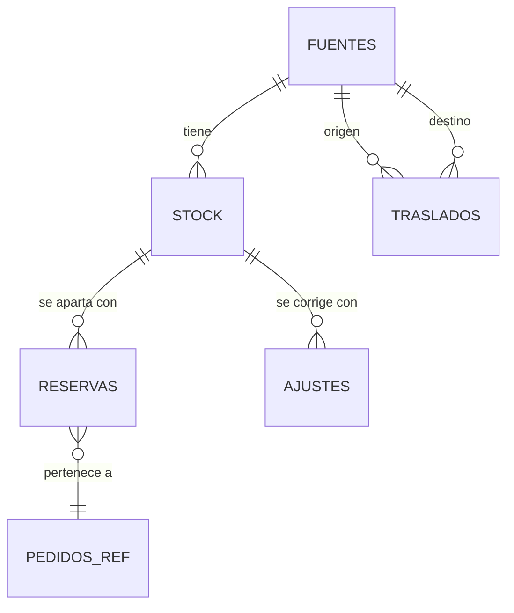

# Modelo de datos lógico

Traduce el [modelo de dominio](../01-analisis-de-sistema/07-modelo-de-dominio.md) a tablas, restricciones e índices. Es un **diseño lógico de referencia**: el plan de cada spec fija los nombres definitivos y las migraciones. Las bases siguen AD03 y AD18: una instancia PostgreSQL para Ventas (con el esquema `identidad`) y otra para Inventario, sin tablas compartidas.

## 1. Convenciones

| Tema | Regla |
| :--- | :--- |
| Identificadores | Clave sustituta (GUID o secuencia) y, cuando existe, clave natural única (ISBN, número de hoja). |
| Fechas | `timestamptz` en UTC; la interfaz muestra la hora de Lima. |
| Dinero | `numeric(12,2)` en soles; nunca `float`. |
| Nombres | Tablas y columnas en español, minúsculas con guion bajo (`reservas`, `fecha_expiracion`). |
| Borrado | Baja lógica para catálogo y usuarios; auditoría y hojas de reclamación nunca se borran (solo se anonimiza lo que corresponda). |
| Concurrencia | Columna de versión por fila (`version`) en agregados con escritura concurrente (stock). |
| Permisos | Una cuenta de base por servicio, con permisos solo sobre su esquema; la cuenta de aplicación no puede modificar ni borrar la auditoría. |
| Datos personales | Marcados en el diccionario; el borrado o la anonimización se prueba (RNF23). |

## 2. Inventario (instancia Inventario)

| Tabla | Columnas principales | Restricciones |
| :--- | :--- | :--- |
| `fuentes` | id, nombre, region, direccion, contacto_aviso, activa | Nombre único; `activa` por defecto verdadero. |
| `stock` | fuente_id, edicion_id, fisico, reservado, version | PK (fuente_id, edicion_id); **CHECK (fisico >= 0 AND reservado >= 0 AND reservado <= fisico)**, que impide el vendible negativo incluso ante concurrencia. |
| `reservas` | id, pedido_id, cliente_id, huella_origen, fuente_id, edicion_id, cantidad, estado, fecha_expiracion, clave_idempotencia, fecha_creacion | Estado en (pendiente, confirmada, cerrada, liberada, expirada); `cerrada` se usa al entregar, pasar a en reparto o consumirse en el despacho de un traslado (el destino recibe una reserva nueva); `clave_idempotencia` única por cliente; índice parcial sobre estado pendiente por cliente (límite de una pendiente). |
| `traslados` | id, edicion_id, origen_id, destino_id, cantidad, estado, motivo, pedido_id, fechas por estado | Origen distinto de destino; estado en el ciclo definido (incluye `cancelado`); cantidad positiva; un traslado con `pedido_id` no pasa a `rechazado`. |
| `rutas` | origen_id, destino_id, plazo_dias, actualizada_en | PK (origen_id, destino_id); origen distinto de destino; **CHECK (plazo_dias > 0)**; direccional. |
| `ajustes` | id, fuente_id, edicion_id, motivo, cantidad, conteo_real, usuario_id, fecha | Motivo en (merma, danado, correccion_conteo, ingreso_inicial, devolucion); `devolucion_id` único para no reingresar dos veces; solo inserción. |
| `eventos_limite` | clave, instante | Un registro por reserva iniciada, por cliente y por origen (SEL-14, SEL-19); el conteo usa una ventana deslizante (SEG-21) y se inserta en la misma transacción de la reserva; los registros viejos se purgan a las 24 horas. La clave del origen es una huella no reversible, no la IP (SEG-25). |
| `auditoria` | id, fecha_utc, usuario_id, rol, accion, detalle, resultado, secuencia | Solo inserción; sin permisos de modificación para la cuenta de aplicación. |

**Regla de oro:** `reservado` se actualiza en la misma transacción que la fila de `reservas`, y el `CHECK` es la última defensa contra la sobreventa (AD23). El vendible se calcula como `fisico - reservado`; no se almacena.

## 3. Ventas (instancia Ventas, esquema `ventas`)

| Tabla | Columnas principales | Restricciones |
| :--- | :--- | :--- |
| `obras` | id, titulo, autor, editorial, categoria, portada, activa | Baja lógica. |
| `ediciones` | id, obra_id, isbn, formato, precio, activa | `isbn` único; formato en (impreso, digital). |
| `licencias` | edicion_id, titular, territorios, vigente_desde, vigente_hasta | Solo para ediciones digitales; vigencia coherente. |
| `carritos` / `carrito_lineas` | cliente_id; carrito_id, edicion_id, cantidad | Una línea por edición; cantidad 1 para digitales. |
| `pedidos` | id, cliente_id, tipo_entrega, estado, costo_envio, total, fecha, fecha_listo_recojo | Estado derivado de las líneas (incluye `no_recogido`); total en soles; `costo_envio` fijo y configurable. |
| `pedido_lineas` | pedido_id, edicion_id, titulo, isbn, cantidad, precio, estado, fuente_id | Una línea por edición y pedido. |
| `intenciones_pago` | id, cliente_id, carrito_ref, costo_envio, versiones_aceptadas, estado, fecha_inicio | Un solo cobro pendiente o aprobado por intención (índice único parcial). |
| `pagos` | id, intencion_id, pedido_id, estado (incluye `pendiente_confirmacion` y `vencido`), monto, referencia_pasarela, clave_idempotencia, fecha_inicio | **Un solo cobro aprobado por pedido** (índice único parcial); sin datos de tarjeta. |
| `envios` | id, pedido_id, guia, estado | Estados en orden; guía única. |
| `devoluciones` / `devolucion_lineas` | pedido_id, motivo, estado; linea_id, cantidad | Cantidad devuelta ≤ comprada. |
| `accesos_digitales` | id, cliente_id, edicion_id, descargas_usadas, revocado | Único (cliente_id, edicion_id); `descargas_usadas` ≤ 5 por restricción. |
| `descargas` | id, acceso_id, fecha, resultado | Solo inserción. |
| `ayudas_descarga` | id, acceso_id, motivo, estado | Solicitudes de ayuda (BIB-16). |
| `hojas_reclamacion` | id, numero, tipo, detalle, datos_consumidor (nombre, documento, domicilio, correo), monto_reclamado, pedido_id, estado, respuesta, aviso_estado | `numero` único; sin borrado; estado en (pendiente, respondido, descartada); `aviso_estado` en (pendiente, enviado). |
| `avisos` | id, evento_id, destinatario, estado, intentos, proximo_intento | Único (evento_id, destinatario) para no duplicar (NOT-05). |
| `auditoria` | como en Inventario | Solo inserción. |

## 4. Identidad (esquema `identidad`)

| Tabla | Columnas principales | Restricciones |
| :--- | :--- | :--- |
| `usuarios` | id, nombre, correo, correo_verificado, resumen_contrasena, rol, sucursal_id, activo, whatsapp, segundo_factor_activo, mayor_de_edad_declarado_en, fecha_cancelacion | Correo único; **CHECK**: sucursal obligatoria solo para encargado; un encargado activo por sucursal (índice único parcial). |
| `renovaciones` | id, usuario_id, huella, expira_absoluta, revocada | La huella reemplaza al valor de la renovación; nunca se guarda el valor; `expira_absoluta` se hereda en cada uso. |
| `codigos_un_solo_uso` | id, usuario_id o correo, proposito, huella, expira, intentos, usado | Se guarda solo la huella; caduca; se borra tras vencer. |
| `segundo_factor` | usuario_id, secreto_cifrado | Solo para administradores; cifrado en reposo. |
| `codigos_respaldo` | usuario_id, huella, usado | 8 por administrador; un solo uso. |
| `consentimientos` | usuario_id, finalidad, vigente, fecha | Historial por cambio. |
| `dispositivos` | usuario_id, huella_marca, region, primera_vez, ultima_vez | Solo la huella de la marca y la región del borde; se eliminan al cancelar la cuenta. |
| `cambios_correo_pendientes` | id, usuario_id, correo_nuevo, dispositivo_huella, region, estado, vence_en | Estados: pendiente, confirmado, rechazado, vencido; un cambio inusual vence a las 24 horas. |
| `versiones_legales` | texto (términos, privacidad, reembolso), version, vigente_desde | La versión vigente es la última; Identidad rechaza aceptaciones de otra. |
| `aceptaciones` | usuario_id o pedido_id, texto (términos, privacidad, reembolso, mayoría de edad), version, fecha | Solo inserción; una fila por texto aceptado en el registro (IDE-34) o en el checkout (CAR-22). |
| `solicitudes_arco` | id, usuario_id, tipo, estado, respuesta, fecha, fecha_limite | Estados: recibida, en atención, atendida, rechazada. `fecha_limite` = 20 días hábiles (acceso) o 10 (resto). |
| `eventos_ingreso` | clave (cuenta+origen), instante | Un registro por ingreso fallido (SEG-06); cuenta también para cuentas inexistentes; ventana deslizante. |
| `auditoria` | como en Inventario | Solo inserción. |

## 5. Índices y rendimiento

| Consulta crítica | Índice |
| :--- | :--- |
| Disponibilidad por edición | (edicion_id) sobre `stock` y agregación por fuente. |
| Reservas pendientes por expirar | (estado, fecha_expiracion) parcial sobre pendientes. |
| Límite por cliente y por origen | Índices sobre `eventos_limite.clave` e `instante`. |
| Pedidos de un cliente / de una sucursal | (cliente_id, fecha), (fuente_id, estado). |
| Búsqueda de catálogo | Índice de texto sobre título, autor y editorial. |
| Auditoría por fecha, usuario y acción | (fecha_utc DESC), (usuario_id), (accion). |

## 6. Datos personales y retención

| Tabla | Datos personales | Tratamiento |
| :--- | :--- | :--- |
| `usuarios` | Nombre, correo, WhatsApp | Se anonimizan al cancelar la cuenta. |
| `pedidos`, `envios` | Dirección, contacto | Se anonimiza el contacto a los 2 años *(propuesta)*. |
| `hojas_reclamacion` | Datos del consumidor | Se conservan al menos 2 años. |
| `auditoria` | Usuario, origen | Se anonimiza a los 2 años o al cancelar la cuenta (AUD-11). |
| Respaldos | Todos | Cifrados; rotan según la retención. |

## 7. Migraciones

Las migraciones son versionadas, hacia adelante y reversibles cuando es posible; se ejecutan con una cuenta distinta de la de aplicación. Cada plan incluye su migración y una prueba de integración con la base real (Testcontainers) que verifica las restricciones críticas (`CHECK` de stock, unicidad de cobro, unicidad de ISBN).
