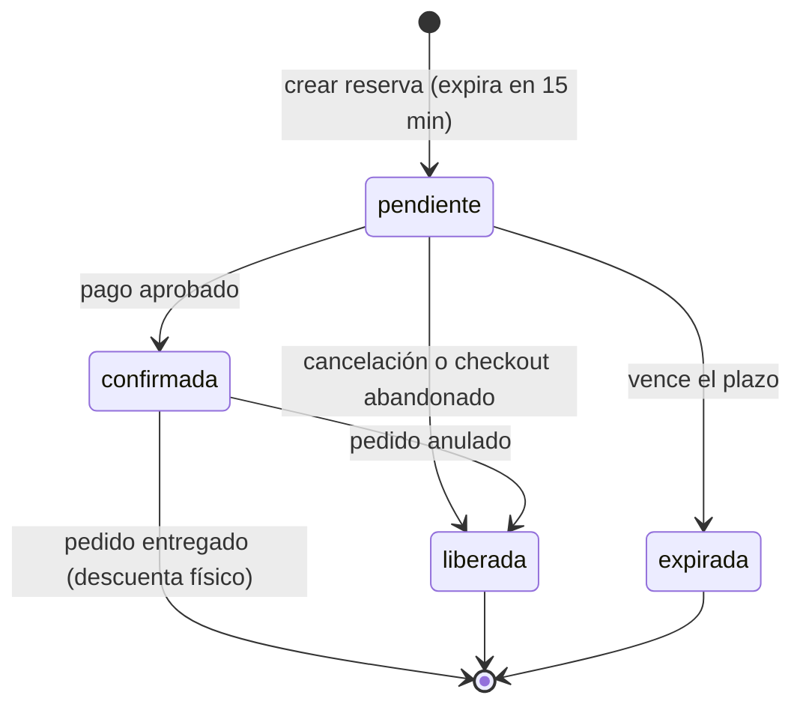
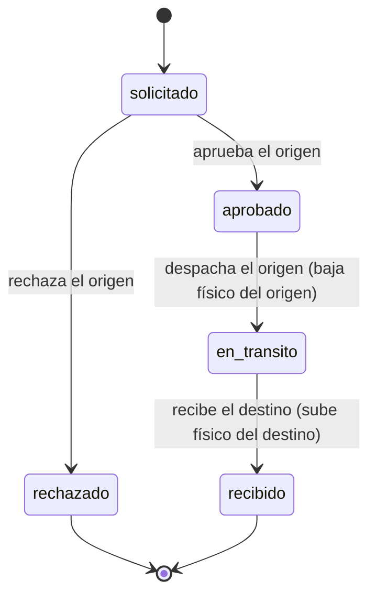
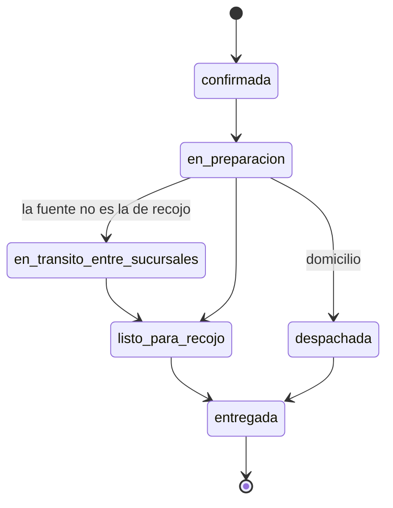

# Estados y concurrencia

Reúne los ciclos de vida del dominio y la forma de garantizar su corrección ante solicitudes simultáneas. Complementa los patrones de [principios y patrones](03-principios-y-patrones.md) y la decisión AD23.

## 1. Máquinas de estado

### 1.1 Reserva

Una reserva pendiente reduce el vendible; el físico solo baja al entregar. Confirmar una reserva expirada se rechaza.

### 1.2 Traslado

### 1.3 Línea de pedido impresa

El estado del pedido se deriva del de sus líneas. La línea digital pasa a *disponible en biblioteca* al aprobarse el pago.

### 1.4 Pago

`pendiente → aprobado | rechazado | pendiente de confirmación → aprobado | rechazado`. Un pedido tiene como máximo un cobro aprobado. Un pago aprobado cuya confirmación de reserva falla se reembolsa automáticamente.

### 1.5 Envío

`pendiente de guía → guía generada → en reparto → entregado`. Un envío entregado no cambia.

### 1.6 Devolución

`solicitada → aprobada → reembolsada → (reingreso de stock)`; también `solicitada → rechazada`. Un reembolso o reingreso fallido queda reintentable sin repetir el paso ya completado.

### 1.7 Solicitud ARCO

`recibida → en atención → atendida | rechazada`.

### 1.8 Códigos de un solo uso

`emitido → usado | vencido | agotado (por intentos)`. Un código usado, vencido o agotado no se acepta.

## 2. Concurrencia

### 2.1 Qué puede competir

| Recurso | Competencia | Riesgo |
| :--- | :--- | :--- |
| Stock de una edición en una fuente | Dos reservas por la última unidad | Sobreventa (AC01) |
| Contadores de límites | Muchas solicitudes simultáneas del mismo cliente u origen | Saltarse el límite |
| Cupo de descargas | Dos solicitudes con una descarga restante | Exceder las 5 descargas |
| Cobro de un pedido | Doble clic o reintento | Cobro duplicado |
| Aprobación de un traslado | Dos aprobaciones | Estado inconsistente |
| Consumo de un código de un solo uso | Dos usos simultáneos | Reutilización |

### 2.2 Estrategia

| Mecanismo | Uso |
| :--- | :--- |
| **Transacción única por caso de uso** | El cambio, la auditoría y los contadores se confirman juntos o ninguno. |
| **Restricciones en la base** | `CHECK (reservado <= fisico)`, índice único parcial de cobro aprobado, índice único de clave de idempotencia. Son la última defensa. |
| **Actualización condicional** | `UPDATE ... WHERE fisico - reservado >= :cantidad`; si afecta 0 filas, se rechaza por falta de stock. |
| **Control optimista** | Columna `version`; un conflicto se reintenta una vez o se informa. |
| **Orden fijo de bloqueos** | Al reservar varias líneas, se procesan en orden por (edicion_id, fuente_id) para evitar interbloqueos. |
| **Idempotencia** | Clave persistida: repetir la operación devuelve el resultado original. |
| **Contadores atómicos** | Los límites se incrementan con una sola sentencia condicional en la transacción de la operación (SEL-18, BIB-17). |

La técnica exacta (nivel de aislamiento o bloqueo de fila) se fija en el plan de `inventario-seleccion-fuente` (AD23) y se prueba con solicitudes simultáneas reales sobre la base de Testcontainers.

### 2.3 Expiración de reservas

Un trabajo de fondo recorre las reservas pendientes vencidas y las marca como expiradas, devolviendo las unidades al vendible. Además, toda lectura del vendible ignora las reservas vencidas, de modo que una demora del trabajo no hace que el stock parezca menor. El trabajo usa una credencial de servicio de mínimo privilegio (IDE-30) y es idempotente.

### 2.4 Pruebas obligatorias

| Prueba | Qué demuestra | Criterio |
| :--- | :--- | :--- |
| 100 reservas simultáneas por 1 unidad | Solo una prospera; vendible nunca negativo | AC-SEL-04 |
| 10 solicitudes simultáneas del mismo cliente | Solo una reserva pendiente | AC-SEL-18 |
| 2 solicitudes con una descarga restante | Solo una recibe el enlace | AC-BIB-15 |
| Repetir un cobro con la misma clave | Un solo cobro | PAG-04 |
| Doble aprobación de un traslado | Una sola transición | TRA-04 |
| Uso simultáneo de un código | Solo uno es aceptado | AC-IDE-17 |

## 3. Fallos parciales

| Situación | Resultado |
| :--- | :--- |
| Falla la auditoría de una operación sensible | La operación no se aplica (AUD-04). |
| Falla el aviso por WhatsApp | La operación se completa; el aviso queda pendiente (NOT-04). |
| Pago aprobado y confirmación de reserva fallida | Reembolso automático y aviso al cliente. |
| Pasarela sin respuesta | Pago pendiente de confirmación; se consulta después; no se cobra de nuevo. |
| Inventario no responde en el checkout | Se informa y no se cobra (CAR-06). |
| Falla el envío del código por correo | La persona reintenta; no hay efectos parciales. |
