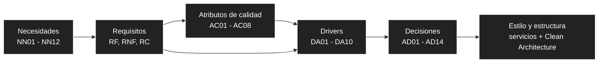

# 04 — Drivers arquitectónicos

Un **driver arquitectónico** es un requisito, atributo de calidad o restricción que condiciona de forma significativa la estructura del sistema. Se seleccionaron los que, si cambiaran, obligarían a cambiar la arquitectura.

## 1. Cadena de derivación

## 2. Drivers

| ID | Driver arquitectónico | Tipo | Origen | ¿Por qué influye en la arquitectura? | Decisiones |
| :--- | :--- | :--- | :--- | :--- | :--- |
| **DA01** | El sistema debe evitar la sobreventa cuando un título está en varias sucursales. | Calidad | AC01, RNF01, RF13, RF14 | Exige un servicio y una base de datos propios para el inventario, con reservas transaccionales y control de concurrencia. | AD01, AD03, AD08 |
| **DA02** | El sistema debe mantener tiempos de respuesta adecuados al consultar disponibilidad en picos de tráfico. | Calidad | AC02, RNF02 | Influye en el uso de caché, en la comunicación entre servicios y en el reparto de recursos de las VMs. | AD04, AD06 |
| **DA03** | El sistema debe seguir operando de forma aceptable sin SLA y con fallos parciales. | Calidad | AC03, RNF03 | Condiciona el reinicio automático, la degradación controlada ante la caída del inventario y los respaldos. | AD04, AD10, AD11 |
| **DA04** | El sistema debe permitir sumar sucursales sin rediseñar. | Calidad | AC04, RNF04 | Obliga a modelar cada sucursal como dato (fuente) y no como código o esquema. | AD01, AD03 |
| **DA05** | Cada encargado solo debe acceder a su sucursal, y los datos de usuarios y pagos deben protegerse. | Calidad | AC05, RNF05–RNF08, RF18 | Influye en la autenticación centralizada, el aislamiento de las bases de datos y la protección del borde de red. | AD05, AD12, AD13 |
| **DA06** | Debe integrarse con pasarela de pago, servicio de envío y LLM externos. | Restricción | RC04, RC05, RC10 | Obliga a aislar los accesos externos para poder cambiar de proveedor sin tocar las reglas del negocio. | AD07, AD09 |
| **DA07** | La comunicación entre componentes debe ser mediante API REST. | Restricción | RC03 | Limita las alternativas de comunicación y descarta, por ahora, un bus de eventos. | AD04 |
| **DA08** | Los cambios de reglas o proveedores deben quedar aislados y ser fáciles de probar. | Calidad | AC06, RNF09, RNF10 | Influye en la organización interna de cada servicio. | AD09 |
| **DA09** | El sistema debe ejecutarse en recursos gratuitos limitados y heterogéneos (ARM64 y x86_64). | Restricción | RC06–RC08, RNF11, RNF12, AC07 | Limita la cantidad de VMs, servicios y contenedores, y exige imágenes multi-arch. | AD02, AD10, AD11 |
| **DA10** | La operación debe tener costo mínimo y esfuerzo técnico manejable. | Negocio | NN12, RC09 | Favorece servicios gratuitos gestionados (Cloudflare) frente a componentes propios que haya que mantener. | AD13, AD14 |

## 3. Riesgos y compromisos

| Riesgo o compromiso | Mitigación |
| :--- | :--- |
| La consulta síncrona al Inventario puede volverse cuello de botella o punto único de falla (DA02, DA03). | Caché Redis, reinicio automático, pruebas de carga con k6 y un mensaje claro cuando no se pueda validar el stock. |
| La disponibilidad en caché puede estar desactualizada (DA01, DA02). | Expiración corta y validación definitiva contra la base de datos al reservar. |
| La reducción del Free Tier de Oracle (ahora 2 OCPU y 12 GB en ARM) deja poca holgura de CPU (DA09). | Dimensionar con 1 OCPU por VM, medir con k6 y evitar componentes pesados. |
| Oracle puede no tener capacidad ARM al crear la VM, o recuperar instancias inactivas (DA03, DA09). | Reintentar la creación, mantener el mismo Compose en local como respaldo y revisar la política de instancias inactivas. |
| El asistente depende de un LLM externo (latencia, costo, respuestas incorrectas) (DA06). | Responde solo con datos de las API, indica cuándo no sabe y su caída no bloquea la compra. |
| Cloudflare es una dependencia de terceros en el camino de todas las solicitudes (DA10). | Aceptable para este alcance; se documenta la alternativa de exponer Nginx directamente. |
