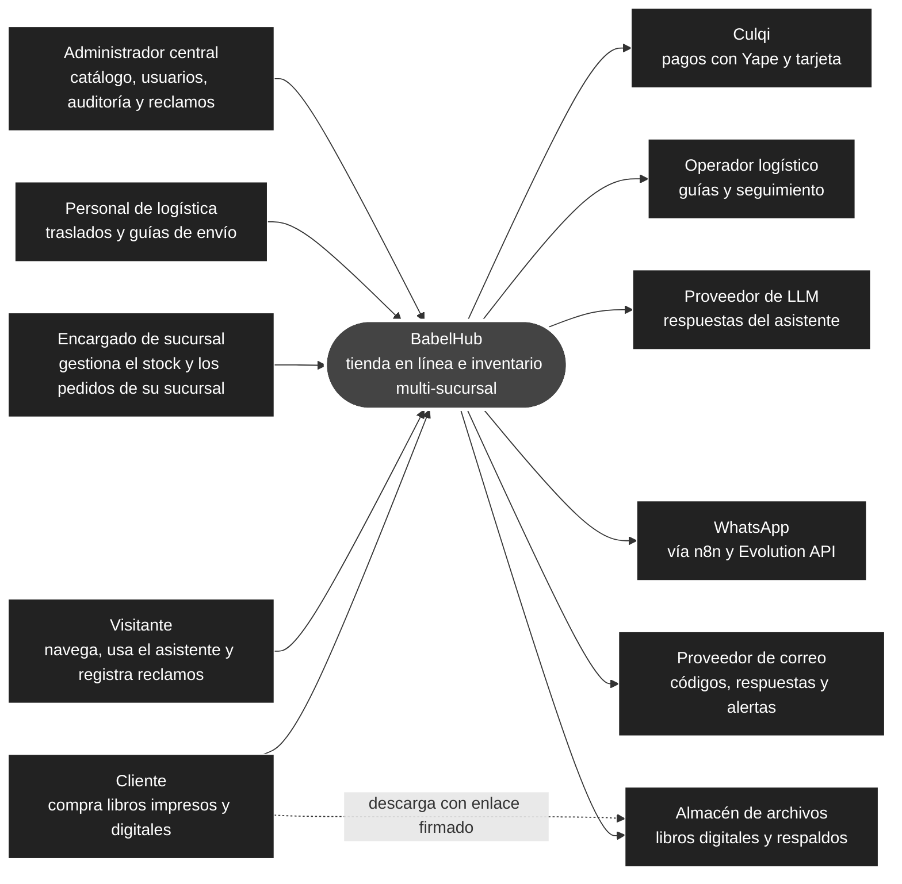
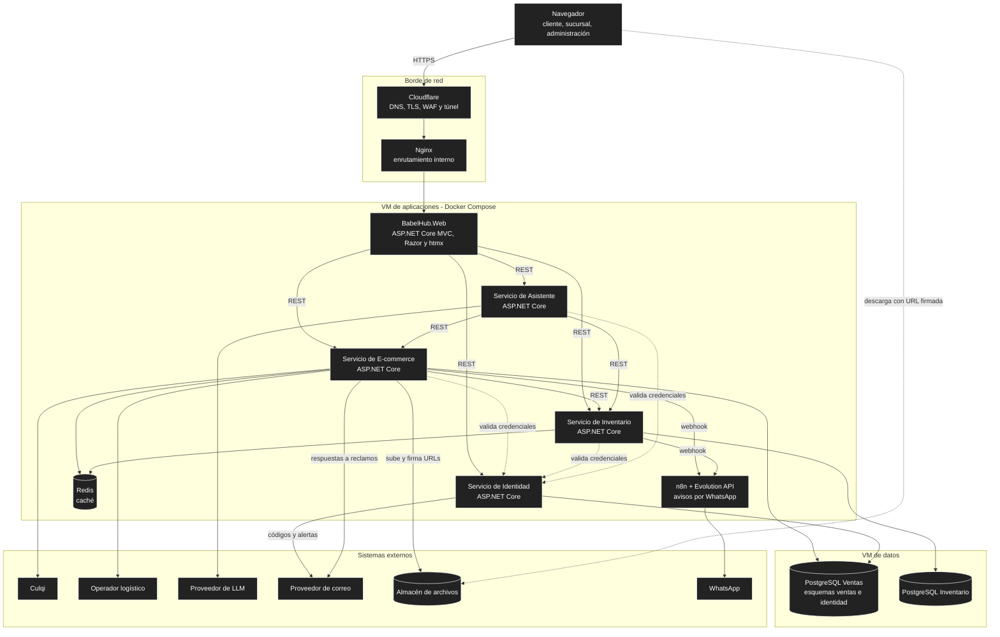

# Contexto y contenedores (niveles 1 y 2)

## 1. Nivel 1: contexto del sistema

BabelHub es un único sistema de software con dos subsistemas de negocio (E-commerce e Inventario) que usan personas de cuatro roles y que se apoya en servicios externos.

| Actor o sistema | Relación | Fuente |
| :--- | :--- | :--- |
| Cliente y visitante | Compran, consultan pedidos y biblioteca, usan el asistente y registran reclamos. | `docs/01-analisis-de-sistema/05-actores-y-permisos.md` |
| Encargado, logística y administración | Operan el inventario, los traslados, los envíos, el catálogo y la auditoría según su rol y alcance. | Ídem |
| Culqi | Cobra y reembolsa; avisa el estado del pago. | AD17, RC04 |
| Operador logístico | Genera guías de envío. | RC05 |
| Proveedor de LLM | Genera las respuestas del asistente; recibe solo datos mínimos. | RC10, RC17 |
| WhatsApp (n8n + Evolution API) | Avisos de pedidos y traslados con consentimiento. | AD16, RC12 |
| Proveedor de correo | Códigos de seguridad, respuestas a reclamos y alertas a la administración. | AD30, RC18 |
| Almacén de archivos | Guarda los EPUB y PDF y los respaldos cifrados; entrega con URL firmada. | AD19, AD27 |

## 2. Nivel 2: contenedores

Un contenedor es una aplicación o un almacén de datos desplegable por separado. Las VMs, los límites de memoria y la red están en el [despliegue](../02-arquitectura-de-software/05-despliegue.md).

| Contenedor | Tecnología | Responsabilidad | Specs principales |
| :--- | :--- | :--- | :--- |
| **BabelHub.Web** | ASP.NET Core MVC, Razor, htmx, Tailwind y daisyUI | Interfaz por áreas (Tienda, Sucursal, Admin); sesión del lado del servidor; mezcla de la auditoría y las alertas de los servicios. Sin reglas de negocio. | `web-base`, `web-indice-infinito` |
| **Servicio de E-commerce** | ASP.NET Core, EF Core | Catálogo, carrito, pagos, pedidos, biblioteca digital, envíos, devoluciones y Libro de Reclamaciones. | `ecommerce-*`, `transversal-notificaciones` |
| **Servicio de Inventario** | ASP.NET Core, EF Core | Fuentes y rutas, stock vendible, reservas y selección de fuente, traslados y ajustes. | `inventario-*` |
| **Servicio de Identidad** | ASP.NET Core, EF Core | Usuarios, roles, credenciales y su firma, segundo factor, recuperación, consentimientos y solicitudes sobre datos personales. | `identidad-seguridad` |
| **Servicio de Asistente** | ASP.NET Core | Recomendaciones y consultas con datos de los servicios; solo lectura. | `asistente-compra-ia` |
| **Redis** | Redis | Caché de disponibilidad y catálogo. | AD06 |
| **n8n + Evolution API** | n8n, Evolution API | Plantillas y envío de avisos por WhatsApp. | AD16 |
| **PostgreSQL Ventas / Inventario** | PostgreSQL | Datos de cada sistema; sin acceso desde Internet. | AD03, AD18 |
| **Nginx y Cloudflare** | Nginx, Cloudflare | Entrada única, TLS, WAF y límites en el borde. | AD13, AD14 |

Los tres elementos transversales (**auditoría** y **seguridad**: límites, errores y eventos) no son contenedores: se implementan en cada servicio con el mismo contrato (`transversal-auditoria`, `transversal-seguridad`).

## 3. Fronteras de confianza

Se dibujan sobre este nivel en el [modelo de amenazas](../05-seguridad/01-modelo-de-amenazas.md) §2: Internet → borde, borde → aplicaciones, aplicaciones → datos y aplicaciones ↔ proveedores externos.
