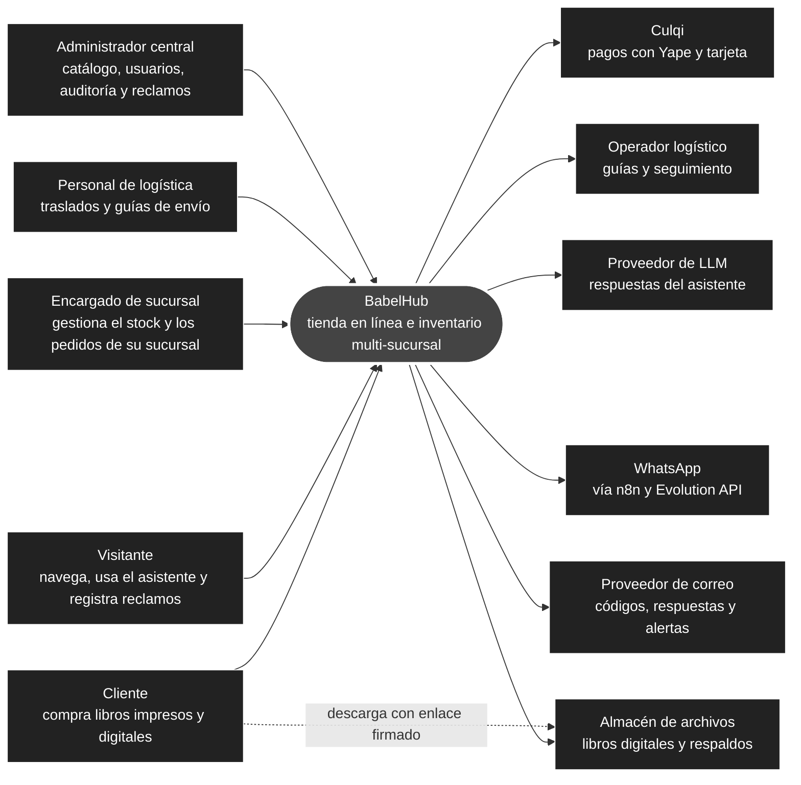
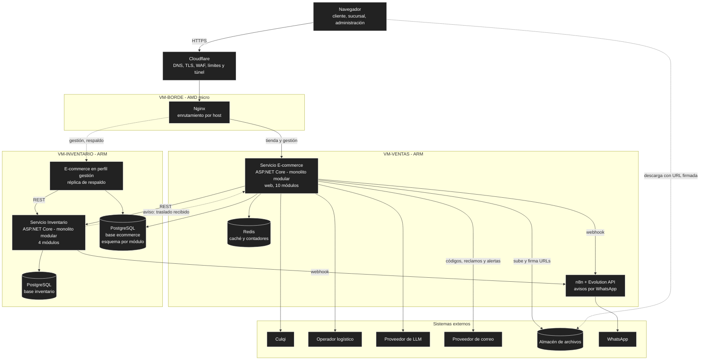

# Contexto y contenedores (niveles 1 y 2)

## 1. Nivel 1: contexto del sistema

BabelHub es un sistema de software formado por dos servicios (E-commerce e Inventario) que usan personas de cuatro roles y que se apoya en servicios externos.

| Actor o sistema | Relación | Fuente |
| :--- | :--- | :--- |
| Cliente y visitante | Compran, consultan pedidos y biblioteca, usan el asistente y registran reclamos. | `docs/01-analisis-de-sistema/05-actores-y-permisos.md` |
| Encargado, logística y administración | Operan el inventario, los traslados, los envíos, el catálogo y la auditoría según su rol y alcance. | Ídem |
| Culqi | Cobra y reembolsa; avisa el estado del pago. | AD17, RC04 |
| Operador logístico | Genera guías de envío. | RC05 |
| Proveedor de LLM | Genera las respuestas del asistente; recibe solo datos mínimos. | RC10, RC17 |
| WhatsApp (n8n + Evolution API) | Avisos de pedidos y traslados con consentimiento. | AD16, RC12 |
| Proveedor de correo | Códigos de seguridad, respuestas a reclamos y alertas a la administración. | AD30, RC18 |
| Almacén de archivos | Guarda los EPUB y PDF y los respaldos cifrados; entrega con URL firmada. | AD19, AD27 |

## 2. Nivel 2: contenedores

Un contenedor es una aplicación o un almacén de datos desplegable por separado. El diagrama muestra los dos servicios, sus bases y la herramienta de avisos, dentro de las cuatro VMs gratuitas. Las VMs, los límites de memoria y la red están en el [despliegue](../02-arquitectura-de-software/05-despliegue.md).

| Contenedor | Tecnología | Responsabilidad | Specs principales |
| :--- | :--- | :--- | :--- |
| **Servicio E-commerce** | ASP.NET Core, EF Core, MVC con Razor, htmx, Tailwind y daisyUI | Interfaz por áreas (Tienda, Sucursal, Admin) y los módulos Catálogo, Carrito y checkout, Pagos, Pedidos, Envíos, Devoluciones, Biblioteca digital, Libro de Reclamaciones, Identidad y Asistente. Sesión del lado del servidor en la base. | `ecommerce-*`, `identidad-seguridad`, `asistente-compra-ia`, `web-*` |
| **Servicio Inventario** | ASP.NET Core, EF Core | Fuentes y rutas, stock vendible, unidades vendidas, reservas y selección de fuente, traslados, ajustes e ingreso de mercadería. Sin entrada pública. | `inventario-*` |
| **Réplica de gestión** | La misma imagen del E-commerce | Áreas Sucursal y Admin, como servidor de respaldo si cae la VM de ventas. | AD11, AD15 |
| **Redis** | Redis | Caché de disponibilidad y catálogo, y contadores de límites. | AD06 |
| **n8n + Evolution API** | n8n, Evolution API | Plantillas y envío de avisos por WhatsApp. | AD16 |
| **PostgreSQL** (bases `ecommerce` e `inventario`) | PostgreSQL | Una instancia con una base por servicio, un esquema por módulo y un rol por esquema; sin acceso desde Internet. | AD03, AD18 |
| **Nginx y Cloudflare** | Nginx, Cloudflare | Entrada única, TLS, WAF, límites en el borde y enrutamiento por host (tienda y gestión). | AD13, AD14 |

Los elementos transversales (**auditoría** y **seguridad**: límites, errores y eventos) no son contenedores: se implementan en cada servicio con el mismo contrato (`transversal-auditoria`, `transversal-seguridad`).

## 3. Fronteras de confianza

Se dibujan sobre este nivel en el [modelo de amenazas](../05-seguridad/01-modelo-de-amenazas.md) §2: Internet → borde, borde → servicios, servicio → datos, entre las VMs y servicios ↔ proveedores externos.
