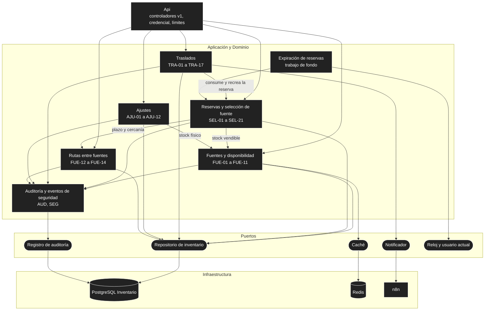
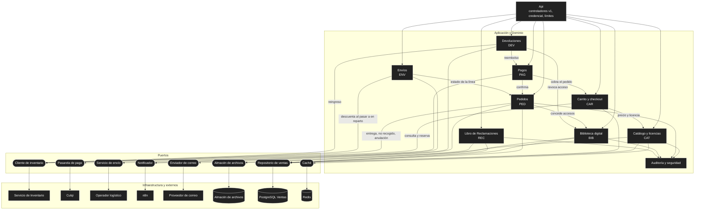
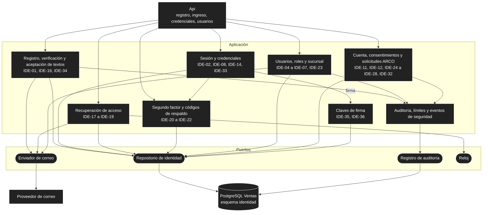
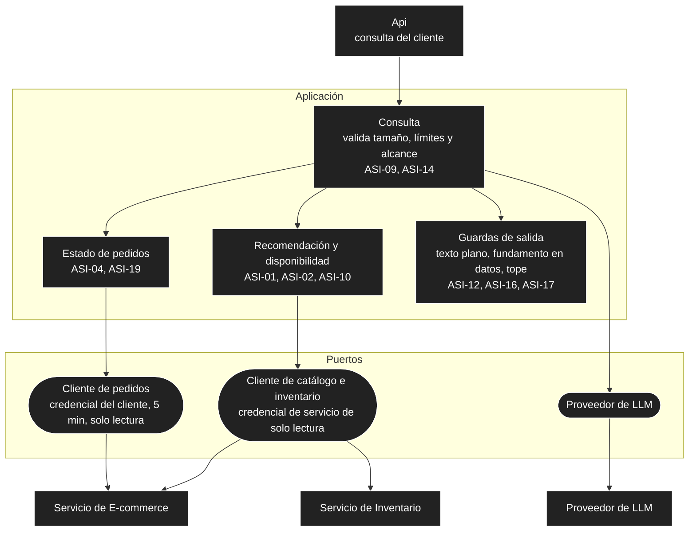
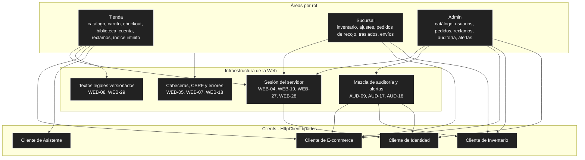

# Componentes (nivel 3)

Cada diagrama abre un contenedor del [nivel 2](01-contexto-y-contenedores.md) y muestra sus **módulos** (casos de uso y reglas agrupados) y los **puertos** que usan, con la Infraestructura que los implementa. Son vistas de referencia a nivel de módulo: los nombres de clases y proyectos los fija el `plan.md` de cada spec. Convención: rectángulo = módulo; cilindro = almacén; óvalo = puerto.

## 1. Servicio de Inventario

| Componente | Responsabilidad | Spec |
| :--- | :--- | :--- |
| Fuentes y disponibilidad | Fuente por sucursal, stock físico, reservado y vendible (nunca negativo), consulta consolidada y por fuente. | `inventario-fuentes` |
| Rutas entre fuentes | Plazo estimado en días entre dos fuentes, como dato; ordena fuentes por cercanía. | `inventario-fuentes` |
| Reservas y selección de fuente | Reservas temporales, límites por cliente y origen, selección de la fuente, consulta previa sin reservar y descuento de físico al entregar o pasar a en reparto. | `inventario-seleccion-fuente` |
| Traslados | Ciclo solicitado → recibido, cancelación al anular el pedido y movimiento de la reserva vinculada. | `inventario-traslados` |
| Ajustes | Merma, daño, corrección de conteo y reingreso por devolución. | `inventario-ajustes` |
| Expiración de reservas | Marca como expiradas las reservas vencidas; con credencial de servicio de mínimo privilegio. | `inventario-seleccion-fuente`, IDE-30 |
| Auditoría y eventos de seguridad | Contrato único de auditoría en la misma transacción, accesos denegados y límites excedidos. | `transversal-auditoria`, `transversal-seguridad` |

## 2. Servicio de E-commerce

| Componente | Responsabilidad | Spec |
| :--- | :--- | :--- |
| Catálogo y licencias | Obras, ediciones, ISBN único, licencias digitales, búsqueda y validación de archivos y portadas subidos. | `ecommerce-catalogo` |
| Carrito y checkout | Carrito persistente, validación de stock, reserva, aceptación de textos legales y correo verificado. | `ecommerce-carrito-checkout` |
| Pagos | Cobro único con idempotencia, conciliación y reembolsos; confirma pedido, reservas y accesos. | `ecommerce-pagos` |
| Pedidos | Líneas y estados, recojo, no recogido y anulación. | `ecommerce-pedidos` |
| Biblioteca digital | Accesos, descargas con enlace firmado y tope, ayuda y restitución. | `ecommerce-biblioteca-digital` |
| Envíos | Guías, seguimiento y descuento de físico al pasar a en reparto. | `ecommerce-envios` |
| Devoluciones | Solicitud, aprobación, reembolso, reingreso y revocación de accesos. | `ecommerce-devoluciones` |
| Libro de Reclamaciones | Hojas, constancia, límite por origen, descarte sin borrado y respuesta por correo. | `ecommerce-libro-reclamaciones` |
| Notificador | Contrato de aviso por WhatsApp, que nunca interrumpe un caso de uso. | `transversal-notificaciones` |

## 3. Servicio de Identidad

Servicio de versión reducida: Presentación y Aplicación con acceso a datos simple, sin Dominio separado.

## 4. Servicio de Asistente

Servicio de versión reducida y de solo lectura (AD28).

El asistente no tiene acceso a ninguna base de datos ni herramientas de escritura. El filtro de los pedidos lo aplica el servicio de pedidos con la credencial del cliente.

## 5. BabelHub.Web

`BabelHub.Web` no es una capa de Clean Architecture sino un cliente de los servicios, sin Dominio ni Aplicación (AD15).

| Aspecto | Regla |
| :--- | :--- |
| Referencias | Solo a `BabelHub.Shared`; nunca al Dominio, Aplicación o Infraestructura de un servicio. |
| Llamadas | Solo desde el servidor; el navegador no ve credenciales ni llama a los servicios. |
| Descargas | La Web redirige al enlace firmado; no transporta el archivo. |
| Auditoría | Pide a cada servicio su página y mezcla por fecha; sin reglas de negocio. |

## 6. Elementos compartidos

| Elemento | Dónde vive | Regla |
| :--- | :--- | :--- |
| `BabelHub.Shared` | Referenciado por Api, Infraestructura y Web | Solo contratos (DTOs, constantes); no lo referencian Dominio ni Aplicación. |
| Auditoría y eventos de seguridad | En cada servicio, mismo contrato | Misma transacción que el cambio; si no se puede auditar, la operación falla (AUD-04). |
| Errores uniformes y límites | En cada Api | `problem+json` y respuesta única de límite excedido (SEG-03, SEG-07). |
