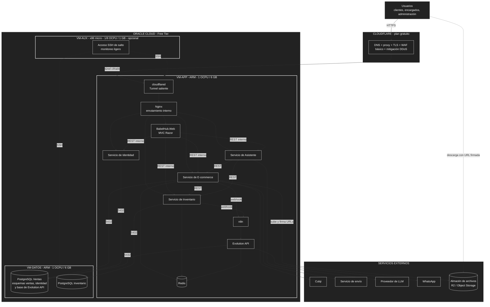

# 05 — Decisiones arquitectónicas

Cada decisión indica el driver que la motiva (`04-drivers-arquitectonicos.md`), por qué se eligió y qué alternativa se descartó. Las decisiones de despliegue (AD10 a AD14 y AD16) se desarrollan con más detalle en la sección 3.

## 1. Resumen de decisiones

| ID | Decisión | Justificación | Alternativa descartada | Drivers |
| :--- | :--- | :--- | :--- | :--- |
| **AD01** | Separar el **E-commerce** y el **Inventario** como dos sistemas independientes que se comunican por API. | El inventario tiene reglas propias (reservas, traslados, auditoría), otro tipo de usuarios y más escritura. Separarlo permite probarlo y asignarle recursos por separado. | Un monolito con inventario embebido. | DA01, DA04 |
| **AD02** | Usar **cuatro servicios de granularidad gruesa**: E-commerce, Inventario, Identidad y Asistente de Compra, más la aplicación web (AD15), que es un cliente y no un servicio de negocio. | Para 5–10 sucursales, más servicios solo sumarían coordinación y consumo de RAM, que es escasa. | Microservicios finos (catálogo, carrito y pagos por separado). | DA09 |
| **AD03** | **Una base PostgreSQL por sistema** (Ventas e Inventario), en instancias separadas. Identidad usa un esquema propio (AD18). | Aísla la escritura intensiva de reservas y traslados, y permite respaldar e inspeccionar cada base por separado. | Una sola base compartida. | DA01, DA04 |
| **AD04** | Comunicación **REST síncrona**, sin bus de eventos. | Es simple, uniforme y suficiente para el volumen previsto; el E-commerce necesita la respuesta de disponibilidad antes de cobrar. | Arquitectura orientada a eventos. | DA02, DA03, DA07 |
| **AD05** | **Servicio de Identidad** centralizado que emite **JWT** con rol y sucursal. | Evita duplicar la lógica de seguridad y permite que cada servicio valide el alcance por sucursal. | Autenticación dentro de cada servicio. | DA05 |
| **AD06** | **Redis** como caché de disponibilidad (expiración corta) y catálogo (expiración mayor). | Reduce consultas a la base en picos; la validación definitiva se hace contra la base al reservar. | Consultar siempre a la base. | DA02 |
| **AD07** | El **Asistente de Compra** es un servicio separado que consume las API y no accede a las bases de datos. | Limita lo que el LLM puede ver a datos autorizados y su caída no afecta la compra. | Acceso directo a las bases. | DA06 |
| **AD08** | **Reserva temporal con expiración** al iniciar el pago, confirmada cuando la pasarela aprueba el cobro. *(Validada con el docente.)* | Evita la ventana de sobreventa entre validar el stock y confirmar el pago. | Reservar solo después de cobrar. | DA01 |
| **AD09** | **Clean Architecture** dentro de cada servicio (Presentación, Aplicación, Dominio, Infraestructura). | Aísla las reglas del negocio de la base, la API y los proveedores externos. Ver `06-estilo-arquitectonico.md`. | Capas tradicionales con el dominio dependiendo de la base de datos. | DA06, DA08 |
| **AD10** | Despliegue en **Oracle Cloud Free Tier (ARM)** con **Docker y Docker Compose**, sobre Linux mínimo sin entorno gráfico. | Es el único entorno gratuito con recursos ARM utilizables; Compose es suficiente para 2–4 VMs. | Servidores locales o Kubernetes. | DA03, DA09 |
| **AD11** | **Dos VMs ARM** (Aplicaciones y Datos, de 1 OCPU y 6 GB cada una) y una VM x86 micro **opcional** de apoyo. | Aprovecha exactamente el cupo ARM y mantiene la separación lógica del diseño. | Una sola VM con todo, o más de dos VMs ARM (no cabe en el cupo). | DA03, DA09 |
| **AD12** | **Base de datos en una VM separada**, sin acceso desde Internet. | Reduce la superficie de ataque, evita que las aplicaciones compitan con PostgreSQL por memoria y facilita respaldos. | Bases en la misma VM que las aplicaciones. | DA05 |
| **AD13** | **Cloudflare (plan gratuito)** en el borde: DNS, proxy, TLS, WAF básico y **Cloudflare Tunnel**. | Protege el origen y evita abrir puertos en Oracle sin costo ni VM adicional. | Exponer la VM directamente a Internet. | DA05, DA10 |
| **AD14** | **Nginx ligero** como puerta de entrada interna en la VM de Aplicaciones (solo enrutamiento). | Cloudflare no reemplaza el enrutamiento hacia la aplicación web y los servicios, y Nginx mantiene el mismo comportamiento en local. | Eliminar Nginx y enrutar solo con Cloudflare. | DA10 |
| **AD15** | **Aplicación web `BabelHub.Web`** en ASP.NET Core MVC con Razor, con áreas por rol (Tienda, Sucursal, Admin). Llama a los servicios **desde el servidor** por REST y guarda el JWT en el servidor; el navegador solo recibe una cookie de sesión. | Da un hogar a la interfaz sin mezclarla con ningún servicio, evita CORS y mantiene el token fuera del navegador. | Vistas dentro del servicio E-commerce (rompe AD01); SPA que llama a las API desde el navegador (expone el token, exige CORS y otro stack). | DA05, DA07, DA09 |
| **AD16** | **Notificaciones por WhatsApp con Evolution API y n8n**, autoalojados en la VM-APP. Los servicios llaman a un webhook de n8n a través del puerto `Notificador`; n8n arma el mensaje y lo envía por Evolution API. | Costo cero por mensaje y control propio; n8n concentra plantillas y reintentos fuera del código. | Correo o SMS de pago; API oficial de WhatsApp Cloud (pago por conversación y trámite de verificación). | DA06, DA09, DA11 |
| **AD17** | **Culqi** como pasarela de pago para Yape y tarjetas. El pago se tokeniza en el navegador con el script de Culqi, por lo que el sistema nunca ve datos de tarjeta; el cobro se hace desde el servicio E-commerce con clave de idempotencia propia. | API simple, soporta Yape y tarjetas, buena integración con ASP.NET Core y comisión por transacción sin costo fijo. | Niubiz. | DA06 |
| **AD18** | **Esquema propio para Identidad** (`identidad`) en la instancia PostgreSQL de Ventas, con su propio rol de base de datos y sus propias migraciones. Ningún otro servicio tiene permiso sobre ese esquema. | Evita una tercera instancia (la RAM es escasa) y mantiene el aislamiento de datos de seguridad. | Tablas de usuarios dentro del esquema de Ventas; una tercera instancia de PostgreSQL. | DA05, DA09 |
| **AD19** | **Archivos digitales en un almacén de objetos externo compatible con S3**, accedido por el puerto `AlmacenDeArchivos`. Candidatos: Cloudflare R2 (encaja con el Cloudflare ya usado) u Oracle Object Storage; en desarrollo, MinIO o una carpeta local. El bucket es privado. | El disco de las VMs es escaso (200 GB en total, con 47 GB de arranque por VM) y los archivos no deben ir en Git ni en PostgreSQL. Con enlaces firmados, la descarga no pasa por la VM de 1 OCPU. | Carpeta en la VM de Aplicaciones; archivos como BLOB en PostgreSQL. | DA09, DA12 |
| **AD20** | **Entrega y protección de libros digitales sin DRM comercial**: acceso ligado a la cuenta, descarga con URL firmada de 5 minutos como máximo, límite de descargas por compra (propuesta: 5), registro de cada descarga y, como mejora posterior, marca de agua con los datos de la compra. Formatos EPUB y PDF. | Los DRM comerciales (Adobe ACS4, Readium LCP) exigen licencia o infraestructura adicional, fuera del presupuesto (NN12). Se acepta el riesgo residual y se deja el puerto para sustituirlo si un titular lo exige. *(A validar con los titulares de derechos.)* | DRM comercial; lector solo en línea; sin ningún control de descarga. | DA12 |

## 2. Decisiones de software en detalle

**Sobre AD01 y AD02.** Dos sistemas no significan muchos servicios: el sistema de E-commerce agrupa catálogo, carrito, checkout, pagos y pedidos en un solo servicio porque comparten ciclo de vida y no necesitan escalar de forma independiente. Solo el inventario justifica un servicio aparte.

**Sobre AD08.** Si el stock se validara y se reservara solo después de pagar, dos clientes podrían pagar la misma última unidad. Reservar antes con un tiempo límite elimina ese caso, a cambio de un proceso que libera reservas vencidas. Es una mejora a la propuesta original, ya validada con el docente.

**Sobre AD15.** La aplicación web es una sola, con tres áreas (Tienda para el cliente, Sucursal para encargados y logística, Admin para la administración central), porque comparten diseño, sesión y despliegue. Los navegadores nunca llaman a los servicios: lo hace el servidor web por la red interna de Docker. Las API siguen enrutadas por Nginx para futuros clientes (aplicación móvil) y para las pruebas de carga, y siempre exigen JWT.

**Sobre AD16.** El flujo es: servicio → webhook de n8n → Evolution API → WhatsApp. El adaptador del servicio no espera al envío: si n8n no responde, registra el aviso como pendiente y se reintenta, de modo que la compra nunca se bloquea. Evolution API usa la Redis existente y una base propia en la instancia de Ventas. n8n guarda sus datos en un volumen (SQLite), y sus flujos se exportan a `infra/n8n/` para versionarlos. Sus paneles se alcanzan solo por túnel SSH.

**Sobre AD17.** Culqi también permite reembolsos, que usa `ecommerce-devoluciones`. Los detalles de idempotencia, Yape y modo de pruebas (llaves de sandbox) se confirman con la documentación de Culqi al escribir la spec de pagos.

**Sobre AD19 y AD20.** Un libro digital es una **edición** del mismo título, con su propio ISBN, y vive solo en el E-commerce: no tiene stock, ni reserva, ni fuente, ni traslado, por lo que su compra no depende del Inventario. Un pedido agrupa **líneas**: las impresas siguen el ciclo de reserva, preparación y entrega; las digitales pasan a *acceso concedido* en cuanto se aprueba el pago. Un pedido mixto cobra una sola vez. La descarga sigue este camino: el cliente pide el archivo, el E-commerce comprueba que es el titular y que no superó el límite, genera una URL firmada de pocos minutos y el navegador descarga directamente del almacén. La Web nunca recibe el archivo. El catálogo digital guarda titular de derechos, territorios y vigencia de la licencia (RF24). El marco legal está en `02-requisitos.md` (sección 5).

## 3. Despliegue en Oracle Cloud Free Tier

### 3.1 Recursos disponibles

Las condiciones del Free Tier cambiaron en 2026. Los datos siguientes se contrastaron con fuentes públicas y deben **verificarse en la consola de Oracle al crear la cuenta**.

| Recurso | Disponible gratis | Implicancia para BabelHub |
| :--- | :--- | :--- |
| VMs ARM (Ampere A1) | **2 OCPU y 12 GB de RAM en total**, repartibles en **1 o 2 instancias** (antes 4 OCPU y 24 GB). | Es el único cupo con recursos útiles. La propuesta original decía "hasta 4 VMs ARM"; con el límite actual caben como máximo **2**. |
| VMs x86 (AMD micro) | **2 instancias** de 1/8 OCPU y 1 GB de RAM. | Son muy limitadas: no sirven para .NET ni PostgreSQL, pero sí para tareas livianas. |
| Almacenamiento en bloque | 200 GB en total; el volumen de arranque mínimo es de 47 GB. | Cuatro VMs usarían unos 188 GB solo en arranque; queda poca holgura. |
| Total de VMs | **Máximo 4**: 2 ARM y 2 x86 micro. | Responde a la duda sobre el límite de 4: son 4 en total, de dos tipos distintos. |

Condiciones a tener en cuenta:
- Superar el cupo ARM puede inhabilitar las instancias o generar cargos, según el tipo de cuenta.
- Crear instancias ARM suele fallar por falta de capacidad en regiones populares; hay que reintentar o elegir bien la región de origen al registrarse, porque no se cambia después.
- Conviene revisar la política de Oracle sobre instancias con uso muy bajo sostenido.

### 3.2 Distribución propuesta de VMs

| VM | Tipo | Contenedores | Justificación |
| :--- | :--- | :--- | :--- |
| **VM-APP** | ARM, 1 OCPU y 6 GB | cloudflared, Nginx, Web, E-commerce, Inventario, Identidad, Asistente, n8n, Evolution API y Redis. | Concentra los componentes sin estado de negocio; puede reconstruirse desde las imágenes. n8n conserva solo su volumen de flujos y la sesión de WhatsApp de Evolution API (se respalda). |
| **VM-DATOS** | ARM, 1 OCPU y 6 GB | PostgreSQL Ventas (esquemas `ventas` e `identidad`, más la base de Evolution API) y PostgreSQL Inventario, más tareas de respaldo. | Es la VM con el estado persistente; se protege y se respalda aparte. |
| **VM-AUX** *(opcional)* | x86 micro, 1/8 OCPU y 1 GB | Acceso SSH de salto y monitoreo ligero de disponibilidad. | Aprovecha una VM gratuita sin consumir cupo ARM. No debe alojar nada crítico: es muy pequeña y puede ser recuperada si está inactiva. |

**Estimación de memoria (a validar con mediciones reales):**

| VM | Consumo estimado | Holgura |
| :--- | :--- | :--- |
| VM-APP (6 GB) | Sistema y Docker ~0,5 GB; cuatro servicios .NET y la web ~1,0–2,0 GB; n8n ~0,3–0,6 GB; Evolution API ~0,3–0,5 GB; Redis limitado a ~0,25 GB; Nginx y cloudflared < 0,2 GB. Total ~2,4–4,0 GB. | Suficiente en RAM, pero ya cerca del 70 % del objetivo de RNF12 en el peor caso; el límite real es la **CPU** (5 aplicaciones .NET y 2 de Node sobre 1 OCPU). Se fijan límites de memoria por contenedor y se mide con k6. |
| VM-DATOS (6 GB) | Sistema ~0,4 GB; dos PostgreSQL con ~1 GB de buffers cada uno y conexiones, ~2,5–3,5 GB. | Buena; la memoria sobrante la usa el sistema como caché de disco. |

**Por qué 1 OCPU y 6 GB en cada una:** el cupo es de 2 OCPU y 12 GB, y la relación de 6 GB por OCPU lo reparte por igual. La alternativa de dar más a la VM-DATOS no ayuda, porque el cuello de botella previsto es la CPU de las aplicaciones.

### 3.3 ¿Conviene separar la base de datos?

**Veredicto: sí, con las condiciones indicadas.**

| A favor | En contra |
| :--- | :--- |
| **Seguridad:** la VM de datos no tiene puerto abierto a Internet, y si se vulnera una aplicación el atacante no obtiene directamente los archivos de la base. | **Latencia de red:** cada consulta cruza la red interna. Es pequeña dentro de la misma red de Oracle, pero Inventario hace muchas consultas cortas; la caché Redis lo compensa. |
| **Aislamiento de recursos:** el recolector de basura de .NET y PostgreSQL no compiten por memoria, y un fallo por falta de memoria en las aplicaciones no mata la base. | **Más piezas que operar:** dos VMs que actualizar, con reglas de red y claves SSH propias. |
| **Mantenimiento independiente:** se puede reiniciar o actualizar las aplicaciones sin tocar la base. | **Reparto fijo:** con 6 GB cada una, la memoria libre de una VM no se puede prestar a la otra. |
| **Respaldos más limpios:** el volumen de datos se respalda o se restaura sin tocar las aplicaciones. | **Nuevo punto de falla:** si la VM de datos cae, todo el sistema deja de funcionar. |
| **Reglas de firewall distintas** para cada VM. | **Riesgo de capacidad:** pedir dos instancias ARM aumenta la probabilidad de recibir un error de falta de capacidad. |

**Condiciones para que la separación aporte seguridad real:**
- El puerto 5432 solo acepta conexiones desde la VM-APP (regla de red de Oracle y firewall del sistema).
- La VM-DATOS no es accesible por SSH desde Internet, solo desde la VM-AUX o desde la IP del administrador.
- Si la red lo permite sin costo, se la ubica en una subred privada; si no, se deja en la pública pero con las reglas anteriores. **A verificar** en tu cuenta.
- Se cifra la conexión a PostgreSQL con TLS, o se confía en la red privada de Oracle y se documenta.
- Se respaldan las bases (como mínimo con un volcado diario fuera de la VM) y se prueba la restauración.

**Contingencia:** si Oracle solo concede una instancia, se usa **una VM ARM de 2 OCPU y 12 GB** con las bases en contenedores sin puertos publicados, en una red interna de Docker y con volúmenes separados. Se pierde el aislamiento por VM, pero se conserva el aislamiento por red.

### 3.4 Reglas de red

| Origen | Destino | Puerto | Estado |
| :--- | :--- | :--- | :--- |
| Internet | VM-APP | 80 y 443 | **Cerrados** (el tráfico entra por el túnel saliente) |
| IP del administrador | VM-APP y VM-AUX | 22 (SSH, solo con llave pública) | Permitido |
| VM-APP | VM-DATOS | 5432 (PostgreSQL) | Permitido |
| VM-AUX | VM-APP y VM-DATOS | 22 | Permitido |
| Cualquier otro origen | VM-DATOS | todos | **Denegado** |
| Internet | n8n y Evolution API | todos | **Sin publicar** (solo red interna de Docker; paneles por túnel SSH) |
| Evolution API | WhatsApp | HTTPS saliente | Permitido |
| VM-APP (E-commerce) | Almacén de archivos | HTTPS saliente | Permitido (subir archivos y firmar URLs) |
| Internet | Almacén de archivos | HTTPS | Solo con URL firmada vigente; bucket privado |

Complementos: firewall del sistema operativo con las mismas reglas, secretos como variables de entorno fuera del repositorio y SSH sin contraseña.

### 3.5 Sistema operativo

Se propone **Ubuntu Server LTS mínimo sin entorno gráfico** en las VMs de Oracle (misma familia, mismo `apt` y mismo Docker) y Debian en local si se desea. El criterio se mantiene: instalación mínima y sin interfaz gráfica para ahorrar memoria.

### 3.6 Pendientes de verificar

- Cupo ARM, número de instancias y condiciones del Free Tier en tu cuenta.
- Capacidad ARM en la región elegida; las más cercanas a Perú son las de Sudamérica, pero la disponibilidad varía.
- Disponibilidad de subred privada sin costo.
- Costo y registro del dominio para Cloudflare.
- Imágenes multi-arch de todos los contenedores (PostgreSQL, Redis, Nginx, cloudflared y .NET ofrecen ARM64).
- Comportamiento del sistema bajo carga con k6 sobre 1 OCPU por VM, con n8n y Evolution API en marcha.
- Imágenes ARM64 de n8n y de Evolution API, y consumo real de memoria de ambos.
- Términos de uso de WhatsApp frente a Evolution API; usar un número dedicado.
- Culqi: idempotencia, soporte de Yape, reembolsos y llaves de pruebas (sandbox).
- Almacén de archivos: cuotas gratuitas vigentes de Cloudflare R2 y de Oracle Object Storage, costo de operaciones y límite de tamaño por archivo; elegir uno antes de implementar `ecommerce-biblioteca-digital`.
- Contratos con los titulares de derechos y política de reembolso de libros digitales (ver `02-requisitos.md`, sección 5).

## 4. Fuentes del despliegue

- Oracle Cloud Free Tier: reducción del cupo ARM a 2 OCPU y 12 GB, 2 VMs x86 micro, 200 GB de bloque (InfoQ, 2026; análisis técnicos de la comunidad).
- Cloudflare: plan gratuito y Cloudflare Tunnel (documentación de Cloudflare).
- Canonical y Oracle: imagen de Ubuntu para Ampere A1.
