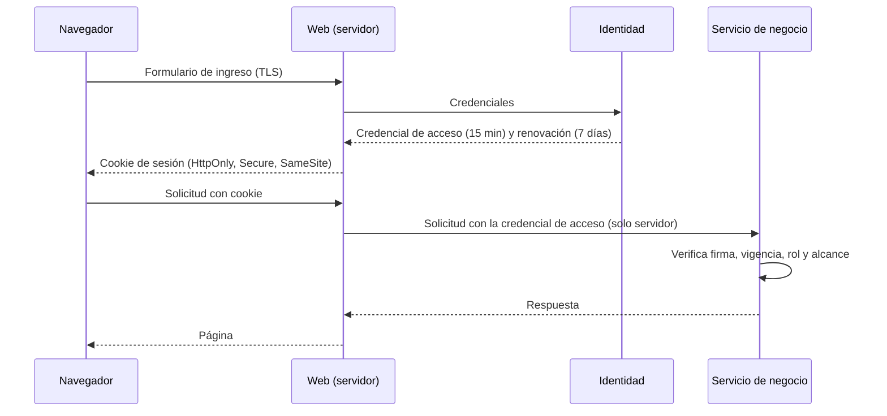

# Autenticación y autorización

Describe cómo se identifica a las personas y a los servicios, cómo viaja la identidad y cómo se decide qué puede hacer cada uno. Desarrolla AD22 y los requisitos RNF05 y RNF15; el comportamiento exacto está en `identidad-seguridad` (IDE) y `transversal-seguridad` (SEG).

## 1. Modelo

La credencial **nunca llega al navegador** (AGENTS.md, regla 9). El navegador solo guarda una cookie de sesión opaca. Los servicios validan la firma y la vigencia por sí mismos, sin consultar a Identidad en cada solicitud (IDE-10).

## 2. Credenciales de las personas

| Elemento | Decisión | Fuente |
| :--- | :--- | :--- |
| Credencial de acceso | Firmada, de **15 minutos**, con rol y sucursal. | AD22, IDE-02 |
| Renovación | De **7 días** para el cliente y **8 horas** para el personal, revocable; también se revoca al cambiar la contraseña o el segundo factor (IDE-44); se invalida al cerrar sesión, al desactivar al usuario y al restablecer la contraseña. | AD22, IDE-08, IDE-14, IDE-18 |
| Contraseña | Mínimo 10 caracteres, fuera de listas comunes o filtradas, sin reglas de composición (guía NIST 800-63B); resumen robusto con sal. | IDE-09, IDE-15, RNF15 |
| Clave de firma | Solo Identidad posee la clave de firma y publica la de verificación; la credencial lleva el identificador de la clave y el algoritmo es fijo. Rota cada 90 días o ante sospecha; la clave comprometida y sus renovaciones se dejan de aceptar en 5 minutos como máximo, con la última lista conocida si Identidad no responde. | IDE-35, IDE-36 |
| Protección del segundo factor | El secreto TOTP se guarda cifrado y los códigos de respaldo solo como resumen; un código ya usado en su ventana se rechaza y se acepta un desfase de una ventana; hasta presentar el segundo factor solo se puede configurarlo o presentarlo. El bloqueo por fallos es por cuenta y origen. | IDE-40 a IDE-42, SEG-20 |
| Aviso de cambio | Al cambiar o restablecer la contraseña llega un aviso al correo, sin la contraseña. | IDE-45 |
| Credencial del asistente | 5 minutos, sin renovación, con el único alcance de leer los pedidos del cliente en el servicio de pedidos. | IDE-33 |
| Bloqueo | 5 fallos en 15 minutos bloquean temporalmente el ingreso; la respuesta no distingue si la cuenta existe. | IDE-03, SEG-06 |
| Segundo factor | TOTP obligatorio para el personal (encargado, logística y administrador central) y opcional para el cliente; recuperar la contraseña no lo desactiva; la administración puede restablecerlo. | IDE-20, IDE-37, IDE-38 |
| Verificación del correo | Código de un solo uso por correo al registrarse o cambiar el correo; el correo sin verificar no permite recuperar el acceso ni iniciar un pago (frena el registro masivo para acaparar stock). | IDE-01, IDE-16, IDE-29, CAR-21 |
| Registro | Máximo 3 cuentas nuevas por hora por origen; se aceptan los términos y la privacidad con su versión y fecha. | SEG-24, IDE-34 |
| Sesión web | 30 minutos de inactividad renovables con cada interacción; máximo absoluto de 7 días (clientes) u 8 horas (personal); identificador nuevo al ingresar e invalidado al cerrar o vencer. La sesión vive en el servidor; la cookie solo lleva un identificador opaco. | WEB-27, WEB-28, WEB-19 |
| Recuperación del cliente | Código de un solo uso (10 minutos, 5 intentos, 3 solicitudes por hora) enviado al correo verificado; al restablecer se revocan todas las renovaciones. | IDE-17 a IDE-19, SEG-19 |
| Recuperación del personal | La restablece el administrador central con una contraseña temporal de un solo uso, auditada. | IDE-23 |
| Códigos de respaldo | 8 códigos de un solo uso del segundo factor, para el personal y para el cliente que lo active. | IDE-21, IDE-22, IDE-37 |

**Riesgo conocido:** quien controle el correo de una cuenta puede recuperarla (AM03, riesgo residual medio). Se mitiga con el código corto, el límite de intentos y solicitudes, el aviso de cambio de contraseña y el cambio de correo que exige la contraseña actual (IDE-25). El proveedor de correo es un bloqueo abierto (B08).

## 3. Identidades de servicio

| Caso | Mecanismo |
| :--- | :--- |
| E-commerce → Inventario | Se reenvía la credencial del usuario para acciones del usuario; para tareas de fondo (expiración de reservas, reintentos) se usa una credencial de servicio de mínimo privilegio. |
| Asistente → catálogo y disponibilidad | Credencial de servicio de solo lectura; sin acceso a las bases de datos. |
| Asistente → pedidos | Credencial de 5 minutos, de solo lectura y limitada al propio cliente, emitida por Identidad a pedido de la capa web (IDE-33); el servicio de pedidos filtra por ese cliente, no el asistente. |
| Notificador ↔ servicios | Secreto compartido o firma verificada en ambos sentidos. |
| Pasarela → E-commerce (aviso) | Firma o secreto del aviso; el estado se confirma además consultando a la pasarela. |

Las credenciales de servicio viven en el entorno de cada contenedor (SEG-11), nunca en el repositorio, y se rotan al cambiar de integrante del equipo o ante sospecha de filtración.

## 4. Autorización

1. **Rol:** viene en la credencial. Define qué funciones existen para el usuario (menús, rutas, casos de uso).
2. **Alcance de sucursal:** viene en la credencial del encargado. Cada caso de uso de la **Aplicación** compara la sucursal del usuario con la del recurso. Los controladores solo verifican el rol, nunca el alcance.
3. **Propiedad:** un cliente solo accede a lo propio (pedidos, biblioteca, cuenta). La comprobación usa el identificador de la credencial, no un identificador recibido en la solicitud.
4. **Denegación:** todo acceso fuera de alcance se rechaza, se registra como evento de seguridad (AUD-10) y suma al umbral de alerta (SEG-09).
5. **Por defecto se niega:** una ruta o una función sin política explícita no está disponible.

### Matriz de verificación

| Escenario | Resultado esperado | Prueba |
| :--- | :--- | :--- |
| Encargado de Ayacucho pide el inventario de Cusco | Rechazo y registro de acceso denegado. | AC-AUD-04 |
| Cliente A pide la biblioteca del cliente B | Rechazo. | AC-BIB-10 |
| Cliente consulta pedidos | Solo ve los suyos. | PED-07 |
| Encargado abre una pantalla de administración | Pantalla de sin permiso. | AC-WEB-02 |
| Personal ingresa sin segundo factor | No recibe credencial. | AC-IDE-18 |

## 5. Cierre de sesión y cambios de rol

Cerrar sesión invalida la renovación. Desactivar a un usuario impide su ingreso y su renovación (IDE-08). Cambiar el rol hace que las credenciales vigentes dejen de servir en la siguiente renovación (como máximo 15 minutos de desfase); esa ventana se acepta porque una credencial más corta aumentaría la carga sobre Identidad.

## 6. Decisiones pendientes

- Custodia de la clave de firma (dónde vive la clave privada y cómo se respalda); la rotación está decidida en IDE-36 (CTL-29).
- Proveedor de correo y configuración de SPF, DKIM y DMARC (B08, AM23).
- ~~Si se extiende el segundo factor al encargado de sucursal~~ Resuelto el 2026-10-16: obligatorio para todo el personal y opcional para el cliente.
