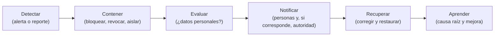

# Operación segura

Cubre lo que sucede después de escribir el código: cómo se construye, se configura, se despliega, se vigila, se respalda y se responde a un incidente. Apoya RNF19, RNF20 y RNF24, y las decisiones AD25 y AD27. Las herramientas son gratuitas (RC15).

## 1. Ciclo de desarrollo seguro

Se sigue una versión reducida del **NIST SSDF**, integrada al flujo de [Spec-Driven Development](../07-proceso-de-desarrollo/01-flujo-sdd.md):

| Práctica | Cómo se aplica |
| :--- | :--- |
| Preparar la organización | Constitución (`AGENTS.md`) con reglas de seguridad no negociables; este directorio como referencia. |
| Proteger el código | Repositorio privado; ramas protegidas; secretos fuera del repositorio; revisión de cambios. |
| Producir software bien protegido | Requisitos de seguridad en las specs (SEG, IDE, etc.); pruebas de seguridad por criterio; revisión de arquitectura y de seguridad por agentes antes de cerrar un plan. |
| Responder a vulnerabilidades | Dependabot y avisos de seguridad del repositorio; corrección priorizada por severidad. |

## 2. Canalización de integración continua

| Control | Herramienta | Cuándo | Falla si |
| :--- | :--- | :--- | :--- |
| Validación de specs y enlaces | `SpecCheck` | Cada cambio | Hay un error. |
| Compilación sin advertencias | `dotnet build -warnaserror` | Cada cambio | Hay una advertencia. |
| Pruebas y arquitectura | `dotnet test` | Cada cambio | Falla una prueba. |
| Análisis estático (SAST) | CodeQL | Cada cambio y semanal | Hay un hallazgo crítico o alto. |
| Dependencias vulnerables | Dependabot y `dotnet list package --vulnerable` | Semanal y cada cambio | Hay una vulnerabilidad alta o crítica sin excepción registrada. |
| Imágenes de contenedor | Trivy | Al construir imágenes | Hay una vulnerabilidad crítica o alta corregible. |
| Detección de secretos | Escáner de secretos (por ejemplo, gitleaks) | Cada cambio | Aparece un secreto. |
| Inventario de componentes | SBOM (formato CycloneDX o SPDX) | Al liberar | No se genera. |
| Pruebas dinámicas básicas | OWASP ZAP baseline contra el entorno local | Antes de cada despliegue (cada versión que se despliega en producción) | Hay una alerta media o superior sin revisar. |

> Estado: **pendiente de implementar**. Hoy CI ejecuta SpecCheck, compilación y pruebas; el resto se agrega como tareas de infraestructura, sin bloquear la aprobación de specs.

## 3. Configuración y endurecimiento

| Área | Regla |
| :--- | :--- |
| Contenedores | Imágenes multi-arquitectura con versión fija; usuario sin privilegios; sistema de archivos de solo lectura cuando se pueda; `healthcheck`; límites de memoria y CPU. |
| Red | La base y Redis sin puertos publicados a Internet y con TLS entre VMs; cada servicio escucha solo en la dirección privada de su VM; el Inventario sin entrada pública; paneles de n8n y Evolution API solo por túnel SSH; solo Cloudflare Tunnel llega a Nginx. Reglas por VM en [despliegue](../02-arquitectura-de-software/05-despliegue.md) §7. |
| Sistema operativo | Linux mínimo sin entorno gráfico; actualizaciones de seguridad automáticas; acceso por clave SSH, sin contraseña. |
| Secretos | Variables de entorno por contenedor; `.env` ignorado por Git; rotación ante cambios del equipo o sospecha; la credencial de aplicación de la cuenta de Gmail se revoca y se renueva desde la cuenta de Google ante cualquier sospecha. **Cada VM recibe solo los secretos de sus servicios** (la clave de Culqi solo en VM-VENTAS, la clave de firma solo en las VMs que alojan Identidad (VM-VENTAS y la réplica de gestión de VM-INVENTARIO), las contraseñas de cada base solo en su servicio). |
| Cuentas de base de datos | Un rol por esquema que solo puede usar su propio esquema (`pg_hba` por base y origen, `REVOKE` a los demás); el esquema `identidad` solo lo usa el módulo Identidad; la cuenta de aplicación no es dueña de las tablas y no puede modificar la auditoría; la anonimización de AUD-19 la hace un rol de depuración distinto, con permiso limitado a las columnas de datos personales. |
| Seguridad por filas | En el Inventario, política por sucursal (`FORCE ROW LEVEL SECURITY`) con la sucursal fijada por `SET LOCAL` en cada transacción. Es una segunda capa frente a un error de alcance en la Aplicación; **no protege contra el control total del servidor**. |
| VM del Inventario | Concentra la base, el Inventario y la réplica de gestión (AD31): contenedores sin privilegios, en redes de Docker separadas y sin el socket de Docker; sistema de archivos de solo lectura cuando se pueda; SSH solo por la VM-AUX; actualizaciones automáticas; discos cifrados; alertas de ingreso por SSH, procesos y puertos nuevos; y recuperación como defensa principal (respaldo y WAL en el almacén de objetos). |
| Hora | Sincronización con `chrony` en todas las VMs, porque las credenciales duran 15 minutos y se validan en cada servicio. |
| Entornos | Desarrollo, pruebas y producción separados; datos de ejemplo solo en desarrollo y pruebas; nunca datos reales en pruebas, salvo el entorno de restauración aislado de los ensayos de respaldo (PLA-22): datos cifrados, sin salida a proveedores externos, acceso solo de la persona responsable y destrucción al terminar. |

## 3.1 Límites de uso y protección contra abuso

Cuatro niveles (AD24). Cada uno frena un tipo de abuso distinto y el personal también tiene presupuestos.

| Nivel | Qué frena | Cómo |
| :--- | :--- | :--- |
| **Cloudflare** | DDoS de red y de aplicación, tráfico automatizado, rutas del personal | Protección DDoS incluida, reglas WAF, *Bot Fight Mode*, reglas de tasa y Turnstile (verificación humana) en inicio de sesión, registro, reclamos, reservas y asistente; **Cloudflare Access con MFA** en el host de gestión. |
| **Nginx** | Ráfagas por IP | `limit_req` y `limit_conn` por la IP real (`CF-Connecting-IP`), tamaño máximo de cuerpo y tiempos de espera. Solo confía en esa cabecera cuando la solicitud llega por el túnel (conector local o red privada de la cuenta); el puerto de Nginx no se publica a Internet, para que nadie pueda falsificar su IP y evadir los límites. |
| **Aplicación** | Abuso por actor y por regla de negocio | Presupuestos por actor y rol (ingreso 5 por 15 min, API 100 por minuto por usuario, descargas 10 por hora, asistente 10 por minuto, una reserva activa y 5 por hora) y, para el personal, topes por hora de ajustes y solicitudes de traslado por usuario (SEG-30) y verificación humana en los flujos abiertos (SEG-31); respuesta uniforme con espera sugerida (SEG-07). |
| **Base de datos** | Consultas que agotan al otro servicio | `CONNECTION LIMIT` por rol y `statement_timeout`. |

El Inventario no tiene entrada pública: solo acepta llamadas del E-commerce, por lo que su superficie de ataque externa es mínima. La interfaz verifica que las solicitudes provengan de personas reales con Turnstile y de los orígenes del túnel con Cloudflare, y los eventos de exceso se registran por actor y origen (SEG-08).

## 4. Registro y alertas

| Qué | Dónde | Notas |
| :--- | :--- | :--- |
| Eventos de seguridad (ingresos fallidos, bloqueos, accesos denegados, límites, cambios de rol, segundo factor fallido) | Registro de auditoría de cada servicio (AUD-05, AUD-10, AUD-28, AUD-33, AUD-37) | Sin contraseñas, credenciales, datos de tarjeta ni enlaces (SEG-10). |
| Registros técnicos | Salida estándar de los contenedores, con el identificador de seguimiento | Rotación por tamaño; retención corta. Con varias VMs, el `traceId` es la clave para seguir una solicitud entre servicios; no hay agregación central (fuera de alcance) y los registros de cada VM se consultan por SSH desde la VM-AUX. |
| Alerta | Más de 10 accesos denegados o 20 ingresos fallidos en 5 minutos, contados por servicio | Lista de la administración central y correo a los administradores activos, agrupado cada 15 minutos (SEG-09). |
| Alerta técnica | Falla al registrar un evento de seguridad (AUD-12) o de la depuración diaria (AUD-31) | Correo a la administración central y revisión inmediata; sin pantalla (AUD-29). |
| Disponibilidad | Monitoreo ligero desde la VM-AUX, fuera de las VMs de aplicaciones | Aviso por correo si la puerta pública o la salud de un servicio no responde. |

Retención de registros de auditoría y seguridad: dos años (AUD-11).

## 5. Respaldo y recuperación (RNF24, AD27)

| Elemento | Decisión |
| :--- | :--- |
| Objetivos | **RPO de 15 minutos** con el archivado de WAL (24 horas solo si el archivo de cambios está roto, PLA-15 y PLA-21) y **RTO ≤ 4 horas** (PLA-10). |
| Qué se respalda | Las bases `ecommerce` (con todos sus esquemas, incluido `identidad`) e `inventario` (una copia consistente de las dos bases al mismo instante, PLA-09, de la que se restaura el clúster o se extrae cada base), el archivado continuo de WAL, la configuración de n8n y de Evolution API, y los archivos de Compose sin secretos. La base técnica de Evolution API entra en la copia del clúster, cifrada, pero al restaurar se descarta y se vuelve a emparejar el número de WhatsApp; el entorno de ensayo no levanta Evolution API (PLA-39). Los archivos digitales ya viven en el almacén de objetos. |
| Frecuencia | Copia consistente diaria de las dos bases y archivado continuo de WAL (RPO de minutos); una réplica de PostgreSQL en caliente es una mejora opcional. |
| Cifrado | Cifrado antes de salir de la VM del Inventario (volcado y WAL). La clave se guarda fuera de la VM de datos, del repositorio y del almacén de respaldos, con una copia fuera de línea en poder de la persona responsable (PLA-17); la restauración debe poder hacerse sin la VM original. |
| Destino | Almacén de objetos (Oracle Object Storage), en un bucket distinto del de los libros y con una credencial de la VM que solo permite agregar objetos, no borrar ni sobrescribir (PLA-16). **Riesgo aceptado (B13):** si se pierde la cuenta de Oracle se pierden también los respaldos; la copia fuera de Oracle queda pospuesta. |
| Retención | Escalonada: 7 diarios, 4 semanales y 3 mensuales (decidido el 2026-11-12, PLA-18). Al restaurar, se vuelven a aplicar las supresiones y anonimizaciones posteriores (PLA-19). |
| Prueba | Restauración en un entorno de restauración aislado **antes de cada despliegue** (cada versión que se despliega en producción), con un respaldo posterior al último cambio de esquema, y registro del tiempo real (PLA-11, PLA-22). |
| Contingencia | Si Oracle no concede una VM ARM o la pierde pero la cuenta sigue activa, se levanta el mismo Compose en otra máquina desde el respaldo y el archivado de WAL ([despliegue](../02-arquitectura-de-software/05-despliegue.md) §6). |

## 6. Respuesta a incidentes

| Paso | Qué se hace |
| :--- | :--- |
| Detectar | Alerta de seguridad, reporte de un cliente o hallazgo de un escáner. |
| Contener | Revocar credenciales, desactivar la cuenta o la integración afectada, bloquear el origen en Cloudflare. |
| Evaluar | Determinar qué datos y cuántas personas se afectaron. |
| Notificar | Informar a las personas afectadas y, cuando corresponda, a la autoridad dentro de las 48 horas de conocer el incidente (meta interna, a verificar; véase [privacidad](04-privacidad-y-datos-personales.md)). |
| Recuperar | Corregir la causa, restaurar desde respaldo si hace falta y volver a probar. |
| Aprender | Registrar el incidente en `progress/`, actualizar el modelo de amenazas y agregar la prueba que lo habría evitado. |

Contactos y responsabilidades: la persona responsable del proyecto decide; el equipo documenta cada incidente aunque sea menor.

## 7. Gestión de cambios y vulnerabilidades

- Las actualizaciones de dependencias críticas se aplican en una rama, con pruebas y SpecCheck.
- Una vulnerabilidad crítica o alta sin corrección disponible se registra en `progress/blockers.md` con su mitigación y fecha de revisión; la aprueba la persona responsable y la excepción vence en su fecha de revisión (PLA-25).
- Antes de cada despliegue (cada versión que se despliega en producción): pruebas completas, escaneo de imágenes, ZAP baseline y restauración de prueba.

## 8. Acciones pendientes

| Pendiente | Responsable | Relacionado |
| :--- | :--- | :--- |
| Agregar CodeQL, Dependabot, Trivy, escáner de secretos y SBOM a CI | Infraestructura | RNF19, CTL-34 |
| ~~Definir cifrado y custodia de la clave de los respaldos~~ | Resuelto el 2026-11-12: fuera de la VM, del repositorio y del almacén, con copia fuera de línea (PLA-17) | CTL-28 |
| ~~Elegir el proveedor de correo~~ | Resuelto el 2026-11-12: MailKit con una cuenta de Gmail sencilla, sin dominio propio por ahora | B08, AM23 |
| ~~Elegir el canal de alertas para la administración~~ | Resuelto el 2026-10-16: lista en el panel y correo (SEG-09) | SEG |
