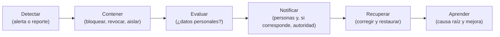

# Operación segura

Cubre lo que sucede después de escribir el código: cómo se construye, se configura, se despliega, se vigila, se respalda y se responde a un incidente. Apoya RNF19, RNF20 y RNF24, y las decisiones AD25 y AD27. Las herramientas son gratuitas (RC15).

## 1. Ciclo de desarrollo seguro

Se sigue una versión reducida del **NIST SSDF**, integrada al flujo de [Spec-Driven Development](../07-proceso-de-desarrollo/01-flujo-sdd.md):

| Práctica | Cómo se aplica |
| :--- | :--- |
| Preparar la organización | Constitución (`AGENTS.md`) con reglas de seguridad no negociables; este directorio como referencia. |
| Proteger el código | Repositorio privado; ramas protegidas; secretos fuera del repositorio; revisión de cambios. |
| Producir software bien protegido | Requisitos de seguridad en las specs (SEG, IDE, etc.); pruebas de seguridad por criterio; revisión de arquitectura y de seguridad por agentes antes de cerrar un plan. |
| Responder a vulnerabilidades | Dependabot y avisos de seguridad del repositorio; corrección priorizada por severidad. |

## 2. Canalización de integración continua

| Control | Herramienta | Cuándo | Falla si |
| :--- | :--- | :--- | :--- |
| Validación de specs y enlaces | `SpecCheck` | Cada cambio | Hay un error. |
| Compilación sin advertencias | `dotnet build -warnaserror` | Cada cambio | Hay una advertencia. |
| Pruebas y arquitectura | `dotnet test` | Cada cambio | Falla una prueba. |
| Análisis estático (SAST) | CodeQL | Cada cambio y semanal | Hay un hallazgo crítico o alto. |
| Dependencias vulnerables | Dependabot y `dotnet list package --vulnerable` | Semanal y cada cambio | Hay una vulnerabilidad alta o crítica sin excepción registrada. |
| Imágenes de contenedor | Trivy | Al construir imágenes | Hay una vulnerabilidad crítica o alta corregible. |
| Detección de secretos | gitleaks (árbol e historial completo, con `.gitleaks.toml`) y Trivy con análisis de secretos en las capas de cada imagen, por `scripts/escanear-secretos.sh` y el flujo `secretos.yml` | Cada cambio y cada imagen construida | Aparece un secreto; la salida nunca lo copia (gitleaks enmascara el 100 % y Trivy lo sustituye por asteriscos). |
| Inventario de componentes | SBOM (formato CycloneDX o SPDX) | Al liberar | No se genera. |
| Pruebas dinámicas básicas | OWASP ZAP baseline contra el entorno local | Antes de cada despliegue (cada versión que se despliega en producción) | Hay una alerta media o superior sin revisar. |

> Estado: **pendiente de implementar**. Hoy CI ejecuta SpecCheck, compilación y pruebas; el resto se agrega como tareas de infraestructura, sin bloquear la aprobación de specs.

## 3. Configuración y endurecimiento

| Área | Regla |
| :--- | :--- |
| Contenedores | Imágenes multi-arquitectura con versión fija; usuario sin privilegios; sistema de archivos de solo lectura cuando se pueda; `healthcheck`; límites de memoria y CPU. |
| Red | La base y Redis sin puertos publicados a Internet y con TLS entre VMs; cada servicio escucha solo en la dirección privada de su VM; el Inventario sin entrada pública; paneles de n8n y Evolution API solo por túnel SSH; solo Cloudflare Tunnel llega a Nginx. Reglas por VM en [despliegue](../02-arquitectura-de-software/05-despliegue.md) §7. |
| Sistema operativo | Linux mínimo sin entorno gráfico; actualizaciones de seguridad automáticas; acceso por clave SSH, sin contraseña. |
| Secretos | Variables de entorno por contenedor; `.env` ignorado por Git; rotación ante cambios del equipo o sospecha; la credencial de aplicación de la cuenta de Gmail se revoca y se renueva desde la cuenta de Google ante cualquier sospecha. **Cada VM recibe solo los secretos de sus servicios** (la clave de Culqi solo en VM-VENTAS, la clave de firma solo en las VMs que alojan Identidad (VM-VENTAS y la réplica de gestión de VM-INVENTARIO), las contraseñas de cada base solo en su servicio). |
| Cuentas de base de datos | Un rol por esquema que solo puede usar su propio esquema (`pg_hba` solo con `hostssl`, por base, y `REVOKE` a los demás; las conexiones de red van cifradas con TLS y los clientes verifican al servidor con la CA privada, AM24); el esquema `identidad` solo lo usa el módulo Identidad; la cuenta de aplicación no es dueña de las tablas y no puede modificar la auditoría; la anonimización de AUD-19 la hace un rol de depuración distinto, con permiso limitado a las columnas de datos personales. |
| Seguridad por filas | En el Inventario, política por sucursal (`FORCE ROW LEVEL SECURITY`) con la sucursal fijada por `SET LOCAL` en cada transacción. Es una segunda capa frente a un error de alcance en la Aplicación; **no protege contra el control total del servidor**. |
| VM del Inventario | Concentra la base, el Inventario y la réplica de gestión (AD31): contenedores sin privilegios, en redes de Docker separadas y sin el socket de Docker; sistema de archivos de solo lectura cuando se pueda; SSH solo por la VM-AUX; actualizaciones automáticas; discos cifrados; alertas de ingreso por SSH, procesos y puertos nuevos; y recuperación como defensa principal (respaldo y WAL en el almacén de objetos). |
| Hora | Sincronización con `chrony` en todas las VMs, porque las credenciales duran 15 minutos y se validan en cada servicio. |
| Entornos | Desarrollo, pruebas y producción separados; datos de ejemplo solo en desarrollo y pruebas; nunca datos reales en pruebas, salvo el entorno de restauración aislado de los ensayos de respaldo (PLA-22): datos cifrados, sin salida a proveedores externos, acceso solo de la persona responsable y destrucción al terminar. |

## 3.1 Límites de uso y protección contra abuso

Cuatro niveles (AD24). Cada uno frena un tipo de abuso distinto y el personal también tiene presupuestos.

| Nivel | Qué frena | Cómo |
| :--- | :--- | :--- |
| **Cloudflare** | DDoS de red y de aplicación, tráfico automatizado, rutas del personal | Protección DDoS incluida, reglas WAF, *Bot Fight Mode*, reglas de tasa y Turnstile (verificación humana) en inicio de sesión, registro, reclamos, reservas y asistente; **Cloudflare Access con MFA** en el host de gestión. |
| **Nginx** | Ráfagas por IP | `limit_req` y `limit_conn` por la IP real (`CF-Connecting-IP`), tamaño máximo de cuerpo y tiempos de espera. Solo confía en esa cabecera cuando la solicitud llega por el túnel (conector local o red privada de la cuenta); el puerto de Nginx no se publica a Internet, para que nadie pueda falsificar su IP y evadir los límites. |
| **Aplicación** | Abuso por actor y por regla de negocio | Presupuestos por actor y rol (ingreso 5 por 15 min, API 100 por minuto por usuario, descargas 10 por hora, asistente 10 por minuto, una reserva activa y 5 por hora) y, para el personal, topes por hora de ajustes y solicitudes de traslado por usuario (SEG-30) y verificación humana en los flujos abiertos (SEG-31); respuesta uniforme con espera sugerida (SEG-07). |
| **Base de datos** | Consultas que agotan al otro servicio | `CONNECTION LIMIT` por rol y `statement_timeout`. |

El Inventario no tiene entrada pública: solo acepta llamadas del E-commerce, por lo que su superficie de ataque externa es mínima. La interfaz verifica que las solicitudes provengan de personas reales con Turnstile y de los orígenes del túnel con Cloudflare, y los eventos de exceso se registran por actor y origen (SEG-08).

## 3.2 Lista de secretos del entorno de `transversal-seguridad`

Todos llegan por variables de entorno con el prefijo `BABELHUB__` (el doble guion bajo es el separador de sección de .NET) y cada VM recibe solo los de sus servicios. Al arrancar, el servicio **falla** si falta uno obligatorio o es débil, y el mensaje nombra la variable y nunca el valor. Reglas comunes a todo secreto: al menos 32 bytes, al menos 8 caracteres distintos (no un carácter repetido), **distinto de cualquier otro secreto del servicio** y la versión anterior distinta de la actual. Ninguno se registra: los registros pasan por la redacción de datos prohibidos (SEG-10) y una revisión automática vigila el repositorio y los registros (AC-SEG-25).

| Variable | Servicio | Uso |
| :--- | :--- | :--- |
| `BABELHUB__Seguridad__ClaveDeHuella` y `…ClaveDeHuellaAnterior` | Ambos | Clave HMAC de las huellas de origen y de sujeto (SEG-25), con el formato `versión:base64`. La anterior solo existe durante una rotación. |
| `BABELHUB__Seguridad__Credenciales__<Alcance>` y `…<Alcance>Anterior` | Ambos | Una credencial de servicio por alcance, con el nombre del alcance en PascalCase (`OperacionDeUsuario`, `LecturaDeDisponibilidad`, `OrigenReenviado`…); cada servicio exige solo los que valida o envía. |
| `BABELHUB__Integraciones__<Proveedor>__Secreto` y `…SecretoAnterior` | El que recibe el aviso | Secreto de la firma HMAC de cada proveedor de integración (SEG-12). |
| `BABELHUB__Seguridad__Turnstile__Secreto` | E-commerce | Secreto de `siteverify` de Turnstile (SEG-31). |
| `BABELHUB__Seguridad__Turnstile__Hostnames` y `…ClaveDeSitio` | E-commerce | No son secretos: los nombres de host permitidos (separados por comas) y la clave de sitio pública del desafío. Se validan igual al arrancar. |
| `BABELHUB__Almacen__Supresiones__Endpoint`, `…__Region`, `…__ClaveDeAcceso` y `…__ClaveSecreta` | E-commerce | La credencial `supresiones-registro` del almacén de objetos (solo crear y leer en `entradas/`) con la que Identidad escribe el registro de supresiones (PLA-37, PLA-38); el endpoint es https. |
| `BABELHUB__Almacen__Catalogo__Endpoint`, `…__Region`, `…__ClaveDeAcceso` y `…__ClaveSecreta` | E-commerce | La credencial `catalogo-archivos` del almacén de objetos (crear, leer por rango y borrar en los contenedores `libros` y `portadas`; sin listar ni administrar el almacén) con la que el Catálogo guarda y sirve portadas y libros; es distinta de la de lectura de la Biblioteca y de la de supresiones; el endpoint es https. Se compone cuando se une el Catálogo a `Program.cs`. |
| `BABELHUB__Almacen__Biblioteca__Endpoint`, `…__Region`, `…__ClaveDeAcceso` y `…__ClaveSecreta` | E-commerce | La credencial `biblioteca-lector` (también en la réplica de gestión, que la exige para arrancar) del almacén de objetos (**solo leer** en el contenedor `libros`): hace el `HEAD` de existencia y firma localmente (SigV4) los enlaces de descarga de 300 segundos como máximo; distinta de la de escritura del Catálogo y de la de supresiones. **Obligatoria en producción** (sin ella el arranque falla y no se publica con contenido sintético); el endpoint es https. Se rota como el resto de credenciales del almacén y, al rotarla, los enlaces ya entregados caducan solos en cinco minutos como máximo (el sistema no guarda enlaces firmados). |
| `BABELHUB__Web__OrigenDelAlmacen` | E-commerce, host `tienda` | El origen https exacto del almacén de libros que la política de contenido abre **solo** en `form-action` de la página `/biblioteca` (Chrome aplica `form-action` también a la redirección de la descarga). **Debe coincidir con el host de `BABELHUB__Almacen__Biblioteca__Endpoint`** (con el estilo de ruta o de host virtual que use el almacén); si falta o difiere, el navegador bloquea las descargas. Nunca se corrige con un comodín. |
| `BABELHUB__Catalogo__ClaveDeIngresos` y `…ClaveDeIngresosAnterior` | E-commerce | Clave HMAC-SHA256 (al menos 32 bytes, distinta de toda otra) con la que el Catálogo firma el token de 30 minutos del formulario de ingreso de mercadería (es la clave de idempotencia del ingreso); la `Anterior` permite rotarla sin invalidar formularios abiertos. |
| `ASPNETCORE_ENVIRONMENT` y `BABELHUB__Pagos__Pasarela` | E-commerce | No son secretos, pero **van juntos y se validan juntos** (PAG-34, D25 de `ecommerce-pagos`): `Staging` (el entorno de revisión de la tienda por la pasarela, **de tipo producción**: mismo endurecimiento que `Production`) solo con `simulador`, que no cobra y se anuncia en pantalla; `Production` solo con `culqi` y `sk_live_…`. Salen del archivo de secretos del E-commerce (los Compose no los fijan), `scripts/desplegar.sh` se niega si no son coherentes y la aplicación vuelve a negarse a arrancar: nunca se cobra «a ciegas». |
| `BABELHUB__Envios__Operador` | E-commerce | No es un secreto. En un entorno de tipo producción debe ser `simulador` (no habrá operador logístico real, DD-22 y DD-88): sin valor el servicio no arranca. La tienda lo anuncia en pantalla («Los envíos son simulados: proyecto académico», PAG-42). `scripts/desplegar.sh` lo exige. |
| `BABELHUB__Contacto__Telefono`, `…__Correo` y `…__Direccion` | E-commerce | **Datos personales** de la persona responsable que la tienda muestra como contacto (Ley N.º 29733): van solo en los archivos de secretos de las VMs, **nunca en el repositorio, el registro ni la auditoría**. |
| `BABELHUB__Migrador__Ecommerce__VersionDeTextos` | Solo `migrador.env` (VM-INVENTARIO) | La versión con la que `migrar` siembra, solo si faltan, los textos legales vigentes (términos, privacidad y reembolso; PAG-37): la aplicación solo los lee. No es un secreto. Nunca pisa lo ya sembrado; cambiar la versión es una decisión de la persona responsable y obliga a todas las cuentas a aceptar los textos de nuevo. |
| `BABELHUB__Pagos__LlavePrivada` | E-commerce | La llave privada de la pasarela de pagos (en Culqi, `sk_test_…` solo en `Development` y `Test` y `sk_live_…` solo en `Production`; de al menos 16 caracteres; **`Staging` no lleva ninguna**). **Con el simulador no se usa**, y en `Restauracion` y `Ensayo` ni se lee: el adaptador es siempre el nulo. El servicio no arranca con `culqi` si falta o no coincide con el entorno (PAG-12). |
| `BABELHUB__Pagos__ClaveDeIntentos` y `…ClaveDeIntentosAnterior` | E-commerce | Clave HMAC (al menos 32 bytes, distinta de toda otra) que firma la clave de cada intento de cobro; con la anterior, las claves ya emitidas siguen valiendo hasta que vencen. Sin ella el servicio no arranca (la guarda de arranque de Pagos ya lo exige y está probada; **se conecta al anfitrión con COMP-1**, junto con la comparación contra las demás claves en `RepeticionDeSecretos`). |
| `BABELHUB__Restauracion__SecretoDeLaMarca` | Ambos | El secreto del HMAC de la marca de un solo uso que `restaurar.sh` emite para arrancar `Restauracion` o `Ensayo` en producción; solo lo conocen el script y el servicio. |
| `BABELHUB__Ensayo__ProhibidosSha256` | Ambos (solo en el ensayo) | No es un secreto: las huellas SHA-256 de las credenciales de producción, para que el ensayo se niegue a arrancar si alguna variable de secreto coincide con una. |
| `BABELHUB__Seguridad__ClaveDeRedisDeLimites` | E-commerce y réplica de gestión | Contraseña del usuario `limites` del Redis de contadores. |
| `BABELHUB__Auditoria__ClaveDeCursor` | Ambos, una distinta por servicio | Clave HMAC del cursor firmado de la consulta de auditoría, con versión y rotación (`transversal-auditoria`). |
| `BABELHUB__Inventario__ClaveDeBajas` | Inventario | Clave HMAC-SHA256 (al menos 32 bytes, distinta de toda otra) con la que `Reservas` calcula el identificador anónimo de un titular dado de baja y de las reservas de más de 2 años (separación de dominio `baja:v1:`, 128 bits del resultado). **Fuera de la rotación** (PLA-43 y `rotar-credenciales.sh` no la tocan): rotarla rompería la repetibilidad de la baja y la unicidad de la idempotencia. Quien tenga la clave y los identificadores del E-commerce puede recalcular el vínculo: custodia como el resto de secretos del archivo `inventario.env`, sin copia en el repositorio, en la auditoría ni en los registros. Se exige al arrancar. |
| `BABELHUB__Web__ClaveDeSesionesTienda` y `…Anterior` | E-commerce, solo la VM del host `tienda` | Clave maestra (al menos 32 bytes) de la que el módulo `Web` deriva con HKDF las subclaves de cifrado de la credencial, la renovación, el borrador y el anillo de Data Protection del host `tienda` (`web-base` D02). La anterior solo existe durante una rotación en dos pasos. |
| `BABELHUB__Web__ClaveDeSesionesGestion` y `…Anterior` | E-commerce, solo la VM del host `gestion` | Lo mismo para el host `gestion`. Debe ser distinta de la de `tienda` y de cualquier otro secreto: una `tienda` comprometida no descifra las sesiones de `gestion`. |
| `BABELHUB__Web__Host` y `BABELHUB__Web__HostsPermitidos` | E-commerce | No son secretos. El primero es el rol del proceso (`tienda` o `gestion`) y decide qué áreas se mapean; el segundo, los hosts que acepta el servidor (`AllowedHosts`) y que usa la comprobación de `Origin`. |
| `BABELHUB__Contacto__Telefono`, `…Correo` y `…Direccion` | E-commerce, los dos hosts (`ecommerce.env` y `ecommerce-gestion.env`) | **No son secretos.** El teléfono, el correo y la dirección públicos del comercio (pie de toda página y `/contacto`; `web-informacion-del-comercio`). Obligatorios en todo entorno distinto de `Development` y `Test` (incluidos `Staging`, `Production`, `Ensayo` y `Restauracion`): si falta uno o no cumple el formato (spec §5), el servicio no arranca y el error nombra la variable, nunca el valor. `generar-secretos.sh` los deja como `CAMBIAR`; la restauración y el ensayo reutilizan el mismo `ecommerce.env`. El correo debe ser de atención al cliente, no la cuenta del Notificador (AM23, AM28). Ver `infra/README.md`. |

### 3.2.0 Operaciones de consola de la imagen del E-commerce (PAG-35 a PAG-49)

Dos modos de consola (con varias opciones), sin endpoint, con el entorno del propio servicio dentro de la VM (el mismo nivel de acceso que `migrar`; amenaza AM44): `cuenta-de-prueba` (una cuenta de la revisión, `--cantidad N` de 1 a 20 cuentas para las personas, solo `Staging`; `--retirar [--correo | --todas]` y `--purgar`, en `Staging` y `Production`), y **`crear-administrador --correo <dirección>`** (el primer administrador central, en `Staging` y `Production`: contraseña temporal aleatoria de 24 horas mostrada una vez; en el primer ingreso se cambia y se configura el segundo factor; solo crea el primero (o el de recuperación si no queda ninguno activo); la temporal se regenera solo si es el único administrador y aún no ingresó). Todas: actor «sistema», auditoría en la misma transacción sin la contraseña, y se niegan antes de construir el servicio en cualquier otro entorno. **Ejecútalas con `docker compose run --rm --no-TTY`:** con `--rm` el contenedor y su registro (donde queda la salida con la contraseña) se borran al salir; si el comando se corta, `docker rm -f` del contenedor y repite el comando (rota la contraseña). El historial de la terminal puede guardar el correo: límpialo si lo usas en un equipo compartido. `--purgar` cancela las cuentas de prueba por la cancelación de cuenta de Identidad (anonimiza, no borra) y la baja de las reservas llega al Inventario por el trabajo de bajas **con el servicio levantado**.

### 3.2.0 bis La cuenta de prueba de la revisión (PAG-35, PAG-38)

En `Staging` la pasarela de pago (Culqi) revisa la tienda con una **cuenta de cliente de prueba**. La crea la persona responsable por consola, dentro de la imagen del E-commerce y con el entorno del propio servicio: `docker compose … run --rm --no-deps --no-TTY ecommerce cuenta-de-prueba [--correo <dirección>]` (guía del primer despliegue, §15.1). Controles: **solo existe en `Staging`** (en cualquier otro entorno se niega antes de construir el servicio o tocar la base); **no es un endpoint**; la contraseña es aleatoria (generador criptográfico, 32 caracteres), se muestra **una sola vez** por la salida estándar y **nunca** se guarda en claro, en un archivo, en el entorno, en el repositorio ni en un registro (una prueba la busca en el registro del servidor de PostgreSQL); solo rota la cuenta que lleva su nombre, nunca la de una persona; el correo por defecto es de un dominio reservado para pruebas (`example.test`); cada cambio (alta, primera clave de firma, cambio de contraseña) se audita en la misma transacción con el actor «sistema» y, si no se puede auditar, no se aplica. Quien la ejecuta ya tiene acceso a las variables del servicio en la VM (el mismo nivel que `migrar`). **Al pasar a `Production` la cuenta de prueba debe retirarse** con `cuenta-de-prueba --retirar` (se permite en `Staging` y en `Production`, solo actúa sobre esa cuenta: la desactiva, cierra sus sesiones y lo audita; PAG-40): es una credencial conocida por un tercero y llega viva a producción porque las dos comparten base. Al cambiar la contraseña se cierran las sesiones abiertas; solo se rota una cuenta de cliente activa, con el correo verificado y el nombre propio, y `--correo` solo admite los correos propios de la operación (`revision@example.test` y `persona-01` a `persona-20@example.test`; PAG-35, PAG-41): ninguna cuenta de prueba puede tener otro correo, así que ninguna escapa al retiro ni a la purga.

### 3.2.1 Conciliación manual de los pagos con el panel de la pasarela

La pasarela es la fuente de verdad del dinero y BabelHub lo concilia solo con lo que consulta; **la comparación con el panel de la pasarela es manual** (PAG-14, PAG-17). Cuando la administración ve un reembolso pendiente en `/administracion/reembolsos`, un pago pendiente de confirmación que no se resuelve o una alerta de «cobro sin resultado», se busca en el panel el cargo por su **referencia opaca** (el identificador del intento, que viaja en los metadatos del cargo y nunca es un dato personal): si el cargo figura aprobado y BabelHub lo tiene como pendiente, se espera la próxima consulta (cada minuto hasta el vencimiento) o se reintenta el reembolso desde la pantalla; si figura reembolsado y BabelHub lo tiene como pendiente, se reintenta (el reembolso es idempotente por origen y clave natural y no se paga dos veces). Una discrepancia que la consulta no resuelve se registra en `progress/blockers.md` con la referencia, nunca con datos de la tarjeta. El panel exige la cuenta del comercio de la persona responsable: la credencial del panel no se comparte con la aplicación.

### 3.3 Dependencias de la interfaz que el SBOM de .NET no ve

La CLI independiente de Tailwind CSS, daisyUI, htmx y las fuentes autoalojadas (DM Serif Display e Inter, licencia OFL) no pasan por NuGet, así que no aparecen en el SBOM (PLA-26). Se fijan por versión y huella SHA-256 (`src/BabelHub.Ecommerce/BabelHub.Ecommerce.Api/Web/versiones.json`, que una prueba de integración vigila), se descargan solo con esa verificación y se listan aquí con su responsable de vigilar avisos de seguridad: la persona responsable del proyecto, revisando las publicaciones de cada proyecto al menos una vez al mes y antes de cada lanzamiento. El CSS generado no se versiona: se genera en la construcción de la imagen.

| Dependencia | Dónde vive | Cómo se fija |
| :--- | :--- | :--- |
| Tailwind CSS (CLI independiente) y daisyUI | Solo en la construcción (`Dockerfile`); no llegan a la imagen final | Versión y SHA-256 por arquitectura en `versiones.json` y en el `Dockerfile`; la construcción falla si la huella no coincide. |
| htmx | `wwwroot/lib/htmx/` | Versión, SHA-256 y licencia junto al archivo; sin `eval` ni etiquetas de script en las respuestas. |
| DM Serif Display e Inter | `wwwroot/lib/fuentes/` | Versión, SHA-256 y licencia OFL junto a los archivos. |

## 4. Registro y alertas

| Qué | Dónde | Notas |
| :--- | :--- | :--- |
| Eventos de seguridad (ingresos fallidos, bloqueos, accesos denegados, límites, cambios de rol, segundo factor fallido) | Registro de auditoría de cada servicio (AUD-05, AUD-10, AUD-28, AUD-33, AUD-37) | Sin contraseñas, credenciales, datos de tarjeta ni enlaces (SEG-10). |
| Registros técnicos | Salida estándar de los contenedores, con el identificador de seguimiento | Rotación por tamaño; retención corta. Con varias VMs, el `traceId` es la clave para seguir una solicitud entre servicios; no hay agregación central (fuera de alcance) y los registros de cada VM se consultan por SSH desde la VM-AUX. |
| Alerta | Más de 10 accesos denegados o 20 ingresos fallidos en 5 minutos, contados por servicio | Lista de la administración central y correo a los administradores activos, agrupado cada 15 minutos (SEG-09). |
| Alerta técnica | Falla al registrar un evento de seguridad (AUD-12) o de la depuración diaria (AUD-31) | Correo a la administración central y revisión inmediata; sin pantalla (AUD-29). |
| Disponibilidad | Monitoreo ligero desde la VM-AUX, fuera de las VMs de aplicaciones | Aviso por correo si la puerta pública o la salud de un servicio no responde. |

Retención de registros de auditoría y seguridad: dos años (AUD-11).

**El servidor de PostgreSQL del E-commerce se configura con `log_error_verbosity = terse`** (ecommerce-carrito-checkout, T24 y D08): un `CHECK` fallido de `carrito.checkouts` hace que PostgreSQL escriba la fila entera (nombre, teléfono y dirección de entrega) en el `DETAIL` de su registro, además de en `PostgresException.Detail` (que la aplicación descarta). Con `terse` no se escribe el `DETAIL`, el `HINT` ni la consulta. Lo mismo vale para `pedidos.pedidos`: un `CHECK` fallido de la tabla (por ejemplo `pedidos_domicilio_con_contacto`) escribiría la fila con el nombre, el teléfono y la dirección, y el disparador que impide cambiar el contacto levanta su error sin incluir valores (ecommerce-pedidos, T28 y T42). Tampoco se activan `log_statement` ni `log_parameter_max_length` con parámetros. **Nota de `pedido_descartado`:** el checkout conserva un solo `pedido_descartado` (el último abortado) para liberar su reserva y reconocer una pestaña obsoleta; un pedido abortado anterior cuya reserva no se liberó se acota por la expiración de la reserva (15 minutos).

## 5. Respaldo y recuperación (RNF24, AD27)

| Elemento | Decisión |
| :--- | :--- |
| Objetivos | **RPO de 15 minutos** con el archivado de WAL (24 horas solo si el archivo de cambios está roto, PLA-15 y PLA-21) y **RTO ≤ 4 horas** (PLA-10). |
| Qué se respalda | Las bases `ecommerce` (con todos sus esquemas, incluido `identidad`) e `inventario` (una copia consistente de las dos bases al mismo instante, PLA-09, de la que se restaura el clúster o se extrae cada base), el archivado continuo de WAL, la configuración de n8n y de Evolution API, y los archivos de Compose sin secretos. La base técnica de Evolution API entra en la copia del clúster, cifrada, pero al restaurar se descarta y se vuelve a emparejar el número de WhatsApp; el entorno de ensayo no levanta Evolution API (PLA-39). Los archivos digitales ya viven en el almacén de objetos. |
| Frecuencia | Copia consistente diaria de las dos bases y archivado continuo de WAL (RPO de minutos); una réplica de PostgreSQL en caliente es una mejora opcional. |
| Cifrado | Cifrado antes de salir de la VM del Inventario (volcado y WAL). La clave se guarda fuera de la VM de datos, del repositorio y del almacén de respaldos, con una copia fuera de línea en poder de la persona responsable (PLA-17); la restauración debe poder hacerse sin la VM original. |
| Destino | Almacén de objetos (Oracle Object Storage), en un bucket distinto del de los libros y con una credencial de la VM que solo permite agregar objetos, no borrar ni sobrescribir (PLA-16). **Riesgo aceptado (B13):** si se pierde la cuenta de Oracle se pierden también los respaldos; la copia fuera de Oracle queda pospuesta. |
| Retención | Escalonada: 7 diarios, 4 semanales y 3 mensuales (decidido el 2026-11-12, PLA-18). Al restaurar, se vuelven a aplicar las supresiones y anonimizaciones posteriores (PLA-19). |
| Prueba | Restauración en un entorno de restauración aislado **antes de cada despliegue** (cada versión que se despliega en producción), con un respaldo posterior al último cambio de esquema, y registro del tiempo real (PLA-11, PLA-22). |
| Contingencia | Si Oracle no concede una VM ARM o la pierde pero la cuenta sigue activa, se levanta el mismo Compose en otra máquina desde el respaldo y el archivado de WAL ([despliegue](../02-arquitectura-de-software/05-despliegue.md) §6). |

## 6. Respuesta a incidentes

| Paso | Qué se hace |
| :--- | :--- |
| Detectar | Alerta de seguridad, reporte de un cliente o hallazgo de un escáner. |
| Contener | Revocar credenciales, desactivar la cuenta o la integración afectada, bloquear el origen en Cloudflare. |
| Evaluar | Determinar qué datos y cuántas personas se afectaron. |
| Notificar | Informar a las personas afectadas y, cuando corresponda, a la autoridad dentro de las 48 horas de conocer el incidente (meta interna, a verificar; véase [privacidad](04-privacidad-y-datos-personales.md)). |
| Recuperar | Corregir la causa, restaurar desde respaldo si hace falta y volver a probar. |
| Aprender | Registrar el incidente en `progress/`, actualizar el modelo de amenazas y agregar la prueba que lo habría evitado. |

Contactos y responsabilidades: la persona responsable del proyecto decide; el equipo documenta cada incidente aunque sea menor.

### 6.1 Purgar una portada ilícita del borde (Catálogo)

Las portadas se sirven en `/portadas/{huella}` con una URL por portada (la huella va en minúsculas y la llave de caché de Cloudflare ignora la cadena de consulta), así que una portada ilícita ya cacheada se purga por su URL exacta.

| Paso | Qué se hace |
| :--- | :--- |
| 1 | **Antes de cambiar nada**, se copia la URL de la portada ilícita (la de la imagen en la ficha pública de la obra: `https://<host-de-la-tienda>/portadas/<huella de 64 hexadecimales>`). La auditoría guarda solo los primeros 16 caracteres de la huella, así que después de reemplazar la portada la URL completa ya no se ve en la interfaz. |
| 2 | La administración central reemplaza la portada (o da de baja la obra) en la interfaz del Catálogo; la portada nueva tiene otra huella y otra URL. |
| 3 | En Cloudflare, *Caching → Configuration → Purge Cache → Custom purge*, se pega la URL completa copiada en el paso 1 y se purga. |
| 4 | Si el objeto ya no debe existir, se borra del contenedor `portadas` con la credencial de administración del almacén (no la `catalogo-archivos`, que solo lo hace por el caso de uso) y se deja el hallazgo en `progress/`. |

Reglas del contenedor: el ciclo de vida (`infra/almacen/ciclo-de-vida.json`) aborta las subidas multipart incompletas; los libros y las portadas nunca son públicos, y los libros solo se entregan con URL firmada de corta duración.

## 7. Gestión de cambios y vulnerabilidades

- Las actualizaciones de dependencias críticas se aplican en una rama, con pruebas y SpecCheck.
- Una vulnerabilidad crítica o alta sin corrección disponible se registra en `progress/blockers.md` con su mitigación y fecha de revisión; la aprueba la persona responsable y la excepción vence en su fecha de revisión (PLA-25).
- Antes de cada despliegue (cada versión que se despliega en producción): pruebas completas, escaneo de imágenes, ZAP baseline y restauración de prueba.

## 8. Acciones pendientes

| Pendiente | Responsable | Relacionado |
| :--- | :--- | :--- |
| Agregar CodeQL, Dependabot, Trivy, escáner de secretos y SBOM a CI | Infraestructura | RNF19, CTL-34 |
| ~~Definir cifrado y custodia de la clave de los respaldos~~ | Resuelto el 2026-11-12: fuera de la VM, del repositorio y del almacén, con copia fuera de línea (PLA-17) | CTL-28 |
| ~~Elegir el proveedor de correo~~ | Resuelto el 2026-11-12: MailKit con una cuenta de Gmail sencilla, sin dominio propio por ahora | B08, AM23 |
| ~~Elegir el canal de alertas para la administración~~ | Resuelto el 2026-10-16: lista en el panel y correo (SEG-09) | SEG |
