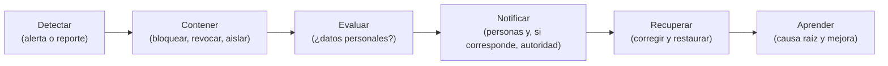

# Operación segura

Cubre lo que sucede después de escribir el código: cómo se construye, se configura, se despliega, se vigila, se respalda y se responde a un incidente. Apoya RNF19, RNF20 y RNF24, y las decisiones AD25 y AD27. Las herramientas son gratuitas (RC15).

## 1. Ciclo de desarrollo seguro

Se sigue una versión reducida del **NIST SSDF**, integrada al flujo de [Spec-Driven Development](../07-proceso-de-desarrollo/01-flujo-sdd.md):

| Práctica | Cómo se aplica |
| :--- | :--- |
| Preparar la organización | Constitución (`AGENTS.md`) con reglas de seguridad no negociables; este directorio como referencia. |
| Proteger el código | Repositorio privado; ramas protegidas; secretos fuera del repositorio; revisión de cambios. |
| Producir software bien protegido | Requisitos de seguridad en las specs (SEG, IDE, etc.); pruebas de seguridad por criterio; revisión de arquitectura y de seguridad por agentes antes de cerrar un plan. |
| Responder a vulnerabilidades | Dependabot y avisos de seguridad del repositorio; corrección priorizada por severidad. |

## 2. Canalización de integración continua

| Control | Herramienta | Cuándo | Falla si |
| :--- | :--- | :--- | :--- |
| Validación de specs y enlaces | `SpecCheck` | Cada cambio | Hay un error. |
| Compilación sin advertencias | `dotnet build -warnaserror` | Cada cambio | Hay una advertencia. |
| Pruebas y arquitectura | `dotnet test` | Cada cambio | Falla una prueba. |
| Análisis estático (SAST) | CodeQL | Cada cambio y semanal | Hay un hallazgo crítico o alto. |
| Dependencias vulnerables | Dependabot y `dotnet list package --vulnerable` | Semanal y cada cambio | Hay una vulnerabilidad alta o crítica sin excepción registrada. |
| Imágenes de contenedor | Trivy | Al construir imágenes | Hay una vulnerabilidad crítica o alta corregible. |
| Detección de secretos | Escáner de secretos (por ejemplo, gitleaks) | Cada cambio | Aparece un secreto. |
| Inventario de componentes | SBOM (formato CycloneDX o SPDX) | Al liberar | No se genera. |
| Pruebas dinámicas básicas | OWASP ZAP baseline contra el entorno local | Antes de cada despliegue mayor | Hay una alerta media o superior sin revisar. |

> Estado: **pendiente de implementar**. Hoy CI ejecuta SpecCheck, compilación y pruebas; el resto se agrega como tareas de infraestructura, sin bloquear la aprobación de specs.

## 3. Configuración y endurecimiento

| Área | Regla |
| :--- | :--- |
| Contenedores | Imágenes multi-arquitectura con versión fija; usuario sin privilegios; sistema de archivos de solo lectura cuando se pueda; `healthcheck`; límites de memoria y CPU. |
| Red | Bases de datos y Redis sin puertos publicados; paneles de n8n y Evolution API solo por red interna o túnel; solo Cloudflare Tunnel llega a Nginx. |
| Sistema operativo | Linux mínimo sin entorno gráfico; actualizaciones de seguridad automáticas; acceso por clave SSH, sin contraseña. |
| Secretos | Variables de entorno por contenedor; `.env` ignorado por Git; rotación ante cambios del equipo o sospecha. |
| Cuentas de base de datos | Una cuenta por servicio con permisos solo sobre su esquema; Identidad aislada; la cuenta de aplicación no puede modificar la auditoría. |
| Entornos | Desarrollo, pruebas y producción separados; datos de ejemplo solo en desarrollo y pruebas; nunca datos reales en pruebas. |

## 4. Registro y alertas

| Qué | Dónde | Notas |
| :--- | :--- | :--- |
| Eventos de seguridad (ingresos fallidos, bloqueos, accesos denegados, límites, cambios de rol, segundo factor fallido) | Registro de auditoría de cada servicio (AUD-10) | Sin contraseñas, credenciales, datos de tarjeta ni enlaces (SEG-10). |
| Registros técnicos | Salida estándar de los contenedores, con el identificador de seguimiento | Rotación por tamaño; retención corta. |
| Alerta | Más de 10 accesos denegados o 20 ingresos fallidos en 5 minutos | Llega a la administración central (SEG-09). |
| Alerta técnica | Falla al registrar un evento de seguridad (AUD-12) | Revisión inmediata. |
| Disponibilidad | Monitoreo ligero desde la VM auxiliar | Aviso si una puerta pública no responde. |

Retención de registros de auditoría y seguridad: dos años (AUD-11).

## 5. Respaldo y recuperación (RNF24, AD27)

| Elemento | Decisión |
| :--- | :--- |
| Objetivos | **RPO ≤ 24 horas** y **RTO ≤ 4 horas**. |
| Qué se respalda | Las dos bases PostgreSQL (incluidos los esquemas `ventas` e `identidad`), la configuración de n8n y de Evolution API, y los archivos de Compose sin secretos. Los archivos digitales ya viven en el almacén de objetos. |
| Frecuencia | Volcado diario. |
| Cifrado | Cifrado antes de salir de la VM de datos; la clave se guarda aparte. |
| Destino | Almacén de objetos, fuera de la VM de datos. |
| Retención | Escalonada: 7 diarios, 4 semanales y 3 mensuales *(propuesta)*. |
| Prueba | Restauración en un entorno limpio **antes de cada despliegue mayor** y registro del tiempo real. |
| Contingencia | Si Oracle no concede la VM ARM o la pierde, se levanta el mismo Compose en otra máquina desde el respaldo. |

## 6. Respuesta a incidentes

| Paso | Qué se hace |
| :--- | :--- |
| Detectar | Alerta de seguridad, reporte de un cliente o hallazgo de un escáner. |
| Contener | Revocar credenciales, desactivar la cuenta o la integración afectada, bloquear el origen en Cloudflare. |
| Evaluar | Determinar qué datos y cuántas personas se afectaron. |
| Notificar | Informar a las personas afectadas y, cuando corresponda, a la autoridad (véase [privacidad](04-privacidad-y-datos-personales.md)). |
| Recuperar | Corregir la causa, restaurar desde respaldo si hace falta y volver a probar. |
| Aprender | Registrar el incidente en `progress/`, actualizar el modelo de amenazas y agregar la prueba que lo habría evitado. |

Contactos y responsabilidades: la persona responsable del proyecto decide; el equipo documenta cada incidente aunque sea menor.

## 7. Gestión de cambios y vulnerabilidades

- Las actualizaciones de dependencias críticas se aplican en una rama, con pruebas y SpecCheck.
- Una vulnerabilidad sin corrección disponible se registra en `progress/blockers.md` con su mitigación y fecha de revisión.
- Antes de cada despliegue mayor: pruebas completas, escaneo de imágenes, ZAP baseline y restauración de prueba.

## 8. Acciones pendientes

| Pendiente | Responsable | Relacionado |
| :--- | :--- | :--- |
| Agregar CodeQL, Dependabot, Trivy, escáner de secretos y SBOM a CI | Infraestructura | RNF19, CTL-34 |
| Definir cifrado y custodia de la clave de los respaldos | Infraestructura | CTL-28 |
| Definir la contingencia de recuperación sin WhatsApp | Identidad | AM23 |
| Elegir el canal de alertas para la administración | Responsable del proyecto | SEG (pregunta abierta) |
