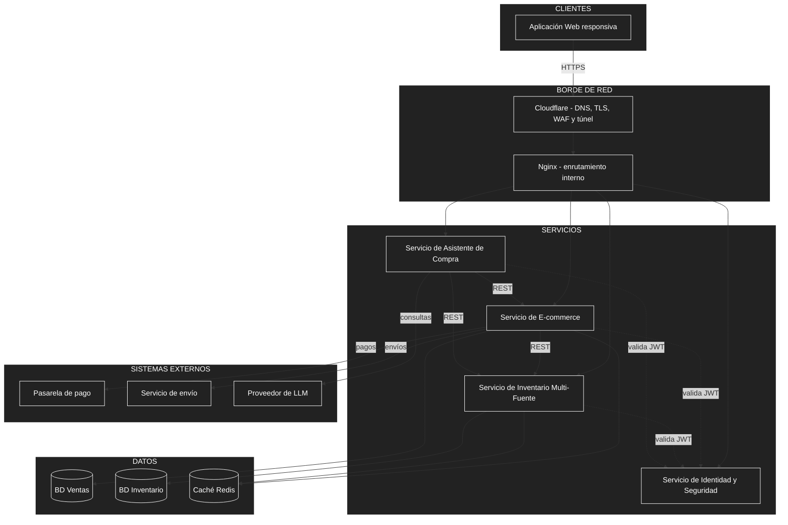
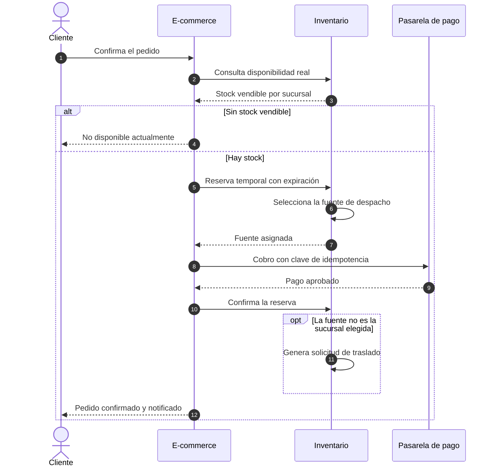
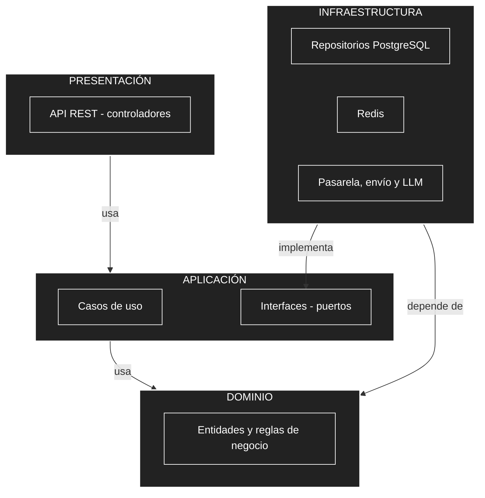

# 06 — Estilo arquitectónico

## 1. Estilo seleccionado

**Arquitectura basada en servicios (*Service-Based*) de granularidad gruesa**, con **Clean Architecture** como organización interna de cada servicio.

- **Estructura global:** pocos servicios independientes, cada uno con una responsabilidad clara y, cuando la necesita, con su propia base de datos. Se comunican por **REST síncrono**.
- **Estructura interna:** cada servicio se divide en cuatro capas cuyas dependencias apuntan siempre hacia el dominio.

**Justificación:** la red prevista es de 5 a 10 sucursales y los recursos son 2 OCPU y 12 GB en total, por lo que dividir el sistema en más servicios agregaría coordinación y consumo sin ventaja real de escalamiento (DA09). Un monolito, en cambio, mezclaría el inventario con la venta y dificultaría aislar y probar la parte más crítica (DA01). Clean Architecture compensa el tamaño reducido del sistema con límites claros dentro de cada servicio (DA08).

## 2. Diagrama de arquitectura



La vista de despliegue sobre las VMs de Oracle está en `05-decisiones-arquitectonicas.md`.

## 3. Componentes y responsabilidades

| Componente | Responsabilidad | Decisión |
| :--- | :--- | :--- |
| **Aplicación Web** | Interfaz de clientes, encargados de sucursal y administración central; consume los servicios por REST. | RC01, RC03 |
| **Cloudflare y Nginx** | Cloudflare protege y cifra el acceso; Nginx enruta cada solicitud al servicio correspondiente. | AD13, AD14 |
| **Servicio de E-commerce** | Catálogo, carrito, checkout, pagos y pedidos. Único servicio con el que interactúa el cliente final. | AD01, AD02 |
| **Servicio de Inventario Multi-Fuente** | Fuentes por sucursal, stock vendible (físico − reservas), reservas, selección de fuente, traslados y ajustes. | AD01, AD08 |
| **Servicio de Identidad y Seguridad** | Autentica usuarios y emite JWT con rol y sucursal. | AD05 |
| **Servicio de Asistente de Compra** | Recomienda libros y responde dudas con datos de las API y un LLM externo. | AD07 |
| **BD Ventas y BD Inventario** | PostgreSQL separadas; la de Inventario se aísla por su volumen de escritura. | AD03, AD12 |
| **Caché Redis** | Disponibilidad (corta duración) y catálogo (mayor duración). | AD06 |

## 4. Reglas de comunicación

| Origen | Destino | Tipo | Propósito |
| :--- | :--- | :--- | :--- |
| Aplicación Web | Cloudflare → Nginx | HTTPS | Enviar todas las solicitudes. |
| E-commerce | Inventario | REST síncrono | Consultar disponibilidad real y solicitar reservas. |
| Asistente | E-commerce e Inventario | REST síncrono | Obtener datos, sin acceder a las bases. |
| Todos los servicios | Identidad | Validación de JWT | Verificar rol y sucursal permitidos. |
| E-commerce e Inventario | Su base y Redis | SQL y caché | Persistir y acelerar sus datos. |
| E-commerce | Pasarela de pago y envío | API externa | Cobrar y gestionar entregas. |
| Asistente | Proveedor de LLM | API externa | Generar respuestas. |

## 5. Flujo principal: compra con selección de fuente



## 6. Organización interna: Clean Architecture

### 6.1 Elementos

| Elemento | Descripción aplicada a BabelHub |
| :--- | :--- |
| **Enfoque** | Clean Architecture (Arquitectura Limpia) en cada servicio .NET. |
| **Objetivo** | Separar responsabilidades y controlar las dependencias hacia el dominio. |
| **Problema que resuelve** | Evita que las reglas del negocio queden acopladas a la interfaz web, la base de datos, la pasarela de pago, el servicio de envío o el LLM. |
| **Capas** | Presentación, Aplicación, Dominio e Infraestructura. |
| **Beneficios** | Facilita el mantenimiento y las pruebas unitarias; permite cambiar una tecnología (por ejemplo, de Niubiz a Culqi) sin modificar las reglas del negocio; ordena el código. |
| **Alcance** | Completo en E-commerce e Inventario, que concentran la lógica. Versión reducida (Presentación y Aplicación con acceso a datos simple) en Identidad y Asistente. |

### 6.2 Dependencias



**Regla de dependencia:** las dependencias apuntan hacia el dominio. El Dominio no conoce a ninguna otra capa; la Aplicación solo conoce el Dominio; la Presentación y la Infraestructura dependen de la Aplicación, nunca al revés. Cuando un caso de uso necesita algo externo (guardar, cobrar, notificar), lo pide mediante una interfaz definida en la Aplicación y la Infraestructura la implementa.

### 6.3 Responsabilidades por capa

| Capa | Responsabilidad | En Inventario | En E-commerce |
| :--- | :--- | :--- | :--- |
| **Presentación** | Recibir solicitudes REST, validar la entrada, verificar rol y sucursal del token y responder. | Controladores de disponibilidad, reservas, traslados y ajustes. | Controladores de catálogo, carrito, pedidos y pagos. |
| **Aplicación** | Coordinar los casos de uso sin conocer detalles técnicos. | Consultar disponibilidad, reservar, seleccionar fuente, gestionar traslados y ajustes. | Buscar libros, gestionar carrito, realizar pedido, confirmar pago, consultar pedidos. |
| **Dominio** | Entidades y reglas del negocio, sin dependencias técnicas. | Fuente, ítem de fuente, reserva, traslado y ajuste. Regla: *stock vendible = físico − reservas activas*, nunca negativo. | Libro, carrito, pedido y pago; estados del pedido. |
| **Infraestructura** | Implementar el acceso a tecnologías externas. | Repositorios PostgreSQL, Redis y notificaciones. | Repositorios PostgreSQL, cliente REST de Inventario, pasarela de pago y servicio de envío. |

### 6.4 Interfaces (puertos) previstas

| Interfaz (en Aplicación) | Implementación (en Infraestructura) |
| :--- | :--- |
| Repositorio de inventario / de ventas | Acceso a PostgreSQL |
| Cliente de inventario | Llamadas REST del E-commerce al Inventario |
| Pasarela de pago | Integración con Niubiz o Culqi |
| Servicio de envío | Integración con el operador logístico |
| Notificador | Correo o SMS |
| Proveedor de LLM | API del modelo de lenguaje |
| Caché | Redis |

Gracias a ellas, cambiar de pasarela o de proveedor de LLM requiere solo una nueva implementación en Infraestructura.

### 6.5 Organización del código y pruebas

```
Inventario/
├── Inventario.Domain/          entidades y reglas de negocio
├── Inventario.Application/     casos de uso e interfaces
├── Inventario.Infrastructure/  PostgreSQL, Redis e integraciones
└── Inventario.Api/             controladores REST y configuración
```

Los nombres de proyectos son una convención sugerida, no parte de la propuesta original.

| Capa | Tipo de prueba | Herramienta |
| :--- | :--- | :--- |
| Dominio | Unitarias (por ejemplo, el cálculo de stock vendible) | xUnit |
| Aplicación | Unitarias de casos de uso con interfaces simuladas | xUnit |
| Infraestructura | Integración con la base real | xUnit + Testcontainers |
| Presentación | Flujos completos de extremo a extremo; carga | Playwright; k6 |

## 7. Alternativas descartadas

| Alternativa | Motivo del descarte |
| :--- | :--- |
| **Monolito único** | Mezcla el inventario con la venta y dificulta aislarlo, probarlo y asignarle recursos. |
| **Microservicios finos** | Añaden coordinación, comunicación y despliegue innecesarios para 5–10 sucursales, con 12 GB de RAM en total. |
| **Arquitectura orientada a eventos** | Su complejidad operativa no se justifica con el volumen previsto; REST síncrono basta. |
| **Capas tradicionales** | El dominio quedaría atado a la base de datos y a los proveedores externos, y sería más difícil de probar. |

## 8. Ventajas y limitaciones

| Ventajas | Limitaciones |
| :--- | :--- |
| Aísla el inventario, la parte más crítica, del resto del sistema. | La comunicación síncrona hace que el E-commerce dependa de la disponibilidad del Inventario. |
| Pocos servicios: despliegue y mantenimiento sencillos con Docker Compose. | Identidad y Redis son puntos compartidos que requieren cuidado. |
| Reglas de negocio aisladas y fáciles de probar. | Clean Architecture agrega interfaces y proyectos, lo que implica más código base para un sistema pequeño. |
| Se adapta a recursos gratuitos limitados. | Dos bases separadas exigen mantener la coherencia entre ventas e inventario mediante llamadas REST. |
| Cada sucursal nueva es una fuente, no un cambio de código. | Si la red superara ampliamente las 20 sucursales, habría que revisar el estilo. |
