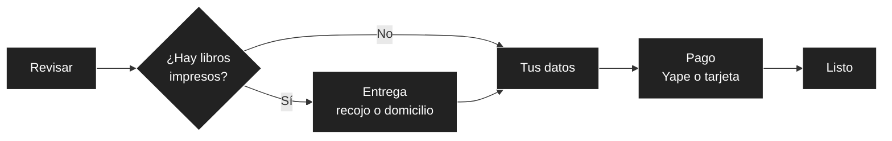

# Pantallas y recorridos

## 1. Mapa de pantallas por rol

| Área | Rol | Pantallas |
| :--- | :--- | :--- |
| **Tienda** | Visitante y cliente | Inicio, catálogo, detalle del libro, carrito, checkout, confirmación, mi biblioteca, mis pedidos y seguimiento, devolución, mi cuenta, inicio de sesión y registro, Libro de Reclamaciones, páginas legales y *El índice infinito* (opcional). |
| **Sucursal** | Encargado de sucursal | Resumen con alertas, inventario, ajustes y su historial, pedidos de recojo, traslados (entrantes, salientes y nueva solicitud). |
| **Sucursal** | Personal de logística | Traslados a nivel nacional, guías de envío y seguimiento de despachos. |
| **Admin** | Administrador central | Resumen, catálogo (ediciones impresas y digitales con su licencia), sucursales como datos, usuarios y roles, pedidos y anulaciones, reclamos, auditoría e indicadores. |

El menú, el selector de sucursal y las acciones visibles dependen del rol y del alcance del token (RNF05): quien no tiene permiso no ve la acción, y si llega por URL recibe la pantalla de «sin permiso».

### Pantallas por especificación

| Spec | Pantallas principales |
| :--- | :--- |
| `ecommerce-catalogo` | Catálogo con filtros (categoría, formato, precio, disponibilidad), detalle con selector de edición. Admin: alta, edición y baja con licencia. |
| `ecommerce-carrito-checkout` | Carrito mixto y checkout adaptable (sección 2). |
| `ecommerce-pagos` | Paso de pago con Yape y tarjeta; errores de pago. |
| `ecommerce-pedidos` | Mis pedidos, seguimiento con estados por línea. Admin: pedidos y anulación. |
| `ecommerce-biblioteca-digital` | Mi biblioteca, descarga y sus estados. |
| `ecommerce-envios` | Guía de envío y seguimiento (Sucursal › Logística). |
| `ecommerce-devoluciones` | Solicitud de devolución con política distinta para impresos y digitales. |
| `ecommerce-libro-reclamaciones` | Formulario, constancia imprimible y listado de reclamos (Admin). |
| `inventario-fuentes`, `inventario-ajustes` | Inventario de la sucursal, ajustes con motivo e historial. |
| `inventario-seleccion-fuente`, `inventario-traslados` | Pedidos de recojo, traslados (solicitar, aprobar, despachar, recibir). |
| `identidad-seguridad` | Inicio de sesión, registro, cuenta con consentimiento de WhatsApp, usuarios y roles. |
| `transversal-auditoria` | Auditoría de solo lectura con filtros. |
| `asistente-compra-ia` | Panel de chat que no tapa precios ni acciones en pantallas pequeñas. |
| `web-base` | Estructura, sesión, errores, estados y pie con enlaces legales. |
| `web-indice-infinito` | Experimento aislado ([El índice infinito](03-estados-accesibilidad-y-criterios.md)). |

## 2. Recorrido de compra

El checkout se adapta al contenido del carrito. Un carrito solo con libros digitales no pide entrega ni consulta al Inventario (RF04).

| Tipo de carrito | Pasos | Particularidades |
| :--- | :---: | :--- |
| Solo digital | 4 | Sin entrega; al aprobar el pago se abre «Mi biblioteca». |
| Solo impreso | 5 | Elección de sucursal con aviso de traslado si falta stock; reserva temporal de 15 minutos visible (AD08). |
| Mixto | 5 | Un solo cobro; en la confirmación, las líneas impresas siguen su seguimiento y las digitales se descargan al instante. |

Antes de pagar, el cliente acepta los términos y la política de reembolso de libros digitales, y da su consentimiento para los avisos por WhatsApp (Ley N.° 29733). Si el Inventario no responde, el checkout informa que no puede validar el stock y **no cobra** (AC03); los libros digitales siguen comprándose.

### 2.1 Tarjeta de libro

Portada protagonista; título en serif; autor en sans; insignia de **formato** («Impreso» o «Digital»); disponibilidad con texto e icono («En tu sucursal», «En 3 sucursales más», «Disponible al instante», «Agotado»); y precio con jerarquía clara. Bordes discretos; el elevado y la sombra se reservan para el hover.

### 2.2 Libros digitales en la interfaz

| Elemento | Comportamiento |
| :--- | :--- |
| Selector de edición | En el detalle, el cliente elige «Impreso» o «Digital» (cada una con su ISBN y precio). |
| Licencia | Si la edición digital no está disponible en el territorio del comprador o su licencia venció, no se ofrece y se explica el motivo. |
| Mi biblioteca | Lista de libros digitales comprados, formato, descargas restantes (de 5) y botón de descarga. |
| Estados de descarga | Disponible, enlace vencido (se genera uno nuevo), límite alcanzado, licencia retirada (el acceso ya concedido se mantiene) y archivo no disponible. |
| Reembolso | La política se muestra en el checkout y en el detalle de la compra. |
