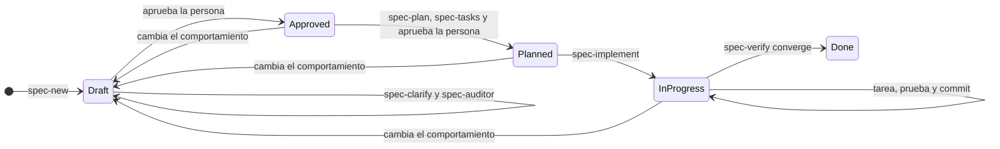

# Flujo de trabajo con Spec-Driven Development

Cómo se construye BabelHub: el ciclo de cada feature, las validaciones que lo protegen, las skills y agentes que lo guían, la estructura final del repositorio y el plan de trabajo. Las reglas obligatorias están en `AGENTS.md`; este documento explica el porqué y el cómo.

## 1. Idea central

**La spec manda y el código la demuestra.** Ninguna línea de producción existe sin una especificación aprobada y un plan aprobado; ningún criterio de aceptación existe sin una prueba; ninguna feature se da por terminada sin una verificación que converge. Dos decisiones las toma siempre una persona (aprobar la spec y aprobar el plan); todo lo demás se valida de forma automática o por revisión independiente.

El método se inspira en el flujo de GitHub Spec Kit (constitución, especificar, planificar, tareas, implementar y converger) y lo adapta a este proyecto: la constitución es `AGENTS.md`, los criterios se escriben en EARS y la convergencia se registra en `verificacion.md`.

## 2. Ciclo de una feature



| Paso | Skill o agente | Entrega | Quién decide |
| :---: | :--- | :--- | :--- |
| 1 | `spec-new` | `spec.md` en Draft | Agente |
| 2 | `spec-clarify`, agente `spec-auditor` | Spec sin ambigüedad ni preguntas abiertas | Agente y la persona (respuestas) |
| 3 | — | Spec **Approved** (`aprobado_por`, `aprobado_en`) | **Persona** |
| 4 | `spec-plan`, agentes `arch-reviewer` y `security-reviewer` | `plan.md` y `decisions.md` | Agente |
| 5 | `spec-tasks` | `tasks.md` con cada criterio cubierto | Agente |
| 6 | — | Plan **Planned** (`plan_aprobado_en`) | **Persona** |
| 7 | `spec-implement`, `dotnet-feature`, `ui-screen` | Código y pruebas, una tarea y un commit a la vez | Agente |
| 8 | `spec-verify`, `arch-review`, `security-review`, `ui-review` | `verificacion.md` con `Resultado: Converge` | Agente (reglas fijas) |
| 9 | `progress-log` | Bitácora y CHANGELOG | Agente |

## 3. Cómo se valida cada cosa

La validación ocurre en capas; cada una atrapa un tipo distinto de error.

| Capa | Qué atrapa | Herramienta | Cuándo |
| :--- | :--- | :--- | :--- |
| **Estructura de la spec** | Falta de secciones, frontmatter incompleto, prefijos o identificadores repetidos, dependencias con ciclos. | `tools/SpecCheck` | Cada edición y en CI |
| **Calidad EARS** | Plantilla incorrecta, ausencia de «deberá», tecnología en un requisito, requisito demasiado largo o corto. | `SpecCheck` | Igual |
| **Cobertura** | Requisitos sin criterio; criterios que cubren requisitos inexistentes; orígenes (`RF`, `NN`, `RNF`, `AC`, `RC`) que no existen en `docs/`; RF del negocio sin spec. | `SpecCheck` y `TRACEABILITY.md` | Igual |
| **Sustancia de la spec** | Requisitos que no se pueden probar, casos límite ausentes, contradicciones con `docs/` o con otras specs, decisiones de negocio asumidas. | Agente `spec-auditor` y la persona | Antes de aprobar |
| **Puertas del ciclo** | Una spec sin aprobar con plan, un plan sin tareas, una spec `Done` sin verificación, aprobaciones sin firma. | `SpecCheck` | Cada edición y en CI |
| **Arquitectura del plan** | Piezas en la capa equivocada, referencias entre servicios, secretos, archivos digitales mal ubicados. | Agente `arch-reviewer` | Antes de aprobar el plan |
| **Lógica de negocio** | Regresiones en reglas e invariantes. | xUnit, **pruebas primero** | Cada tarea |
| **Estructura del código** | Referencias de proyecto indebidas, dependencias de infraestructura en Dominio o Aplicación. | `tests/architecture` (referencias y NetArchTest) | Cada compilación y en CI |
| **Compilación estricta** | Advertencias, estilo, nulabilidad. | `dotnet build -warnaserror` | Cada tarea y en CI |
| **Trazabilidad hacia las pruebas** | Un criterio de una spec en ejecución que ninguna prueba nombra (`[Trait("Criterio", "AC-XXX-NN")]`). | `SpecCheck` | Desde `InProgress` |
| **Convergencia** | Diferencias entre spec, código y pruebas; funcionalidad de más. | Skill `spec-verify` | Antes de `Done` |
| **Interfaz** | Paridad con el prototipo, responsividad, temas, teclado, contraste, estados. | Skill `ui-review` (navegador) y Playwright | Pantallas de cada feature |

La prueba de arquitectura y `SpecCheck` están probadas contra violaciones deliberadas, para confirmar que fallan cuando deben.

## 4. Estructura final del repositorio

```
babelhub/
├── AGENTS.md  CLAUDE.md  README.md
├── BabelHub.sln  global.json  Directory.Build.props  Directory.Packages.props
├── .editorconfig  .gitignore  .gitattributes  .env.example
├── .github/workflows/ci.yml
├── .claude/               skills/ (12), agents/ (3), settings.json, launch.json
├── docs/                  7 carpetas temáticas (01-analisis-de-sistema a 07-proceso-de-desarrollo) y glossary.md
├── specs/                 README.md, speccheck.json, TRACEABILITY.md, _template/ y 18 features
├── progress/              CHANGELOG.md, blockers.md, log/
├── src/                   Inventario, Ecommerce (4 proyectos cada uno), Identidad, AsistenteCompra, Web y Shared
├── tests/                 unit/, integration/, architecture/, e2e/ (Playwright) y load/ (k6)
├── tools/SpecCheck/       validador de specs
├── infra/                 docker-compose.local.yml, nginx/, n8n/
└── prototype/ui-v2/       prototipo de interfaz (referencia)
```

## 5. Skills y agentes

### 5.1 Del proyecto (`.claude/`)

| Skill | Para qué |
| :--- | :--- |
| `spec-new` | Redactar el borrador de una spec desde `docs/` y el prototipo. |
| `spec-clarify` | Resolver ambigüedades y preguntas abiertas con la persona responsable. |
| `spec-plan` | Convertir una spec aprobada en `plan.md` y `decisions.md`. |
| `spec-tasks` | Dividir el plan en tareas atómicas, con cada criterio cubierto. |
| `spec-implement` | Implementar una tarea a la vez con pruebas primero. |
| `spec-verify` | Comprobar la convergencia y escribir `verificacion.md`. |
| `progress-log` | Registrar la sesión, el CHANGELOG y los bloqueos. |
| `arch-review` | Revisar un cambio o un plan contra las reglas de arquitectura. |
| `security-review` | Revisar una spec, un plan o un cambio contra el modelo de amenazas y los controles de seguridad. |
| `dotnet-feature` | Guía para escribir casos de uso, puertos, adaptadores y pruebas. |
| `ui-screen` | Construir una pantalla Razor desde su prototipo y el sistema de diseño. |
| `ui-review` | Revisar una pantalla en el navegador (responsividad, temas, teclado, contraste). |

| Agente | Para qué |
| :--- | :--- |
| `spec-auditor` | Segunda opinión independiente sobre una spec, en contexto aislado y de solo lectura. |
| `arch-reviewer` | Revisión de arquitectura de un cambio o plan, en contexto aislado y de solo lectura. |
| `security-reviewer` | Revisión de seguridad y privacidad contra `docs/05-seguridad/`, en contexto aislado y de solo lectura. |

### 5.2 Externas recomendadas (instalación a cargo de la persona responsable)

Se **recomiendan**, no se instalan automáticamente: son instrucciones que cambian el comportamiento del agente, así que conviene revisarlas antes. Las skills del proyecto mandan en caso de diferencia.

| Fuente | Licencia | Qué aporta | Cómo instalarla en Claude Code |
| :--- | :--- | :--- | :--- |
| [dotnet/skills](https://github.com/dotnet/skills) (oficial de Microsoft) | MIT | Plugins `dotnet-test` (pruebas), `dotnet-data` (EF Core), `dotnet-aspnetcore` (API), `dotnet-msbuild` (fallos de compilación), `dotnet-nuget`. | `/plugin marketplace add dotnet/skills` y luego `/plugin install dotnet-test@dotnet-agent-skills` (y los demás); reiniciar Claude Code. |
| [GitHub Spec Kit](https://github.com/github/spec-kit) | MIT | Referencia del flujo SDD (constitución, especificar, planificar, tareas, implementar y converger). Se usa como inspiración, no se instala. | — |
| [codewithmukesh/dotnet-claude-kit](https://github.com/codewithmukesh/dotnet-claude-kit) | MIT (según su listado) | Skills de Clean Architecture y estructura de proyecto en .NET. Opcional, como lectura de apoyo. | Revisar su repositorio antes de usarlo. |

Para Playwright (E2E) y k6 (carga) se usará su documentación oficial al implementar las pruebas.

## 6. Plan de trabajo reformulado

| Fase | Contenido | Entregable verificable | Estado |
| :---: | :--- | :--- | :--- |
| 0 | Marco SDD: `AGENTS.md`, `CLAUDE.md`, plantillas, 19 specs en borrador, `SpecCheck`, skills y agentes, CI, glosario, bitácoras. | `SpecCheck` pasa; las skills existen. | **Hecha** |
| 1 | Esqueleto técnico: solución, proyectos por servicio, prueba de arquitectura, infraestructura local. | `dotnet build -warnaserror` y `dotnet test` en verde; Compose válido. | **Hecha** |
| 2 | Revisión y aprobación de las specs, en el orden de `specs/README.md`, con `spec-clarify` y `spec-auditor`. Resolver los bloqueos B02, B05 y B06 antes de planificar las specs que dependen de ellos. | Specs `Approved` con cero preguntas abiertas. | **Siguiente** |
| 3 | Inventario: `transversal-auditoria`, `inventario-fuentes`, `inventario-seleccion-fuente`, `inventario-ajustes`, `inventario-traslados`. | Pruebas de concurrencia sin sobreventa (AC01). | Pendiente |
| 4 | `identidad-seguridad`, `transversal-notificaciones`, `web-base`. | Alcance por sucursal en funcionamiento; avisos con notificador simulado; shell de la Web. | Pendiente |
| 5 | `ecommerce-catalogo`, `ecommerce-carrito-checkout`, `ecommerce-pagos` (con pasarela de pruebas), `ecommerce-pedidos`. | Compra de punta a punta contra el Inventario. | Pendiente |
| 6 | `ecommerce-biblioteca-digital`, `ecommerce-envios`, `ecommerce-devoluciones`, `ecommerce-libro-reclamaciones`. | Ciclo digital, de entrega, de retorno y legal. | Pendiente |
| 7 | `asistente-compra-ia` y `web-indice-infinito` (opcional). | Asistente fundamentado en datos reales. | Pendiente |
| 8 | Despliegue: Dockerfiles, `docker-compose.oracle.yml`, Nginx, Cloudflare, E2E con Playwright y carga con k6. | Criterios de aceptación y metas de rendimiento verificados. | Pendiente |

Cada fase de implementación repite el ciclo de la sección 2 por cada spec. Las specs de una misma fase pueden planificarse juntas si comparten decisiones técnicas.

## 7. Definición de «terminado»

**Una tarea:** compila sin advertencias, su prueba falló antes y pasa ahora, las pruebas de arquitectura pasan, `SpecCheck` pasa, la tarea está marcada y hay un commit pequeño con el tipo correcto.

**Una feature:** todas sus tareas marcadas, cada criterio de aceptación nombrado en una prueba, `verificacion.md` con `Resultado: Converge`, la spec en `Done`, la matriz `TRACEABILITY.md` actualizada y la bitácora al día.

## 8. Cómo empezar una feature

1. Pide a Claude: «escribe la spec de *X*» (usa `spec-new`) y luego «aclara la spec» (`spec-clarify`).
2. Responde las preguntas, revisa y **aprueba**: escribe en el frontmatter `aprobado_por`, `aprobado_en` y cambia `estado: Approved`.
3. Pide el plan y las tareas (`spec-plan` y `spec-tasks`), revísalos y **aprueba**: `plan_aprobado_en` y `estado: Planned`.
4. Pide implementar (`spec-implement`), tarea por tarea.
5. Pide verificar (`spec-verify`); si converge, la spec queda en `Done`.

## 9. Fuentes

- [GitHub Spec Kit](https://github.com/github/spec-kit): flujo de Spec-Driven Development (MIT).
- [dotnet/skills](https://github.com/dotnet/skills): skills oficiales para .NET y comandos de instalación para Claude Code (MIT).
- [Documentación de subagentes de Claude Code](https://code.claude.com/docs/en/sub-agents) y formato de skills (`SKILL.md`) en `.claude/skills/`.
- EARS: *Easy Approach to Requirements Syntax* (Mavin y otros).
