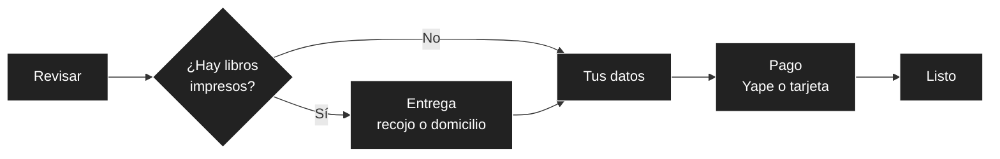

# 08 — Interfaz de usuario

Este documento define cómo se ve y cómo se comporta `BabelHub.Web` (decisión AD15): identidad visual, sistema de diseño, mapa de pantallas por rol, recorridos clave, estados, accesibilidad y criterios de aceptación visual. No cambia la estructura funcional de los documentos `01` a `07`; la traduce a pantallas. Parte del documento de dirección visual del equipo (fuera del repositorio) y de los prototipos de `prototype/`.

## 1. Principios

| Principio | Qué implica |
| :--- | :--- |
| **Stock real, a la vista** | La disponibilidad se muestra siempre con texto e icono, nunca solo con color, y refleja datos reales (OB01). No se finge infinito ni stock. |
| **Conservar la estructura probada** | Cabecera, buscador, selector de sucursal, banner, filtros laterales, ordenamiento, cuadrícula de libros, carrito y perfil. Cambia la identidad, no el recorrido. |
| **Las portadas son las protagonistas** | La interfaz las enmarca; no compite con ellas. Sin fondos de color aleatorios por tarjeta. |
| **Dos temas, una sola marca** | Claro («Papel y tinta») y oscuro («Archivo nocturno») comparten jerarquía, espaciado y estados; solo cambian los tokens. |
| **Movimiento con propósito** | Cada animación comunica una respuesta del sistema. Todo funciona sin movimiento (`prefers-reduced-motion`). |
| **Móvil primero** | La demanda en provincias llega desde celulares y conexiones variables (AC08). |
| **Una sola app, tres áreas** | Tienda, Sucursal y Admin comparten sistema de diseño, sesión y componentes (AD15). |

## 2. Identidad: «Babel cromático + laberinto de historias»

Concepto: una librería donde cada libro abre la puerta a otros mundos (referencia: *La biblioteca de Babel*, de Borges). Editorial y literaria, vibrante sin ser estridente, contemporánea y cálida. Los motivos gráficos son caminos finos, nodos, círculos y coordenadas que conectan libros y categorías. El universo «cósmico» (órbitas, puntos) es solo un detalle secundario.

### 2.1 Paleta de marca

| Token de marca | Color | Uso |
| :--- | :--- | :--- |
| **Azul biblioteca** | `#172554` | Texto fuerte en tema claro; base del tema oscuro; cabecera y pie. |
| **Coral Babel** | `#FF665A` | Acción primaria y acento de marca. |
| **Papel antiguo** | `#F5EBD8` | Fondo y superficies editoriales del tema claro; texto del tema oscuro. |
| **Verde descubrimiento** | `#A9E85E` | Indicadores positivos de stock y disponibilidad. |
| **Violeta infinito** | `#7857D9` | Colecciones especiales y descubrimiento. |
| **Cian portal** | `#36C8D4` | Foco, enlaces activos y conexiones gráficas. |

Reglas: azul y papel son la base y el coral el acento principal; verde, violeta y cian se reservan para estados y contextos concretos. No se usan los seis colores con la misma intensidad.

### 2.2 Contraste medido (WCAG, mínimo 4,5:1 para texto normal)

La paleta inicial no cumple en todos los pares. Estos son los valores calculados y la decisión que se tomó:

| Par | Contraste | Decisión |
| :--- | :---: | :--- |
| Azul sobre papel | 12,4 | Texto principal del tema claro. |
| Papel sobre azul oscuro | 14,4 | Texto principal del tema oscuro. |
| Blanco sobre coral | **2,9** | **No se usa.** Los botones coral llevan texto azul. |
| Azul sobre coral | 5,1 | Botón primario en ambos temas. |
| Coral sobre papel | **2,4** | **No se usa como texto ni borde fino en el tema claro.** Se usa «coral tinta» `#B5352A` (5,1). |
| Violeta `#7857D9` sobre azul oscuro | **2,9** | En el tema oscuro se usa un violeta más claro, `#A78BFA` (6,3). |
| Blanco sobre violeta `#7857D9` | 5,0 | Botón o insignia violeta del tema claro. |
| Cian sobre azul / azul sobre cian | 7,3 | Foco y enlaces en el tema oscuro; texto azul sobre cian. |
| Azul sobre verde | 10,1 | Insignias de stock positivo con texto azul. |
| Cian oscuro `#1A6F80` sobre papel | 4,9 | Variante del cian para texto en el tema claro. |

Regla general: **ningún color de marca es la única señal de un estado**. El stock se acompaña de texto («En tu sucursal», «En 3 sucursales más», «Agotado») y de icono.

### 2.3 Temas

| Tema | Fondo | Superficies | Texto | Acción | Foco y enlaces | Carácter |
| :--- | :--- | :--- | :--- | :--- | :--- | :--- |
| **Claro: «Papel y tinta»** | Marfil `#FBF5E8` | Papel `#F5EBD8` y bordes cálidos | Azul `#172554` | Coral con texto azul | Cian oscuro `#1A6F80` | Librería editorial, cálida y abierta. |
| **Oscuro: «Archivo nocturno»** | Azul muy oscuro `#0F1A3D` | Tarjetas `#14214A` y `#1B2A57` | Papel `#F5EBD8` | Coral con texto azul | Cian `#36C8D4` y violeta `#A78BFA` | Biblioteca profunda e inmersiva, sin perder legibilidad. |

Se respeta la preferencia de tema del sistema operativo y se recuerda la elección del usuario. Se verifican hover, foco, deshabilitado, error, stock y selección en ambos temas.

## 3. Sistema de diseño

| Aspecto | Decisión (AD21) |
| :--- | :--- |
| **CSS** | Tailwind CSS 4 con daisyUI 5, compilado con la CLI independiente de Tailwind (sin Node) en el `Dockerfile` de `BabelHub.Web`. El CSS generado no se versiona. |
| **Tokens** | Los colores viven como tokens semánticos de daisyUI (`primary`, `secondary`, `accent`, `base-100/200/300`, `base-content`, `info`, `success`, `warning`, `error`) en dos temas con los mismos nombres. Ningún componente tiene colores propios. |
| **Componentes** | Clases de daisyUI para botones, tarjetas, formularios, insignias y modales; Tailwind para layout, espaciado y responsive. |
| **Interactividad** | htmx para fragmentos (carrito, disponibilidad, estado de pedido y filtros); JavaScript propio mínimo. |
| **Tipografía** | **DM Serif Display** para títulos y precios destacados; **Inter** para interfaz y texto. En producción se autoalojan las fuentes (sin depender de servidores externos). |
| **Iconos** | Conjunto de trazo fino (estilo Heroicons outline), siempre con texto o `aria-label`. |
| **Portadas** | Proporción 2:3 uniforme. En el catálogo real vendrán de cada edición; en los prototipos se generan con motivos abstractos. |
| **Fondos y motivos** | Laberinto de líneas finas, casi imperceptible y solo en áreas amplias (banner, pie, páginas vacías); nunca detrás de párrafos ni de tarjetas. |

## 4. Mapa de pantallas por rol

| Área | Rol | Pantallas |
| :--- | :--- | :--- |
| **Tienda** | Visitante y cliente | Inicio, catálogo, detalle del libro, carrito, checkout, confirmación, mi biblioteca, mis pedidos y seguimiento, devolución, mi cuenta, inicio de sesión y registro, Libro de Reclamaciones, páginas legales y *El índice infinito* (opcional). |
| **Sucursal** | Encargado de sucursal | Resumen con alertas, inventario, ajustes y su historial, pedidos de recojo, traslados (entrantes, salientes y nueva solicitud). |
| **Sucursal** | Personal de logística | Traslados a nivel nacional, guías de envío y seguimiento de despachos. |
| **Admin** | Administrador central | Resumen, catálogo (ediciones impresas y digitales con su licencia), sucursales como datos, usuarios y roles, pedidos y anulaciones, reclamos, auditoría e indicadores. |

El menú, el selector de sucursal y las acciones visibles dependen del rol y del alcance del token (RNF05): quien no tiene permiso no ve la acción, y si llega por URL recibe la pantalla de «sin permiso».

### Pantallas por especificación

| Spec | Pantallas principales |
| :--- | :--- |
| `ecommerce-catalogo` | Catálogo con filtros (categoría, formato, precio, disponibilidad), detalle con selector de edición. Admin: alta, edición y baja con licencia. |
| `ecommerce-carrito-checkout` | Carrito mixto y checkout adaptable (sección 5). |
| `ecommerce-pagos` | Paso de pago con Yape y tarjeta; errores de pago. |
| `ecommerce-pedidos` | Mis pedidos, seguimiento con estados por línea. Admin: pedidos y anulación. |
| `ecommerce-biblioteca-digital` | Mi biblioteca, descarga y sus estados. |
| `ecommerce-envios` | Guía de envío y seguimiento (Sucursal › Logística). |
| `ecommerce-devoluciones` | Solicitud de devolución con política distinta para impresos y digitales. |
| `ecommerce-libro-reclamaciones` | Formulario, constancia imprimible y listado de reclamos (Admin). |
| `inventario-fuentes`, `inventario-ajustes` | Inventario de la sucursal, ajustes con motivo e historial. |
| `inventario-seleccion-fuente`, `inventario-traslados` | Pedidos de recojo, traslados (solicitar, aprobar, despachar, recibir). |
| `identidad-seguridad` | Inicio de sesión, registro, cuenta con consentimiento de WhatsApp, usuarios y roles. |
| `transversal-auditoria` | Auditoría de solo lectura con filtros. |
| `asistente-compra-ia` | Panel de chat que no tapa precios ni acciones en pantallas pequeñas. |
| `web-base` | Estructura, sesión, errores, estados y pie con enlaces legales. |
| `web-indice-infinito` | Experimento aislado (sección 8). |

## 5. Recorrido de compra

El checkout se adapta al contenido del carrito. Un carrito solo con libros digitales no pide entrega ni consulta al Inventario (RF04).

| Tipo de carrito | Pasos | Particularidades |
| :--- | :---: | :--- |
| Solo digital | 4 | Sin entrega; al aprobar el pago se abre «Mi biblioteca». |
| Solo impreso | 5 | Elección de sucursal con aviso de traslado si falta stock; reserva temporal de 15 minutos visible (AD08). |
| Mixto | 5 | Un solo cobro; en la confirmación, las líneas impresas siguen su seguimiento y las digitales se descargan al instante. |

Antes de pagar, el cliente acepta los términos y la política de reembolso de libros digitales, y da su consentimiento para los avisos por WhatsApp (Ley N.° 29733). Si el Inventario no responde, el checkout informa que no puede validar el stock y **no cobra** (AC03); los libros digitales siguen comprándose.

### 5.1 Tarjeta de libro

Portada protagonista; título en serif; autor en sans; insignia de **formato** («Impreso» o «Digital»); disponibilidad con texto e icono («En tu sucursal», «En 3 sucursales más», «Disponible al instante», «Agotado»); y precio con jerarquía clara. Bordes discretos; el elevado y la sombra se reservan para el hover.

### 5.2 Libros digitales en la interfaz

| Elemento | Comportamiento |
| :--- | :--- |
| Selector de edición | En el detalle, el cliente elige «Impreso» o «Digital» (cada una con su ISBN y precio). |
| Licencia | Si la edición digital no está disponible en el territorio del comprador o su licencia venció, no se ofrece y se explica el motivo. |
| Mi biblioteca | Lista de libros digitales comprados, formato, descargas restantes (de 5) y botón de descarga. |
| Estados de descarga | Disponible, enlace vencido (se genera uno nuevo), límite alcanzado, licencia retirada (el acceso ya concedido se mantiene) y archivo no disponible. |
| Reembolso | La política se muestra en el checkout y en el detalle de la compra. |

## 6. Estados de pantalla estándar

Cada pantalla de datos contempla los mismos estados, con el mismo patrón visual (RNF13):

| Estado | Patrón |
| :--- | :--- |
| Cargando | Esqueletos con la forma del contenido; sin saltos de diseño. |
| Vacío | Icono, título breve, explicación y una acción clara. |
| Error | Aviso con la causa en lenguaje simple y un botón para reintentar. |
| Sin permiso (403) | Mensaje de que la cuenta no tiene acceso, con salida a una pantalla permitida. |
| Servicio no disponible (503) | Informa qué parte no responde (por ejemplo, «No podemos validar el stock ahora»); nunca cobra a ciegas. |
| Éxito | Aviso breve y no bloqueante, con `role="status"`. |

## 7. Microinteracciones y accesibilidad

| Elemento | Comportamiento |
| :--- | :--- |
| Tarjeta de libro | Elevar 3–5 px y reforzar la sombra al pasar el cursor. |
| Portada | Inclinación muy leve; escala máxima aproximada de 1,01. |
| Botones | Cambio de color y desplazamiento mínimo. |
| Buscador | Anillo de foco visible y panel de sugerencias (recientes, categorías, títulos). |
| Carrito | Pequeño rebote del contador al añadir un artículo. |
| Filtros | Estado activo claro y transición breve de resultados. |
| «Sorpréndeme» | Elige un libro disponible al azar y pasa a su ficha con una transición corta. |
| Fondo | Movimiento ambiental lento y opcional solo en áreas decorativas, nunca detrás del texto. |

Accesibilidad: contraste AA en ambos temas; navegación completa por teclado con foco visible; «saltar al contenido»; etiquetas y roles en formularios, tablas y diálogos; `prefers-reduced-motion` desactiva las animaciones sin perder funcionalidad; ninguna animación retrasa la respuesta de un control; el botón del asistente no tapa precios ni acciones en pantallas pequeñas.

## 8. «El índice infinito» (opcional)

Una pieza de marca separada del flujo de compra, accesible desde el catálogo. Genera una «página de Babel» de texto pseudoaleatorio a partir de una dirección: la misma dirección devuelve siempre el mismo texto. No requiere base de datos ni mezcla su contenido con búsquedas, inventario, reseñas o títulos reales; avisa de que el texto es generado y puede carecer de sentido, y enlaza de vuelta al catálogo real. Se implementa con un generador propio (sin reutilizar código de terceros, para no depender de licencias ajenas) y solo después de estabilizar el catálogo. Corresponde a la spec opcional `web-indice-infinito`.

## 9. Cumplimiento visible

Pie de todas las páginas de la Tienda: enlace permanente al **Libro de Reclamaciones** (RF25), términos y condiciones, política de privacidad y política de reembolso de libros digitales. Consentimiento de WhatsApp en el registro o en la cuenta y en el checkout. Detalle legal y su estado en `02-requisitos.md`, sección 5.

## 10. Criterios de aceptación visual

- [ ] Se conserva la estructura funcional del catálogo.
- [ ] BabelHub tiene identidad reconocible más allá de una paleta oscura genérica.
- [ ] Los temas claro y oscuro son coherentes, legibles y cumplen contraste AA en texto.
- [ ] Coral, azul y papel definen la marca; verde, violeta y cian se usan con moderación.
- [ ] Las portadas siguen siendo el foco de las tarjetas.
- [ ] Filtros, precio, stock y carrito se localizan fácilmente.
- [ ] El stock y el formato nunca dependen solo del color.
- [ ] Las animaciones son breves, útiles y tienen alternativa con movimiento reducido.
- [ ] El checkout se completa en 4 o 5 pasos según el carrito.
- [ ] No se simula stock ni se confunden textos generados con productos reales.
- [ ] El experimento del índice infinito está claramente separado del flujo de compra.

## 11. Prototipos

| Prototipo | Ubicación | Estado |
| :--- | :--- | :--- |
| v1: recorrido funcional básico | `prototype/ui/` | Superado por v2; se conserva solo porque aún contiene las áreas Sucursal y Admin, y se retira al terminar la entrega 2. |
| v2, entrega 1: sistema de diseño y área Tienda (incluye libros digitales) | `prototype/ui-v2/` | Lista para revisión. |
| v2, entrega 2: áreas Sucursal, Logística y Admin | `prototype/ui-v2/` | Pendiente. |

Son descartables: HTML estático con Tailwind y daisyUI por CDN y datos ficticios. Lo aprobado en ellos queda reflejado en este documento antes de escribir las vistas Razor.
